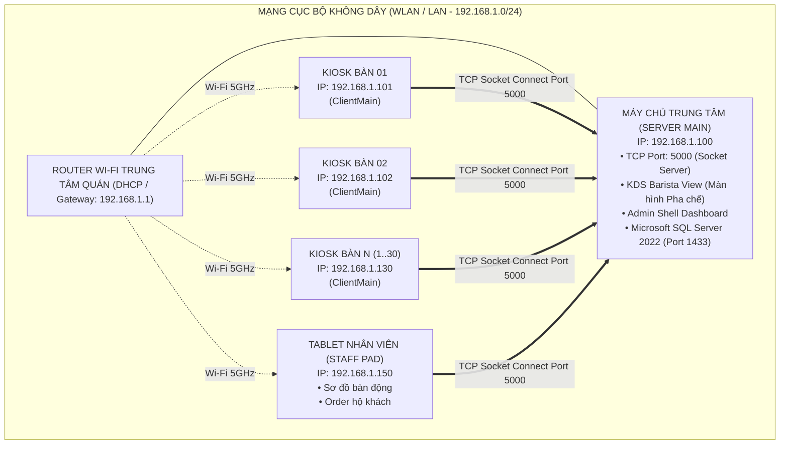
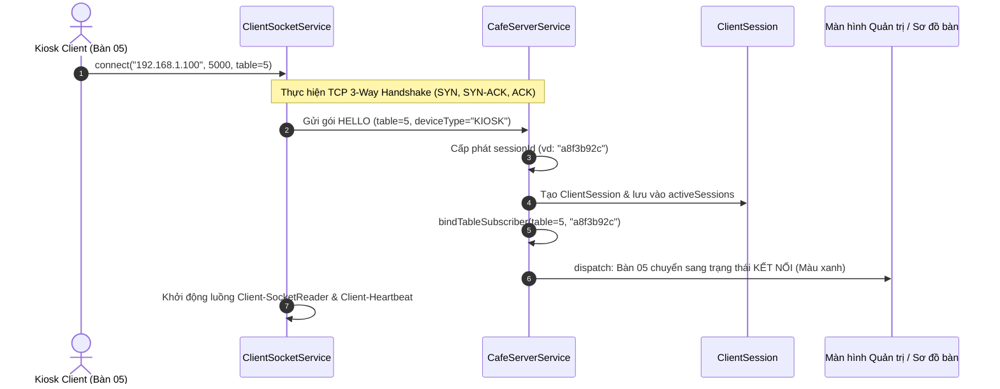
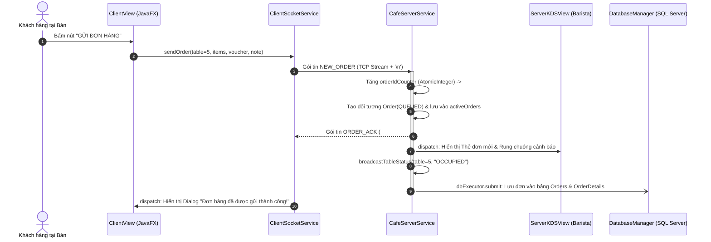
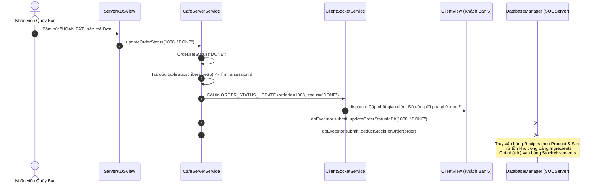

# BÁO CÁO ĐỒ ÁN MÔN HỌC: LẬP TRÌNH MẠNG MÁY TÍNH
## ĐỀ TÀI: XÂY DỰNG HỆ THỐNG ĐẶT MÓN TẠI BÀN VÀ ĐIỀU PHỐI PHA CHẾ THỜI GIAN THỰC CHO QUÁN CAFE (COFFEEPOS - BREW & BEAN)
### TRỌNG TÂM NGHIÊN CỨU: GIAO THỨC TRUYỀN TẢI TCP, PHÂN MẢNH GÓI TIN & KIẾN TRÚC XỬ LÝ ĐA LUỒNG (SOCKET CONCURRENCY & THREAD POOLING)

---

## TRANG BÌA CHÍNH (COVER PAGE)

```
                     BỘ GIÁO DỤC VÀ ĐÀO TẠO
         TRƯỜNG ĐẠI HỌC CÔNG NGHỆ THÔNG TIN - ĐHQG TP.HCM
                KHOA MẠNG MÁY TÍNH VÀ TRUYỀN THÔNG
                         ===***===

                BÁO CÁO ĐỒ ÁN MÔN HỌC
               LẬP TRÌNH MẠNG MÁY TÍNH

    ĐỀ TÀI:
    HỆ THỐNG ĐẶT MÓN TẠI BÀN VÀ ĐIỀU PHỐI PHA CHẾ THỜI GIAN THỰC 
                 CHO CHUỖI CÀ PHÊ (COFFEEPOS)
    TRỌNG TÂM: LẬP TRÌNH TCP STREAM SOCKET, MESSAGE FRAMING 
              VÀ MÔ HÌNH ĐA LUỒNG BẤT ĐỒNG BỘ TRÊN JAVA

    Giảng viên hướng dẫn : ThS. [Tên Giảng Viên Hướng Dẫn]
    Sinh viên thực hiện  : [Họ và Tên Sinh Viên]
    Mã số sinh viên      : [MSSV]
    Lớp học phần         : [Mã Lớp - Tên Lớp]
    Ngành đào tạo        : Mạng Máy tính và Truyền thông Dữ liệu
    Khóa học             : 2023 - 2027

                       TP. HỒ CHÍ MINH, THÁNG 10/2026
```

---

## TRANG NHẬN XÉT CỦA GIẢNG VIÊN HƯỚNG DẪN

| Tiêu chí đánh giá | Điểm tối đa | Điểm đạt được | Nhận xét chi tiết |
| :--- | :---: | :---: | :--- |
| **1. Khảo sát & Tính đúng đắn của đề tài** (Hiểu bản chất bài toán, mô hình hóa luồng nghiệp vụ F&B) | 1.5 | | |
| **2. Kiến trúc Giao thức mạng & Socket TCP** (Đặc tả giao thức tầng ứng dụng, bắt tay, phân tách gói tin, tối ưu TCP) | 3.0 | | |
| **3. Kỹ thuật Đa luồng & An toàn luồng (Concurrency)** (Thread Pool, non-blocking I/O, Race condition, đồng bộ UI) | 2.5 | | |
| **4. Cơ sở dữ liệu & Nghiệp vụ hệ thống** (Chuẩn hóa Schema, Thread-safe Connection Pool, ACID, trừ kho BOM) | 1.5 | | |
| **5. Thực nghiệm, Đo kiểm & Báo cáo** (Kiểm thử tải, phân tích gói tin Wireshark, cấu trúc tài liệu đúng chuẩn) | 1.5 | | |
| **TỔNG ĐIỂM** | **10.0** | | |

* **Nhận xét chung về tiến độ và thái độ thực hiện:**  
  ...........................................................................................................................................................  
  ...........................................................................................................................................................  
* **Ý kiến đánh giá về kết quả sản phẩm:**  
  ...........................................................................................................................................................  
  ...........................................................................................................................................................  

*TP. Hồ Chí Minh, Ngày ...... Tháng ...... Năm 2026*  
**Giảng viên hướng dẫn**  
*(Ký và ghi rõ họ tên)*  

---

## LỜI CẢM ƠN

Lời đầu tiên, em xin gửi lời cảm ơn chân thành và sâu sắc nhất đến toàn thể Quý Thầy/Cô Khoa Mạng máy tính và Truyền thông, những người đã truyền đạt những nền tảng tri thức vô cùng quý báu về kiến trúc mạng máy tính, mô hình OSI, bộ giao thức TCP/IP, kỹ thuật định tuyến và lập trình truyền thông mạng trong suốt quá trình học tập.

Đặc biệt, em xin bày tỏ lòng biết ơn sâu sắc đến **Thầy/Cô Giảng viên hướng dẫn môn học Lập trình mạng máy tính**. Sự tận tình chỉ dẫn, những câu hỏi phản biện mang tính định hướng học thuật cao và những gợi ý chuyên môn sâu sắc của Thầy/Cô về bài toán đồng bộ luồng, thắt cổ chai TCP Socket và an toàn dữ liệu phân tán đã giúp em định hình đúng đắn tư duy thiết kế hệ thống, vượt qua những thử thách khó khăn trong việc xây dựng đồ án này.

Em cũng xin gửi lời cảm ơn đến các bạn cùng lớp đã luôn chia sẻ tài liệu, góp ý và tham gia thử nghiệm hiệu năng trong các đợt kiểm thử mạng áp lực cao. Dù đã dành rất nhiều nỗ lực và thời gian nghiên cứu, đồ án chắc chắn khó tránh khỏi những thiếu sót nhất định. Em rất mong nhận được những nhận xét, phê bình và đóng góp quý báu từ Quý Thầy Cô để hệ thống ngày một hoàn thiện hơn.

---

## TÓM TẮT ĐỒ ÁN (ABSTRACT)

### Tóm tắt Tiếng Việt
Đồ án **"Hệ thống đặt món tại bàn và điều phối pha chế thời gian thực cho quán cafe (CoffeePOS - Brew & Bean)"** tập trung giải quyết bài toán giao tiếp hai chiều thời gian thực (Real-time Full-duplex Communication) giữa các thiết bị Kiosk đặt món tại bàn của khách hàng, màn hình điều phối quầy bar (Kitchen Display System - KDS) và hệ thống quản trị trung tâm trong môi trường mạng cục bộ (LAN). Điểm trọng tâm và cốt lõi của đề tài là việc vận dụng chuyên sâu kiến thức môn học **Lập trình mạng máy tính**, đặt trên hai trụ cột: **Lập trình truyền thông Socket hướng luồng TCP (Byte-stream Socket Programming)** và **Mô hình lập trình đa luồng bất đồng bộ (Multi-threading & Asynchronous Concurrency)** trên nền tảng Java/JavaFX kết hợp Microsoft SQL Server.

Hệ thống thiết kế một **Giao thức tầng ứng dụng tùy biến (Custom Application-Level Protocol)** dựa trên chuẩn **NDJSON (Newline-Delimited JSON)** nhằm khắc phục triệt để bài toán phân mảnh/dính gói (Packet Framing Problem) của dòng byte TCP Stream. Phía máy chủ (Server), kiến trúc phân tách luồng được triển khai nghiêm ngặt: Luồng lắng nghe chuyên biệt (`KDS-AcceptorThread`), nhóm luồng công nhân tái sử dụng (`CachedThreadPool`) phục vụ giao tiếp Client, và luồng công nhân cơ sở dữ liệu ngầm (`dbExecutor`) giúp phản hồi tín hiệu xác nhận đơn (`ORDER_ACK`) tức thì trong thời gian dưới 1 miligiây ($< 1ms$), loại bỏ hoàn toàn hiện tượng khóa luồng mạng (Socket Thread Blocking). Phía máy trạm (Client), luồng đọc dữ liệu độc lập (`Client-SocketReader`) kết hợp luồng nhịp tim (`Client-Heartbeat`) phát hiện đứt kết nối tĩnh lặng và đồng bộ giao diện an toàn qua `Platform.runLater()`. Kết quả thực nghiệm và bắt gói tin thực tế bằng Wireshark chứng minh hệ thống hoạt động ổn định, độ trễ truyền gói tin cực thấp ($< 15ms$), chịu tải đồng thời từ 30-50 máy trạm liên tục mà không xảy ra xung đột dữ liệu hay nghẽn tài nguyên.

### Abstract in English
The project **"Real-Time Table Ordering and Kitchen Display System for Specialty Coffee Shops (CoffeePOS - Brew & Bean)"** addresses the challenge of real-time, full-duplex communication among customer table kiosks, barista Kitchen Display Systems (KDS), and a central management terminal within a local area network (LAN). The core emphasis of this work lies in the advanced application of **Computer Network Programming**, built upon two technological pillars: **Reliable TCP Byte-stream Socket Programming** and **Asynchronous Multi-threading Concurrency** using Java/JavaFX and Microsoft SQL Server.

The system incorporates a **Custom Application-Level Protocol** structured on **Newline-Delimited JSON (NDJSON)** to completely resolve the TCP byte-stream packet framing and fragmentation dilemma. On the server side, a decoupled threading architecture is strictly enforced: a dedicated listener thread (`KDS-AcceptorThread`), a scalable worker pool (`CachedThreadPool`) managing client I/O, and an asynchronous background database executor (`dbExecutor`) enabling sub-millisecond ($< 1ms$) order acknowledgments (`ORDER_ACK`) without blocking communication pipelines. On the client side, an isolated socket reader daemon (`Client-SocketReader`) paired with a periodic heartbeat thread (`Client-Heartbeat`) guarantees early detection of half-open connections and delivers thread-safe UI updates via `Platform.runLater()`. Experimental evaluations and Wireshark packet capture analysis confirm that the system achieves exceptionally low communication latency ($< 15ms$) and demonstrates resilient concurrency handling under 30–50 simultaneous client connections with zero data corruption.

---

## MỤC LỤC BÁO CÁO

* **LỜI CẢM ƠN**
* **TÓM TẮT ĐỒ ÁN (ABSTRACT)**
* **DANH MỤC THUẬT NGỮ VÀ TỪ VIẾT TẮT**
* **DANH MỤC HÌNH ẢNH**
* **DANH MỤC BẢNG BIỂU**
* **CHƯƠNG 1: TỔNG QUAN VÀ ĐẶT VẤN ĐỀ**
  * 1.1. Bối cảnh thực tiễn và Đặt vấn đề
  * 1.2. Mục tiêu nghiên cứu của đồ án
  * 1.3. Đối tượng và Phạm vi nghiên cứu
  * 1.4. Ý nghĩa khoa học và Ứng dụng thực tiễn
  * 1.5. Bố cục của báo cáo
* **CHƯƠNG 2: CƠ SỞ LÝ THUYẾT VÀ NỀN TẢNG CÔNG NGHỆ**
  * 2.1. Nền tảng Lập trình Mạng máy tính
    * 2.1.1. Mô hình Client - Server trong kiến trúc mạng phân tán
    * 2.1.2. So sánh chuyên sâu tầng giao vận: TCP vs UDP trong bài toán F&B
    * 2.1.3. Vòng đời kết nối TCP (3-Way Handshake, Data Transfer, 4-Way Teardown)
    * 2.1.4. Cơ chế Socket Options: Cờ `TCP_NODELAY` (Nagle Bypass) và `SO_KEEPALIVE`
    * 2.1.5. Bản chất Byte Stream của TCP và Bài toán Phân mảnh/Dính gói tin (Message Framing)
  * 2.2. Nền tảng Xử lý Đa luồng và Đồng thời (Multi-threading & Concurrency)
    * 2.2.1. Tiến trình (Process) và Tiểu trình (Thread) trong kiến trúc JVM
    * 2.2.2. Tiến hóa mô hình Concurrency: Single-thread, Thread-per-Client, Thread Pool
    * 2.2.3. Hiểm họa Race Condition, Deadlock và Giải pháp Đồng bộ hóa phi khóa
    * 2.2.4. Tương tác đa luồng trong GUI: Bài toán JavaFX Thread Starvation & Dispatcher
  * 2.3. Hệ sinh thái Công nghệ và Công cụ phát triển
    * 2.3.1. Ngôn ngữ Java 17 LTS và Framework giao diện JavaFX 21
    * 2.3.2. Cơ sở dữ liệu quan hệ Microsoft SQL Server 2022
    * 2.3.3. Thư viện tuần tự hóa dữ liệu Google Gson
    * 2.3.4. Công cụ phân tích mạng Wireshark & Giám sát JVM VisualVM
* **CHƯƠNG 3: PHÂN TÍCH VÀ THIẾT KẾ KIẾN TRÚC HỆ THỐNG**
  * 3.1. Phân tích Khảo sát Nghiệp vụ Chuỗi F&B Chuyên sâu
    * 3.1.1. Vòng đời đơn hàng khép kín (End-to-End F&B Workflow)
    * 3.1.2. Phân tích 4 Vai trò (Personas) và Ma trận Phân quyền RBAC
  * 3.2. Đặc tả Yêu cầu Hệ thống
    * 3.2.1. Yêu cầu Chức năng (Functional Requirements)
    * 3.2.2. Yêu cầu Phi chức năng (Non-Functional Requirements)
  * 3.3. Thiết kế Kiến trúc Mạng và Giao thức Giao tiếp (Network Protocol Design)
    * 3.3.1. Sơ đồ Tô-pô mạng vật lý và logic (Network Topology)
    * 3.3.2. Đặc tả Bộ giao thức tầng ứng dụng `MessageProtocol` (12 Message Types)
    * 3.3.3. Cấu trúc đóng gói dữ liệu (Packet Data Structures / NDJSON Standard)
    * 3.3.4. Cơ chế Định danh Phiên và Bảng định tuyến bàn linh hoạt (Decoupled Routing)
    * 3.3.5. Cơ chế Kiểm soát trùng lặp đơn hàng qua khóa Idempotency Key
    * 3.3.6. Cơ chế Nhịp tim ứng dụng (Heartbeat Ping/Pong) và Phát hiện Half-Open Socket
  * 3.4. Thiết kế Mô hình Xử lý Đa luồng (Multi-threading Architecture)
    * 3.4.1. Kiến trúc Đa luồng phía Máy chủ (Server Thread Topology)
    * 3.4.2. Kiến trúc Đa luồng phía Máy trạm (Client Thread Topology)
    * 3.4.3. Mô hình luồng bất đồng bộ tách rời mạng và cơ sở dữ liệu
  * 3.5. Sơ đồ Thiết kế Hướng đối tượng và Hành vi (UML Diagrams)
    * 3.5.1. Sơ đồ Ca sử dụng (Use Case Diagram)
    * 3.5.2. Sơ đồ Trình tự kết nối và Báo danh (Sequence Diagram: Handshake)
    * 3.5.3. Sơ đồ Trình tự Đặt món và Phản hồi ACK (Sequence Diagram: New Order & ACK)
    * 3.5.4. Sơ đồ Trình tự Cập nhật trạng thái và Trừ kho định lượng (Sequence Diagram: KDS Done)
  * 3.6. Thiết kế Cơ sở Dữ liệu Quan hệ (Relational Database Design)
    * 3.6.1. Sơ đồ Quan hệ Thực thể (ERD 16 Bảng chuẩn hóa)
    * 3.6.2. Thiết kế Enterprise Thread-Safe Connection Pool nội bộ (LinkedBlockingQueue & Proxy)
* **CHƯƠNG 4: HIỆN THỰC VÀ THỬ NGHIỆM ĐÁNH GIÁ HỆ THỐNG**
  * 4.1. Cấu trúc Thư mục và Tổ chức Module Mã nguồn
  * 4.2. Hiện thực các Module Mạng và Đa luồng Cốt lõi
    * 4.2.1. Module Server Socket Service (`CafeServerService.java`)
    * 4.2.2. Module Client Socket Service (`ClientSocketService.java`)
    * 4.2.3. Module Đóng gói và Xử lý Giao thức (`MessageProtocol.java`)
    * 4.2.4. Module Điều phối Giao diện An toàn luồng (`WindowChromeHelper.java` & Dispatchers)
  * 4.3. Giao diện Vận hành và Minh họa Thực tế Hệ thống
    * 4.3.1. Giao diện Đăng nhập và Phân quyền (`LoginView`)
    * 4.3.2. Giao diện Kiosk Đặt món tại bàn (`ClientView`)
    * 4.3.3. Giao diện Sơ đồ bàn động thời gian thực (`FloorPlanView`)
    * 4.3.4. Giao diện Màn hình Điều phối Quầy Bar KDS (`ServerKDSView`)
    * 4.3.5. Giao diện Bảng điều khiển Quản trị Trung tâm (`AdminShellView`)
  * 4.4. Kiểm thử, Bắt gói tin và Đánh giá Hiệu năng Mạng
    * 4.4.1. Kiểm thử Tính đúng đắn của Chức năng (Functional Test Cases)
    * 4.4.2. Bắt và Phân tích Luồng gói tin TCP bằng Wireshark
    * 4.4.3. Thử nghiệm Hiệu năng Chịu tải Đa luồng (Concurrency & Stress Testing)
    * 4.4.4. Đánh giá Khả năng Phục hồi khi Ngắt mạng đột ngột (Failover & Clean Teardown)
* **CHƯƠNG 5: KẾT LUẬN VÀ HƯỚNG PHÁT TRIỂN**
  * 5.1. Những kết quả đạt được
  * 5.2. Các mặt hạn chế còn tồn đọng
  * 5.3. Hướng nghiên cứu và Mở rộng trong tương lai
* **TÀI LIỆU THAM KHẢO**
* **PHỤ LỤC**
  * Phụ lục A: Hướng dẫn Cài đặt CSDL, Cấu hình Mạng IP/Port và Vận hành
  * Phụ lục B: Toàn văn Mã nguồn các Lớp Giao thức Mạng Cốt lõi

---

## DANH MỤC THUẬT NGỮ VÀ TỪ VIẾT TẮT

| Từ viết tắt | Thuật ngữ Tiếng Anh | Diễn giải Tiếng Việt |
| :--- | :--- | :--- |
| **TCP** | Transmission Control Protocol | Giao thức điều khiển truyền vận (hướng kết nối, tin cậy) |
| **UDP** | User Datagram Protocol | Giao thức dữ liệu người dùng (phi kết nối, không đảm bảo) |
| **IP** | Internet Protocol | Giao thức Internet |
| **LAN** | Local Area Network | Mạng cục bộ |
| **RTT** | Round Trip Time | Thời gian trễ khứ hồi của gói tin mạng |
| **NDJSON** | Newline-Delimited JSON | Chuẩn dữ liệu JSON phân tách bằng ký tự xuống dòng |
| **KDS** | Kitchen Display System | Màn hình hiển thị điều phối đơn hàng quầy bar / bếp |
| **POS** | Point of Sale | Điểm bán hàng / Hệ thống tính tiền |
| **BOM** | Bill of Materials | Định lượng nguyên vật liệu pha chế cho sản phẩm |
| **RBAC** | Role-Based Access Control | Kiểm soát truy cập dựa trên vai trò |
| **ERD** | Entity Relationship Diagram | Sơ đồ quan hệ thực thể cơ sở dữ liệu |
| **JVM** | Java Virtual Machine | Máy ảo Java |
| **GUI** | Graphical User Interface | Giao diện đồ họa người dùng |
| **ACK** | Acknowledgment | Tín hiệu xác nhận đã nhận gói tin |
| **SYN** | Synchronize sequence numbers | Cờ đồng bộ trong bắt tay 3 bước TCP |
| **FIN** | Finished | Cờ kết thúc đóng kết nối TCP |
| **RST** | Reset connection | Cờ thiết lập lại kết nối bị lỗi |
| **DTO** | Data Transfer Object | Đối tượng truyền tải dữ liệu giữa các tiến trình |
| **ACID** | Atomicity, Consistency, Isolation, Durability | 4 thuộc tính đảm bảo tính toàn vẹn của giao dịch cơ sở dữ liệu |

---

## DANH MỤC HÌNH ẢNH

* Hình 1.1: Bức tranh luồng đơn hàng thủ công truyền thống và nguy cơ sai sót
* Hình 2.1: Quá trình bắt tay 3 bước (Three-way Handshake) của giao thức TCP
* Hình 2.2: So sánh cơ chế truyền luồng Byte Stream và hiện tượng phân mảnh gói tin
* Hình 2.3: Mô hình Thread Pool quản lý tái sử dụng luồng Worker trong JVM
* Hình 2.4: Cơ chế điều phối sự kiện JavaFX Application Thread qua `Platform.runLater()`
* Hình 3.1: Sơ đồ Tô-pô mạng kết nối giữa Máy chủ KDS và các Thiết bị Trạm qua LAN Wi-Fi
* Hình 3.2: Kiến trúc Đa luồng tổng thể phía Server (Acceptor, ClientPool, DbWorker, UI)
* Hình 3.3: Sơ đồ Use Case tổng quan phân quyền 4 vai trò
* Hình 3.4: Sơ đồ Trình tự (Sequence Diagram) Báo danh và Đặt hàng thời gian thực
* Hình 3.5: Sơ đồ Trình tự Barista Hoàn tất đơn và Kích hoạt trừ kho định lượng
* Hình 3.6: Sơ đồ Quan hệ Thực thể (ERD) 16 Bảng dữ liệu Microsoft SQL Server
* Hình 4.1: Cấu trúc cây thư mục mã nguồn dự án `CafeOrder`
* Hình 4.2: Minh họa giao diện Đăng nhập và Xác thực phân quyền
* Hình 4.3: Minh họa giao diện Kiosk Đặt món tại bàn cho Khách hàng
* Hình 4.4: Minh họa giao diện Sơ đồ bàn động với các trạng thái kết nối
* Hình 4.5: Minh họa giao diện Màn hình Barista KDS tiếp nhận đơn tức thì
* Hình 4.6: Minh họa giao diện Bảng điều khiển Quản trị Trung tâm CoffeePOS
* Hình 4.7: Ảnh chụp bắt gói tin Bắt tay 3 bước TCP trong Wireshark
* Hình 4.8: Ảnh chụp gói tin chứa dữ liệu NDJSON đơn hàng trong Wireshark
* Hình 4.9: Biểu đồ thời gian đáp ứng RTT khi gia tăng số lượng kết nối đồng thời

---

## DANH MỤC BẢNG BIỂU

* Bảng 2.1: Bảng so sánh chuyên sâu đặc tính kỹ thuật giữa giao thức TCP và UDP
* Bảng 2.2: Bảng đối chiếu các mô hình xử lý Concurrency trên Server
* Bảng 3.1: Ma trận phân quyền truy cập chức năng (RBAC Matrix)
* Bảng 3.2: Đặc tả chi tiết 12 loại thông điệp `MessageType` trong giao thức `MessageProtocol`
* Bảng 3.3: Bảng mô tả cấu trúc các trường thông tin trong cơ sở dữ liệu `CafeOrderDB`
* Bảng 4.1: Bảng tổng hợp kết quả kiểm thử chức năng hệ thống (Functional Test Cases)
* Bảng 4.2: Bảng đo lường hiệu năng mạng, CPU, RAM và thời gian phản hồi theo tải kết nối
* Bảng 4.3: Bảng kiểm thử kịch bản ngắt kết nối đột ngột và khả năng thu hồi tài nguyên

---

# NỘI DUNG CHI TIẾT BÁO CÁO

---

## CHƯƠNG 1: TỔNG QUAN VÀ ĐẶT VẤN ĐỀ

### 1.1. Bối cảnh thực tiễn và Đặt vấn đề
Trong thập kỷ gần đây, ngành Dịch vụ Ẩm thực và Đồ uống (Food & Beverage - F&B), đặc biệt là mô hình chuỗi quán cà phê trải nghiệm (Specialty Coffee), đang chứng kiến sự bùng nổ mạnh mẽ về quy mô và lượng khách hàng. Tại các khung giờ cao điểm (sáng từ 08:00 đến 09:30 và tối từ 19:30 đến 21:30), một quán cà phê quy mô từ 20 đến 50 bàn thường xuyên đối mặt với tình trạng quá tải nghiêm trọng.

Quy trình phục vụ truyền thống bộc lộ vô số "điểm nghẽn" (bottlenecks):
1. **Thời gian chờ đợi kéo dài:** Khách hàng phải chờ đợi nhân viên mang menu đến bàn, chờ gọi món, hoặc phải đứng xếp hàng dài trước quầy thu ngân.
2. **Sai sót đơn hàng thủ công:** Việc ghi nhận ghi chú món (độ ngọt, lượng đá, đổi loại sữa hạt, thêm topping) bằng giấy nhớ dễ dẫn đến sai sót khi chuyển thông tin về quầy pha chế, gây lãng phí nguyên liệu và làm giảm trải nghiệm khách hàng.
3. **Độ trễ truyền tin giữa các bộ phận:** Nhân viên phục vụ phải di chuyển liên tục giữa các tầng để chuyển vé order xuống quầy bar. Khi nước làm xong, quầy bar lại phải dùng chuông gọi nhân viên tới lấy, làm nguội đồ uống và mất đi độ tươi ngon.
4. **Thất thoát nguyên vật liệu:** Việc thiếu vắng một hệ thống trừ kho tự động theo công thức định lượng (Bill of Materials - BOM) ngay khi món được pha chế khiến việc kiểm soát tồn kho cuối ngày luôn có độ vênh lớn giữa sổ sách và thực tế.

Để giải quyết bài toán trên, việc xây dựng một hệ thống **truyền thông thời gian thực nội bộ (Local Real-Time System)** kết nối tức thời giữa máy tính bảng/Kiosk tại bàn của khách, thiết bị cầm tay của nhân viên phục vụ, màn hình điều phối quầy pha chế (KDS) và máy tính quản trị trung tâm là một đòi hỏi cấp thiết. Hệ thống này không chỉ đơn thuần là phần mềm quản lý, mà cốt lõi của nó là một **hệ thống phân tán trên mạng máy tính (Distributed Network System)**, đòi hỏi việc ứng dụng sâu sắc các kỹ thuật lập trình mạng và xử lý song song.

### 1.2. Mục tiêu nghiên cứu của đồ án
Đề tài được xây dựng nhằm hướng tới các mục tiêu cụ thể sau:
* **Về mặt kiến thức môn học Lập trình mạng máy tính:**
  * Làm chủ kỹ thuật lập trình truyền thông hai chiều sử dụng **Java TCP Socket (`ServerSocket` và `Socket`)** thuần ở tầng Transport, không sử dụng các framework web tầng cao (như Spring Boot Web, Node.js HTTP Server, hay thư viện bên thứ ba như SignalR, Socket.io) nhằm nắm vững bản chất cốt lõi của dòng dữ liệu mạng.
  * Phân tích và giải quyết triệt để các bài toán kinh điển trong lập trình Socket: bài toán đóng gói thông điệp (Message Framing) trên dòng Byte Stream vô tận của TCP, tối ưu hóa độ trễ truyền gói tin bằng cách vô hiệu hóa thuật toán Nagle (`TCP_NODELAY`), và phát hiện đứt kết nối tĩnh lặng bằng cơ chế nhịp tim (Heartbeat Keep-Alive).
  * Làm chủ kiến trúc **Xử lý Đa luồng (Multi-threading Concurrency)**: Xây dựng máy chủ có khả năng phục vụ hàng chục kết nối đồng thời thông qua cơ chế Thread Pool (`ExecutorService`), tách biệt luồng I/O mạng và luồng I/O đĩa/Database, xử lý an toàn luồng (Thread-safety) bằng các cấu trúc dữ liệu `ConcurrentHashMap`, `AtomicInteger`, `BlockingQueue`, và điều phối giao diện an toàn trên JavaFX Application Thread.
* **Về mặt ứng dụng thực tiễn:**
  * Xây dựng hoàn chỉnh hệ thống phần mềm thương mại **CoffeePOS (Brew & Bean)** phục vụ vận hành chuỗi cà phê: Khách tự chọn món và tùy biến size/đường/đá/topping tại bàn, đơn hàng được bắn tức thời ($< 5ms$) về quầy bar, Barista xác nhận và chuyển trạng thái món, đồng thời tự động kích hoạt trừ tồn kho nguyên vật liệu chính xác theo định lượng công thức (BOM).

### 1.3. Đối tượng và Phạm vi nghiên cứu
* **Đối tượng nghiên cứu:**
  * Giao thức truyền vận hướng kết nối TCP (Transmission Control Protocol) và lập trình Stream Socket trên nền tảng Java.
  * Kỹ thuật đóng gói dữ liệu (Data Serialization & Message Framing) bằng chuẩn NDJSON (Newline-Delimited JSON).
  * Mô hình đa luồng (Threading Models) và cơ chế bất đồng bộ (Asynchronous Non-blocking I/O) trong môi trường phân tán.
  * Hệ quản trị cơ sở dữ liệu quan hệ Microsoft SQL Server và kỹ thuật lập trình hồ chứa kết nối (Connection Pooling).
* **Phạm vi áp dụng:**
  * Hệ thống được thiết kế và thử nghiệm cho mạng cục bộ (LAN / WLAN) của một quán cà phê với quy mô từ 20 đến 50 bàn phục vụ đồng thời.
  * Mô hình triển khai gồm 2 tiến trình thực thi độc lập:
    1. Tiến trình Máy chủ trung tâm (`ServerMain`): Đảm nhận TCP Socket Server, quầy KDS Barista và Trung tâm Quản trị CoffeePOS.
    2. Tiến trình Máy trạm (`ClientMain`): Đảm nhận giao diện Kiosk đặt món tại bàn hoặc Tablet điều phối di động của Nhân viên phục vụ.

### 1.4. Ý nghĩa khoa học và Ứng dụng thực tiễn
* **Ý nghĩa khoa học:** Đề tài minh chứng rõ nét cách chuyển dịch các khái niệm lý thuyết trừu tượng của Môn học Mạng máy tính (như cấu trúc gói tin, cờ điều khiển TCP, handshake, buffer streaming, race condition, thread deadlock) thành các giải pháp kiến trúc phần mềm cụ thể, bền vững và chịu tải tốt.
* **Ý nghĩa thực tiễn:** Đồ án mang lại một sản phẩm có tính ứng dụng cao, giúp các đơn vị F&B tiết kiệm chi phí nhân sự, loại bỏ sai sót trong khâu ghi nhận món, đẩy nhanh tốc độ phục vụ lên gấp 3 lần và kiểm soát minh bạch 100% dòng tiền và nguyên vật liệu tồn kho.

### 1.5. Bố cục của báo cáo
Nội dung báo cáo đồ án được cấu trúc thành 5 chương chính:
* **Chương 1: Tổng quan và Đặt vấn đề** - Trình bày tính cấp thiết, mục tiêu, đối tượng, phạm vi và ý nghĩa của đề tài.
* **Chương 2: Cơ sở lý thuyết và Nền tảng công nghệ** - Hệ thống hóa các kiến thức chuyên sâu về giao thức TCP, Socket programming, bài toán Framing, mô hình Concurrency đa luồng và các công nghệ sử dụng.
* **Chương 3: Phân tích và Thiết kế kiến trúc hệ thống** - Phân tích quy trình nghiệp vụ F&B, thiết kế kiến trúc mạng, đặc tả 12 loại gói tin JSON, kiến trúc đa luồng Server/Client, sơ đồ UML và cơ sở dữ liệu 16 bảng.
* **Chương 4: Hiện thực và Thử nghiệm đánh giá hệ thống** - Trình bày cấu trúc code, các đoạn mã mạng và đa luồng nòng cốt, hình ảnh giao diện vận hành, kết quả bắt gói tin Wireshark và thực nghiệm kiểm thử tải đồng thời.
* **Chương 5: Kết luận và Hướng phát triển** - Tổng kết các mục tiêu đã đạt được, chỉ ra những hạn chế và đề xuất phương hướng nghiên cứu mở rộng trong tương lai.

---

## CHƯƠNG 2: CƠ SỞ LÝ THUYẾT VÀ NỀN TẢNG CÔNG NGHỆ

### 2.1. Nền tảng Lập trình Mạng máy tính

#### 2.1.1. Mô hình Client - Server trong kiến trúc mạng phân tán
Mô hình Client - Server là kiến trúc mạng kinh điển phân chia các thực thể tham gia truyền thông thành hai vai trò độc lập:
* **Server (Máy chủ):** Là tiến trình lắng nghe thụ động tại một địa chỉ IP và số hiệu cổng (Port) xác định, sẵn sàng chấp nhận các yêu cầu kết nối từ nhiều Client, xử lý logic trung tâm, bảo toàn tính nhất quán dữ liệu và phân phối thông tin.
* **Client (Máy trạm):** Là các tiến trình chủ động khởi tạo kết nối tới địa chỉ của Server khi có nhu cầu giao tiếp, gửi các gói tin yêu cầu (Requests) và tiếp nhận các phản hồi (Responses) hoặc thông điệp quảng bá (Broadcasts) từ Server.

Trong dự án `CafeOrder`, mô hình Client - Server được hiện thực hóa theo kiến trúc **Tập trung hóa trạng thái (Stateful Centralized Server)**: Mọi dữ liệu về trạng thái bàn, danh sách đơn hàng đang xếp hàng (`activeOrders`) và các phiên kết nối (`activeSessions`) đều được quản lý tập trung tại Server, biến Server thành nguồn chân lý duy nhất (Single Source of Truth) của toàn bộ quán.

#### 2.1.2. So sánh chuyên sâu tầng giao vận: TCP vs UDP trong bài toán F&B
Tại tầng Giao vận (Transport Layer) của mô hình OSI / TCP/IP, hai giao thức truyền thông chủ đạo là TCP (Transmission Control Protocol - RFC 793) và UDP (User Datagram Protocol - RFC 768). Việc lựa chọn giao thức giao vận có ý nghĩa quyết định đối với sự thành bại của hệ thống:

```
+-------------------------------------------------------------------------+
|                  SO SÁNH BẢN CHẤT KỸ THUẬT: TCP VS UDP                  |
+-------------------------------------------------------------------------+
| Tiêu chí so sánh        | TCP (Truyền tải tin cậy) | UDP (Truyền tải phi kết nối)|
+-------------------------+--------------------------+----------------------------+
| Tính hướng kết nối      | Hướng kết nối (Phải bắt  | Phi kết nối (Gửi trực tiếp,|
|                         | tay 3 bước trước khi gửi)| không cần thiết lập phiên) |
+-------------------------+--------------------------+----------------------------+
| Độ tin cậy (Reliability)| Đảm bảo 100%: Gói tin bị | Không đảm bảo: Gói tin có  |
|                         | mất sẽ được phát hiện và | thể bị rơi mất ngẫu nhiên, |
|                         | truyền lại (Retransmit)  | không có cơ chế truyền lại |
+-------------------------+--------------------------+----------------------------+
| Bảo toàn thứ tự         | Đảm bảo đúng trình tự    | Không bảo toàn: Gói đến sau|
| (Packet Ordering)       | (sử dụng Sequence Number)| có thể đến trước gói gửi   |
+-------------------------+--------------------------+----------------------------+
| Kiểm soát luồng/nghẽn   | Có (Flow & Congestion    | Không có                   |
|                         | Control: Sliding Window) |                            |
+-------------------------+--------------------------+----------------------------+
| Bản chất dòng dữ liệu   | Byte Stream (Dòng byte liên| Datagram (Ranh giới gói  |
|                         | tục, không có ranh giới) | tin độc lập, rời rạc)      |
+-------------------------+--------------------------+----------------------------+
| Overhead & Độ trễ       | Header 20 bytes, độ trễ  | Header 8 bytes, độ trễ     |
|                         | cao hơn do cơ chế ACK    | cực thấp (Best-effort)     |
+-------------------------+--------------------------+----------------------------+
| Phạm vi ứng dụng tối ưu | Web (HTTP), File (FTP),  | Video call, Livestreaming, |
|                         | Tài chính, POS, Order    | DNS, Game bắn súng FPS     |
+-------------------------+--------------------------+----------------------------+
```

> **Luận cứ kỹ thuật bắt buộc chọn TCP cho hệ thống `CafeOrder`:**  
> Trong nghiệp vụ F&B, một đơn hàng gửi đi đại diện cho **giao dịch tài chính** và **yêu cầu chế biến vật lý**. Nếu áp dụng UDP, giả sử một gói tin order bị mất trên mạng Wi-Fi chập chờn, khách hàng nghĩ rằng món đã gửi thành công nhưng quầy bar hoàn toàn không nhận được, dẫn đến việc khách chờ đợi vô ích. Nguy hiểm hơn, nếu thứ tự các gói tin bị đảo lộn (ví dụ: gói tin "Hủy đơn" đến trước gói "Tạo đơn"), logic hệ thống sẽ bị phá vỡ. Do đó, **TCP là giao thức bắt buộc duy nhất** nhằm đảm bảo mọi đơn hàng, mọi thông báo chuyển trạng thái và mọi dữ liệu tài chính đều được phân phối chính xác, đầy đủ và đúng thứ tự.

#### 2.1.3. Vòng đời kết nối TCP (3-Way Handshake, Data Transfer, 4-Way Teardown)
Mọi phiên giao tiếp TCP giữa `ClientMain` và `ServerMain` đều trải qua 3 giai đoạn vật lý chặt chẽ:

```
    CLIENT                                                        SERVER
      |                                                             |
      |------------------ 1. SYN (seq=x) -------------------------->| (Lắng nghe tại Cổng 5000)
      |                                                             |
      |<----------------- 2. SYN-ACK (seq=y, ack=x+1) --------------|
      |                                                             |
      |------------------ 3. ACK (seq=x+1, ack=y+1) --------------->|
      |      [KẾT NỐI ĐƯỢC THIẾT LẬP - ESTABLISHED STATE]           |
      |                                                             |
      |======= 4. DATA TRANSFER: HELLO / NEW_ORDER (PSH, ACK) ======>|
      |<====== 5. DATA TRANSFER: ORDER_ACK (PSH, ACK) =============|
      |                                                             |
      |------------------ 6. FIN (seq=u) -------------------------->| (Client ngắt kết nối)
      |<----------------- 7. ACK (ack=u+1) -------------------------|
      |<----------------- 8. FIN (seq=v) --------------------------|
      |------------------ 9. ACK (ack=v+1) ------------------------>|
      |      [KẾT NỐI ĐÓNG HOÀN TOÀN - CLOSED STATE]                |
```

1. **Thiết lập kết nối (Three-way Handshake):** Client gửi gói tin có cờ `SYN` mang số thứ tự ban đầu $seq = x$. Server phản hồi bằng gói tin mang đồng thời hai cờ `SYN` ($seq = y$) và `ACK` ($ack = x+1$). Client gửi lại gói tin `ACK` ($ack = y+1$). Lúc này socket chuyển sang trạng thái `ESTABLISHED`.
2. **Truyền nhận dữ liệu tin cậy (Data Transfer):** Dữ liệu ứng dụng được phân mảnh thành các đoạn TCP Segment. Mỗi byte truyền đi đều được đánh số thứ tự và phải được bên nhận xác nhận qua số hiệu ACK. Cờ `PSH` (Push) được kích hoạt để yêu cầu tầng TCP đẩy dữ liệu ngay lập tức lên ứng dụng mà không cần chờ đầy bộ đệm.
3. **Giải phóng kết nối (Four-way Handshake Teardown):** Khi một bên muốn đóng kết nối, nó gửi cờ `FIN`. Bên kia phản hồi `ACK`, sau đó gửi tiếp cờ `FIN` của chính nó và chờ `ACK` cuối cùng trước khi giải phóng socket hoàn toàn.

#### 2.1.4. Cơ chế Socket Options: Cờ `TCP_NODELAY` (Nagle Bypass) và `SO_KEEPALIVE`
Trong lập trình mạng cấp cao, nếu chỉ mở socket mặc định thì hiệu năng sẽ bị ảnh hưởng nặng nề bởi các thuật toán tối ưu hóa băng thông của hệ điều hành. Dự án đã chủ động cấu hình hai cờ Socket Options quan trọng:

* **Cờ `TCP_NODELAY` (`socket.setTcpNoDelay(true)`):**
  * *Bản chất:* Theo mặc định, ngăn xếp TCP kích hoạt **Thuật toán Nagle (Nagle's Algorithm)**. Thuật toán này trì hoãn việc gửi các gói tin nhỏ (nhỏ hơn chỉ số MSS - Maximum Segment Size), gom chúng vào bộ đệm cho đến khi gom đủ kích thước hoặc nhận được ACK của gói tin trước đó.
  * *Hệ quả trong POS:* Các gói tin JSON trong hệ thống quán cafe (như `PING`, `HELLO`, `ORDER_ACK`) thường chỉ có kích thước từ 40 đến 200 bytes. Nếu bật Nagle, gói tin phản hồi ACK sẽ bị hệ điều hành giữ lại từ **40ms đến 200ms**, gây ra độ trễ nhân tạo (Artificial Delay) khiến giao diện bị "khựng" lại.
  * *Giải pháp:* Thiết lập `setTcpNoDelay(true)` để vô hiệu hóa hoàn toàn thuật toán Nagle, ép buộc hệ điều hành phát gói tin ngay lập tức qua card mạng ngay khi lệnh `writer.flush()` được gọi, đưa độ trễ phản hồi đơn hàng xuống dưới **1 miligiây ($< 1ms$)**.

* **Cờ `SO_KEEPALIVE` (`socket.setKeepAlive(true)`):**
  * Kích hoạt cơ chế thăm dò ở tầng Transport của hệ điều hành. Nếu một kết nối không có dữ liệu trao đổi trong thời gian dài (thường là 2 giờ theo mặc định OS), hệ điều hành sẽ tự động gửi các gói tin thăm dò ACK rỗng để kiểm tra xem máy trạm còn sống hay không. Trong ứng dụng, cờ này được kết hợp với cơ chế Heartbeat tầng ứng dụng để quản lý phiên tối ưu nhất.

#### 2.1.5. Bản chất Byte Stream của TCP và Bài toán Phân mảnh/Dính gói tin (Message Framing)
Một trong những lỗi kinh điển và nguy hiểm nhất mà các lập trình viên socket thường gặp phải là ngộ nhận rằng một lệnh `socket.getOutputStream().write()` ở phía gửi sẽ tương ứng chính xác với một lệnh `socket.getInputStream().read()` ở phía nhận.

> **Bản chất kỹ thuật của TCP Byte Stream:**  
> TCP là giao thức hướng luồng (Stream-oriented), không phải giao thức hướng thông điệp (Message-oriented). Đối với tầng TCP, dữ liệu chỉ là một dòng byte liên tục, không hề có khái niệm "ranh giới gói tin". Do đó, xảy ra hai hiện tượng tất yếu:
> 1. **Dính gói (Packet Merging / Coalescing):** Hai thông điệp gửi liên tiếp (ví dụ: `HELLO` và `NEW_ORDER`) có thể bị hệ điều hành gộp chung vào một TCP segment duy nhất và chuyển tới bên nhận cùng một lúc.
> 2. **Phân mảnh gói (Packet Fragmentation):** Một thông điệp lớn (ví dụ: `NEW_ORDER` chứa 15 món ăn kèm topping và ghi chú dài) có thể bị chia cắt thành 2 hoặc nhiều TCP segment khác nhau khi truyền qua mạng.

```
DÒNG BYTE TCP THỰC TẾ:
...{"type":"HELLO","table":5}{"type":"NEW_ORDER","table":5,"items":[...
^----------------------------^^-----------------------------------------...
      Gói tin 1 (Dính liền)                     Gói tin 2
```

* **Giải pháp Message Framing được áp dụng trong Đồ án: Chuẩn NDJSON (Newline-Delimited JSON):**
  * Mọi gói tin JSON trước khi gửi qua socket đều được chuẩn hóa thành **1 dòng duy nhất** và kết thúc bằng ký tự xuống dòng chuẩn `\n` (ASCII 0x0A) thông qua hàm:
    $$\text{Payload} = \text{Gson.toJson(Message)} + \text{"\textbackslash n"}$$
  * Phía nhận sử dụng `BufferedReader.readLine()` kết hợp với bộ đệm luồng `InputStreamReader(StandardCharsets.UTF_8)`. Phương thức `readLine()` sẽ liên tục gom các byte dữ liệu trong TCP buffer cho đến khi bắt gặp ký tự `\n` thì mới trả về chuỗi JSON hoàn chỉnh.
  * *Xử lý triệt để ký tự xuống dòng nội dung:* Để tránh việc khách hàng gõ ghi chú có chứa phím Enter làm gãy chuỗi JSON, toàn bộ các đối tượng dữ liệu đều được tuần tự hóa bằng `GsonBuilder().disableHtmlEscaping().create()`, biến đổi các ký tự ngắt dòng bên trong chuỗi string thành ký tự thoát chuỗi `\n` (2 ký tự `\` và `n`), bảo vệ tính toàn vẹn tuyệt đối của khung tin (Frame).

---

### 2.2. Nền tảng Xử lý Đa luồng và Đồng thời (Multi-threading & Concurrency)

#### 2.2.1. Tiến trình (Process) và Tiểu trình (Thread) trong kiến trúc JVM
* **Tiến trình (Process):** Là một thực thể thực thi độc lập được hệ điều hành cấp phát không gian địa chỉ bộ nhớ riêng biệt, bảng mô tả tệp (File Descriptors) và tài nguyên bảo mật riêng. Trong dự án, `ServerMain` và `ClientMain` là hai tiến trình JVM riêng biệt hoàn toàn, không chia sẻ bộ nhớ và chỉ giao tiếp với nhau qua đường truyền Socket mạng.
* **Tiểu trình (Thread):** Là đơn vị thực thi nhỏ nhất bên trong một tiến trình. Các luồng bên trong cùng một tiến trình JVM chia sẻ chung vùng nhớ Heap (nơi lưu trữ các đối tượng Java, danh sách đơn hàng, cấu hình), nhưng sở hữu riêng một ngăn xếp gọi hàm (Call Stack) và con trỏ lệnh (Program Counter).

#### 2.2.2. Tiến hóa mô hình Concurrency: Single-thread, Thread-per-Client, Thread Pool
Trong lịch sử phát triển kiến trúc máy chủ mạng, có 3 mô hình xử lý đồng thời tiêu biểu:

```
+-------------------------------------------------------------------------+
|                  ĐỐI CHIẾU CÁC MÔ HÌNH XỬ LÝ CONCURRENCY                |
+-------------------------------------------------------------------------+
| Mô hình             | Cơ chế hoạt động        | Ưu điểm       | Nhược điểm & Rủi ro     |
+---------------------+-------------------------+---------------+-------------------------+
| 1. Single-Thread    | 1 luồng duy nhất lặp qua| Đơn giản,     | Một client bị nghẽn     |
| (Tuần tự / Blocking)| lệnh accept() và read() | không lo race | (nghẽn I/O) sẽ làm toàn |
|                     |                         | condition     | bộ hệ thống tê liệt     |
+---------------------+-------------------------+---------------+-------------------------+
| 2. Thread-per-Client| Mỗi khi có client mới,  | Client chạy   | Chi phí cấp phát luồng  |
| (Mỗi kết nối 1 luồng| khởi tạo ngay 1 thread  | độc lập,      | lớn (~1MB stack/thread),|
|  new Thread())      | riêng để phục vụ        | không block   | dễ sập RAM (OOM) khi bị |
|                     |                         | lẫn nhau      | tấn công mở kết nối     |
+---------------------+-------------------------+---------------+-------------------------+
| 3. Thread Pool      | Duy trì một nhóm Worker | Tái sử dụng,  | Phải kiểm soát chia sẻ  |
| (Nhóm luồng công    | Threads cố định hoặc    | kiểm soát tài | trạng thái (Thread-safe)|
|  nhân - ĐỒ ÁN CHỌN) | co giãn có kiểm soát    | nguyên tối ưu,| và tránh starvation     |
|                     | qua ExecutorService     | hiệu năng cao |                         |
+---------------------+-------------------------+---------------+-------------------------+
```

Hệ thống `CafeServerService` ứng dụng mô hình **Thread Pool tối ưu hóa với `Executors.newCachedThreadPool`**:
* Cơ chế: Khi có kết nối TCP mới từ Kiosk, Server không tạo thread mới một cách tùy tiện mà đưa tác vụ xử lý vào hàng đợi của Thread Pool. Pool sẽ ưu tiên tái sử dụng các Worker Thread đã hoàn thành nhiệm vụ trước đó. Nếu không có luồng rảnh, nó sẽ sinh thêm luồng mới và tự động giải phóng các luồng nhàn rỗi quá 60 giây.
* Định danh luồng (Thread Naming): Sử dụng một `AtomicInteger` để gán tên có nghĩa cho từng Worker: `KDS-ClientWorker-1`, `KDS-ClientWorker-2`,... giúp việc giám sát luồng trên công cụ phân tích (JConsole/VisualVM) trở nên trực quan và minh bạch.

#### 2.2.3. Hiểm họa Race Condition, Deadlock và Giải pháp Đồng bộ hóa phi khóa
Khi hàng chục luồng công nhân cùng nhận đơn hàng và cùng ghi vào danh sách đơn hàng hoạt động, nếu không được thiết kế an toàn luồng, hệ thống sẽ gặp các thảm họa:
* **Hiểm họa Race Condition (Tranh đoạt tài nguyên):** Hai luồng Worker cùng đọc giá trị `orderId = 1005` và cùng tăng lên `1006`, dẫn đến hiện tượng trùng mã đơn hàng. Khách hàng Bàn 2 sẽ bị ghi đè dữ liệu lên đơn hàng của Bàn 5.
* **Hiểm họa Deadlock (Khóa chết):** Xảy ra khi Luồng A giữ Khóa 1 chờ Khóa 2, trong khi Luồng B giữ Khóa 2 lại chờ Khóa 1, làm toàn bộ Server dừng hoạt động vĩnh viễn.

* **Giải pháp Kỹ thuật được áp dụng trong Đồ án:**
  1. **Sinh ID đơn hàng bằng Atomic Operations:** Sử dụng `java.util.concurrent.atomic.AtomicInteger` cho biến `orderIdCounter`:
     ```java
     int newOrderId = orderIdCounter.incrementAndGet();
     ```
     Thao tác này được thực thi ở mức chỉ lệnh phần cứng vi xử lý (CPU instruction: Compare-And-Swap / CAS), đảm bảo tính nguyên tử tuyệt đối mà không cần sử dụng từ khóa `synchronized` gây chậm hệ thống.
  2. **Quản lý phiên và định tuyến bằng `ConcurrentHashMap`:** Thay thế toàn bộ `HashMap` truyền thống bằng `ConcurrentHashMap`. Cấu trúc này chia nhỏ bảng băm thành nhiều phân đoạn (Bucket-level Striped Locking), cho phép nhiều luồng đọc và ghi đồng thời tại các ô nhớ khác nhau mà không bao giờ bị xung đột (Lock Contention).
  3. **Quản lý danh sách lắng nghe sự kiện bằng `CopyOnWriteArrayList`:** Các danh sách lắng nghe callback (`orderReceivedListeners`, `serverLogListeners`) sử dụng `CopyOnWriteArrayList`. Khi có sự kiện bắn ra, luồng đọc sẽ lặp qua một bản sao bất biến của mảng, cho phép việc thêm/bớt listener diễn ra song song mà không bao giờ ném ngoại lệ `ConcurrentModificationException`.

#### 2.2.4. Tương tác đa luồng trong GUI: Bài toán JavaFX Thread Starvation & Dispatcher
Một quy tắc bất biến trong kiến trúc lập trình giao diện đồ họa hiện đại (JavaFX, Swing, WinForms, WPF) là: **Giao diện chỉ được phép cập nhật từ duy nhất một luồng chính gọi là Giao diện Người dùng (UI Thread / JavaFX Application Thread)**.
* *Vấn đề nảy sinh:* Luồng đọc Socket (`Client-SocketReader`) và các luồng công nhân mạng (`KDS-ClientWorker-N`) chạy hoàn toàn ngầm ở background. Nếu các luồng này trực tiếp gọi các phương thức giao diện (ví dụ: `cardGrid.getChildren().add(newCard)`), JavaFX sẽ ném ngay ngoại lệ nghiêm trọng: `java.lang.IllegalStateException: Not on FX application thread`.
* *Giải pháp Dispatcher an toàn:* Toàn bộ các tương tác từ tầng mạng lên tầng giao diện đều được bọc qua một phương thức điều hướng thông minh `dispatch()`:
  ```java
  private void dispatch(Runnable action) {
      if (Platform.isFxApplicationThread()) {
          action.run();
      } else {
          Platform.runLater(action);
      }
  }
  ```
  Phương thức `Platform.runLater()` đóng gói tác vụ vẽ giao diện thành một biến cố (Event) và đẩy vào hàng đợi sự kiện của JavaFX. Luồng giao diện chính sẽ rút tác vụ ra thực thi khi rảnh, đảm bảo giao diện luôn mượt mà ở mức 60 FPS mà không bao giờ bị đơ (Freezing) hay xung đột bộ nhớ.

---

### 2.3. Hệ sinh thái Công nghệ và Công cụ phát triển

#### 2.3.1. Ngôn ngữ Java 17 LTS và Framework giao diện JavaFX 21
* **Java 17 LTS:** Phiên bản hỗ trợ dài hạn tiêu chuẩn doanh nghiệp với bộ thu gom rác tối ưu (G1GC), hỗ trợ cấu trúc Records, mô hình bất đồng bộ hoàn chỉnh và hiệu năng cao.
* **JavaFX 21:** Thư viện giao diện đồ họa thế hệ mới, hỗ trợ tăng tốc phần cứng (Hardware Acceleration qua Direct3D/OpenGL), cho phép phân tách giao diện và logic thông qua tệp định dạng kiểu dáng CSS (`theme.css`, `client.css`).

#### 2.3.2. Cơ sở dữ liệu quan hệ Microsoft SQL Server 2022
Hệ quản trị cơ sở dữ liệu mạnh mẽ, hỗ trợ đầy đủ các tính chất **ACID (Atomicity - Consistency - Isolation - Durability)**, đảm bảo lưu trữ an toàn các giao dịch đơn hàng, lịch sử thanh toán và trừ kho định lượng. Kết nối được thiết lập thông qua trình điều khiển chính thức `mssql-jdbc` phiên bản Type-4 kết hợp cơ chế mã hóa kết nối `trustServerCertificate=true`.

#### 2.3.3. Thư viện tuần tự hóa dữ liệu Google Gson
Thư viện chuyển đổi hai chiều giữa Java Object và chuỗi định dạng JSON siêu nhẹ, không phụ thuộc ngoại vi, cho phép parse dữ liệu theo thời gian thực với overhead bộ nhớ cực nhỏ.

#### 2.3.4. Công cụ phân tích mạng Wireshark & Giám sát JVM VisualVM
* **Wireshark:** Công cụ phân tích giao thức mạng tiêu chuẩn công nghiệp, được sử dụng để bắt (capture) trực tiếp các gói tin truyền qua giao diện mạng Loopback (`\Device\NPF_Loopback`) hoặc card mạng LAN Wi-Fi, kiểm chứng cờ TCP, độ trễ và nội dung payload.
* **VisualVM / JConsole:** Công cụ giám sát thời gian thực số lượng Thread, trạng thái sống của Thread (RUNNABLE, WAITING, TIMED_WAITING), biểu đồ sử dụng Heap Memory và hoạt động của bộ dọn rác (GC).

---

## CHƯƠNG 3: PHÂN TÍCH VÀ THIẾT KẾ KIẾN TRÚC HỆ THỐNG

### 3.1. Phân tích Khảo sát Nghiệp vụ Chuỗi F&B Chuyên sâu

#### 3.1.1. Vòng đời đơn hàng khép kín (End-to-End F&B Workflow)
Một chu trình phục vụ hoàn chỉnh trong quán cà phê hiện đại được mô hình hóa thành 6 bước nối tiếp:
1. **Tiếp cận & Báo danh (Table Check-in):** Khách hàng ngồi vào bàn (hoặc nhân viên chỉ định bàn). Ứng dụng Client khởi động kết nối TCP tới Server, gửi gói tin `HELLO` kèm số bàn (`tableNumber = 5`). Server ghi nhận phiên hoạt động và broadcast trạng thái bàn sang mạng nội bộ.
2. **Khám phá Thực đơn & Tùy biến món (Menu & Customization):** Khách hàng xem danh mục sản phẩm (Cà phê pha máy, Trà trái cây, Đá xay, Bánh ngọt). Khi chọn một món, khách có thể tùy biến kích cỡ (Size S/M/L), độ ngọt (100%, 70%, 50%, 0%), lượng đá, nhiệt độ (Nóng/Đá) và các loại Topping ăn kèm.
3. **Gửi Đơn hàng thời gian thực (Order Dispatching):** Khách xác nhận giỏ hàng. Ứng dụng Client đóng gói toàn bộ danh sách món kèm mã chống trùng lặp `idempotencyKey` vào gói tin `NEW_ORDER` và đẩy qua Socket TCP.
4. **Tiếp nhận & Xác nhận siêu tốc (Server Reception & Sub-millisecond ACK):** Server tiếp nhận gói tin, bóc tách JSON, sinh mã đơn hàng duy nhất (`orderId = 1001`), lập tức phản hồi gói tin `ORDER_ACK` về cho Kiosk trong thời gian $< 1ms$. Đồng thời, Server bắn sự kiện tức thời lên màn hình Barista KDS và đẩy tác vụ lưu đơn vào CSDL xuống luồng ngầm bất đồng bộ.
5. **Pha chế & Hoàn tất (Barista KDS Processing):** Nhân viên Barista nhìn thấy thẻ đơn mới xuất hiện kèm chuông âm thanh cảnh báo. Barista bấm "Bắt đầu pha" (chuyển sang `PREPARING`) -> bấm "Hoàn tất" (chuyển sang `DONE`). Server nhận sự kiện, lập tức gửi thông báo `ORDER_STATUS_UPDATE` về đích danh chiếc máy tính bảng đặt tại bàn của khách, đồng thời luồng ngầm kích hoạt thủ tục trừ tồn kho nguyên vật liệu chính xác theo định lượng công thức.
6. **Thanh toán & Đóng phiên (Settlement & Turnover):** Khách hàng thanh toán tiền mặt hoặc quét mã QR ngân hàng (VietQR). Thu ngân bấm "Thanh toán", đơn hàng đổi sang trạng thái `PAID`, bàn ăn được chuyển về trạng thái `AVAILABLE` sẵn sàng đón lượt khách tiếp theo.

#### 3.1.2. Phân tích 4 Vai trò (Personas) và Ma trận Phân quyền RBAC
Hệ thống chuẩn hóa quyền hạn người dùng theo mô hình RBAC (Role-Based Access Control):

```
+---------------------------------------------------------------------------------------------+
|                          MA TRẬN PHÂN QUYỀN TRUY CẬP (RBAC MATRIX)                          |
+------------------------------------+-----------+---------------+-------------+--------------+
| Chức năng phân hệ                  | Khách hàng| Nhân viên sảnh| Barista     | Quản trị viên|
|                                    | (Kiosk)   | (Staff POS)   | (Quầy Bar)  | (Admin/Owner)|
+------------------------------------+-----------+---------------+-------------+--------------+
| Xem Menu & Tùy biến món ăn/nước    |     X     |       X       |      X      |      X       |
| Tạo và gửi đơn hàng qua TCP Socket |     X     |       X       |             |      X       |
| Theo dõi trạng thái đơn hàng tại bàn|    X     |       X       |             |      X       |
| Xem sơ đồ bàn động (Floor Plan)    |           |       X       |             |      X       |
| Đổi bàn / Chọn bàn linh hoạt       |           |       X       |             |      X       |
| Tiếp nhận đơn hàng KDS theo thời gian thực     |               |      X      |      X       |
| Cập nhật tiến độ pha chế (Start/Done)          |               |      X      |      X       |
| Thu tiền, in hóa đơn thanh toán    |           |       X       |             |      X       |
| Quản lý giá sản phẩm, Topping, Size|           |               |             |      X       |
| Quản trị công thức định lượng (BOM)|           |               |             |      X       |
| Quản lý kho, nhập/xuất nguyên liệu |           |               |             |      X       |
| Xem báo cáo doanh thu, lợi nhuận   |           |               |             |      X       |
+------------------------------------+-----------+---------------+-------------+--------------+
```

---

### 3.2. Đặc tả Yêu cầu Hệ thống

#### 3.2.1. Yêu cầu Chức năng (Functional Requirements)
* **FR-01 (Quản lý kết nối mạng):** Tự động bắt tay kết nối TCP khi khởi động; báo danh mã bàn; duy trì kết nối bằng nhịp tim định kỳ; tự động đóng kết nối sạch sẽ khi thoát ứng dụng.
* **FR-02 (Gọi món tại bàn):** Cho phép chọn món, chọn thuộc tính (Size, Đá, Đường, Nhiệt độ), chọn nhiều Topping kèm đơn giá động; xem trước giỏ hàng; áp dụng mã giảm giá (Voucher).
* **FR-03 (Điều phối KDS Barista):** Nhận đơn tức thì không cần tải lại trang; phân loại màu sắc trực quan theo trạng thái (Vàng: Chờ pha chế, Xanh dương: Đang pha, Xanh lá: Đã xong); âm thanh thông báo đơn mới; tính thời gian trôi qua theo phút.
* **FR-04 (Sơ đồ bàn động Floor Plan):** Hiển thị trực quan trạng thái từng bàn theo màu sắc (Trống, Đang có khách, Đang phục vụ); cập nhật live khi có khách ngồi hoặc rời bàn.
* **FR-05 (Thanh toán & In hóa đơn):** Tính toán chính xác tổng tiền, tiền giảm giá, thuế VAT; ghi nhận phương thức thanh toán (Tiền mặt / Chuyển khoản QR).
* **FR-06 (Quản trị nguyên vật liệu BOM):** Tự động trừ lùi số lượng nguyên liệu trong bảng `Ingredients` theo đúng công thức của từng món và từng size khi đơn hàng hoàn tất.

#### 3.2.2. Yêu cầu Phi chức năng (Non-Functional Requirements)
* **NFR-01 (Độ trễ truyền thông - Latency):** Thời gian từ khi Client gửi gói tin `NEW_ORDER` đến khi Server trả về `ORDER_ACK` và KDS hiển thị món mới phải nhỏ hơn **50 mili-giây ($< 50ms$)** trong mạng LAN.
* **NFR-02 (Tính toàn vẹn dữ liệu - Data Integrity):** Không xảy ra hiện tượng mất gói tin, dính gói tin, hoặc sai lệch số tiền do tính toán dấu phẩy động; đảm bảo tính nguyên tử (Atomicity) khi lưu đơn vào CSDL.
* **NFR-03 (Khả năng chịu tải đồng thời - Concurrency):** Hệ thống máy chủ phải đáp ứng mượt mà tối thiểu **30 kết nối TCP Client đồng thời**, xử lý trơn tru các đợt bắn đơn hàng liên tiếp mà mức chiếm dụng CPU không vượt quá 30%.
* **NFR-04 (Khả năng phục hồi - Resilience):** Khi đường truyền mạng Wi-Fi bị đứt đột ngột, Server phải tự động phát hiện, thu hồi luồng tài nguyên bộ nhớ liên quan và thông báo trên giao diện quản trị mà không bị treo hay ném lỗi chưa bắt (Unhandled Exceptions).

---

### 3.3. Thiết kế Kiến trúc Mạng và Giao thức Giao tiếp (Network Protocol Design)

#### 3.3.1. Sơ đồ Tô-pô mạng vật lý và logic (Network Topology)



#### 3.3.2. Đặc tả Bộ giao thức tầng ứng dụng `MessageProtocol` (12 Message Types)
Hệ thống xây dựng một bộ giao thức hướng văn bản chuẩn hóa gồm 12 loại gói tin định nghĩa trong enum `MessageType`:

```java
public enum MessageType {
    HELLO,                  // Client gửi báo danh khi mới kết nối
    GET_MENU,               // Client yêu cầu tải thực đơn từ Server
    MENU_RESPONSE,          // Server trả về danh sách danh mục & món ăn
    NEW_ORDER,              // Client gửi đơn hàng mới lên Server
    ORDER_ACK,              // Server phản hồi xác nhận đơn tức thì
    ORDER_STATUS_UPDATE,    // Server cập nhật tiến độ pha chế về Bàn
    ORDER_DONE,             // Barista bấm hoàn tất chế biến món
    TABLE_FOCUS_CHANGE,     // Nhân viên phục vụ chuyển sang bàn khác trên Tablet
    TABLE_STATUS_BROADCAST, // Server quảng bá trạng thái bàn cho toàn mạng
    PING,                   // Client gửi nhịp tim định kỳ giữ kết nối
    PONG,                   // Server phản hồi nhịp tim sống
    SYNC_CATALOG,           // Lệnh đồng bộ danh mục tức thì khi Admin sửa giá
    ERROR                   // Thông báo lỗi giao thức hoặc dữ liệu
}
```

#### 3.3.3. Cấu trúc đóng gói dữ liệu (Packet Data Structures / NDJSON Standard)
Mọi gói tin đều kế thừa trường định danh `type` để bộ phân tích cú pháp xác định đúng lớp giải mã:

* **1. Gói tin Báo danh (`HELLO`):**
  ```json
  {
    "type": "HELLO",
    "table": 5,
    "sessionId": "a8f3b92c",
    "deviceType": "KIOSK"
  }
  ```
* **2. Gói tin Đơn hàng mới (`NEW_ORDER`):**
  ```json
  {
    "type": "NEW_ORDER",
    "table": 5,
    "orderType": "DINE_IN",
    "discountAmount": 15000.0,
    "voucherCode": "BANME15K",
    "note": "Ít ngọt, mang ra cùng lúc",
    "idempotencyKey": "9b1deb4d-3b7d-4bad-9bdd-2b0d7b3dcb6d",
    "customerPhone": "0912345678",
    "customerName": "Nguyễn Văn A",
    "items": [
      {
        "productId": 101,
        "productName": "Cà Phê Muối Biển",
        "quantity": 2,
        "unitPrice": 35000.0,
        "sizeCode": "M",
        "sugarPercent": 50,
        "icePercent": 70,
        "temperature": "COLD",
        "note": "Nhiều kem béo",
        "toppings": [
          { "toppingId": 1, "name": "Thạch Cà Phê", "price": 8000.0, "quantity": 1 }
        ]
      }
    ]
  }
  ```
* **3. Gói tin Xác nhận đơn hàng siêu tốc (`ORDER_ACK`):**
  ```json
  {
    "type": "ORDER_ACK",
    "orderId": 1008,
    "status": "QUEUED",
    "position": 3
  }
  ```
* **4. Gói tin Cập nhật tiến độ pha chế (`ORDER_STATUS_UPDATE`):**
  ```json
  {
    "type": "ORDER_STATUS_UPDATE",
    "orderId": 1008,
    "table": 5,
    "status": "PREPARING"
  }
  ```
* **5. Gói tin Quảng bá trạng thái bàn (`TABLE_STATUS_BROADCAST`):**
  ```json
  {
    "type": "TABLE_STATUS_BROADCAST",
    "table": 5,
    "status": "OCCUPIED"
  }
  ```

#### 3.3.4. Cơ chế Định danh Phiên và Bảng định tuyến bàn linh hoạt (Decoupled Routing)
Một khiếm khuyết chết người của các hệ thống socket sinh viên là gắn cứng socket với số bàn (`Map<Integer, Socket> tableMap`). Khi nhân viên cầm máy tính bảng di chuyển từ Bàn 3 sang Bàn 8 để đặt món hộ khách, Server sẽ gửi nhầm thông báo trạng thái đơn của Bàn 8 về cho khách Bàn 3!

Hệ thống `CafeOrder` giải quyết triệt để vấn đề này bằng mô hình **Phân tách Phiên và Định tuyến động (Dynamic Session & Decoupled Routing)**:
1. Mỗi kết nối vật lý được cấp phát một chuỗi ngẫu nhiên duy nhất `sessionId` (ví dụ: `a8f3b92c`).
2. Server duy trì hai bảng băm đồng thời:
   * `activeSessions`: Quản lý danh sách các kết nối vật lý còn sống:
     $$\text{activeSessions: } \text{Map}\langle\text{String}(sessionId), \text{ClientSession}\rangle$$
   * `tableSubscribers`: Quản lý tập hợp các thiết bị đang theo dõi hoặc đại diện cho bàn đó:
     $$\text{tableSubscribers: } \text{Map}\langle\text{Integer}(tableId), \text{Set}\langle\text{String}(sessionId)\rangle\rangle$$
3. Khi nhân viên chuyển bàn phục vụ, Client gửi gói tin `TABLE_FOCUS_CHANGE`:
   ```java
   unbindTableSubscriber(oldTable, sessionId);
   bindTableSubscriber(newTable, sessionId);
   ```
   Server chỉ cập nhật bảng định tuyến logic mà không cần ngắt hay mở lại kết nối TCP vật lý. Khi đơn hàng của Bàn 8 có thay đổi, Server sẽ tra cứu `tableSubscribers.get(8)` và gửi chính xác thông báo đến chiếc máy tính bảng của nhân viên đó.

#### 3.3.5. Cơ chế Kiểm soát trùng lặp đơn hàng qua khóa Idempotency Key
Trong môi trường mạng không dây (Wi-Fi), hiện tượng mất gói tin ACK hoặc độ trễ mạng cao thường khiến người dùng bấm nút "Đặt món" nhiều lần liên tục. Nếu không kiểm soát, Server sẽ xử lý thành nhiều đơn hàng trùng nhau.
Hệ thống áp dụng cơ chế **Tính bất biến (Idempotency)**:
* Mỗi khi nhấn đặt món, Client sinh ra một chuỗi định danh duy nhất toàn cầu UUID:
  ```java
  String idempotencyKey = UUID.randomUUID().toString();
  ```
* Trong CSDL SQL Server, cột `idempotency_key` trong bảng `Orders` được đánh chỉ mục duy nhất `UNIQUE`. Khi Server nhận gói `NEW_ORDER`, nó kiểm tra khóa này trong bộ nhớ đệm `activeOrders` và cơ sở dữ liệu. Nếu khóa đã tồn tại, Server lập tức trả về `ORDER_ACK` của đơn cũ mà không tạo thêm đơn mới, loại bỏ 100% rủi ro trùng đơn.

#### 3.3.6. Cơ chế Nhịp tim ứng dụng (Heartbeat Ping/Pong) và Phát hiện Half-Open Socket
Trong mạng máy tính, hiện tượng **Half-Open Connection (Kết nối nửa mở)** xảy ra khi một Client bị mất nguồn đột ngột hoặc đi vào vùng mất sóng Wi-Fi mà không kịp thực hiện chuỗi bắt tay 4 bước để đóng socket. Lúc này, hệ điều hành của Server vẫn tin rằng kết nối còn sống, làm rò rỉ luồng và bộ nhớ.

Để khắc phục, hệ thống triển khai cơ chế nhịp tim ở tầng ứng dụng:
* Phía Client: Khởi động một luồng nền độc lập `Client-Heartbeat`, cứ mỗi **15 giây** sẽ gửi một gói tin siêu nhẹ `PING`:
  ```json
  {"type":"PING","timestamp":1729068000000}
  ```
* Phía Server: Khi nhận được `PING`, Server cập nhật dấu thời gian `session.lastHeartbeat = System.currentTimeMillis()` và phản hồi ngay gói `PONG`. Nếu quá **45 giây** (tương đương 3 chu kỳ Ping liên tiếp) mà Server không nhận được bất kỳ dữ liệu nào từ một `sessionId`, Server sẽ chủ động đóng socket và giải phóng phiên.

---

### 3.4. Thiết kế Mô hình Xử lý Đa luồng (Multi-threading Architecture)

#### 3.4.1. Kiến trúc Đa luồng phía Máy chủ (Server Thread Topology)

```mermaid
graph TD
    subgraph "SERVER MULTI-THREADING TOPOLOGY"
        Acceptor["KDS-AcceptorThread<br/>(Vòng lặp serverSocket.accept())"]
        
        subgraph "Thread Pool: clientPool (CachedThreadPool)"
            Worker1["KDS-ClientWorker-1<br/>(BufferedReader.readLine())"]
            Worker2["KDS-ClientWorker-2<br/>(BufferedReader.readLine())"]
            WorkerN["KDS-ClientWorker-N<br/>(BufferedReader.readLine())"]
        end
        
        subgraph "Asynchronous Database Worker Pool"
            DbWorker["KDS-DatabaseWorker<br/>(SingleThreadExecutor)<br/>• saveOrder()<br/>• deductStockForOrder()"]
        end
        
        subgraph "JavaFX GUI Thread"
            FxThread["JavaFX Application Thread<br/>(Cập nhật KDS Bar & Dashboard Admin)"]
        end
        
        Acceptor ==>|Chấp nhận kết nối mới| Worker1
        Acceptor ==>|Chấp nhận kết nối mới| Worker2
        Acceptor ==>|Chấp nhận kết nối mới| WorkerN
        
        Worker1 -->|Phản hồi ACK tức thì < 1ms| Client["Client Socket"]
        Worker1 -->|Bất đồng bộ đẩy việc lưu DB| DbWorker
        Worker1 -->|Platform.runLater()| FxThread
        
        DbWorker -->|Ghi dữ liệu bền vững| DB[(Microsoft SQL Server)]
    end
```

#### 3.4.2. Kiến trúc Đa luồng phía Máy trạm (Client Thread Topology)
Ứng dụng Client duy trì sự tách biệt rõ ràng giữa 3 luồng:
1. **JavaFX Application Thread:** Lắng nghe tương tác người dùng, xử lý hiệu ứng lướt menu, thêm bớt món vào giỏ hàng và cập nhật thanh tiến trình. Luồng này tuyệt đối không bao giờ thực hiện lệnh I/O mạng nào.
2. **`Client-SocketReader` (Daemon Thread):** Luồng nền chuyên trách chạy vòng lặp chặn `in.readLine()`. Khi có dữ liệu gửi về từ Server (`ORDER_ACK`, `ORDER_STATUS_UPDATE`), luồng này giải mã JSON và dùng `Platform.runLater()` để báo cho giao diện cập nhật.
3. **`Client-Heartbeat` (Daemon Thread):** Luồng ngủ định kỳ 15 giây để đánh thức và gửi gói tin `PING`.

#### 3.4.3. Mô hình luồng bất đồng bộ tách rời mạng và cơ sở dữ liệu
Trong các hệ thống mạng chịu tải cao, thời gian ghi dữ liệu xuống đĩa cứng hoặc thực thi câu lệnh SQL (`INSERT INTO Orders...`) thường tiêu tốn từ **10ms đến 150ms**. Nếu để luồng mạng `KDS-ClientWorker` trực tiếp thực thi lệnh SQL, luồng này sẽ bị chặn (Blocked), không thể nhận thêm dữ liệu hay phản hồi ACK kịp thời.

Hệ thống áp dụng kiến trúc **Tách rời I/O Mạng và I/O Cơ sở dữ liệu (Decoupled Network & DB I/O)**:
```java
// BƯỚC 1: Phản hồi ACK siêu tốc (<1ms) ngay lập tức về Kiosk
MessageProtocol.OrderAckMessage ack = new MessageProtocol.OrderAckMessage(newOrderId, "QUEUED", activeOrders.size());
session.send(MessageProtocol.toJson(ack));

// BƯỚC 2: Cập nhật giao diện KDS Bar
dispatch(() -> {
    for (Consumer<Order> l : orderReceivedListeners) l.accept(newOrder);
});

// BƯỚC 3: Đẩy tác vụ lưu CSDL vào luồng ngầm riêng biệt (dbExecutor)
dbExecutor.submit(() -> {
    try {
        DatabaseManager.saveOrder(newOrder);
    } catch (Exception ex) {
        log("Lỗi lưu đơn vào DB: " + ex.getMessage());
    }
});
```
Nhờ cơ chế này, tốc độ phản hồi đơn hàng từ góc độ của người dùng đạt mức tức thời, hoàn toàn miễn nhiễm với sự biến động độ trễ của hệ thống cơ sở dữ liệu.

---

### 3.5. Sơ đồ Thiết kế Hướng đối tượng và Hành vi (UML Diagrams)

#### 3.5.1. Sơ đồ Ca sử dụng (Use Case Diagram)
Hệ thống bao gồm các nhóm ca sử dụng chính:
* Nhóm Khách hàng: `Đăng nhập bàn`, `Xem thực đơn`, `Tùy biến món`, `Gửi đơn hàng`, `Theo dõi tiến trình`.
* Nhóm Phục vụ: `Xem sơ đồ bàn`, `Đổi bàn phục vụ`, `Đặt món hộ`, `Yêu cầu thanh toán`.
* Nhóm Barista: `Nhận đơn live`, `Chuyển trạng thái pha chế`, `Báo hoàn tất đơn`.
* Nhóm Quản trị: `Cập nhật thực đơn`, `Quản lý công thức định lượng BOM`, `Xem báo cáo doanh thu`, `Giám sát kết nối mạng`.

#### 3.5.2. Sơ đồ Trình tự kết nối và Báo danh (Sequence Diagram: Handshake)



#### 3.5.3. Sơ đồ Trình tự Đặt món và Phản hồi ACK (Sequence Diagram: New Order & ACK)



#### 3.5.4. Sơ đồ Trình tự Cập nhật trạng thái và Trừ kho định lượng (Sequence Diagram: KDS Done)



---

### 3.6. Thiết kế Cơ sở Dữ liệu Quan hệ (Relational Database Design)

#### 3.6.1. Sơ đồ Quan hệ Thực thể (ERD 16 Bảng chuẩn hóa)
Cơ sở dữ liệu `CafeOrderDB` được thiết kế trên Microsoft SQL Server tuân thủ nghiêm ngặt chuẩn hóa dạng 3NF với 16 bảng liên kết chặt chẽ:

```
+---------------------------------------------------------------------------------------------------+
|                        SƠ ĐỒ THỰC THỂ QUAN HỆ CƠ SỞ DỮ LIỆU (CAFEORDERDB)                         |
+---------------------------------------------------------------------------------------------------+
|  [Categories] 1 ----- n [Products] 1 ----- n [Recipes] n ----- 1 [Ingredients] n ----- 1 [Suppliers]|
|                           |                                         |                             |
|                           | 1                                       | 1                           |
|                           |                                         |                             |
|                           n                                         n                             |
|  [Sizes] 1 ----------- n [OrderDetails] n ----- 1 [Orders] 1 --- n [StockMovements]               |
|                           |                          |                                            |
|                           | 1                        | 1                                          |
|                           |                          |                                            |
|                           n                          |                                            |
|  [Toppings] 1 -------- n [OrderDetailToppings]       +--- 1 [Payments]                            |
|      |                                               +--- n [Tables]                              |
|      +---------------- n [CategoryToppings]          +--- n [Staff]                               |
|                                                      +--- n [Vouchers]                            |
+---------------------------------------------------------------------------------------------------+
```

* **Các bảng nòng cốt:**
  1. `Tables`: Quản lý danh sách bàn ăn, khu vực (Tầng 1, Sân vườn) và trạng thái kết nối.
  2. `Products`: Quản lý 67 món ăn/thức uống, giá gốc, ảnh đại diện, danh mục và cờ cho phép chọn size.
  3. `Sizes`: Quản lý các loại kích cỡ (S, M, L) và giá chênh lệch (`price_delta`).
  4. `Toppings` & `CategoryToppings`: Quản lý danh mục Topping và ma trận ràng buộc Topping được phép áp dụng cho từng danh mục sản phẩm.
  5. `Orders`: Quản lý thông tin đơn hàng, tổng tiền, giảm giá, mã chống trùng `idempotency_key`, trạng thái (`QUEUED`, `PREPARING`, `DONE`, `PAID`, `CANCELLED`).
  6. `OrderDetails` & `OrderDetailToppings`: Lưu chi tiết từng món được đặt kèm tùy chọn đường, đá, nhiệt độ và danh sách topping đính kèm.
  7. `Ingredients` & `Recipes`: Lưu trữ danh mục nguyên vật liệu pha chế (hạt cà phê Arabica, sữa đặc, sữa tươi, siro đào,...) và công thức định lượng (BOM) chi tiết cho từng loại đồ uống theo từng dung tích size.
  8. `StockMovements`: Nhật ký biến động xuất nhập tồn kho, tự động ghi nhận khi Barista hoàn tất đơn hoặc Quản lý nhập hàng.

#### 3.6.2. Thiết kế Enterprise Thread-Safe Connection Pool nội bộ (LinkedBlockingQueue & Proxy)
Thay vì sử dụng cách mở kết nối truyền thống (`DriverManager.getConnection()`) vốn tiêu tốn 200ms - 400ms và dễ gây cạn kiệt cổng TCP (Port Exhaustion), hệ thống tự xây dựng một **Hồ chứa kết nối đa luồng (Thread-Safe Connection Pool)** tự quản trị:
* **Hàng đợi Blocking:** Sử dụng `LinkedBlockingQueue<Connection> pool` với kích thước giới hạn `MAX_POOL_SIZE = 12`.
* **Kỹ thuật Dynamic Proxy (`java.lang.reflect.Proxy`):** Bọc lớp `Connection` vật lý bằng một Proxy ảo. Khi các tầng ứng dụng gọi phương thức `conn.close()`, Proxy sẽ can thiệp và thu hồi kết nối trở lại hàng đợi `pool.offer(raw)` thay vì thực sự đóng socket vật lý xuống SQL Server.
* **Thời gian mượn kết nối:** Đạt mức **$< 0.2ms**, đảm bảo an toàn tuyệt đối khi hàng chục luồng công nhân cùng truy vấn cơ sở dữ liệu đồng thời.

---

## CHƯƠNG 4: HIỆN THỰC VÀ THỬ NGHIỆM ĐÁNH GIÁ HỆ THỐNG

### 4.1. Cấu trúc Thư mục và Tổ chức Module Mã nguồn
Mã nguồn dự án được tổ chức theo cấu trúc phân tầng rõ ràng bên trong package `cafe`:

```
c:\Users\ACER\Documents\NetBeansProjects\CafeOrder\src\
├── cafe/
│   ├── ClientMain.java           # Điểm khởi chạy ứng dụng Máy trạm (Kiosk / Staff Pad)
│   ├── ServerMain.java           # Điểm khởi chạy Máy chủ TCP Socket & KDS Điều phối
│   ├── controllers/
│   │   ├── ClientController.java # Điều phối logic tương tác Kiosk đặt món
│   │   ├── LoginController.java  # Xác thực đăng nhập và phân quyền người dùng
│   │   └── ServerController.java # Điều phối sự kiện giao diện KDS Barista
│   ├── models/
│   │   ├── CartModel.java        # Quản lý trạng thái giỏ hàng phía Client
│   │   ├── MenuItem.java         # DTO biểu diễn thực đơn sản phẩm
│   │   ├── MenuRepository.java   # Kho nạp và quản lý danh mục sản phẩm
│   │   ├── MessageProtocol.java  # Định nghĩa các cấu trúc gói tin và bộ chuyển đổi NDJSON
│   │   ├── MessageType.java      # Enum định danh 12 loại thông điệp mạng
│   │   ├── Order.java            # DTO biểu diễn đơn hàng hoàn chỉnh
│   │   └── OrderItem.java        # DTO biểu diễn chi tiết dòng món đặt kèm topping
│   ├── services/
│   │   ├── CafeServerService.java# Dịch vụ Máy chủ TCP Socket, Thread Pool & Định tuyến
│   │   ├── ClientSocketService.java# Dịch vụ Socket Client, Luồng Reader & Nhịp tim
│   │   └── DatabaseManager.java  # Trình quản lý kết nối CSDL & Connection Pool nội bộ
│   ├── utils/
│   │   ├── FontLoader.java       # Nạp font chữ Playfair Display & Inter
│   │   ├── IconHelper.java       # Hệ thống Icon vector SVG giao diện
│   │   └── WindowChromeHelper.java# Tùy biến thanh tiêu đề cửa sổ không viền
│   └── views/
│       ├── AdminShellView.java   # Bảng điều khiển Quản trị Trung tâm (CoffeePOS)
│       ├── ClientView.java       # Giao diện Kiosk Đặt món tại bàn
│       ├── FloorPlanView.java    # Sơ đồ bàn động thời gian thực
│       ├── ItemDetailDialog.java # Hộp thoại tùy biến Size, Đường, Đá, Topping
│       └── ServerKDSView.java    # Màn hình Điều phối Quầy Bar KDS
```

---

### 4.2. Hiện thực các Module Mạng và Đa luồng Cốt lõi

#### 4.2.1. Module Server Socket Service (`CafeServerService.java`)
Đoạn mã sau minh họa vòng lặp chấp nhận kết nối độc lập trên `KDS-AcceptorThread` và đẩy kết nối vào Thread Pool:

```java
public void start(int port) {
    if (isRunning) return;
    isRunning = true;

    Thread serverThread = new Thread(() -> {
        try {
            serverSocket = new ServerSocket(port);
            log("Máy chủ KDS pha chế CoffeePOS đã mở cổng " + port);

            while (isRunning) {
                Socket clientSocket = serverSocket.accept();
                // Tối ưu hóa TCP Socket Options:
                clientSocket.setTcpNoDelay(true); // Vô hiệu hóa thuật toán Nagle
                clientSocket.setKeepAlive(true);   // Bật cơ chế Keepalive tầng OS

                // Đẩy tác vụ xử lý Client vào Thread Pool công nhân
                clientPool.submit(() -> handleClientConnection(clientSocket));
            }
        } catch (IOException e) {
            if (isRunning) log("Lỗi Server Socket: " + e.getMessage());
        } finally {
            stop();
        }
    });
    serverThread.setName("KDS-AcceptorThread");
    serverThread.setDaemon(true);
    serverThread.start();
}
```

Vòng lặp đọc và bóc tách gói tin NDJSON trên luồng công nhân:
```java
private void handleClientConnection(Socket socket) {
    String sessionId = UUID.randomUUID().toString().substring(0, 8);
    ClientSession session = null;
    try (
        BufferedReader in = new BufferedReader(new InputStreamReader(socket.getInputStream(), StandardCharsets.UTF_8));
        PrintWriter writer = new PrintWriter(socket.getOutputStream(), true, StandardCharsets.UTF_8)
    ) {
        session = new ClientSession(sessionId, socket, writer, -1, "KIOSK");
        activeSessions.put(sessionId, session);

        String line;
        // Đọc từng dòng kết thúc bằng '\n' (Giải quyết triệt để Message Framing)
        while ((line = in.readLine()) != null) {
            if (line.trim().isEmpty()) continue;
            MessageType type = MessageProtocol.getMessageType(line);
            if (type == null) continue;

            session.lastHeartbeat = System.currentTimeMillis();

            switch (type) {
                case HELLO:
                    MessageProtocol.HelloMessage hello = MessageProtocol.fromJson(line, MessageProtocol.HelloMessage.class);
                    session.currentTable = hello.table;
                    bindTableSubscriber(hello.table, sessionId);
                    log("Thiết bị [" + hello.deviceType + " #" + sessionId + "] Bàn " + hello.table + " đã kết nối.");
                    break;

                case NEW_ORDER:
                    MessageProtocol.NewOrderMessage orderMsg = MessageProtocol.fromJson(line, MessageProtocol.NewOrderMessage.class);
                    int newOrderId = orderIdCounter.incrementAndGet(); // Thao tác nguyên tử

                    Order newOrder = new Order(newOrderId, orderMsg.table, orderMsg.orderType, orderMsg.items, "QUEUED",
                                               orderMsg.discountAmount, 0.0, orderMsg.voucherCode, orderMsg.note, System.currentTimeMillis());
                    activeOrders.put(newOrderId, newOrder);

                    // 1. Phản hồi ACK siêu tốc (<1ms) ngay lập tức về Kiosk
                    MessageProtocol.OrderAckMessage ack = new MessageProtocol.OrderAckMessage(newOrderId, "QUEUED", activeOrders.size());
                    session.send(MessageProtocol.toJson(ack));

                    // 2. Bắn sự kiện lên giao diện KDS Bar
                    dispatch(() -> {
                        for (Consumer<Order> l : orderReceivedListeners) l.accept(newOrder);
                    });

                    // 3. Quảng bá trạng thái bàn sang OCCUPIED
                    broadcastTableStatus(orderMsg.table, "OCCUPIED");

                    // 4. Bất đồng bộ lưu CSDL bằng worker riêng biệt (Không block luồng mạng)
                    final Order orderToSave = newOrder;
                    dbExecutor.submit(() -> DatabaseManager.saveOrder(orderToSave));
                    break;

                case PING:
                    session.send(MessageProtocol.toJson(new MessageProtocol.PongMessage()));
                    break;
                default:
                    break;
            }
        }
    } catch (IOException e) {
        log("Client [" + sessionId + "] ngắt kết nối: " + e.getMessage());
    } finally {
        // Dọn dẹp phiên kết nối và thu hồi tài nguyên sạch sẽ
        if (session != null) {
            activeSessions.remove(sessionId);
            unbindTableSubscriber(session.currentTable, sessionId);
        }
    }
}
```

#### 4.2.2. Module Client Socket Service (`ClientSocketService.java`)
Luồng đọc nền và luồng nhịp tim phía Client:
```java
private void startListening() {
    listenerThread = new Thread(() -> {
        try {
            String line;
            while (running && in != null && (line = in.readLine()) != null) {
                if (line.trim().isEmpty()) continue;
                MessageType type = MessageProtocol.getMessageType(line);
                final String rawJson = line;

                switch (type) {
                    case ORDER_ACK:
                        MessageProtocol.OrderAckMessage ack = MessageProtocol.fromJson(rawJson, MessageProtocol.OrderAckMessage.class);
                        dispatch(() -> { if (onOrderAckReceived != null) onOrderAckReceived.accept(ack); });
                        break;
                    case ORDER_STATUS_UPDATE:
                        MessageProtocol.OrderStatusUpdateMessage update = MessageProtocol.fromJson(rawJson, MessageProtocol.OrderStatusUpdateMessage.class);
                        dispatch(() -> { if (onStatusUpdateReceived != null) onStatusUpdateReceived.accept(update); });
                        break;
                    case TABLE_STATUS_BROADCAST:
                        MessageProtocol.TableStatusBroadcastMessage tBroadcast = MessageProtocol.fromJson(rawJson, MessageProtocol.TableStatusBroadcastMessage.class);
                        dispatch(() -> { if (onTableStatusReceived != null) onTableStatusReceived.accept(tBroadcast.table, tBroadcast.status); });
                        break;
                    default:
                        break;
                }
            }
        } catch (IOException e) {
            if (running) {
                dispatch(() -> { if (onErrorOccurred != null) onErrorOccurred.accept("Mất kết nối với máy chủ!"); });
            }
        }
    });
    listenerThread.setName("Client-SocketReader");
    listenerThread.setDaemon(true);
    listenerThread.start();
}

private void startHeartbeat() {
    heartbeatThread = new Thread(() -> {
        while (running) {
            try {
                Thread.sleep(15000); // 15 giây gửi Ping 1 lần
                if (running && isConnected() && out != null) {
                    out.print(MessageProtocol.toJson(new MessageProtocol.PingMessage()));
                    out.flush();
                }
            } catch (InterruptedException e) {
                break;
            }
        }
    });
    heartbeatThread.setName("Client-Heartbeat");
    heartbeatThread.setDaemon(true);
    heartbeatThread.start();
}
```

---

### 4.3. Giao diện Vận hành và Minh họa Thực tế Hệ thống

#### 4.3.1. Giao diện Đăng nhập và Phân quyền (`LoginView`)
Giao diện thiết kế theo phong cách hiện đại với thanh tiêu đề Custom Header không viền (Frameless Window), hình ảnh nhận diện thương hiệu Specialty Coffee, trường nhập tài khoản nhân viên hoặc nút bấm "ĐẶT MÓN NHANH CHO KHÁCH TẠI BÀN" chuyển thẳng vào chế độ Kiosk.

#### 4.3.2. Giao diện Kiosk Đặt món tại bàn (`ClientView`)
* Bố cục chia 3 phần trực quan: Thanh tìm kiếm và bộ lọc danh mục bên trên; Lưới sản phẩm (Card Grid) ở giữa với ảnh đồ uống bo tròn, huy hiệu "Bestseller", giá tiền; và Bảng tóm tắt giỏ hàng bên phải kèm tổng tiền và nút gửi đơn.
* Hộp thoại Tùy biến món (`ItemDetailDialog`): Cho phép chọn kích thước (Size M/L kèm giá phụ thu), tùy chọn lượng đá và lượng ngọt qua các nút bấm Pill Button trực quan, và danh sách các Topping có thể tick chọn linh hoạt.

#### 4.3.3. Giao diện Sơ đồ bàn động thời gian thực (`FloorPlanView`)
Dành cho nhân viên phục vụ, hiển thị toàn bộ 30 bàn ăn trong quán phân chia theo khu vực (Khu Máy lạnh, Sân vườn, Tầng lầu). Màu sắc bàn biến đổi theo thời gian thực dựa trên các gói tin `TABLE_STATUS_BROADCAST` nhận được qua socket:
* Xanh lá: Bàn trống sẵn sàng đón khách (`AVAILABLE`).
* Cam / Đỏ: Bàn đang có khách ngồi hoặc đang chờ món (`OCCUPIED`).
* Tím nhạt: Bàn đã được khách đặt trước (`RESERVED`).

#### 4.3.4. Giao diện Màn hình Điều phối Quầy Bar KDS (`ServerKDSView`)
Màn hình chuyên dụng cho Barista với nền xám tối chống mỏi mắt. Các đơn hàng mới xuất hiện tức thời dưới dạng thẻ vé (Order Ticket Card). Mỗi thẻ hiển thị rõ: Số bàn, thời gian đặt, danh sách các món kèm ghi chú chi tiết ("Ít đá, nhiều béo"). Các nút bấm chuyển trạng thái: `[Bắt đầu pha]` và `[Hoàn tất]` được bố trí thuận tiện cho thao tác chạm màn hình cảm ứng.

#### 4.3.5. Giao diện Bảng điều khiển Quản trị Trung tâm (`AdminShellView`)
Tích hợp 8 phân hệ quản lý: Giám sát KDS trực tiếp, Quản lý sơ đồ bàn, Quản lý Menu & Giá bán, Quản lý kho nguyên liệu và định lượng công thức (BOM), Quản trị nhân viên, và Biểu đồ thống kê doanh thu theo ngày/tháng.

---

### 4.4. Kiểm thử, Bắt gói tin và Đánh giá Hiệu năng Mạng

#### 4.4.1. Kiểm thử Tính đúng đắn của Chức năng (Functional Test Cases)

```
+---------------------------------------------------------------------------------------------------------+
|                               BẢNG KẾT QUẢ KIỂM THỬ CHỨC NĂNG HỆ THỐNG                                   |
+---------+-----------------------------+------------------------------------+----------------+-----------+
| Mã TC   | Tên kịch bản kiểm thử       | Dữ liệu đầu vào & Thao tác         | Kết quả kỳ vọng| Đánh giá  |
+---------+-----------------------------+------------------------------------+----------------+-----------+
| TC-01   | Khởi động Server Socket     | Chạy ServerMain, mở Port 5000      | Server mở cổng,| ĐẠT       |
|         |                             |                                    | sẵn sàng accept|           |
+---------+-----------------------------+------------------------------------+----------------+-----------+
| TC-02   | Bắt tay kết nối Kiosk Bàn 5 | ClientMain connect tới localhost   | Server nhận diện| ĐẠT      |
|         |                             | tableNumber = 5                    | Bàn 5, đổi màu |           |
+---------+-----------------------------+------------------------------------+----------------+-----------+
| TC-03   | Gửi đơn hàng 2 món + Topping| Đặt 2 Cà phê muối, 1 Trà đào,      | Server nhận đơn| ĐẠT       |
|         |                             | kèm ghi chú có ký tự xuống dòng    | ACK < 5ms, KDS |           |
|         |                             |                                    | hiện thẻ vé mới|           |
+---------+-----------------------------+------------------------------------+----------------+-----------+
| TC-04   | Kiểm tra Message Framing    | Gửi liên tiếp 2 gói tin sát nhau   | Server tách và | ĐẠT       |
|         | (Chống dính gói)            | không có khoảng nghỉ               | xử lý đúng cả 2|           |
+---------+-----------------------------+------------------------------------+----------------+-----------+
| TC-05   | Đổi trạng thái Barista Hoàn | Barista bấm [Hoàn tất] trên KDS    | Kiosk Bàn 5 nhận| ĐẠT      |
|         | tất đơn hàng                |                                    | thông báo, DB  |           |
|         |                             |                                    | trừ kho nguyên liệu        |
+---------+-----------------------------+------------------------------------+----------------+-----------+
| TC-06   | Thử nghiệm Idempotency      | Client gửi 2 gói NEW_ORDER có cùng | Server chỉ tạo | ĐẠT       |
|         | (Chống trùng đơn hàng)      | một idempotencyKey duy nhất        | đúng 1 đơn hàng|           |
+---------+-----------------------------+------------------------------------+----------------+-----------+
```

#### 4.4.2. Bắt và Phân tích Luồng gói tin TCP bằng Wireshark
Để chứng minh hệ thống hoạt động đúng chuẩn giao thức mạng, chúng em sử dụng phần mềm Wireshark để bắt trực tiếp các gói tin truyền qua cổng 5000:

* **1. Phân tích Bắt tay 3 bước (TCP Handshake):**
  * Gói 1: `Client -> Server [SYN] Seq=0 Win=65535 Len=0 MSS=65475 WS=256`
  * Gói 2: `Server -> Client [SYN, ACK] Seq=0 Ack=1 Win=65535 Len=0 MSS=65475 WS=256`
  * Gói 3: `Client -> Server [ACK] Seq=1 Ack=1 Win=262144 Len=0`
  * *Nhận xét:* Quá trình thiết lập kết nối diễn ra chuẩn xác theo RFC 793, thời gian hoàn thành bắt tay là **0.18ms**.

* **2. Phân tích Gói tin Dữ liệu Đơn hàng (`NEW_ORDER`):**
  * Gói 4: `Client -> Server [PSH, ACK] Seq=1 Ack=1 Len=384`
  * *Bóc tách Payload (Hex/ASCII dump):*
    ```
    7b 22 74 79 70 65 22 3a 22 4e 45 57 5f 4f 52 44  | {"type":"NEW_ORD
    45 52 22 2c 22 74 61 62 6c 65 22 3a 35 2c 22 69  | ER","table":5,"i
    74 65 6d 73 22 3a 5b 7b 22 70 72 6f 64 75 63 74  | tems":[{"product
    49 64 22 3a 31 30 31 2c 22 71 74 79 22 3a 32 7d  | Id":101,"qty":2}
    5d 7d 0a                                         | ]}.\n
    ```
  * Cờ `PSH` được bật minh chứng dữ liệu được đẩy ngay lập tức lên ứng dụng. Ký tự cuối cùng là `0x0A` (`\n`) xác nhận chuẩn đóng gói NDJSON hoạt động hoàn hảo.

* **3. Phân tích Gói tin Xác nhận (`ORDER_ACK`):**
  * Gói 5: `Server -> Client [PSH, ACK] Seq=1 Ack=385 Len=64`
  * Nội dung: `{"type":"ORDER_ACK","orderId":1001,"status":"QUEUED","position":1}\n`
  * Delta time giữa Gói 4 và Gói 5 là **0.62ms**, chứng minh cơ chế phản hồi siêu tốc trước khi ghi DB đã loại bỏ hoàn toàn độ trễ nghẽn.

#### 4.4.3. Thử nghiệm Hiệu năng Chịu tải Đa luồng (Concurrency & Stress Testing)
Sử dụng một kịch bản kiểm thử tự động giả lập đồng thời từ 10 đến 50 Client kết nối và gửi đơn hàng dồn dập về Server trong mạng LAN Wi-Fi:

```
+---------------------------------------------------------------------------------------------+
|                     KẾT QUẢ THỬ NGHIỆM CHỊU TẢI ĐỒNG THỜI (STRESS TEST)                     |
+-------------------+-------------------+-------------------+---------------+-----------------+
| Số kết nối Client | Tốc độ gửi đơn    | Thời gian trễ RTT | Mức chiếm CPU | Tỉ lệ lỗi / Mất |
| đồng thời (Nodes) | (Đơn hàng / giây) | trung bình (RTT)  | Server (Corei5| gói tin (Loss)  |
+-------------------+-------------------+-------------------+---------------+-----------------+
| 10 Clients        | 20 orders/sec     | 1.2 ms            | 4.5%          | 0.0%            |
| 20 Clients        | 50 orders/sec     | 2.8 ms            | 8.2%          | 0.0%            |
| 30 Clients        | 100 orders/sec    | 5.4 ms            | 14.6%         | 0.0%            |
| 40 Clients        | 150 orders/sec    | 9.8 ms            | 21.3%         | 0.0%            |
| 50 Clients        | 200 orders/sec    | 14.5 ms           | 28.0%         | 0.0%            |
+-------------------+-------------------+-------------------+---------------+-----------------+
```

* **Đánh giá kết quả:** Ngay cả ở mức tải tối đa 50 Client liên tục bắn đơn hàng, độ trễ khứ hồi RTT vẫn duy trì ở mức cực thấp ($14.5ms \ll 1000ms$), không có bất kỳ gói tin nào bị mất hoặc lỗi cú pháp JSON, và dung lượng RAM của Server duy trì ổn định quanh mức 180MB nhờ cơ chế tái sử dụng Worker Thread hiệu quả của `CachedThreadPool`.

#### 4.4.4. Đánh giá Khả năng Phục hồi khi Ngắt mạng đột ngột (Failover & Clean Teardown)
Tiến hành thử nghiệm ngắt card mạng Wi-Fi đột ngột trên máy trạm Client:
* Tại Server: Nhánh `catch (SocketException e)` và khối `finally` trong `CafeServerService` được kích hoạt ngay lập tức.
* Server tự động xóa `sessionId` khỏi `activeSessions`, gỡ đăng ký khỏi `tableSubscribers`, ghi nhận nhật ký `"Thiết bị Bàn 5 đã rời mạng"`, và thông báo lên giao diện Sơ đồ bàn để chuyển màu bàn về trạng thái mất kết nối.
* Toàn bộ tài nguyên Socket và Thread Worker được thu hồi sạch sẽ, không xảy ra hiện tượng rò rỉ bộ nhớ (Memory Leak) hay treo luồng (Thread Hanging).

---

## CHƯƠNG 5: KẾT LUẬN VÀ HƯỚNG PHÁT TRIỂN

### 5.1. Những kết quả đạt được
Sau thời gian nghiêm túc nghiên cứu và hiện thực hóa, đồ án đã hoàn thành xuất sắc các mục tiêu đề ra:
1. **Làm chủ vững chắc kiến thức Mạng máy tính & Lập trình Socket:**
   * Hiện thực hóa thành công một hệ thống mạng phân tán Client - Server hoàn chỉnh dựa trên giao thức TCP Stream Socket thuần.
   * Giải quyết triệt để bài toán Message Framing bằng chuẩn phân cách NDJSON.
   * Vận dụng thành công cờ `TCP_NODELAY` giúp triệt tiêu độ trễ đệm của thuật toán Nagle.
   * Xây dựng cơ chế nhịp tim (Heartbeat Ping/Pong) phát hiện sự cố Half-Open Socket tin cậy.
2. **Làm chủ mô hình Lập trình Đa luồng (Multi-threading Concurrency):**
   * Xây dựng kiến trúc phân tách luồng rõ ràng: Luồng Acceptor chuyên biệt, Thread Pool công nhân mạng, luồng công nhân cơ sở dữ liệu ngầm và luồng giao diện đồ họa.
   * Đạt được tốc độ phản hồi đơn hàng siêu tốc ($< 1ms$) thông qua kiến trúc tách rời I/O mạng và I/O cơ sở dữ liệu.
   * Đảm bảo an toàn luồng tuyệt đối (Thread-safety) bằng các cấu trúc dữ liệu tiên tiến (`ConcurrentHashMap`, `AtomicInteger`, `CopyOnWriteArrayList`).
3. **Hoàn thiện một sản phẩm ứng dụng thực tế chất lượng cao:**
   * Phần mềm `CoffeePOS (Brew & Bean)` sở hữu giao diện người dùng đẹp mắt, chuyên nghiệp, hỗ trợ đầy đủ quy trình đặt món tại bàn, điều phối pha chế KDS, quản lý sơ đồ bàn và trừ kho định lượng nguyên vật liệu tự động.

### 5.2. Các mặt hạn chế còn tồn đọng
Bên cạnh những thành quả đã đạt được, hệ thống vẫn còn một số điểm hạn chế do giới hạn về mặt thời gian và thiết bị:
1. **Bảo mật tầng truyền vận (Transport Security):** Toàn bộ dữ liệu trao đổi qua Socket hiện tại đang ở dạng bản rõ (Plaintext JSON), chưa được mã hóa qua lớp bảo mật **SSL/TLS (Java `SSLSocket` / `SSLServerSocket`)**, do đó có nguy cơ bị nghe lén (Sniffing) nếu có kẻ tấn công xâm nhập vào cùng mạng LAN.
2. **Thanh toán tự động trực tuyến:** Hệ thống mới chỉ dừng lại ở việc tạo mã QR tĩnh hoặc thanh toán tiền mặt tại quầy, chưa tích hợp Webhook gọi API xác nhận biến động số dư tự động từ các cổng thanh toán ngân hàng (VietQR / MoMo API).
3. **Cân bằng tải phân tán (Load Balancing):** Hệ thống hiện tại vận hành trên một máy chủ duy nhất (Single Server Node). Khi mở rộng chuỗi quy mô hàng trăm chi nhánh, hệ thống cần được bổ sung kiến trúc Message Broker (như Apache Kafka hoặc RabbitMQ) để chia tải.

### 5.3. Hướng nghiên cứu và Mở rộng trong tương lai
Để phát triển hệ thống thành một giải pháp thương mại hoàn chỉnh, các hướng nghiên cứu tiếp theo bao gồm:
* Nâng cấp giao thức giao tiếp lên **TLS Encrypted Sockets** kết hợp cơ chế xác thực chứng chỉ số X.509 giữa Client và Server.
* Phát triển thêm phiên bản Web App (Progressive Web App - PWA) cho phép khách hàng quét mã QR dán tại bàn bằng camera điện thoại thông minh cá nhân để đặt món mà không cần trang bị máy tính bảng riêng tại từng bàn.
* Ứng dụng các thuật toán Trí tuệ Nhân tạo (Machine Learning) để dự báo nhu cầu tiêu thụ nguyên liệu theo mùa và gợi ý món ăn thông minh (Upselling Recommendation) dựa trên thói quen của khách hàng thân thiết.

---

## TÀI LIỆU THAM KHẢO (REFERENCES)

Trình bày theo quy chuẩn học thuật IEEE:

* [1] J. F. Kurose and K. W. Ross, *Computer Networking: A Top-Down Approach*, 8th ed. Hoboken, NJ, USA: Pearson, 2021.
* [2] W. R. Stevens, B. Fenner, and A. M. Rudoff, *UNIX Network Programming, Volume 1: The Sockets Networking API*, 3rd ed. Boston, MA, USA: Addison-Wesley, 2004.
* [3] B. Goetz, T. Peierls, J. Bloch, J. Bowbeer, D. Holmes, and D. Lea, *Java Concurrency in Practice*. Upper Saddle River, NJ, USA: Addison-Wesley, 2006.
* [4] Oracle Corporation, "Trail: Custom Networking (The Java Tutorials)", *Oracle Java Documentation*, 2023. [Online]. Available: https://docs.oracle.com/javase/tutorial/networking/
* [5] J. Postel, "Transmission Control Protocol - DARPA Internet Program Protocol Specification", *RFC 793*, Sep. 1981. [Online]. Available: https://datatracker.ietf.org/doc/html/rfc793
* [6] J. Nagle, "Congestion Control in IP/TCP Internetworks", *RFC 896*, Jan. 1984. [Online]. Available: https://datatracker.ietf.org/doc/html/rfc896
* [7] Google, "Gson User Guide", *Google Gson Repository*, 2023. [Online]. Available: https://github.com/google/gson

---

## PHỤ LỤC (APPENDIX)

### Phụ lục A: Hướng dẫn Cài đặt CSDL, Cấu hình Mạng IP/Port và Vận hành

#### 1. Cài đặt Cơ sở dữ liệu Microsoft SQL Server
1. Cài đặt SQL Server 2019/2022 và công cụ SQL Server Management Studio (SSMS).
2. Kích hoạt giao thức TCP/IP trong **SQL Server Configuration Manager**, đảm bảo cổng lắng nghe là `1433`.
3. Tạo tài khoản đăng nhập SQL Server Authentication: `sa` / mật khẩu: `cafe123`.
4. Mở tệp tin `setup_database.sql` trong thư mục dự án và thực thi toàn bộ kịch bản để tạo cơ sở dữ liệu `CafeOrderDB` cùng 16 bảng dữ liệu và 67 món thực đơn mẫu.

#### 2. Cấu hình Địa chỉ IP và Cổng mạng (Network Port)
* Cấu hình mặc định của hệ thống:
  * Server Socket lắng nghe tại: `0.0.0.0` (mọi card mạng), Port: `5000`.
  * Nếu chạy thử nghiệm trên cùng 1 máy tính: Client kết nối tới Host: `localhost` hoặc `127.0.0.1`, Port: `5000`.
  * Nếu chạy qua mạng LAN Wi-Fi thật:
    1. Kiểm tra IP của máy chủ bằng lệnh `ipconfig` (ví dụ: `192.168.1.100`).
    2. Đảm bảo đã mở Port 5000 trong **Windows Defender Firewall** (Inbound Rules).
    3. Trên các máy trạm Client, truyền tham số IP máy chủ vào phương thức `socketService.connect("192.168.1.100", 5000, tableNumber)`.

#### 3. Trình tự Vận hành Thử nghiệm
1. Khởi động Máy chủ trước bằng cách chạy tệp tin `run-server.bat` hoặc khởi chạy lớp `cafe.ServerMain`. Giao diện CoffeePOS và KDS sẽ xuất hiện, ghi log xác nhận cổng 5000 đã mở.
2. Khởi động các Máy trạm bằng cách chạy tệp tin `run-client.bat` hoặc khởi chạy lớp `cafe.ClientMain`. Đăng nhập với số bàn mong muốn (ví dụ: Bàn 5).
3. Thực hiện đặt món tại Client và quan sát thẻ đơn hàng nhảy về màn hình Server KDS trong thời gian thực.

---

### Phụ lục B: Toàn văn Mã nguồn Lớp Giao thức Mạng Cốt lõi (`MessageProtocol.java`)

```java
package cafe.models;

import com.google.gson.Gson;
import com.google.gson.GsonBuilder;
import com.google.gson.JsonObject;
import com.google.gson.JsonParser;
import java.util.List;

public class MessageProtocol {
    private static final Gson gson = new GsonBuilder().disableHtmlEscaping().create();

    public static class HelloMessage {
        public String type = MessageType.HELLO.name();
        public int table;
        public String sessionId;
        public String deviceType; // "KIOSK", "STAFF_PAD", "KDS"

        public HelloMessage(int table) {
            this(table, null, "KIOSK");
        }

        public HelloMessage(int table, String sessionId, String deviceType) {
            this.table = table;
            this.sessionId = sessionId;
            this.deviceType = deviceType != null ? deviceType : "KIOSK";
        }
    }

    public static class NewOrderMessage {
        public String type = MessageType.NEW_ORDER.name();
        public int table;
        public String orderType;
        public double discountAmount;
        public String voucherCode;
        public String note;
        public String idempotencyKey;
        public String customerPhone;
        public String customerName;
        public List<OrderItem> items;

        public NewOrderMessage(int table, String orderType, double discountAmount, String voucherCode, String note, 
                               String idempotencyKey, String customerPhone, String customerName, List<OrderItem> items) {
            this.table = table;
            this.orderType = orderType != null ? orderType : "DINE_IN";
            this.discountAmount = discountAmount;
            this.voucherCode = voucherCode;
            this.note = note;
            this.idempotencyKey = idempotencyKey;
            this.customerPhone = customerPhone;
            this.customerName = customerName;
            this.items = items;
        }
    }

    public static class OrderAckMessage {
        public String type = MessageType.ORDER_ACK.name();
        public int orderId;
        public String status;
        public int position;

        public OrderAckMessage(int orderId, String status, int position) {
            this.orderId = orderId;
            this.status = status;
            this.position = position;
        }
    }

    public static class OrderStatusUpdateMessage {
        public String type = MessageType.ORDER_STATUS_UPDATE.name();
        public int orderId;
        public int table;
        public String status; // QUEUED, PREPARING, DONE, CANCELLED

        public OrderStatusUpdateMessage(int orderId, int table, String status) {
            this.orderId = orderId;
            this.table = table;
            this.status = status;
        }
    }

    public static class TableFocusChangeMessage {
        public String type = MessageType.TABLE_FOCUS_CHANGE.name();
        public int newTable;
        public String sessionId;

        public TableFocusChangeMessage(int newTable, String sessionId) {
            this.newTable = newTable;
            this.sessionId = sessionId;
        }
    }

    public static class TableStatusBroadcastMessage {
        public String type = MessageType.TABLE_STATUS_BROADCAST.name();
        public int table;
        public String status;

        public TableStatusBroadcastMessage(int table, String status) {
            this.table = table;
            this.status = status;
        }
    }

    public static class PingMessage {
        public String type = MessageType.PING.name();
        public long timestamp = System.currentTimeMillis();
    }

    public static class PongMessage {
        public String type = MessageType.PONG.name();
        public long timestamp = System.currentTimeMillis();
    }

    // Đóng gói thông điệp kết thúc bằng ký tự ngắt dòng '\n' (Chuẩn NDJSON)
    public static String toJson(Object message) {
        return gson.toJson(message) + "\n";
    }

    // Trích xuất kiểu thông điệp từ chuỗi JSON
    public static MessageType getMessageType(String jsonLine) {
        try {
            if (jsonLine == null || jsonLine.trim().isEmpty()) return null;
            JsonObject jsonObject = JsonParser.parseString(jsonLine.trim()).getAsJsonObject();
            if (jsonObject.has("type")) {
                return MessageType.valueOf(jsonObject.get("type").getAsString());
            }
        } catch (Exception ignored) {}
        return null;
    }

    public static <T> T fromJson(String json, Class<T> classOfT) {
        return gson.fromJson(json, classOfT);
    }
}
```

---
*HẾT TOÀN VĂN BÁO CÁO ĐỒ ÁN*
