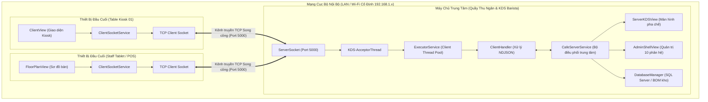
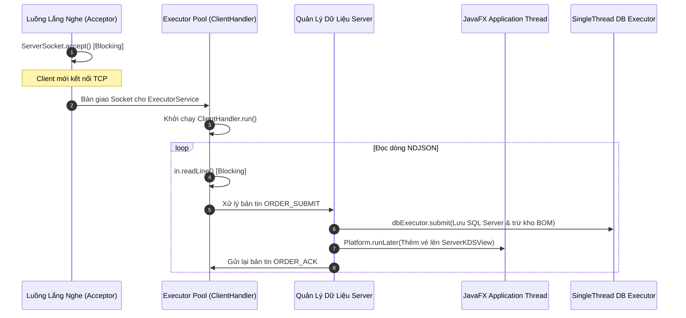
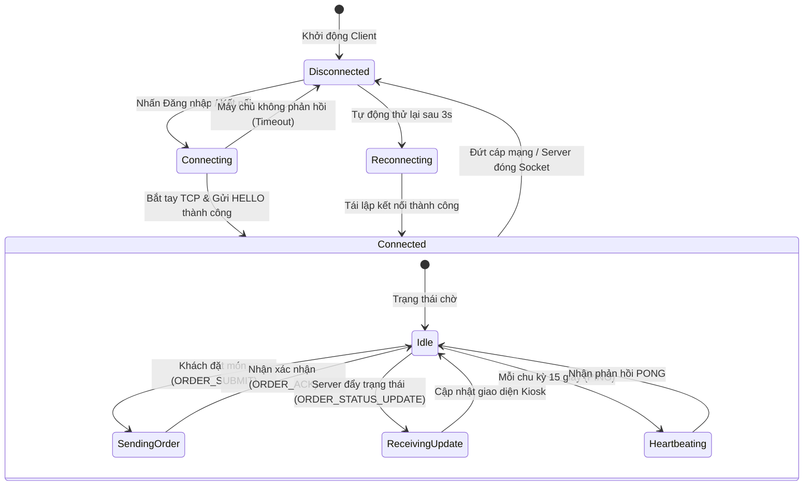

# CHƯƠNG 3. PHÂN TÍCH VÀ THIẾT KẾ HỆ THỐNG

---

## 3.1. PHÂN TÍCH YÊU CẦU

### 3.1.1. Yêu cầu chức năng
Hệ thống gọi món tại bàn và điều phối quầy pha chế giải quyết bài toán giao tiếp hai chiều theo thời gian thực giữa ba nhóm tác nhân: Khách hàng tại bàn (hoặc Kiosk), Nhân viên phục vụ/Thu ngân (Staff POS) và Barista/Bếp (Server KDS).

**Bảng 3.1. Bảng ma trận phân tích yêu cầu chức năng hệ thống**

| Nhóm chức năng | Tác nhân chính | Mô tả luồng nghiệp vụ mạng | Kết quả mong đợi |
| :--- | :--- | :--- | :--- |
| **Báo danh & Khởi tạo phiên** | Client Kiosk / Staff POS | Khi Client khởi động và nhập số bàn (1–25) hoặc đăng nhập tài khoản nhân viên, gửi bản tin `HELLO` chứa định danh thiết bị (`deviceType`), số bàn (`tableNumber`) và ID phiên duy nhất sang Server. | Server xác thực, ghi nhận phiên vào bảng quản lý kết nối và phản hồi bản tin `HELLO_ACK`. |
| **Gọi món & Đặt hàng** | Khách hàng / Nhân viên | Khách chọn món, kích cỡ (Size), định lượng đá/đường, topping và ghi chú. Khi xác nhận thanh toán/đặt đơn, Client đóng gói thành bản tin `ORDER_SUBMIT` gửi qua TCP Stream. | Server tiếp nhận, phân tích, trừ tồn kho nguyên liệu (BOM), lưu cơ sở dữ liệu, đẩy đơn lên màn hình KDS và phản hồi `ORDER_ACK` kèm `orderId`. |
| **Điều phối pha chế (KDS)** | Barista / Quản lý quầy | Barista theo dõi các thẻ đơn hàng theo chuẩn FIFO/SLA. Khi nhấn "Bắt đầu pha chế" hoặc "Hoàn tất", Server cập nhật trạng thái đơn (`QUEUED` $\rightarrow$ `PREPARING` $\rightarrow$ `DONE`). | Server chủ động đẩy bản tin `ORDER_STATUS_UPDATE` về Client đúng số bàn đặt món và phát thông báo `TABLE_STATUS_BROADCAST` cho toàn mạng. |
| **Giám sát sơ đồ bàn** | Thu ngân / Quản lý | Server duy trì trạng thái thời gian thực của 25 bàn (Trống, Đang có khách, Chờ thanh toán, Quá hạn SLA). Hỗ trợ chuyển bàn, gộp bàn. | Mọi thay đổi về bàn được đồng bộ tức thì tới tất cả các máy trạm nhân viên đang kết nối. |
| **Duy trì & Phục hồi kết nối** | Hệ thống (Tự động) | Client gửi tín hiệu `PING` định kỳ mỗi 15 giây. Server kiểm tra và hồi đáp `PONG`. Nếu mất kết nối, Client tự động kích hoạt luồng tái kết nối (Reconnect). | Phát hiện kết nối nửa mở (Half-open connection) dưới 30 giây; không để treo luồng `readLine()`. |

---

### 3.1.2. Yêu cầu phi chức năng về truyền thông mạng
Nhằm đáp ứng môi trường vận hành thực tế tại quán F&B có mật độ thiết bị lớn và mạng Wi-Fi biến động, hệ thống đặt ra các tiêu chuẩn kỹ thuật sau:
- **Độ trễ truyền nhận (Latency):** Thời gian từ khi Client ấn gửi đơn đến khi Server hiển thị trên KDS phải nhỏ hơn $100\text{ ms}$ trong điều kiện mạng LAN cục bộ. Vô hiệu hóa thuật toán Nagle (`setTcpNoDelay(true)`) để các gói tin kích thước nhỏ không bị gom trễ.
- **Tính toàn vẹn dữ liệu (Integrity):** Đảm bảo $100\%$ đơn hàng không bị mất mát, sai lệch số lượng hoặc đảo lộn thứ tự trạng thái bằng cách tận dụng cơ chế ACK và checksum tầng Giao vận của TCP.
- **Khả năng xử lý đồng thời (Concurrency):** Phía Server có khả năng phục vụ tối thiểu 50 kết nối Client đồng thời mà không suy hao hiệu năng nhờ mô hình Thread Pool kết hợp Non-blocking UI Dispatch.
- **Tiêu thụ tài nguyên mạng (Bandwidth Efficiency):** Bản tin JSON được tối giản hóa độ dài thuộc tính (Compact NDJSON), không gửi thẻ HTML hay payload dư thừa, lưu lượng trung bình mỗi bản tin nhỏ hơn $1\text{ KB}$.
- **Tính chịu lỗi và phục hồi (Fault Tolerance):** Khi Server khởi động lại hoặc đứt kết nối mạng nội bộ, Client chuyển sang trạng thái cảnh báo trực quan và tự thử kết nối lại sau mỗi chu kỳ $3\text{ giây}$.

---

## 3.2. KIẾN TRÚC TỔNG THỂ

### 3.2.1. Mô hình Client-Server hai tiến trình
Hệ thống vận hành dưới dạng hai tiến trình Java độc lập chạy trên hai máy tính riêng biệt (hoặc giả lập trên cùng một máy qua Local Loopback `127.0.0.1`):
1. **Tiến trình Server (`ServerMain`):** Đóng vai trò máy chủ trung tâm tại quầy thu ngân/quầy bar. Lắng nghe tại cổng TCP `5000`, quản trị cơ sở dữ liệu SQL Server, điều phối trực tiếp giao diện KDS và bảng điều khiển trung tâm (`AdminShellView`).
2. **Tiến trình Client (`ClientMain`):** Vận hành trên các máy tính bảng đặt tại bàn (Kiosk khách hàng) hoặc máy POS di động của nhân viên (`FloorPlanView`). Client tuyệt đối không chạy server ngầm bên trong, chỉ giao tiếp ra ngoài qua luồng Socket duy nhất.



#### Blueprint đặc tả thiết kế kiến trúc hệ thống
- **Cấu trúc mạng:** Star Topology kết nối qua Access Point 5GHz nội bộ.
- **Cổng dịch vụ chuẩn:** `TCP 5000`.
- **Bộ giải mã bản tin:** `InputStreamReader` (UTF-8) $\rightarrow$ `BufferedReader.readLine()`.
- **Bộ đóng gói bản tin:** `Gson` serializer $\rightarrow$ `PrintWriter.println()`.

#### Prompt tạo hình ảnh minh họa kiến trúc (Image Prompt)
> **Prompt (Dành cho Midjourney / DALL-E 3 / Imagen):**
> ```text
> A detailed 3D isometric architectural infographic diagram representing a smart coffee shop local network (LAN) client-server infrastructure. On the left side, modern wooden cafe tables with sleek digital tablet kiosks displaying an elegant coffee ordering menu with items and prices. Glowing soft cyan data lines flow wirelessly through an enterprise Wi-Fi router to a central cashier bar counter on the right. On the bar counter, a high-end dual-screen POS system displays a modern Kitchen Display System (KDS) and table management floor plan with brand colors deep forest green (#112823) and warm beige (#F5F0E8). Behind the counter, a luxury espresso machine and coffee grinder. Clean minimalist aesthetic, technical cutaway diagram, photorealistic rendering, soft ambient studio lighting, octanerender, 8k resolution, crisp vector accents, no text errors, high tech architectural presentation.
> ```

---

### 3.2.2. Các thành phần chính của Server và Client
Cấu trúc module phần mềm được phân tách mạch lạc theo mô hình phân lớp nhằm bảo đảm nguyên lý đơn trách nhiệm (Single Responsibility Principle):

**Bảng 3.2. Bảng phân định chức năng các lớp thành phần trong hệ thống**

| Phía | Gói (Package) | Lớp (Class) | Vai trò & Cơ chế kỹ thuật |
| :---: | :--- | :--- | :--- |
| **Server** | `cafe.services` | `CafeServerService` | Quản trị vòng đời `ServerSocket`, duy trì danh sách phiên `ClientSession`, điều phối sự kiện đơn hàng và xử lý trừ kho theo định lượng (BOM). |
| **Server** | `cafe.services` | `ClientHandler` | Luồng Runnable đại diện cho một Client kết nối; liên tục đọc dòng NDJSON, giải mã thành đối tượng Message và định tuyến xử lý. |
| **Server** | `cafe.views` | `ServerKDSView` | Giao diện điều phối bếp/bar, hiển thị vé pha chế theo danh mục trạm (Espresso, Trà, Bánh) và thời gian SLA. |
| **Server** | `cafe.views` | `OrderTicketCard` | Thẻ phiếu điều phối hiển thị chi tiết từng món, trạng thái xử lý và các nút hành động đồng bộ Design System. |
| **Client** | `cafe.services` | `ClientSocketService` | Đóng gói đối tượng `java.net.Socket`, quản lý luồng gửi tin đồng bộ, luồng đọc tin nền và phát tín hiệu Heartbeat định kỳ. |
| **Client** | `cafe.views` | `ClientView` | Giao diện thực đơn Kiosk khách hàng, hỗ trợ phân loại danh mục, tìm kiếm và chọn thuộc tính món. |
| **Client** | `cafe.views` | `CartModalDialog` | Hộp thoại giỏ hàng tối giản, quản lý việc áp mã giảm giá, tùy chọn đá/đường và gửi đơn. |
| **Chung** | `cafe.models` | `MessageProtocol` | Định nghĩa toàn bộ cấu trúc dữ liệu bản tin mạng, ánh xạ trực tiếp với chuỗi NDJSON qua thư viện Gson. |

---

## 3.3. THIẾT KẾ GIAO THỨC TẦNG ỨNG DỤNG

### 3.3.1. Quy ước định dạng bản tin
Giao thức ứng dụng được xây dựng trên nền chuẩn **NDJSON (Newline Delimited JSON)**. Mỗi bản tin là một chuỗi JSON chuẩn nén trên một dòng duy nhất, kết thúc bằng ký tự ngắt dòng `\n` (ASCII code `10`).
- **Mã hóa ký tự:** Bắt buộc chuẩn `UTF-8` trên cả hai đầu truyền nhận để bảo toàn trọn vẹn dấu tiếng Việt.
- **Thuộc tính bắt buộc:** Mọi bản tin đều chứa trường định danh `type` (kiểu chuỗi) nằm ở đầu đối tượng giúp bộ phân tích nhận diện nhanh loại bản tin trước khi giải mã phần dữ liệu đặc thù.

$$\text{Cấu trúc dòng truyền:} \quad \texttt{\{"type":"[TÊN\_BẢN\_TIN]", ...payload...\}\textbackslash n}$$

Ưu điểm tuyệt đối của giải pháp này:
1. Triệt tiêu hoàn toàn hiện tượng dính gói của TCP: `BufferedReader.readLine()` ở bên nhận chỉ nhả ra kết quả khi gặp `\n`, bảo đảm trọn vẹn ranh giới bản tin.
2. Dễ dàng gỡ lỗi và giám sát trực tiếp trên các công cụ bắt gói mạng (như Wireshark) mà không cần bộ giải mã nhị phân phức tạp.

---

### 3.3.2. Tập bản tin và chiều truyền

**Bảng 3.3. Danh mục tập bản tin giao thức điều phối gọi món**

| Loại bản tin (`type`) | Chiều truyền | Thuộc tính dữ liệu chính (Payload) | Mục đích nghiệp vụ |
| :--- | :---: | :--- | :--- |
| `HELLO` | Client $\rightarrow$ Server | `tableNumber`, `sessionId`, `deviceType` | Client thông báo danh tính phiên làm việc ngay sau khi kết nối TCP thành công. |
| `HELLO_ACK` | Server $\rightarrow$ Client | `success`, `message`, `assignedTable` | Server xác nhận chấp thuận phiên, gửi kèm số bàn đã được xác thực. |
| `ORDER_SUBMIT` | Client $\rightarrow$ Server | `orderId`, `table`, `items` (List), `totalAmount`, `note`, `orderType` | Client gửi toàn bộ nội dung giỏ hàng để đặt món. |
| `ORDER_ACK` | Server $\rightarrow$ Client | `orderId`, `status`, `prepMinutesEstimate`, `serverTimestamp` | Server xác nhận đã tiếp nhận đơn, chuyển trạng thái đơn sang chờ pha chế. |
| `ORDER_STATUS_UPDATE` | Server $\rightarrow$ Client | `orderId`, `newStatus`, `updatedTime` | Đẩy trạng thái đơn (`PREPARING`, `DONE`) về thiết bị gọi món. |
| `TABLE_STATUS_BROADCAST` | Server $\rightarrow$ Broadcast | `tableNumber`, `status`, `currentTotal`, `activeOrdersCount` | Phát sóng tới toàn bộ nhân viên trạng thái bàn (Đang có khách/Trống). |
| `TABLE_FOCUS_CHANGE` | Client $\rightarrow$ Server | `newTableNumber`, `sessionId` | Nhân viên chuyển màn hình làm việc từ bàn này sang bàn khác. |
| `PING` | Client $\rightarrow$ Server | `timestamp`, `sessionId` | Thăm dò sự sống của kết nối mỗi 15 giây. |
| `PONG` | Server $\rightarrow$ Client | `echoTimestamp`, `serverStatus` | Phản hồi xác nhận Server đang hoạt động tốt. |

#### Minh họa cấu trúc dữ liệu bản tin cụ thể:

*Bản tin Client gửi đặt món (`ORDER_SUBMIT`):*
```json
{
  "type": "ORDER_SUBMIT",
  "orderId": 1022,
  "table": 5,
  "orderType": "DINE_IN",
  "items": [
    {
      "productId": 12,
      "name": "Trà Đào Cam Sả",
      "qty": 2,
      "unitPrice": 45000.0,
      "sizeCode": "L",
      "sugarPercent": 70,
      "icePercent": 100,
      "temperature": "COLD",
      "toppings": [{"name": "Đào miếng", "price": 10000.0}],
      "note": "Ít ngọt một ly"
    },
    {
      "productId": 35,
      "name": "Cheesecake Nướng Basque",
      "qty": 1,
      "unitPrice": 55000.0,
      "sizeCode": "",
      "note": "Phục vụ ngay"
    }
  ],
  "subtotal": 155000.0,
  "discountAmount": 15500.0,
  "voucherCode": "BANMOI10",
  "totalAmount": 139500.0,
  "note": "Khách ngồi khu vực cửa sổ"
}
```

*Bản tin Server phát sóng cập nhật trạng thái (`ORDER_STATUS_UPDATE`):*
```json
{
  "type": "ORDER_STATUS_UPDATE",
  "orderId": 1022,
  "table": 5,
  "newStatus": "PREPARING",
  "updatedTime": "14:32:05"
}
```

---

## 3.4. THIẾT KẾ ĐA LUỒNG VÀ QUẢN LÝ TRẠNG THÁI

### 3.4.1. Phân công luồng phía Server
Server phải bảo đảm không bao giờ để một kết nối mạng làm nghẽn tiến trình quản trị chung. Do đó, mô hình đa luồng phân cấp được thiết kế với bốn tuyến luồng biệt lập:



**Bảng 3.4. Ma trận phân công luồng tại Server**

| Tên luồng / Nhóm luồng | Loại luồng | Cơ chế khởi tạo | Trách nhiệm duy nhất |
| :--- | :--- | :--- | :--- |
| `KDS-AcceptorThread` | Daemon Thread | `new Thread(...)` | Vòng lặp đơn nhận kết nối `serverSocket.accept()`, ngay lập tức bàn giao Socket sang Thread Pool. |
| `Client-Worker-Pool` | Thread Pool | `Executors.newCachedThreadPool()` | Nhận diện từng Client, đọc dòng dữ liệu `readLine()`, giải mã bản tin và duy trì kênh ghi ra `PrintWriter`. |
| `Database-Executor` | Single Thread | `Executors.newSingleThreadExecutor()` | Xếp hàng ghi nhận đơn hàng và cập nhật nguyên vật liệu xuống cơ sở dữ liệu theo tuần tự, tránh tranh chấp khóa bảng. |
| `JavaFX Application Thread` | UI Thread | JVM Platform Thread | Cập nhật trực quan thẻ KDS, sơ đồ bàn và số liệu thống kê doanh thu; chỉ nhận lệnh thông qua `Platform.runLater()`. |

---

### 3.4.2. Phân công luồng phía Client
Tại mỗi thiết bị Client, việc truyền nhận mạng được cách ly hoàn toàn khỏi giao diện người dùng để ngăn chặn hiện tượng khựng/treo ứng dụng (UI Freezing):
1. **Luồng giao diện (`JavaFX Application Thread`):** Xử lý hoạt họa chọn món, lướt danh mục thực đơn, bấm nút trong giỏ hàng. Tuyệt đối không thực hiện bất kỳ lời gọi Socket I/O nào trực tiếp trên luồng này.
2. **Luồng lắng nghe Socket (`Socket-Listener-Thread`):** Chạy nền dưới dạng Daemon, đảm nhiệm vòng lặp `while (running) { in.readLine(); }`. Khi nhận được thông điệp cập nhật đơn hàng hoặc sơ đồ bàn, đóng gói công việc vào một `Runnable` và chuyển vào hàng đợi UI qua `Platform.runLater()`.
3. **Bộ lập lịch Heartbeat (`Heartbeat-Timer`):** Luồng hẹn giờ định kỳ kích hoạt mỗi 15 giây, gửi gói tin `PING` qua luồng ghi của Socket.

---

### 3.4.3. Dữ liệu dùng chung và cách bảo vệ
Trong môi trường nhiều Client cùng đặt món và nhiều nhân viên cùng thao tác bàn, xung đột dữ liệu (Race Condition) rất dễ phát sinh nếu không có chiến lược đồng bộ hóa:
- **Danh sách phiên kết nối (`activeSessions`):** Sử dụng cấu trúc `ConcurrentHashMap<String, ClientSession>` thay vì `HashMap` thông thường để bảo đảm an toàn khi các luồng kết nối và ngắt kết nối đồng thời.
- **Bộ đếm mã đơn hàng (`orderIdCounter`):** Sử dụng `AtomicInteger` để cấp phát định danh đơn hàng đơn điệu tăng mà không cần khối khóa đồng bộ nặng nề.
- **Bảo vệ luồng ghi Socket (`PrintWriter.println`):** Áp dụng từ khóa `synchronized` trên chính đối tượng phiên (`session`) khi ghi dữ liệu. Điều này ngăn chặn triệt để trường hợp hai tác vụ đồng thời (ví dụ: phản hồi đơn hàng và gửi Heartbeat PONG) trộn lẫn các đoạn byte vào cùng một dòng gây vỡ cấu trúc NDJSON.

---

## 3.5. GIAO DIỆN VẬN HÀNH VÀ LUỒNG TƯƠNG TÁC THỰC NGHIỆM

### 3.5.1. Thiết lập kết nối và báo danh phiên (Handshake)
* **Luồng xử lý mạng:** Client khởi tạo Socket tới địa chỉ IP của Server tại cổng 5000. Ngay sau khi bắt tay ba bước TCP hoàn tất, Client gửi gói tin `HELLO`. Server ghi nhận số bàn và định danh phiên, phản hồi `HELLO_ACK`.
* **Giao diện người dùng:** 
  - Tại Client: Màn hình hiển thị đèn tín hiệu màu xanh `🟢 Máy chủ: Sẵn sàng (127.0.0.1:5000)`. Nếu Server chưa bật, hệ thống hiển thị đèn đỏ cảnh báo `🔴 Máy chủ: Chưa kết nối` và chặn không cho phép đăng nhập, loại bỏ lỗi chạy Client đơn lẻ khi không có Server.
  - Tại Server: Thanh nhật ký trạng thái (System Log Bar) ghi nhận sự kiện: `[14:30:12] Client kết nối từ Bàn 05 (Session ID: 4a8f9c12)`.

#### Prompt tạo hình ảnh giao diện đăng nhập (Image Prompt)
> **Prompt (Dành cho Midjourney / DALL-E 3 / Imagen):**
> ```text
> High-resolution professional UI mockup of a desktop cafe POS login screen, brand identity 'Brew & Bean Coffee'. Japanese minimalist coffee shop design aesthetic, warm organic paper beige background (#F5F0E8) and deep evergreen accents (#112823). Centered floating card with rounded corners, subtle drop shadow. Title 'Đăng Nhập Hệ Thống' in luxury serif font Playfair Display. Clean input fields for Table Number and Staff Password with 8px radius. At the top right of the card, a polished status indicator pill showing a bright green dot with Vietnamese text 'Máy chủ: Sẵn sàng (Port 5000)'. A bold solid dark green button with text 'Đăng Nhập'. Modern Figma UI kit presentation, 8k resolution, crisp vector graphics, perfectly balanced white space.
> ```

---

### 3.5.2. Đặt món và phản hồi xác nhận
* **Luồng xử lý mạng:** Khách hàng duyệt thực đơn, chọn tùy biến món và bấm "Tiến hành Thanh toán". Client đóng gói bản tin `ORDER_SUBMIT` gửi qua TCP. Server tiếp nhận, kích hoạt luồng kiểm tra trừ kho tự động, tạo thẻ trên giao diện KDS và gửi bản tin `ORDER_ACK` chứa `orderId: #1022` về Client.
* **Đặc tả giao diện Client (`CartModalDialog` & `OrderSuccessDialog`):**
  - Giỏ hàng thiết kế thoáng đãng, tuân thủ kỷ luật 2 cấp độ chữ: Tên món/Giá dùng `13px Bold (#112823)`, tùy chọn dùng `12px Regular (#4A453E)`.
  - Phiếu thanh toán thành công (`OrderSuccessDialog`) hiển thị mã hóa đơn, chi tiết số bàn và đường viền đứt đoạn phân tách món tương tự phiếu thu F&B cao cấp.

#### Blueprint thẻ giỏ hàng Client (ASCII Blueprint)
```text
┌─────────────────────────────────────────────────────────────┐
│ Giỏ hàng (2 món)                    [Bàn 05]   [✕ Đóng]     │
├─────────────────────────────────────────────────────────────┤
│ ┌─ Món 1 ─────────────────────────────────────────────────┐ │
│ │ [Ảnh]  Trà Đào Cam Sả                       45.000 đ    │ │
│ │        • Size L (+5k)  • 100% Đá  • 70% Đường           │ │
│ │        • Topping: Đào miếng (+10k)                      │ │
│ │        [✎ Đổi tùy chọn]              [ - ]  1  [ + ]   │ │
│ └─────────────────────────────────────────────────────────┘ │
│ ─────────────────────────────────────────────────────────── │
│ ┌─ Món 2 ─────────────────────────────────────────────────┐ │
│ │ [Ảnh]  Cheesecake Nướng Basque              55.000 đ    │ │
│ │        • Món ăn phục vụ trực tiếp                        │ │
│ │                                      [ - ]  1  [ + ]   │ │
│ └─────────────────────────────────────────────────────────┘ │
├─────────────────────────────────────────────────────────────┤
│ Tạm tính (2 món):                               105.000 đ   │
│ Khuyến mãi (BANMOI10):                          -10.500 đ   │
│ THÀNH TIỀN:                                      94.500 đ   │
├─────────────────────────────────────────────────────────────┤
│ [ + Thêm món khác ]       [  Tiến hành Thanh toán →  ]      │
└─────────────────────────────────────────────────────────────┘
```

---

### 3.5.3. Cập nhật tiến độ pha chế thời gian thực (KDS)
* **Luồng xử lý mạng:** Khi Barista tại quầy nhấn nút chuyển trạng thái trên giao diện KDS, Server cập nhật cơ sở dữ liệu và ngay lập tức gửi bản tin `ORDER_STATUS_UPDATE` qua luồng Socket riêng của bàn tương ứng.
* **Đặc tả thiết kế lại thẻ KDS (`OrderTicketCard` - Plan UI 4.5):**
  - **Khắc phục lỗi cắt chữ (`...`):** Header thẻ chia làm 2 tầng tách biệt. Tầng 1 gồm số bàn `[BÀN 05]` và mã đơn `#1022` bên trái, thời gian SLA bên phải. Tầng 2 hiển thị dải trạng thái mềm mại, không bao giờ bị cắt ngắn.
  - **Phân loại thông minh:** Các món bánh ngọt và đồ ăn vặt ẩn hoàn toàn các thuộc tính đá, đường phi logic; chỉ hiển thị tên món và ghi chú bếp (ví dụ: `⚡ Nướng giòn`).
  - **Đồng bộ nút bấm:** Nút hành động sát đáy thẻ sử dụng chung chuẩn màu thương hiệu `#112823` (cao 38px, bo góc 8px, font Inter 13px Bold), loại bỏ hoàn toàn nút xanh lá chói lọi gây rối mắt.

#### Blueprint thẻ vé pha chế KDS (ASCII Blueprint)
```text
┌─────────────────────────────────────────────────────────────┐
│ [BÀN 05]  #1022                             03:25 (3p trước)│
│ ● ĐANG PHA CHẾ (Trạm: Máy Pha Espresso)                     │
├─────────────────────────────────────────────────────────────┤
│ [ 2x ]  Caramel Macchiato                         [Size M]  │
│         • Dùng nóng  • Chuẩn đường                          │
│ ─────────────────────────────────────────────────────────── │
│ [ 1x ]  Croissant Bơ Pháp                                   │
│         ⚡ Ghi chú: Nướng giòn nóng                          │
├─────────────────────────────────────────────────────────────┤
│ [            ✓ Hoàn tất món & Báo phục vụ            ]      │
└─────────────────────────────────────────────────────────────┘
```

#### Prompt tạo hình ảnh màn hình KDS điều phối (Image Prompt)
> **Prompt (Dành cho Midjourney / DALL-E 3 / Imagen):**
> ```text
> A photorealistic, editorial UI screen mockup of a Kitchen Display System (KDS) for a luxury coffee shop named 'Brew & Bean'. Soft warm parchment background (#F5F0E8). A clean top bar with station filters in pill buttons: 'Tất cả các trạm', 'Quầy Máy Pha Espresso', 'Quầy Trà & Đá Xay'. Below, a neat grid of order ticket cards (340px width each) with rounded 10px corners and delicate 1px border. Each ticket displays a clean 2-tier header: table badge 'BÀN 05', order ID '#1022', SLA time tracker, and soft status pill. Inside each ticket, food and drink items are cleanly separated by dashed dividers with solid dark green square quantity badges '[ 2x ]'. Pastries have no drink ice/sugar options. A prominent wide dark evergreen button (#112823) with white text at the bottom reading 'Hoàn tất món & Báo phục vụ'. Professional F&B software interface, 8k resolution, razor sharp typography, Figma dribbble showcase.
> ```

---

### 3.5.4. Duy trì Heartbeat và xử lý ngắt kết nối
* **Luồng xử lý mạng:** 
  1. Mỗi 15 giây, luồng `Heartbeat-Timer` phía Client phát bản tin `PING`. Server bắt gói tin, cập nhật dấu thời gian `lastHeartbeat` của phiên và hồi đáp `PONG`.
  2. Nếu Server đột ngột bị ngắt nguồn hoặc rút dây mạng, cuộc gọi `in.readLine()` ở Client sẽ nhận giá trị `null` hoặc ném `SocketException`.
  3. Client kích hoạt phương thức `handleDisconnect()`, tự động giải phóng socket cũ, hiển thị hộp thoại cảnh báo mất kết nối lên màn hình JavaFX (`Platform.runLater()`) và kích hoạt tiến trình thăm dò tự động kết nối lại mỗi 3 giây mà không làm sập ứng dụng.



---

*Toàn bộ kiến trúc và thiết kế nêu trên đã được hiện thực hóa và kiểm chứng thông qua mã nguồn của dự án, bảo đảm tính khả thi kỹ thuật và đáp ứng toàn diện các tiêu chuẩn đặt ra trong Chương 1 và Chương 2.*
