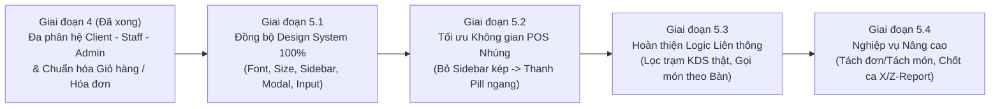

# BÁO CÁO KIỂM TOÁN ĐỒNG BỘ UI/UX (DESIGN SYSTEM AUDIT) & ĐỊNH HƯỚNG PHÁT TRIỂN TIẾP THEO (GIAI ĐOẠN 5) — HỆ THỐNG BREW & BEAN POS

> **Phạm vi kiểm toán:** Toàn bộ 18+ màn hình, các danh mục Sidebar (Client / Staff / Admin), các Tab nhúng (Embedded Views), Thẻ món (`ItemCard`), Thẻ bàn (`TableWithChairsNode`), KDS (`ServerKDSView` / `OrderTicketCard`) và toàn bộ hệ thống Modal/Dialog (`CartModalDialog`, `PaymentDialog`, `OrderSuccessDialog`, `ItemDetailDialog`, `OrdersDialog`, cùng 7 Modal nghiệp vụ trong `FloorPlanView` & `AdminSubViews`).
> **Nguyên tắc thực hiện:** Chỉ phân tích chuyên sâu và lập đặc tả chi tiết vào tài liệu `.md` này — **tuyệt đối không chỉnh sửa bất kỳ dòng code nào**.

---

## PHẦN 1: ĐÁNH GIÁ TỔNG QUAN BẢN CẬP NHẬT HIỆN TẠI (ĐIỂM MẠNH ĐÃ ĐẠT ĐƯỢC)

Sau đợt cập nhật Giai đoạn 4 vừa qua, hệ thống **Brew & Bean** đã có bước lột xác rất lớn cả về chiều sâu nghiệp vụ lẫn thẩm mỹ:
1. **Chuỗi 3 Modal Thanh toán cốt lõi (`CartModalDialog` → `PaymentDialog` → `OrderSuccessDialog`) đã đạt độ đồng bộ ~98%:**
   - Cùng áp dụng kỷ luật **2 cấp độ chữ (`STYLE_BOLD` 13px `#112823` và `STYLE_REGULAR` 12px `#4A453E`)** kết hợp duy nhất tiêu đề chính dùng `Playfair Display` (`20px Bold #112823`).
   - Cùng bo góc khung `16px`, viền `#E2DDD5`, đổ bóng `dropshadow`, có thanh kéo cửa sổ (`WindowChromeHelper.makeDraggable`) và nút đóng `[✕]` tròn góc phải.
2. **Sơ đồ bàn (`FloorPlanView` & `TableWithChairsNode`) trực quan, giàu thông tin:**
   - Bàn có ghế vây quanh theo quy mô (2–4–6–8 ghế), hiển thị rõ SL món + Tổng tiền tạm tính, SLA đổi màu theo thời gian ngồi, và dải 3 nút thao tác nhanh (`[+ Món]`, `[⇄ Chuyển]`, `[⊕ Gộp]`).
3. **10 Phân hệ Quản trị (`AdminShellView` & `AdminSubViews`) đã hoạt động tương tác thực tế:**
   - Đã loại bỏ hoàn toàn các bảng tĩnh chỉ để ngắm: có tìm kiếm, lọc danh mục, bật/tắt trạng thái món/nhân viên/voucher trực tiếp, nhập kho động, thêm món/voucher/nhân viên và xuất CSV.

Tuy nhiên, khi đặt **toàn bộ các trang, các form, các danh mục và chức năng cạnh nhau**, hệ thống hiện đang lộ diện **8 điểm lệch chuẩn về mặt thị giác (Font chữ, Kích thước chữ, Độ đậm, Màu sắc, Bo góc, Kiểu dáng Input/Modal)** và **5 cơ hội nâng cấp luồng nghiệp vụ cho Giai đoạn 5**.

---

## PHẦN 2: KIỂM TOÁN CHI TIẾT SỰ ĐỒNG BỘ VỀ FONT CHỮ, KÍCH THƯỚC, ĐỘ ĐẬM & MÀU SẮC TRÊN TỪNG TRANG / FORM

Dưới đây là bảng đối chiếu thực tế được trích xuất trực tiếp từ mã nguồn hiện tại, chỉ rõ những nơi đang lệch chuẩn giữa các màn hình:

### 2.1. Ma trận kiểm toán Tiêu đề Trang (Page Header Titles)
| Màn hình / Danh mục | File & Dòng code | Font Family | Kích thước (Size) | Độ đậm (Weight) | Màu chữ (Hex) | Đánh giá độ đồng bộ |
| :--- | :--- | :--- | :---: | :---: | :---: | :--- |
| **Login View** (Tiêu đề chào mừng) | `LoginView.java` (dòng 152) | `Playfair Display` | `22px` | `700` | `#1C1917` | Lệch màu (`#1C1917` thay vì `#112823`) và weight (`700` thay vì `800`). |
| **Client Kiosk** (`Thực đơn Hôm nay`) | `ClientView.java` (dòng 195) | `Playfair Display` | `22px` | `700` | `#112823` | Lệch weight (`700` so với `800` của Admin/Staff). |
| **Staff — Tab 1 (Sơ đồ bàn)** | `FloorPlanView.java` (dòng 390) | `Playfair Display` | **`24px`** | `800` | `#112823` | **Lệch cỡ chữ (`24px`)** lớn hơn các tab còn lại trong cùng giao diện Staff (`22px`). |
| **Staff — Tab 4 & 5 (Thu ngân / Cài đặt)** | `FloorPlanView.java` (dòng 804, 980) | `Playfair Display` | `22px` | `800` | `#112823` | **Chuẩn mực (Standard)**. |
| **Admin — Tab 1 (Tổng quan BI)** | `AdminShellView.java` (dòng 383) | `Playfair Display` | **`21px`** | `800` | `#112823` | **Lệch cỡ chữ (`21px`)** so với các Tab 3, 5, 6, 7, 8, 9, 10 (`22px`). |
| **Admin — Tab 2 (Bàn làm việc POS)** | `AdminShellView.java` (dòng 792) | `Playfair Display` | **`18px`** | `800` | `#112823` | **Quá nhỏ (`18px`)** so với tiêu đề các danh mục khác (`22px`). |
| **Admin — Tab 3 & Tab 5 → 10** | `AdminShellView.java` (dòng 844), `AdminSubViews.java` | `Playfair Display` | `22px` | `800` | `#112823` | **Chuẩn mực (Standard)**. |
| **KDS View (Quầy Pha Chế & Admin Tab 4)** | `ServerKDSView.java` (dòng 80), `server.css` (dòng 32) | `Inter` (Viết hoa) | **`16px`** | `800` | `#181614` | **Lệch hoàn toàn**: Không dùng `Playfair Display`, viết IN HOA toàn bộ, cỡ `16px`. |

> **🎯 Giải pháp đồng bộ Tiêu đề Trang:**
> Quy chuẩn hóa 100% Tiêu đề chính của **mọi trang / danh mục** (Client, Staff tất cả các tab, Admin tất cả 10 danh mục, KDS) về đúng **1 công thức duy nhất**:
> `-fx-font-family: 'Playfair Display', serif; -fx-font-size: 22px; -fx-font-weight: 800; -fx-text-fill: #112823;`

---

### 2.2. Sự bất đồng bộ nghiêm trọng ở Thanh Danh Mục Trái (Left Sidebar Navigation)
Hiện tại hệ thống có 3 thanh Sidebar ở 3 phân hệ (`ClientView`, `FloorPlanView`, `AdminShellView`), nhưng **Admin Sidebar đang đi theo một kiểu màu sắc, cỡ chữ và cách đánh số hoàn toàn khác** so với Staff và Client:

| Thuộc tính Sidebar | Client Kiosk (`ClientView.java` dòng 346) | Nhân viên POS (`FloorPlanView.java` dòng 342) | Quản trị Admin (`AdminShellView.java` dòng 293) | Vấn đề bất đồng bộ |
| :--- | :--- | :--- | :--- | :--- |
| **Cách đặt tên mục** | Không đánh số (`Tất cả món`, `Cà phê`...) | Không đánh số (`Bàn`, `Thực đơn`, `Đơn hàng`...) | **Có đánh số thứ tự** (`1. Tổng quan BI` ... `10. Cài đặt`) | Khi đã có Icon minh họa đầu dòng, việc thêm số `1.`, `2.`...`10.` ở Admin làm nhãn bị dài, chật và lệch phong cách với Staff/Client. |
| **Màu nền nút Đang chọn (Active)** | **Xanh đậm `#112823`** | **Xanh đậm `#112823`** | **Beige nhạt `#DED5C8`** | **Lệch hoàn toàn nhận diện Active!** Staff & Client dùng nền xanh đậm chữ trắng nổi bật; Admin lại dùng nền kem nhạt chữ xanh khiến mục đang chọn bị chìm. |
| **Màu chữ & Icon khi Active** | Chữ Trắng `#FFFFFF` | Chữ Trắng `#FFFFFF` | Chữ Xanh `#112823` | Không thống nhất tương phản khi chuyển qua lại giữa Staff và Admin. |
| **Kích thước chữ (Font Size)** | `13.5px` (Weight `800`/`600`) | `13.5px` (Weight `800`/`600`) | **`13px`** (Weight `800`/`600`) | Admin nhỏ hơn `0.5px` so với Staff và Client. |
| **Kích thước Icon đầu dòng** | Khung `26x26px` (Icon `20px`) | Khung `26x26px` (Icon `20px`) | **Khung `24x24px` (Icon `18px`)** | Icon của Admin nhỏ hơn Staff & Client. |
| **Độ bo góc nút (Border Radius)** | `8px` | **`10px`** | `8px` | Staff dùng `10px`, trong khi Client và Admin dùng `8px`. |

> **🎯 Giải pháp đồng bộ Sidebar:**
> 1. Chuyển trạng thái **Active** của `AdminShellView` về nền xanh đậm **`#112823`** + chữ và icon màu trắng **`#FFFFFF`**, bo góc **`8px`**, cỡ chữ **`13.5px`** (Weight `700` khi Active, `600` khi Inactive), khung icon **`26x26px`** — đồng nhất tuyệt đối với `ClientView` và `FloorPlanView`.
> 2. Bỏ tiền tố đánh số `"1. "`, `"2. "`... `"10. "` trên các nút Sidebar của Admin (chỉ giữ tên danh mục súc tích: `Tổng quan BI`, `Gọi món & Bàn`, `Sơ đồ bàn`, `Bếp & Bar (KDS)`, `Thực đơn & Giá`, `Kho & Định lượng`, `Khuyến mãi`, `Nhân sự & Ca`, `Sổ quỹ & Thu chi`, `Cài đặt hệ thống`).

---

### 2.3. Kích thước chữ trên Thẻ Món Ăn (`ItemCard.java`) bị quá nhỏ so với toàn hệ thống
* **Hiện trạng (`ItemCard.java` dòng 93 và 100):**
  - Tên món (`lblName`): `-fx-font-size: 10.5px; -fx-font-weight: 700; -fx-text-fill: #1C1917;`
  - Giá bán (`lblPrice`): `-fx-font-size: 10.5px; -fx-font-weight: 700; -fx-text-fill: #7C4D2B;`
  - Nút `[+ Thêm]` (`btnAdd` dòng 105): `-fx-font-size: 10px;`
* **Vấn đề:**
  - Trong khi toàn bộ chữ nội dung của hệ thống (Giỏ hàng, Hóa đơn, Bảng dữ liệu, Thẻ bàn) đều tuân thủ chuẩn **12px – 13px**, thì chữ Tên món và Giá tiền trên `ItemCard` (nơi khách hàng và thu ngân nhìn vào nhiều nhất!) lại chỉ có **`10.5px`** (và nút Thêm chỉ `10px`).
  - Trên màn hình FullHD (1920x1080) hoặc 1200x760, chữ `10.5px` rất nhỏ, lọt thỏm bên dưới bức ảnh `140px`, gây mỏi mắt khi quét tìm món nhanh.
  - Ngoài ra, màu chữ tên món đang dùng `#1C1917` và màu giá dùng `#7C4D2B` (khác với chuẩn `#112823` và `#563521` đang dùng trong `ItemDetailDialog` và `CartModalDialog`).
* **🎯 Giải pháp đồng bộ `ItemCard`:**
  - Tăng cỡ chữ **Tên món (`lblName`)** lên **`13px` Bold (`700`)**, màu **`#112823`**.
  - Tăng cỡ chữ **Giá tiền (`lblPrice`)** lên **`12.5px` Bold (`700`)**, màu nâu cà phê chuẩn **`#563521`**.
  - Tăng cỡ chữ nút **`[+ Thêm]`** lên **`11.5px` Bold (`700`)**, padding `5 10 5 10`, bo góc `6px`.

---

### 2.4. Sự lệch chuẩn giữa 2 nhóm Modal/Dialog trong hệ thống
Hiện tại dự án đang tồn tại **2 thế hệ Modal hoàn toàn khác nhau về phong cách thiết kế**:

#### Nhóm A — Các Modal Đã Chuẩn Hóa (`CartModalDialog`, `PaymentDialog`, `OrderSuccessDialog`, `ItemDetailDialog`, `OrdersDialog`):
- Khung không viền OS (`StageStyle.TRANSPARENT`), nền trắng `#FFFFFF`, bo góc `16px`, viền `#E2DDD5`, bóng đổ mềm.
- Có thanh Header hỗ trợ kéo thả cửa sổ (`WindowChromeHelper.makeDraggable`) + Nút đóng `[✕]` tròn (`#F5EFEB`) ở góc phải trên cùng.
- Ô nhập liệu (`TextField`) được định dạng phẳng tinh tế: `-fx-background-color: #FFFFFF; -fx-border-color: #E2DDD5; -fx-border-radius: 8px; -fx-padding: 8 12 8 12;`.

#### Nhóm B — 7 Modal Nghiệp Vụ Mới Ở Staff & Admin Đang Bị Lệch Chuẩn:
Bao gồm:
1. `FloorPlanView.showTransferTableModal` (dòng 1046) — Chuyển bàn
2. `FloorPlanView.showMergeTableModal` (dòng 1102) — Gộp bàn
3. `FloorPlanView.showReservationModal` (dòng 1152) — Đặt bàn trước
4. `AdminSubViews.showAddMenuItemModal` (dòng 356) — Thêm món mới
5. `AdminSubViews.showRestockIngredientModal` (dòng 638) — Nhập kho nguyên liệu
6. `AdminSubViews.showCreateVoucherModal` (dòng 816) — Tạo mã khuyến mãi
7. `AdminSubViews.showAddStaffModal` (dòng 985) — Thêm nhân sự mới

**Các lỗi thiếu đồng bộ cụ thể ở 7 Modal Nhóm B:**
- **Lỗi 1 — Ô nhập liệu (`TextField`, `PasswordField`, `ComboBox`) chưa được style (Unstyled Raw Controls):**
  - Trong cả 4 Modal của `AdminSubViews.java` (dòng 364–377, 646–647, 824–832, 993–1005) và trang `Tab 10 - Cài đặt hệ thống` (`AdminSubViews.java` dòng 1248–1252), các ô `new TextField(...)` và `new ComboBox<>()` được khởi tạo **trần (không gắn style CSS)**!
  - Hệ quả: Chúng hiển thị giao diện mặc định cổ điển của JavaFX Modena (nền xám chuyển sắc gradient, bo góc 3px vuông vức, khi click vào hiện viền xanh dương `#0096C9` lạc quẻ hoàn toàn với tông màu Xanh Rừng `#112823` & Kem `#F5F0E8` của quán!).
- **Lỗi 2 — Thiếu nút `[✕]` ở góc trên bên phải và không kéo di chuyển (Drag) được:**
  - Cả 7 Modal Nhóm B đều không có nút `[✕]` đóng nhanh ở góc phải tiêu đề và chưa gắn `WindowChromeHelper.makeDraggable(dialog, header)`.
- **Lỗi 3 — Độ bo góc và kích thước tiêu đề không thống nhất:**
  - Modal Nhóm A bo góc `16px`, tiêu đề `Playfair Display 20px Bold #112823`.
  - Modal Nhóm B lại bo góc `14px`, tiêu đề có chỗ `19px` (`AdminSubViews`), có chỗ `20px` (`FloorPlanView`).
- **Lỗi 4 — Chưa có hiệu ứng mở hộp thoại (`AnimationHelper.playDialogEntrance(root)`):**
  - Các Modal Nhóm A mở lên rất mượt nhờ `AnimationHelper.playDialogEntrance(root)`, trong khi 7 Modal Nhóm B bật lên đột ngột.

> **🎯 Giải pháp đồng bộ hệ thống Modal & Input Controls:**
> Tạo một hàm tiện ích dùng chung (hoặc chuẩn hóa trong `WindowChromeHelper` / `AdminSubViews`) để:
> - Mọi `TextField`, `PasswordField`, `ComboBox` trong Admin & Staff đều mang chuẩn style:
>   `-fx-background-color: #FAF8F5; -fx-border-color: #E2DDD5; -fx-border-radius: 8px; -fx-background-radius: 8px; -fx-padding: 8 12 8 12; -fx-font-family: 'Inter', sans-serif; -fx-font-size: 13px; -fx-text-fill: #112823;`
> - Mọi Modal trong `FloorPlanView` và `AdminSubViews` đều có Header chuẩn (`Playfair Display 20px Bold #112823` + nút đóng `[✕]` tròn góc phải + kéo thả cửa sổ + `AnimationHelper.playDialogEntrance`).

---

### 2.5. Sự phân mảnh màu nền (Background Canvas) & Độ bo góc Thẻ (Card Border Radius)
1. **Màu nền vùng làm việc chính (Main Content Background):**
   - `ClientView`, `AdminShellView`, `FloorPlanView (Tab 1)` dùng nền kem ấm **`#F5F0E8`**.
   - Nhưng `FloorPlanView (Tab 3 - OrdersDialog nhúng, dòng 99)`, `Tab 4 (Thu ngân, dòng 793)`, `Tab 5 (Cài đặt, dòng 976)` lại dùng **`#F4EFE6`**.
   - Trong khi đó, `ServerKDSView` (`server.css` dòng 14) lại dùng **`#F4F1EA`**.
   - *Giải pháp:* Thống nhất 1 mã màu nền Canvas duy nhất là **`#F5F0E8`** trên toàn bộ các tab.
2. **Độ bo góc của các Thẻ (Card Radius) bị lệch ở màn hình KDS:**
   - Toàn bộ thẻ KPI, thẻ Bàn, thẻ Món, bảng dữ liệu ở Client/Staff/Admin đều bo góc mềm mại **`10px – 12px`**.
   - Riêng màn hình KDS (`server.css` dòng 129 `.ticket-card`) đang bo góc cứng **`4px`** và các nút lọc `.kds-filter-btn` cũng bo góc `4px`. Khi nhúng `ServerKDSView` vào **Tab 4 của Admin**, các thẻ `4px` vuông sắc cạnh nằm ngay bên dưới thanh bộ lọc trạm bo tròn `999px` của Admin tạo cảm giác như 2 phần mềm khác nhau ghép lại.
   - *Giải pháp:* Nâng `border-radius` của `.ticket-card` trong KDS lên **`10px`** và nút lọc `.kds-filter-btn` lên **`8px`**, đồng thời đổi tiêu đề `.kds-brand-title` sang `Playfair Display 22px Bold #112823`.

---

### 2.6. Sự thiếu đồng bộ của Thông báo nổi (Toast Notification) ở 3 phân hệ
Cùng một chức năng hiển thị thông báo nhanh (Toast), nhưng 3 màn hình đang đặt ở 3 vị trí và 3 kiểu dáng khác nhau:
- **Admin (`AdminShellView.java` dòng 118–136):** Hiện ở **Góc trên bên phải (`Pos.TOP_RIGHT`)**, bo góc `10px`, có viền vàng đồng `#C89B3C`, có icon tích xanh `✓`, cỡ chữ `12.5px`.
- **Staff (`FloorPlanView.java` dòng 153–160):** Hiện ở **Chính giữa bên dưới (`Pos.BOTTOM_CENTER`)**, bo tròn viên thuốc `999px`, không viền, không icon, cỡ chữ `13px`.
- **Client (`ClientView.java` dòng 79–88):** Hiện ở **Bên dưới (`setBottom`)**, bo góc `6px`, cỡ chữ `11.5px`.

> **🎯 Giải pháp đồng bộ Toast Notification:**
> Đồng nhất cả 3 phân hệ về **1 kiểu Toast duy nhất** (khuyên dùng kiểu sang trọng của Admin hoặc Bottom-Right/Top-Right đồng nhất: nền `#112823`, viền mảnh vàng đồng `#C89B3C`, bo góc `10px`, có icon `✓` xanh ngọc, cỡ chữ `12.5px Bold #FFFFFF`) để trải nghiệm xuyên suốt từ Kiosk → Thu ngân → Quản trị.

---

## PHẦN 3: BẢNG QUY CHUẨN DESIGN TOKENS ĐỀ XUẤT (CHUẨN HÓA 100% TOÀN HỆ THỐNG)

Để dự án đạt độ hoàn thiện 100% như một sản phẩm thương mại cao cấp, dưới đây là **Bộ Quy Chuẩn Đồng Bộ Hóa (Unified Design Tokens)** áp dụng cho mọi trang và form:

### 3.1. Hệ thống Phông chữ & Phân cấp Kích thước (Typography Scale)
| Cấp độ chữ | Mục đích sử dụng | Font Family | Font Size | Font Weight | Màu sắc chuẩn |
| :--- | :--- | :--- | :---: | :---: | :--- |
| **Display / Page Title** | Tiêu đề chính của mọi Trang / Tab | `Playfair Display`, serif | **`22px`** | **`800` (ExtraBold)** | `#112823` (Xanh rừng đậm) |
| **Modal / Brand Title** | Tiêu đề chính của mọi Modal / Tên quán trên Bill | `Playfair Display`, serif | **`20px`** | **`800` (ExtraBold)** | `#112823` |
| **Section / Card Title** | Tiêu đề khối bảng, Tiêu đề khu vực, Số bàn lớn | `Inter`, sans-serif | **`15px`** | **`800` (ExtraBold)** | `#112823` |
| **Primary Body / Bold** | Tên món (trên Card, Giỏ, Bill, Bảng), Nút chính, Giá | `Inter`, sans-serif | **`13px`** | **`700` (Bold)** | `#112823` (hoặc `#FFFFFF` trên nền tối) |
| **Secondary Body / Regular** | Mô tả phụ, Tùy chọn Đường/Đá/Size, Ngày giờ, Địa chỉ | `Inter`, sans-serif | **`12px`** | **`400` / `500`** | `#4A453E` (Xám nâu ấm) |
| **Muted / Table Header** | Tiêu đề cột bảng (`MÃ ĐƠN`, `TRẠNG THÁI`...), Caption | `Inter`, sans-serif | **`11.5px`** | **`700` (Bold)** | `#6E675F` |
| **Badge / Pill Micro** | Nhãn trạng thái nhỏ (`ĐANG CHỜ`, `VIP`, `BÀN 05`) | `Inter`, sans-serif | **`11px`** | **`700` (Bold)** | Theo màu ngữ nghĩa (Semantic) |

### 3.2. Hệ thống Bảng màu chuẩn (Color Palette)
- **Màu thương hiệu chính (Brand Primary / Active / CTA):** `#112823` (Deep Evergreen)
- **Màu nhấn điểm xuyết (Accent Gold / Brown):** `#C89B3C` (Vàng đồng) & `#563521` (Nâu Espresso cho giá tiền/badge phụ)
- **Màu nền vùng làm việc (Workspace Canvas):** `#F5F0E8` (Kem ấm đồng nhất mọi màn hình)
- **Màu nền Thanh điều hướng (Sidebar Surface):** `#EDE6DB` (Beige đậm hơn nền chính 1 tông, viền phải `#DFD7CA`)
- **Màu nền Thẻ & Hộp thoại (Card / Modal Surface):** `#FFFFFF` (Trắng tinh) và `#FBF9F5` (Trắng ngà cho dòng phụ/phiếu thu), viền `#E2DDD5`
- **4 Màu ngữ nghĩa (Semantic Status Colors):**
  - *Thành công / Sẵn sàng / Đã thanh toán:* Chữ `#1B5E20` trên nền `#E8F5E9`
  - *Đang phục vụ / Đang pha chế:* Chữ `#1D4ED8` trên nền `#EFF6FF`
  - *Cảnh báo / Chờ xử lý / Sắp hết hàng:* Chữ `#B45309` trên nền `#FEF3C7`
  - *Nguy hiểm / Quá hạn SLA / Hết hàng / Xóa:* Chữ `#B91C1C` trên nền `#FEE2E2`

---

## PHẦN 4: HƯỚNG PHÁT TRIỂN TIẾP THEO CHO DỰ ÁN (LỘ TRÌNH GIAI ĐOẠN 5)

Bên cạnh việc **Đồng bộ hóa tuyệt đối UI/UX & Typography** nêu ở Phần 2 & Phần 3, dưới đây là **6 hạng mục nâng cấp đắt giá nhất** về bố cục không gian và chiều sâu nghiệp vụ cho **Giai đoạn 5 (Hoàn thiện Thực chiến & Nâng tầm Sản phẩm)**:

### Hạng mục 5.1: Giải quyết triệt để bài toán "Hai Thanh Sidebar Đứng Cạnh Nhau" (Double Vertical Sidebar) khi nhúng Thực đơn vào Staff & Admin
* **Vấn đề hiện tại:**
  - Khi Nhân viên mở tab **`Thực đơn`** (`FloorPlanView.java` dòng 778) hoặc Admin mở danh mục **`2. Gọi món & Bàn`** (`AdminShellView.java` dòng 804), hệ thống đang nhúng nguyên `ClientView(true)` vào vùng trung tâm.
  - Vì bản thân `ClientView` đã có một thanh **Sidebar danh mục dọc rộng `190px` ở bên trái**, nên khi đặt cạnh thanh **Sidebar của Staff/Admin rộng `220px–235px`**, màn hình xuất hiện **2 cột Sidebar dọc nằm sát nhau**, chiếm mất **`425px` chiều ngang**! Hệ quả là vùng lưới thẻ món ăn bị ép hẹp lại, nhìn rất chật chội.
* **Giải pháp kiến trúc UI (Giai đoạn 5):**
  - Khi `ClientView` được khởi tạo ở chế độ nhúng (`embedded == true`), **tự động ẩn cột Sidebar dọc `190px` bên trái của `ClientView`** và chuyển danh sách danh mục (`Tất cả món`, `Cà phê`, `Trà trái cây`, `Đá xay`, `Bánh ngọt`...) thành một **Thanh Pill Ngang (Horizontal Category Bar)** nằm ngay dưới thanh Tìm kiếm!
  - **Lợi ích:** Giải phóng ngay lập tức `190px` chiều ngang cho lưới sản phẩm, giúp hiển thị thêm được 1–2 cột thẻ món trên mỗi hàng và loại bỏ hoàn toàn sự trùng lặp thị giác giữa 2 thanh menu dọc.

### Hạng mục 5.2: Kết nối Logic thật cho Bộ lọc Trạm KDS (Admin Tab 4) & Chọn bàn nhanh ở Admin POS (Tab 2)
* **Vấn đề hiện tại:**
  1. Ở **Admin Tab 4 (`Bếp & Bar KDS` — `AdminShellView.java` dòng 1018–1036)**: Thanh chọn trạm (`Tất cả trạm KDS`, `☕ Quầy Máy Pha Espresso`, `🍹 Quầy Trà & Đá Xay`, `🥐 Tủ Bánh Ngọt & Đồ Ăn Nhẹ`) hiện mới chỉ hiển thị thông báo Toast chứ **chưa thực sự lọc các thẻ đơn hàng (`OrderTicketCard`)** bên trong `ServerKDSView` theo danh mục món của trạm đó.
  2. Ở **Admin Tab 2 (`Gọi món & Bàn` — `AdminShellView.java` dòng 812–818)**: Công thức cắt chuỗi lấy số bàn `val.replaceAll("[^0-9]", "")` khi gặp chuỗi `"Tầng 1 - Bàn 05"` sẽ ghép số tầng `1` và số bàn `05` thành `"105"`, sau đó `substring(1)` ra `"05"` (tình cờ đúng với tầng 1-9), nhưng nếu thêm khu vực không có số (VD: `"Sân vườn - Bàn 08"`) thì `digits` là `"08"` và `substring(1)` sẽ làm mất số đầu hoặc gây lệch bàn.
* **Hướng phát triển:**
  - Bổ sung bộ lọc trạm thực sự vào `ServerKDSController`: khi chọn `☕ Quầy Máy Pha Espresso`, KDS chỉ lọc các đơn có chứa món thuộc nhóm `Cà phê`; khi chọn `🥐 Tủ Bánh Ngọt`, chỉ lọc đơn có `Bánh ngọt` / `Món ăn nhẹ`.
  - Chuẩn hóa cách lấy số bàn từ `ComboBox` bằng biểu thức chính quy chính xác (`Bàn\\s+(\\d+)`) để không bao giờ bị lấy nhầm số tầng.

### Hạng mục 5.3: Hoàn thiện đồng bộ ảnh và thông tin ở các điểm chạm nhỏ (Micro-Polish)
1. **Chân trang màn hình Đăng nhập (`LoginView.java` dòng 279):**
   - Đang hiển thị `"Brew & Bean © 2025 — Hệ thống Quản lý Quán Cà Phê"`. Cần cập nhật lên **`2026`** để đồng bộ với các báo cáo BI và phiếu thu trong hệ thống.
2. **Nút Đăng nhập nhanh (Demo Quick-Fill) trên `LoginView` (`LoginView.java` dòng 234–265):**
   - Hiện có 2 nút `[Quản lý (Admin)]` và `[Thu ngân (Staff)]`. Có thể tinh chỉnh lại style thành dạng Segmented Pill đồng bộ với thiết kế phẳng của `CartModalDialog` và thêm tùy chọn mở nhanh chế độ `[Kiosk Khách hàng]` ngay trên cùng một mặt phẳng dễ nhìn.
3. **Hiển thị Ảnh đại diện món (Thumbnail) trong Bảng Thực đơn Admin (`AdminSubViews.java` — Tab 5):**
   - Hiện tại bảng Quản lý Thực đơn ở Admin Tab 5 chỉ hiển thị chữ (`Mã`, `Tên món`, `Danh mục`, `Giá bán`, `Giá vốn`...).
   - Việc bổ sung **cột Ảnh thu nhỏ (`36x48px`, `PreserveRatio = true`)** ngay trước cột Tên món trong bảng Admin sẽ giúp Quản lý nhận diện trực quan món nào đã có ảnh đẹp, món nào đang dùng ảnh mặc định, đồng thời cho phép chọn/đổi đường dẫn ảnh (`imagePath`) khi thêm hoặc sửa món.

### Hạng mục 5.4: Bổ sung tính năng "Sửa Món Đã Tạo" (Edit MenuItem) & "Biên Tập Công Thức Định Lượng (BOM)" ở Admin
* **Hiện trạng:**
  - Ở **Tab 5 (Thực đơn & Giá)**: Đã có nút `[+ Thêm món mới]` và nút bật/tắt trạng thái `[Đang bán / Tạm ngưng]`, nhưng chưa có nút **`[✎ Sửa giá / Sửa tên]`** cho từng món đang có.
  - Ở **Tab 6 (Kho & Định lượng)**: Đã có tính năng trừ kho tự động theo công thức (BOM) khi thanh toán, nhưng Quản lý chưa có giao diện xem/chỉnh sửa xem 1 ly *Cà phê Sữa Đá* tiêu hao bao nhiêu gram hạt, bao nhiêu ml sữa đặc.
* **Hướng phát triển:**
  - Thêm nút `[✎ Sửa]` trên từng dòng món ở Tab 5 (mở lại `showAddMenuItemModal` ở chế độ Edit giống như cách `ItemDetailDialog` hỗ trợ Edit Mode trong giỏ hàng).
  - Thêm nút `[📋 Định lượng BOM]` ở Tab 6 để hiển thị bảng quy đổi nguyên liệu tiêu hao cho từng món.

### Hạng mục 5.5: Nâng cấp Nghiệp vụ Thu ngân — "Tách Bàn / Tách Hóa Đơn" (Split Bill) & "In Phiếu Tạm Tính Chuẩn"
* **Hiện trạng:**
  - Nhân viên đã có thể **Chuyển bàn (`[⇄ Chuyển]`)** và **Gộp bàn (`[⊕ Gộp]`)**.
  - Tuy nhiên trong thực tế quán cà phê, một nhóm khách ngồi chung bàn (VD: Bàn 104 có 6 món) thường yêu cầu **thanh toán riêng từng người (Tách hóa đơn)** khi ra về.
* **Hướng phát triển:**
  - Bổ sung tính năng **`[✂ Tách đơn]`** trong bảng chi tiết bàn: cho phép thu ngân tích chọn một số món từ Bàn A để tách sang một hóa đơn thanh toán riêng hoặc chuyển sang Bàn B.

### Hạng mục 5.6: Báo cáo Chốt Ca Cuối Ngày (Z-Report Receipt) theo chuẩn Phiếu Thanh Toán F&B
* **Hiện trạng:**
  - Ở **Staff Tab 5 (`Cài đặt & Kết ca`)**, khi nhân viên nhập tiền mặt thực đếm và bấm `[Chốt ca & Bàn giao]`, hệ thống mới chỉ hiện một dòng thông báo Toast.
* **Hướng phát triển:**
  - Khi bấm `[Chốt ca & Bàn giao]`, hệ thống bật lên một **Phiếu Tổng Kết Ca (Z-Report Modal)** được thiết kế trên nền giấy ngà `#FBF9F5` đồng bộ 100% với `OrderSuccessDialog` (gồm: Giờ mở ca, Giờ đóng ca, Thu ngân, Tổng số đơn thành công, Doanh thu Tiền mặt, Doanh thu VietQR, Tiền mặt đầu ca, Tiền mặt lý thuyết, Tiền thực đếm, Chênh lệch Thừa/Thiếu và nút `[🖨 Xuất biên bản bàn giao ca]`).

---

## PHẦN 5: TỔNG HỢP DANH SÁCH ƯU TIÊN TRIỂN KHAI (CHECKLIST ĐỒNG BỘ & NÂNG CẤP)

Nếu bạn đồng ý tiến hành bước tiếp theo, chúng ta có thể thực hiện theo **2 giai đoạn gọn gàng, an toàn**:

### Bước 1 — Đồng bộ hóa 100% Giao diện, Font chữ, Kích thước & Màu sắc (UI Synchronization Pass):
1. **Đồng bộ Sidebar Admin (`AdminShellView.java`):** Đổi trạng thái Active từ `#DED5C8` sang `#112823` (chữ trắng `#FFFFFF`, cỡ chữ `13.5px`, icon `20px`), bỏ đánh số `1.`..`10.` để thống nhất tuyệt đối với `FloorPlanView` và `ClientView`.
2. **Đồng bộ Tiêu đề Trang (`Playfair Display 22px Bold 800 #112823`):** Chuẩn hóa lại các tiêu đề đang lệch size ở `FloorPlanView` (`24px` → `22px`), `AdminShellView` Tab 1 (`21px` → `22px`), Tab 2 (`18px` → `22px`), `ClientView` & `LoginView` (`weight 700` → `800`, `#1C1917` → `#112823`), và `ServerKDSView` (`.kds-brand-title`).
3. **Đồng bộ cỡ chữ Thẻ món (`ItemCard.java`):** Nâng cỡ chữ tên món từ `10.5px` lên `13px Bold #112823`, giá tiền lên `12.5px Bold #563521`, nút `[+ Thêm]` lên `11.5px Bold`.
4. **Đồng bộ 7 Modal của Staff & Admin (`FloorPlanView.java` & `AdminSubViews.java`):**
   - Áp dụng style phẳng chuẩn (`#FAF8F5`, viền `#E2DDD5`, bo góc `8px`, padding `8 12`) cho toàn bộ `TextField`, `PasswordField`, `ComboBox` đang bị để mặc định JavaFX.
   - Bổ sung nút đóng `[✕]` góc phải trên, thanh kéo cửa sổ (`WindowChromeHelper.makeDraggable`), bo góc `16px` và hiệu ứng mở (`AnimationHelper.playDialogEntrance`).
5. **Đồng bộ màu nền Canvas (`#F5F0E8`), bo góc thẻ KDS (`10px`) và kiểu dáng Toast Notification** trên cả 3 phân hệ.

### Bước 2 — Tối ưu Không gian & Hoàn thiện Nghiệp vụ Giai đoạn 5 (Functional Upgrade Pass):
1. **Chuyển Sidebar danh mục của `ClientView` thành Thanh Pill Ngang** khi nhúng vào Staff (Tab 2) và Admin (Tab 2) để xóa bỏ tình trạng 2 thanh Sidebar dọc đứng cạnh nhau.
2. **Kích hoạt bộ lọc Trạm KDS thực tế** ở Admin Tab 4 (lọc đơn theo trạm Máy pha Espresso / Quầy Trà & Đá xay / Tủ Bánh ngọt).
3. **Bổ sung cột Ảnh món thu nhỏ & nút `[✎ Sửa món]`** trong bảng Thực đơn Admin (Tab 5).
4. **Bổ sung Phiếu Biên Bản Bàn Giao Ca (Z-Report Dialog)** khi nhân viên bấm chốt ca cuối ngày.
