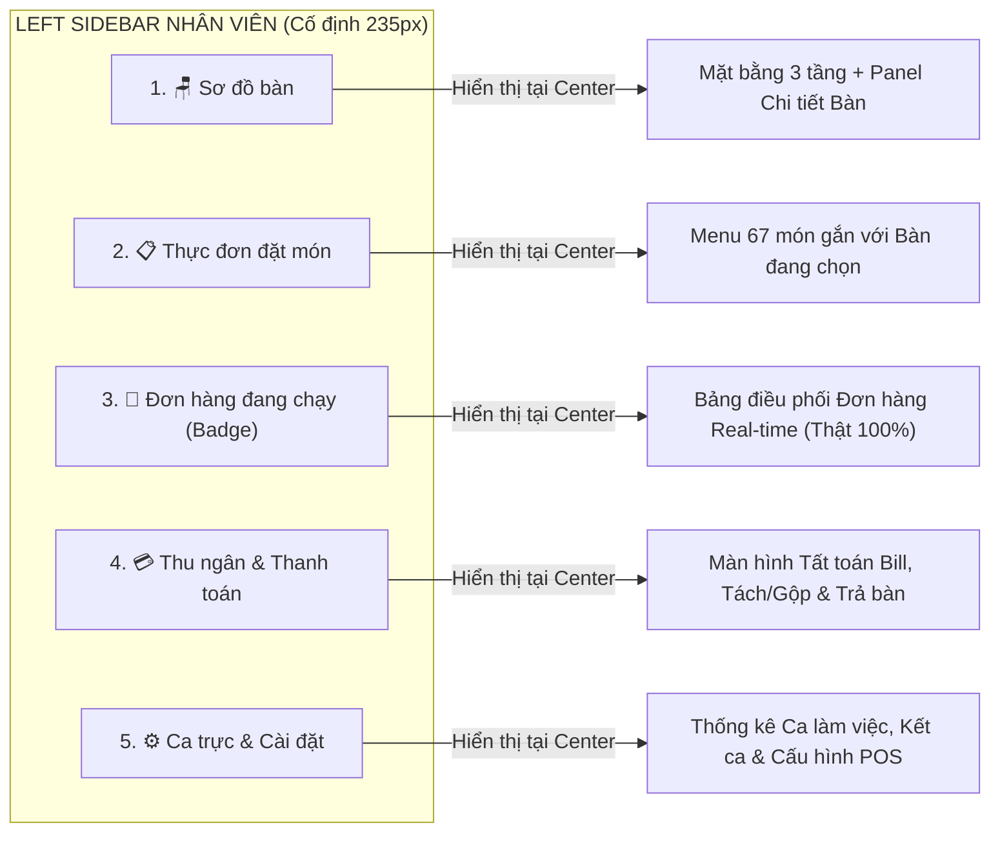

# KẾ HOẠCH NÂNG CẤP HỆ THỐNG GIAI ĐOẠN 4: TOÀN DIỆN UI/UX, LOGIC, LUỒNG NGHIỆP VỤ & CSDL (PHÂN HỆ NHÂN VIÊN & ADMIN)

**Hệ thống:** CafeOrder (Brew & Bean CoffeePOS)  
**Phạm vi:** Phân hệ Nhân viên (`FloorPlanView`, `OrdersDialog`, `ClientView`) & Phân hệ Quản trị (`AdminShellView`, `ServerKDSView`, `DatabaseManager`)  
**Trạng thái:** Tài liệu Phân tích Kiến trúc & Đặc tả Kỹ thuật (Không can thiệp code)

---

## MỤC LỤC
1. [Chẩn đoán Hiện trạng & Các "Điểm Đứt Gãy" Phát hiện từ Mã nguồn](#1-chẩn-đoán-hiện-trạng--các-điểm-đứt-gãy-phát-hiện-từ-mã-nguồn)
2. [PHẦN I: Nâng cấp Toàn diện Phân hệ Nhân viên (Staff POS)](#2-phần-i-nâng-cấp-toàn-diện-phân-hệ-nhân-viên-staff-pos)
   - [1.1. Đồng bộ Danh mục Sidebar & Chuẩn hóa Luồng Điều hướng](#11-đồng-bộ-danh-mục-sidebar--chuẩn-hóa-luồng-điều-hướng)
   - [1.2. Đại tu UI/UX Sơ đồ bàn (Floor Plan 2.5D & Right Inspector)](#12-đại-tu-uiux-sơ-đồ-bàn-floor-plan-25d--right-inspector)
   - [1.3. Bổ sung Các Tính năng Nghiệp vụ Cốt lõi cho Nhân viên](#13-bổ-sung-các-tính-năng-nghiệp-vụ-cốt-lõi-cho-nhân-viên)
   - [1.4. Kiểm toán & Khép kín Toàn bộ Luồng Logic Nhân viên](#14-kiểm-toán--khép-kín-toàn-bộ-luồng-logic-nhân-viên)
3. [PHẦN II: Nâng cấp Toàn diện Phân hệ Quản trị (Admin POS & Executive Dashboard)](#3-phần-ii-nâng-cấp-toàn-diện-phân-hệ-quản-trị-admin-pos--executive-dashboard)
   - [2.1. Đồng bộ CSDL SQL Server & Xây dựng Dữ liệu Mẫu Chân thật (Realistic Seed Data)](#21-đồng-bộ-csdl-sql-server--xây-dựng-dữ-liệu-mẫu-chân-thật-realistic-seed-data)
   - [2.2. Đồng bộ Logic & Luồng Tương tác Đa chiều (Interactive Drill-down) ở Dashboard](#22-đồng-bộ-logic--luồng-tương-tác-đa-chiều-interactive-drill-down-ở-dashboard)
   - [2.3. Nghiên cứu & Tái cấu trúc Danh mục Sidebar của Admin](#23-nghiên-cứu--tái-cấu-trúc-danh-mục-sidebar-của-admin)
   - [2.4. Kiểm toán Chi tiết Nội dung, UI & Logic của Từng Danh mục Admin (Tab 1 → Tab 10)](#24-kiểm-toán-chi-tiết-nội-dung-ui--logic-của-từng-danh-mục-admin-tab-1--tab-10)
4. [PHẦN III: Đề xuất Mở rộng Đột phá từ Góc nhìn Chuyên gia F&B](#4-phần-iii-đề-xuất-mở-rồng-đột-phá-từ-góc-nhìn-chuyên-gia-fb)
5. [PHẦN IV: Lộ trình Triển khai Đề xuất (Step-by-Step Roadmap)](#5-phần-iv-lộ-trình-triển-khai-đề-xuất-step-by-step-roadmap)

---

## 1. CHẨN ĐOÁN HIỆN TRẠNG & CÁC "ĐIỂM ĐỨT GÃY" PHÁT HIỆN TỪ MÃ NGUỒN

Qua quá trình rà soát trực tiếp toàn bộ mã nguồn hiện tại ([`FloorPlanView.java`](file:///c:/Users/ACER/Documents/NetBeansProjects/CafeOrder/src/cafe/views/FloorPlanView.java), [`TableWithChairsNode.java`](file:///c:/Users/ACER/Documents/NetBeansProjects/CafeOrder/src/cafe/views/TableWithChairsNode.java), [`OrdersDialog.java`](file:///c:/Users/ACER/Documents/NetBeansProjects/CafeOrder/src/cafe/views/OrdersDialog.java), [`AdminShellView.java`](file:///c:/Users/ACER/Documents/NetBeansProjects/CafeOrder/src/cafe/views/AdminShellView.java), [`DatabaseManager.java`](file:///c:/Users/ACER/Documents/NetBeansProjects/CafeOrder/src/cafe/services/DatabaseManager.java)), hệ thống đang có nền tảng thẩm mỹ rất tốt nhưng tồn tại **14 điểm đứt gãy về logic và trải nghiệm** cần được giải quyết triệt để ở Giai đoạn 4:

| STT | Phân hệ | Vị trí file / Dòng code | Phát hiện thực tế trong mã nguồn | Mức độ |
| :-: | :--- | :--- | :--- | :-: |
| 1 | **Nhân viên** | [`FloorPlanView.java#L135`](file:///c:/Users/ACER/Documents/NetBeansProjects/CafeOrder/src/cafe/views/FloorPlanView.java#L135) | Nút **Thanh toán** trên Sidebar lại gọi `onNavigateToMenu.run()` (bấm Thanh toán lại nhảy sang Thực đơn gọi món). | 🔴 Nghiêm trọng |
| 2 | **Nhân viên** | [`FloorPlanView.java#L141`](file:///c:/Users/ACER/Documents/NetBeansProjects/CafeOrder/src/cafe/views/FloorPlanView.java#L141) | Nút **Cài đặt** trên Sidebar hoàn toàn rỗng, không gắn `setOnAction`. Bấm vào không có phản hồi. | 🟠 Cao |
| 3 | **Nhân viên** | [`FloorPlanView.java#L304-L308`](file:///c:/Users/ACER/Documents/NetBeansProjects/CafeOrder/src/cafe/views/FloorPlanView.java#L304-L308) | Nút **Chuyển bàn** và **Gộp bàn** chỉ chạy hiệu ứng nhún nút (`applyButtonPress`), chưa có hộp thoại và logic xử lý. | 🔴 Nghiêm trọng |
| 4 | **Nhân viên** | [`FloorPlanView.java#L447-L453`](file:///c:/Users/ACER/Documents/NetBeansProjects/CafeOrder/src/cafe/views/FloorPlanView.java#L447-L453) | Mặt bằng Tầng 1 bị **lặp 2 lần nhãn bàn `"09"`** (bàn ID 6 bị truyền nhầm text `"09"`), đồng thời bị **thiếu mất Bàn 04 và Bàn 06**. | 🟠 Cao |
| 5 | **Nhân viên** | [`TableWithChairsNode.java#L180`](file:///c:/Users/ACER/Documents/NetBeansProjects/CafeOrder/src/cafe/views/TableWithChairsNode.java#L180) | Biến `isDark = currentSelected \|\| "SERVING"...` khiến bất kỳ **bàn trống** nào khi được click chọn cũng biến thành màu xanh đen + chấm cam y hệt bàn đang có khách. | 🔴 Nghiêm trọng |
| 6 | **Nhân viên** | [`OrdersDialog.java#L165-L176`](file:///c:/Users/ACER/Documents/NetBeansProjects/CafeOrder/src/cafe/views/OrdersDialog.java#L165-L176) | Danh sách đơn hàng đang hiển thị **7 đơn giả cố định (hardcoded)**, không lấy đơn thực tế từ Server/DB, nút In & Hủy chưa có sự kiện. | 🔴 Nghiêm trọng |
| 7 | **Nhân viên** | Vòng đời bàn | Khi khách ăn xong và thanh toán, **không có nút "Dọn bàn / Trả bàn trống"**, khiến bàn bị treo ở trạng thái `Đang phục vụ` mãi mãi. | 🔴 Nghiêm trọng |
| 8 | **Admin** | [`AdminShellView.java#L445-L470`](file:///c:/Users/ACER/Documents/NetBeansProjects/CafeOrder/src/cafe/views/AdminShellView.java#L445-L470) | Biểu đồ doanh thu trên Dashboard dùng mảng chiều cao tĩnh `{45, 60, 52...}`, không bấm chọn được từng cột, không đồng bộ với KPI và bảng bên dưới. | 🔴 Nghiêm trọng |
| 9 | **Admin** | [`AdminShellView.java#L1219-L1229`](file:///c:/Users/ACER/Documents/NetBeansProjects/CafeOrder/src/cafe/views/AdminShellView.java#L1219-L1229) | **Tab 2 (Gọi món):** Khởi tạo `new ClientView()` nhưng **quên tạo `ClientController`**, dẫn đến màn hình gọi món tại quầy của Admin bị trắng trơn, không có món ăn nào! | 🔴 Nghiêm trọng |
| 10 | **Admin** | [`AdminShellView.java#L669-L675`](file:///c:/Users/ACER/Documents/NetBeansProjects/CafeOrder/src/cafe/views/AdminShellView.java#L669-L675) | **Tab 3 (Đơn hàng):** Lấy `Scene.getRoot()` của popup `OrdersDialog` (rộng 460px, có nút đóng `✕`) nhúng thẳng vào màn hình rộng 1200px, bấm nút đóng không hoạt động. | 🟠 Cao |
| 11 | **Admin** | [`AdminShellView.java#L685-L704`](file:///c:/Users/ACER/Documents/NetBeansProjects/CafeOrder/src/cafe/views/AdminShellView.java#L685-L704) | **Tab 5 (Món & giá):** Đang là trang placeholder chỉ có đúng 2 dòng chữ, chưa có danh sách 67 món ăn, giá bán hay bảng công thức BOM. | 🔴 Nghiêm trọng |
| 12 | **Admin** | [`AdminShellView.java#L709-L728`](file:///c:/Users/ACER/Documents/NetBeansProjects/CafeOrder/src/cafe/views/AdminShellView.java#L709-L728) | **Tab 6 (Nhân viên):** Chỉ liệt kê 4 dòng chữ tĩnh, chưa có chức năng Thêm/Sửa/Khóa nhân viên hay quản lý ca trực. | 🟠 Cao |
| 13 | **Admin** | [`AdminShellView.java#L842-L855`](file:///c:/Users/ACER/Documents/NetBeansProjects/CafeOrder/src/cafe/views/AdminShellView.java#L842-L855) | **Tab 7 (Tồn kho):** Hiển thị 12 dòng nguyên liệu giả, lệch hoàn toàn với 25 nguyên liệu trong `setup_database.sql`. Nút lọc nhóm & tìm kiếm chưa gắn code xử lý. | 🔴 Nghiêm trọng |
| 14 | **Admin** | [`AdminShellView.java#L967-L972`](file:///c:/Users/ACER/Documents/NetBeansProjects/CafeOrder/src/cafe/views/AdminShellView.java#L967-L972) | **Tab 8 (Báo cáo):** Các nút lọc kỳ (`Hôm nay`, `7 ngày qua`, `Tháng này`, `Quý này`) là nút tĩnh, bấm vào số liệu không thay đổi. | 🟠 Cao |

---

## 2. PHẦN I: NÂNG CẤP TOÀN DIỆN PHÂN HỆ NHÂN VIÊN (STAFF POS)

### 1.1. Đồng bộ Danh mục Sidebar & Chuẩn hóa Luồng Điều hướng

#### A. Vấn đề hiện tại:
* Khi Nhân viên bấm **"Thực đơn"** trên Sidebar của [`FloorPlanView.java`](file:///c:/Users/ACER/Documents/NetBeansProjects/CafeOrder/src/cafe/views/FloorPlanView.java#L118-L121), toàn bộ cửa sổ bị thay thế bằng `ClientView` (màn hình của khách). Lúc này **thanh Sidebar của Nhân viên biến mất hoàn toàn**, thay bằng danh mục nước uống. Nhân viên muốn sang mục *Đơn hàng* hay *Thanh toán* lại phải bấm nút nhỏ `← Sơ đồ bàn` để quay ngược về.
* Bấm mục **"Thanh toán"** lại chạy hàm mở Thực đơn.
* Bấm mục **"Cài đặt"** không có hiện tượng gì xảy ra.

#### B. Giải pháp Kiến trúc: "Unified Staff Shell" (Khung Giao diện Nhân viên Đồng nhất)
Giữ cố định **Left Sidebar (235px)** của Nhân viên xuyên suốt phiên làm việc (tương tự chuẩn `AdminShellView`), khi bấm vào từng mục trong 5 danh mục trên Sidebar, vùng trung tâm (`centerContent`) sẽ chuyển đổi mượt mà và đổi trạng thái `Active (#DED5C8)` đúng vào mục đang chọn:



* **Mục 1 — `Sơ đồ bàn`:** Quản lý mặt bằng 3 tầng trực quan, theo dõi trạng thái bàn thời gian thực.
* **Mục 2 — `Thực đơn`:** Nhúng giao diện chọn món ngay trong khu vực trung tâm (có thanh tiêu đề rõ ràng: `Đang gọi món hộ khách • BÀN 05 (Tầng 1)` kèm nút đổi bàn nhanh).
* **Mục 3 — `Đơn hàng`:** Hiển thị danh sách đơn hàng thực tế theo thời gian thực (có huy hiệu đếm số đơn đang chờ giao, ví dụ `Đơn hàng [3]`).
* **Mục 4 — `Thanh toán`:** Mở giao diện **Quản lý Hóa đơn Bàn (Table Billing & Checkout)** cho các bàn đang có khách: xem tổng bill, nhập voucher hộ khách, tính tiền khách đưa – tiền thừa trả khách, in hóa đơn và bấm **"Xác nhận Thanh toán & Giải phóng bàn"**.
* **Mục 5 — `Ca trực & Cài đặt`:** Xem thông tin nhân viên đang trực, tổng số đơn và doanh thu đã thu trong ca, bàn giao ca (Shift Handover), kiểm tra độ trễ kết nối tới máy chủ KDS.

---

### 1.2. Đại tu UI/UX Sơ đồ bàn (Floor Plan 2.5D & Right Inspector)

#### A. Khắc phục lỗi đánh số bàn & Tách biệt trạng thái thị giác trên [`TableWithChairsNode.java`](file:///c:/Users/ACER/Documents/NetBeansProjects/CafeOrder/src/cafe/views/TableWithChairsNode.java):
1. **Sửa lại sơ đồ Tầng 1 chuẩn thứ tự 01 → 12:**
   * Hàng 1: `Bàn 01`, `Bàn 02`, `Bàn 03`
   * Hàng 2: `Bàn 04`, `Bàn 05`, `Bàn 06`
   * Hàng 3: `Bàn 07`, `Bàn 08`, `Bàn 09`
   * Hàng 4 (Bàn nhóm lớn 6 ghế): `Bàn 10 • Sảnh Chính`, `Bàn 11 • Khu Cửa Sổ`, `Bàn 12 • Sofa Dài`.
2. **Tách biệt rõ ràng 5 trạng thái thị giác của bàn (Không bao giờ bị nhầm giữa "Đang click chọn" và "Đang có khách"):**
   * **Bàn Trống (`EMPTY`):** Mặt bàn nền trắng kem `#FFFFFF`, chữ than `#2C2623`, ghế màu `#DDD4C8`.
   * **Bàn Đang Chọn (`SELECTED` nhưng vẫn `EMPTY`):** Giữ nguyên nền trắng `#FFFFFF`, nhưng **viền mặt bàn tô dày 2.5px màu xanh than `#112823` kèm hiệu ứng vòng sáng (Focus Halo)** và nhãn góc `"Đang chọn"`. Tuyệt đối không biến mặt bàn thành màu đen của bàn có khách!
   * **Bàn Đang Phục Vụ (`SERVING / OCCUPIED`):** Mặt bàn nền xanh rừng sâu `#172E27`, chữ trắng `#FFFFFF`, chấm tròn cam `#E2943B` phát sáng, ghế đổi sang màu nâu ấm `#C8BBAE`.
   * **Bàn Đặt Trước (`RESERVED`):** Mặt bàn nền xanh sage nhạt `#EDF3EE`, viền `#86A88A`, chấm xanh lá kèm giờ hẹn (VD: `18:30`).
   * **Bàn Đang Dọn / Bảo Trì (`CLEANING / MAINTENANCE`):** Mặt bàn nền đỏ gạch nhạt `#FDF2F2`, viền `#C62828`, icon chổi dọn/cờ lê.
3. **Hiển thị Thông tin Sống (Live Metadata) ngay trên mặt bàn có khách:**
   * Thay vì chỉ hiện mỗi con số `"05"`, mặt bàn đang phục vụ sẽ hiển thị 3 tầng thông tin cực kỳ hữu ích cho nhân viên:
     ```
     ┌──────────────────┐
     │ ● 24p        3 ☕ │  <- Góc trái: Thời gian khách ngồi (24p) | Góc phải: Số món (3)
     │      BÀN 05      │  <- Chính giữa: Tên bàn rõ nét
     │    142.000 đ     │  <- Phía dưới: Tổng tiền tạm tính của bàn
     └──────────────────┘
     ```
4. **Bổ sung các Điểm mốc Kiến trúc (Architectural Landmarks) trên mặt bằng Canvas:**
   * Vẽ thêm các thanh định vị không gian tinh tế trên `floorCanvas`:
     * Khối **`[ ☕ QUẦY PHA CHẾ & THU NGÂN (MAIN BAR) ]`** ở cạnh trên hoặc cạnh trái Tầng 1.
     * Dải **`[ 🚪 LỐI VÀO CHÍNH (ENTRANCE) ]`** ở cạnh dưới.
     * Dải **`[ 🪟 HÀNH LANG KÍNH VIEW PHỐ ]`** dọc cạnh phải cùng các chậu cây 3D.

#### B. Thiết kế mới: "Right Table Inspector Drawer" (Panel Chi tiết Bàn bên phải 290px)
Hiện tại khi nhân viên bấm vào một bàn trên sơ đồ, thông tin quá ít. Nâng cấp bằng cách bổ sung **Panel Chi tiết Bàn** cố định bên phải sơ đồ bàn:

```
┌─ SƠ ĐỒ BÀN (TRÁI - 70%) ───────────────┬─ CHI TIẾT BÀN ĐANG CHỌN (PHẢI - 290px) ────────┐
│                                        │  BÀN 05 • TẦNG 1              [● Đang phục vụ] │
│   [Bàn 01]    [Bàn 02]    [Bàn 03]     │  Giờ vào: 17:45 (Đã ngồi 38 phút)              │
│                                        │  Khách: 4 người • Phục vụ: Minh Anh            │
│   [Bàn 04]   [BÀN 05*]    [Bàn 06]     │  ────────────────────────────────────────────  │
│              (142.000đ)                │  DANH SÁCH MÓN ĐÃ GỌI (3 món):                 │
│                                        │  1. Mocha Đá (M) x2                   96.000 đ │
│   [Bàn 07]    [Bàn 08]    [Bàn 09]     │     • 70% đường, 100% đá    [✓ Đã lên món]     │
│                                        │  2. Croissant Bơ Pháp x1              46.000 đ │
│   [  Bàn 11 Dài  ]  [  Bàn 12 Sảnh  ]  │     • Hâm nóng giòn         [⏳ Đang pha chế]  │
│                                        │  ────────────────────────────────────────────  │
│                                        │  Tạm tính:                           142.000 đ │
│                                        │  Giảm giá:                                 0 đ │
│                                        │  TỔNG CỘNG:                          142.000 đ │
│                                        │                                                │
│                                        │  [ + Gọi thêm món ]       [ 🖨️ In tạm tính ]   │
│                                        │  [ ⇄ Chuyển bàn ]         [ 🔗 Gộp bàn ]       │
│                                        │  [ 💳 Thanh toán & Trả bàn trống → ]           │
└────────────────────────────────────────┴────────────────────────────────────────────────┘
```

---

### 1.3. Bổ sung Các Tính năng Nghiệp vụ Cốt lõi cho Nhân viên

1. **Hộp thoại Chuyển bàn (`TransferTableDialog`):**
   * Khi bấm `[Chuyển bàn]`: Hiển thị danh sách các bàn đang `EMPTY` ở Tầng 1, 2, 3.
   * Khi xác nhận chuyển từ `Bàn 05` $\rightarrow$ `Bàn 08`:
     * Toàn bộ đơn hàng đang hoạt động của Bàn 05 đổi `table_id = 8` trong bộ nhớ Server và trong SQL Server (`UPDATE Orders SET table_id = 8...`).
     * Broadcast tín hiệu Socket: Bàn 05 về `EMPTY`, Bàn 08 sang `SERVING`.
     * Thông báo tự động lên màn hình KDS của Barista: *"⚠️ Đơn #1004 vừa chuyển từ Bàn 05 sang Bàn 08"*.
2. **Hộp thoại Gộp bàn / Ghép hóa đơn (`MergeTableDialog`):**
   * Cho phép chọn 2 bàn đang `SERVING` (VD: `Bàn 05` gộp vào `Bàn 06`).
   * Toàn bộ danh sách món của Bàn 05 được cộng dồn vào hóa đơn của Bàn 06, giải phóng Bàn 05 hoặc đánh dấu `Ghép với Bàn 06`.
3. **Chức năng Đặt bàn trước (`ReservationModal`):**
   * Cho phép nhân viên bấm vào bàn trống $\rightarrow$ chọn **"Đặt lịch hẹn"** $\rightarrow$ nhập *Tên khách, SĐT, Số người, Giờ khách đến (VD: 19:00)*. Bàn chuyển sang màu xanh Sage (`RESERVED`) và hiển thị tên khách + giờ hẹn ngay trên mặt bàn.
4. **Chức năng Dọn bàn & Giải phóng bàn (`Release / Clean Table`):**
   * Bổ sung nút **"✓ Đã thanh toán / Trả bàn trống"**: Cập nhật trạng thái bàn về `EMPTY` trên cả SQL Server lẫn tất cả các máy trạm đang mở.
5. **Thông báo Thời gian thực khi Barista hoàn tất món (`Barista Ready Notification`):**
   * Khi Barista bấm `Hoàn thành` trên màn hình KDS, máy Nhân viên phát hiệu ứng thông báo nổi ở góc trên bên phải kèm chấm chuông nhấp nháy ngay trên bàn tương ứng để nhân viên bưng nước ra kịp thời, không để đồ uống bị tan đá.

---

### 1.4. Kiểm toán & Khép kín Toàn bộ Luồng Logic Nhân viên

* **Luồng 1 — Khởi động & Đồng bộ trạng thái bàn ban đầu:**
  * Hiện tại khi mới mở `FloorPlanView`, bàn số 5 và 12 luôn bị gán cứng là `SERVING`.
  * **Nâng cấp:** Ngay khi nhân viên đăng nhập, `ClientSocketService` gửi bản tin `SYNC_TABLES_REQUEST` (hoặc truy vấn `DatabaseManager.getAllTableStatuses()`) để nạp đúng 100% trạng thái thực tế của toàn bộ các bàn đang có trong quán.
* **Luồng 2 — Phân quyền RBAC ngay từ lúc Đăng nhập ([`LoginController.java`](file:///c:/Users/ACER/Documents/NetBeansProjects/CafeOrder/src/cafe/controllers/LoginController.java)):**
  * Nếu đăng nhập bằng tài khoản `WAITER` (Phục vụ) hoặc `CASHIER` (Thu ngân) $\rightarrow$ Vào `StaffShellView` (Sơ đồ bàn & Đặt món).
  * Nếu đăng nhập bằng tài khoản `BARISTA` (Pha chế) $\rightarrow$ Hiển thị tùy chọn vào thẳng màn hình `KDS Pha Chế`.
  * Nếu đăng nhập bằng tài khoản `MANAGER / OWNER` (`admin`) $\rightarrow$ Có nút chuyển thẳng sang `AdminShellView` (Quản trị toàn diện) hoặc mở trực tiếp giao diện Quản trị.
* **Luồng 3 — Đồng bộ Đơn hàng thật trong tab Đơn hàng Nhân viên:**
  * Loại bỏ hoàn toàn 7 thẻ đơn hàng giả trong [`OrdersDialog.java`](file:///c:/Users/ACER/Documents/NetBeansProjects/CafeOrder/src/cafe/views/OrdersDialog.java#L165-L176). Kết nối trực tiếp với danh sách đơn hàng thực tế từ Server/Database, cho phép bấm nút **In hóa đơn** (mở `OrderSuccessDialog` 5 tầng) và **Hủy đơn** (có xác nhận lý do hủy).

---

## 3. PHẦN II: NÂNG CẤP TOÀN DIỆN PHÂN HỆ QUẢN TRỊ (ADMIN POS & EXECUTIVE DASHBOARD)

### 2.1. Đồng bộ CSDL SQL Server & Xây dựng Dữ liệu Mẫu Chân thật (Realistic Seed Data)

#### A. Thực trạng lệch pha dữ liệu hiện tại:
1. Trong [`setup_database.sql`](file:///c:/Users/ACER/Documents/NetBeansProjects/CafeOrder/setup_database.sql), bảng `Orders`, `OrderDetails`, `Payments`, `StockMovements` **chưa có bất kỳ bản ghi mẫu nào**.
2. Vì DB trống nên [`AdminShellView.java`](file:///c:/Users/ACER/Documents/NetBeansProjects/CafeOrder/src/cafe/views/AdminShellView.java) đang phải dùng các con số giả viết cứng trong code Java (`"8.420.000đ"`, `"126 đơn"`, `"Cà phê sữa đá 48 ly"`).
3. Ở Tab Tồn kho, code Java viết cứng 12 nguyên liệu (`NL-01` đến `NL-12`) hoàn toàn khác với 25 nguyên liệu thật trong bảng `Ingredients` của `setup_database.sql`.

#### B. Giải pháp: Kiến tạo Bộ Dữ liệu Mẫu Chân thật (Realistic F&B Seed Dataset) & Đồng bộ SQL 100%
Thiết kế script dữ liệu mẫu chuẩn thực tế kinh doanh chuỗi F&B tại Việt Nam (và cơ chế tự động nạp Seed Data nếu bảng `Orders` đang rỗng):

1. **Dữ liệu Doanh thu & Đơn hàng 12 Tháng + 7 Ngày gần nhất:**
   * Sinh tự động bộ dữ liệu mẫu gồm **hơn 200 đơn hàng mẫu** phân bổ chân thực:
     * **Theo 12 tháng trong năm:** Tháng 1 → Tháng 12 với biến động mùa vụ thực tế (cao điểm mùa hè Tháng 5–7 và dịp cuối năm Tháng 10–12 đạt `115 – 145 triệu/tháng`, các tháng thấp điểm đạt `85 – 98 triệu/tháng`).
     * **Theo 7 ngày gần nhất (T2 → CN):** Ngày thường đạt `6.400.000đ – 7.800.000đ/ngày`, cuối tuần (Thứ 7, Chủ Nhật) tăng vọt lên `9.500.000đ – 11.200.000đ/ngày`.
     * **Theo 4 khung giờ trong ngày:** Sáng (07:00–10:00: khách mua Cà phê, Bánh mì, Croissant), Trưa (11:30–13:30: Trà trái cây, Nước ép), Chiều (14:30–17:30: Trà sữa, Đá xay, Matcha), Tối (18:30–22:00: Đồ uống ấm, Kem phô mai, Đồ ăn nhẹ).
2. **Dữ liệu Chi tiết món (`OrderDetails`) & Nhân viên thu ngân (`Staff`):**
   * Mỗi đơn hàng liên kết chính xác tới `staff_id` thật (*Trần Minh Anh*, *Lê Quốc Bảo*, *Phạm Thu Hà*), `table_id` thật (Bàn 01 → Bàn 12, Mang về), và các món ăn thật trong 67 món của quán.
3. **Đồng bộ 100% Bảng Nguyên vật liệu (`Ingredients`) & Công thức (`Recipes`):**
   * Bảng Tồn kho trên UI Admin sẽ đọc trực tiếp từ bảng `Ingredients` trong SQL Server (kèm giá vốn mỗi đơn vị, phân nhóm nguyên liệu, ngưỡng cảnh báo tối thiểu và trạng thái thực tế: `SAFE`, `WARNING`, `DANGER`).

---

### 2.2. Đồng bộ Logic & Luồng Tương tác Đa chiều (Interactive Drill-down) ở Dashboard

Đây là nâng cấp trọng tâm giúp Dashboard của Admin trở thành một **Hệ thống Phân tích Điều hành Sống (Live Interactive BI Dashboard)** thay vì một bức ảnh tĩnh:

#### A. Thiết kế Biểu đồ Cột Tương tác (Interactive Bar Chart) có Animation & Drill-down:

```
┌─ XU HƯỚNG DOANH THU & ĐƠN HÀNG ──────────────────────────────────────────────────────────┐
│  Chế độ xem: [ ● 7 ngày qua ]  [ ○ Theo tháng (T1-T12) ]  [ ○ Theo khung giờ ]           │
│  Đang chọn: 📅 Tháng 10/2026 • Doanh thu: 128.450.000đ • 2.140 đơn (↑ +14.2%)            │
│                                                                                          │
│               ┌──────────┐                                                               │
│               │ 128,4 Tr │ <- Badge nổi trên cột đang được click chọn                    │
│               └────┬─────┘                                                               │
│                    ▼                                                                     │
│                  ┏━━━┓                                                                   │
│            ┏━━━┓ ┃███┃       ┏━━━┓                                                       │
│      ┏━━━┓ ┃   ┃ ┃███┃ ┏━━━┓ ┃   ┃                                                       │
│  ┏━━━┓   ┃ ┃   ┃ ┃███┃ ┃   ┃ ┃   ┃ ┏━━━┓ ┏━━━┓                                           │
│  ┃   ┃   ┃ ┃   ┃ ┃███┃ ┃   ┃ ┃   ┃ ┃   ┃ ┃   ┃  ...                                      │
│  ┗━━━┛━━━┛ ┗━━━┛ ┗━━━┛ ┗━━━┛ ┗━━━┛ ┗━━━┛ ┗━━━┛                                           │
│   T5   T6    T7    T8    T9  [T10]  T11   T12                                            │
└──────────────────────────────────────────────────────────────────────────────────────────┘
```

1. **Bộ chuyển đổi góc nhìn (View Mode Switcher):**
   * Cho phép Admin chuyển đổi tức thì giữa 3 chế độ biểu đồ:
     * **`[ 7 ngày qua ]`:** Hiển thị 7 cột từ Thứ 2 đến Chủ Nhật.
     * **`[ Theo tháng (12 tháng) ]`:** Hiển thị 12 cột từ `Tháng 1` đến `Tháng 12`.
     * **`[ Theo ca / Khung giờ ]`:** Hiển thị 4 ca trong ngày (*Ca Sáng, Ca Trưa, Ca Chiều, Ca Tối*).
2. **Hiệu ứng Màu sắc & Animation khi Hover / Click vào từng cột:**
   * **Khi rê chuột (Hover) vào một cột (VD: `Tháng 8` hoặc `Thứ 6`):**
     * Cột nhấc nhẹ lên (`translateY(-4px)`), đổi màu sang nâu hổ phách `#8C5835` và hiển thị **Tooltip / Floating Pill** ngay trên đỉnh cột: `Tháng 08/2026: 112.600.000đ (1.890 đơn)`.
   * **Khi bấm chọn (Click) vào một cột bất kỳ:**
     * **Animation cột:** Cột được chọn chuyển sang màu xanh than đậm `#112823` kèm viền sáng và hiệu ứng nảy đàn hồi (`ScaleTransition`), các cột khác dịu xuống màu `#DFD6C9`.
     * **Đồng bộ Dây chuyền Toàn Dashboard (Cross-Component Data Sync):**
       1. **4 Thẻ KPI phía trên:** Tự động tính toán lại và chạy hiệu ứng nhảy số (*Animated Counter*) hiển thị đúng **Doanh thu**, **Số đơn hàng**, **Giá trị TB/Đơn (AOV)** và **Tỷ lệ khách thành viên/Voucher** của riêng ngày/tháng vừa bấm!
       2. **Bảng "Món bán chạy" bên phải:** Tự động cập nhật lại Top 5 món bán chạy nhất trong đúng ngày/tháng vừa chọn (kèm thanh tiến trình % tỷ trọng).
       3. **Bảng "Đơn hàng" bên dưới:** Tự động lọc và hiển thị các đơn hàng phát sinh trong đúng kỳ đó, tiêu đề bảng đổi thành: `Đơn hàng trong kỳ đang chọn (Tháng 10/2026)`.

#### B. Tương tác khi bấm vào 4 Thẻ KPI và Bảng Đơn hàng:
* **Click vào từng thẻ trong 4 Thẻ KPI:**
  * Thẻ được click sẽ sáng viền `#112823` (Active Card):
    * Bấm thẻ **DOANH THU** $\rightarrow$ Biểu đồ cột vẽ theo giá trị **Tiền (VNĐ)**.
    * Bấm thẻ **SỐ ĐƠN HÀNG** $\rightarrow$ Biểu đồ cột chuyển sang vẽ theo **Số lượng đơn (Đơn)** kèm tỷ lệ *Tại bàn / Mang về*.
    * Bấm thẻ **GIÁ TRỊ TB / ĐƠN** $\rightarrow$ Biểu đồ cột vẽ biến động **AOV (đ/đơn)** qua các ngày/tháng.
    * Bấm thẻ **KHÁCH THÀNH VIÊN** $\rightarrow$ Hiển thị thống kê hiệu quả của các mã Voucher khuyến mãi.
* **Click vào dòng bất kỳ trong bảng "Đơn gần đây":**
  * Khi bấm vào một dòng đơn hàng (VD: `#CF-1002`), hệ thống mở ngay **Phiếu Thanh Toán 5 tầng (`OrderSuccessDialog`)** hiển thị toàn bộ danh sách món, topping, nhân viên phục vụ, giờ thanh toán và cho phép Admin bấm **In lại hóa đơn**.

---

### 2.3. Nghiên cứu & Tái cấu trúc Danh mục Sidebar của Admin

#### A. Đánh giá 9 danh mục hiện tại:
Hiện tại Sidebar Admin có 9 mục phẳng (*Tổng quan, Gọi món, Đơn hàng, Màn pha chế, Món & giá, Nhân viên, Tồn kho, Báo cáo, Cài đặt*). Qua đối chiếu với nghiệp vụ thực tế và cấu trúc CSDL `CafeOrderDB`:
1. **Thiếu mục quản lý `Khuyến mãi & Voucher`:** Bảng `Vouchers` đã có trong SQL Server nhưng Admin không có giao diện nào để tạo mã mới, sửa % giảm giá hay tắt mã hết hạn.
2. **Thiếu huy hiệu cảnh báo trực tiếp trên Sidebar (Live Notification Badges):** Admin đang ở tab Báo cáo sẽ không biết tab *Màn pha chế* đang có mấy đơn chờ, hay tab *Tồn kho* đang có mấy nguyên liệu chạm mức nguy hiểm.
3. **Thiếu nút `Đăng xuất / Đổi ca` ở chân Sidebar:** Chân Sidebar Admin hiện chỉ có thẻ tên tĩnh, không thể đăng xuất về màn hình Login.

#### B. Cấu trúc Sidebar Admin Chuẩn hóa (Chia 3 nhóm rõ ràng + Live Badges):

| Nhóm | STT | Tên danh mục trên Sidebar | Icon | Huy hiệu sống (Live Badge) | Vai trò cốt lõi |
| :--- | :-: | :--- | :-: | :--- | :--- |
| **ĐIỀU HÀNH TRỰC TIẾP** | 1 | **Tổng quan** | 📊 | — | BI Dashboard tương tác, KPI, Biểu đồ, Top món |
| *(LIVE POS)* | 2 | **Gọi món & Bàn** | 🛒 | `Bàn 05` | Đặt món trực tiếp tại quầy thu ngân + Xem nhanh bàn |
| | 3 | **Đơn hàng** | 🧾 | `126` (Xanh) | Tra cứu, kiểm toán, in lại bill, hủy/hoàn tiền đơn |
| | 4 | **Màn pha chế (KDS)** | ☕ | `3 chờ` (Cam) | Điều phối pha chế thời gian thực, cảnh báo trễ đơn |
| **QUẢN TRỊ VẬN HÀNH** | 5 | **Thực đơn & Định lượng** | 🏷️ | `67 món` | CRUD món ăn, chỉnh giá, bật/tắt hết hàng, công thức BOM |
| *(MANAGEMENT)* | 6 | **Tồn kho Nguyên liệu** | 📦 | `! 5 sắp hết` (Đỏ) | Quản lý 25+ nguyên liệu, nhập kho, lịch sử xuất/nhập |
| | 7 | **Khuyến mãi & Voucher** | 🎟️ | *(MỚI)* | Quản lý mã giảm giá (`WELCOME10`, `GIAM15K`...), tạo mã mới |
| | 8 | **Nhân sự & Phân quyền** | 👥 | `4 ca` | Quản lý tài khoản Staff, phân quyền RBAC, hiệu suất nhân viên |
| **BÁO CÁO & HỆ THỐNG** | 9 | **Báo cáo Tài chính** | 📈 | — | Phân tích doanh thu, giá vốn (COGS), lợi nhuận ròng, xuất file |
| *(SYSTEM)* | 10 | **Cài đặt Hệ thống** | ⚙️ | `Online` | Cấu hình thông tin quán in lên bill, mạng TCP, SQL Server |

*(Chân Sidebar: Thẻ Profile `Minh Anh · Quản lý` kèm nút icon `🚪 Đăng xuất`)*

---

### 2.4. Kiểm toán Chi tiết Nội dung, UI & Logic của Từng Danh mục Admin (Tab 1 → Tab 10)

Dưới đây là đặc tả chi tiết những việc cần nâng cấp ở từng Tab để không còn bất kỳ tab nào bị sơ sài hay lỗi logic:

#### 🔹 Tab 1: Tổng quan (`Executive Dashboard`)
* **UI & Logic:**
  * Nâng cấp biểu đồ thành **Interactive Chart** (hỗ trợ 7 ngày / 12 tháng / Khung giờ) có hiệu ứng chọn cột, đổi màu, animation và đồng bộ dữ liệu toàn trang.
  * Gắn sự kiện cho ô **Tìm kiếm nhanh (`⌘K`)** trên góc phải: khi gõ mã đơn hoặc tên món, lọc trực tiếp bảng Đơn gần đây và Món bán chạy.
  * Thêm nút **`[ 🔄 Làm mới dữ liệu ]`** cập nhật tức thì từ SQL Server.

#### 🔹 Tab 2: Gọi món tại quầy (`Counter POS`)
* **Khắc phục lỗi nghiêm trọng:** Khởi tạo đầy đủ `ClientController` kết nối với `CafeServerService` nội bộ cho `ClientView` trong Tab 2 (thay vì chỉ `new ClientView()` rỗng như hiện tại ở dòng 1226).
* **Nâng cấp UI Quầy Thu ngân:**
  * Cho phép Admin/Thu ngân chọn nhanh loại đơn: **`[ Uống tại bàn (Chọn bàn 01..12) ]`** hoặc **`[ Khách mua mang về (Takeaway) ]`**.
  * Khi bấm Thanh toán tại quầy, đơn hàng lập tức được đẩy thẳng vào `CafeServerService`, nhảy sang Tab 4 (Màn pha chế KDS) và cộng doanh thu vào Tab 1 ngay lập tức.

#### 🔹 Tab 3: Đơn hàng (`Order Management & Audit`)
* **Khắc phục lỗi nhúng Dialog:** Xóa bỏ việc lấy `OrdersDialog` (popup 460px) nhét vào giữa màn hình. Thiết kế mới thành **Bảng Quản lý Đơn hàng Toàn màn hình (Full-Width Enterprise DataGrid)**:
  * **Thanh công cụ lọc:** Tìm theo Mã đơn / Số bàn, Lọc theo Trạng thái (*Tất cả, Đang chờ, Đang pha chế, Hoàn tất, Đã hủy*), Lọc theo Hình thức (*Tại bàn / Mang về*), Lọc theo Phương thức thanh toán (*Tiền mặt / VietQR / MoMo*).
  * **Các cột dữ liệu:** `Mã Đơn` | `Thời gian` | `Bàn / Loại đơn` | `Chi tiết món tóm tắt` | `Tạm tính` | `Giảm giá` | `Tổng thu` | `Thanh toán` | `Trạng thái` | `Thao tác`.
  * **Thao tác trên từng dòng:**
    * `[ 👁️ Xem & In Bill ]`: Mở phiếu hóa đơn 5 tầng chuẩn F&B.
    * `[ ✓ Đổi trạng thái ]`: Chuyển nhanh trạng thái đơn.
    * `[ ✕ Hủy / Hoàn tiền ]`: Hủy đơn hàng kèm hộp thoại chọn lý do hủy, tự động trừ doanh thu ảo và hoàn lại nguyên liệu kho (nếu đã trừ).

#### 🔹 Tab 4: Màn pha chế (`Embedded KDS View`)
* **UI & Logic:**
  * Bổ sung **`Timeline` tự động cập nhật mỗi 30 giây** cho các thẻ `OrderTicketCard` để đồng hồ đếm thời gian chờ (`2p trước` $\rightarrow$ `10p trước` màu cam $\rightarrow$ `15p trước` màu đỏ cảnh báo) nhảy số thực tế mà không cần bấm làm mới.
  * Thêm bộ lọc nhanh theo khu vực pha chế: `Tất cả món` | `Quầy Máy Pha (Espresso)` | `Quầy Trà & Đá Xay` | `Bánh & Đồ ăn nhẹ`.

#### 🔹 Tab 5: Thực đơn, Giá bán & Công thức Định lượng (`Menu & Recipes BOM`)
* **Khắc phục tình trạng trang trống (chỉ có 2 dòng chữ):** Xây dựng giao diện **Quản lý Thực đơn & Định lượng 2 Cột (Master-Detail Layout)**:
  * **Cột trái (65% — Danh sách 67 món ăn):**
    * Thanh tìm kiếm món + 8 nút lọc danh mục (*Cà phê, Trà trái cây, Đá xay, Trà sữa, Soda, Matcha, Bánh ngọt, Ăn nhẹ*).
    * Bảng/Lưới hiển thị: Ảnh món (giữ chuẩn tỉ lệ `preserveRatio=true`), Mã món, Tên món, Danh mục, Giá gốc (Size S/M/L), Nút gạt **`[ Đang bán / Tạm hết ]`**, và nút **`[ ✏️ Sửa giá ]`**.
  * **Cột phải (35% — Bảng Công thức Định lượng BOM của món đang chọn):**
    * Khi bấm vào bất kỳ món nào ở cột trái (VD: *Bạc Xỉu*), cột phải lập tức hiển thị:
      * Ảnh & Tên món + Giá vốn ước tính (COGS) + Tỷ suất lợi nhuận gộp (%).
      * Danh sách nguyên liệu cấu thành 1 ly chuẩn từ bảng `Recipes`:
        * *Cà phê Robusta rang:* `15 gram`
        * *Sữa đặc:* `35 gram`
        * *Sữa tươi:* `80 ml`
        * *Đá viên:* `150 gram`
      * Cho phép Admin chỉnh sửa định lượng hoặc thêm/bớt nguyên liệu cho công thức món đó.

#### 🔹 Tab 6: Tồn kho & Nguyên vật liệu (`Inventory & Stock Movements`)
* **Đồng bộ & Logic thực tế:**
  * Nạp danh sách nguyên liệu trực tiếp từ bảng `Ingredients` trong SQL Server (và cập nhật tức thì mỗi khi Barista bấm Hoàn tất đơn hàng).
  * **Kích hoạt toàn bộ các nút lọc nhóm & thanh tìm kiếm:** Bấm vào chip `Cà phê & Trà`, `Sữa & Kem`, hay `⚠️ Sắp hết` sẽ lọc đúng danh sách nguyên liệu tương ứng.
  * **Hộp thoại Nhập kho thật (`RestockModal`):** Khi bấm `[+ Nhập kho nguyên liệu]` hoặc nút `[Nhập thêm]` ở từng dòng:
    * Mở hộp thoại cho phép nhập **Số lượng nhập thêm**, **Đơn giá nhập**, **Ghi chú nhà cung cấp**.
    * Khi bấm Xác nhận: Cộng trực tiếp vào `current_stock` trong SQL Server, ghi lịch sử `IMPORT` vào bảng `StockMovements`, cập nhật lại thẻ KPI *Cảnh báo thiếu* và đổi trạng thái dòng từ `🔴 Cần nhập gấp` sang `● Đủ dùng` ngay trước mắt người dùng!

#### 🔹 Tab 7 (Mới): Khuyến mãi & Voucher (`Promotions & Vouchers`)
* **Nội dung & Tính năng:**
  * Hiển thị danh sách các mã giảm giá từ bảng `Vouchers` (`WELCOME10`, `GIAM15K`, và các mã mới).
  * Thẻ thống kê: Tổng số lượt sử dụng mã, Tổng số tiền đã chiết khấu cho khách, Doanh thu mang lại từ đơn có Voucher.
  * Form tạo mã Voucher mới: Nhập `Mã code`, Chọn loại (`Giảm theo %` hoặc `Giảm tiền mặt VNĐ`), `Giá trị giảm`, `Đơn tối thiểu áp dụng`, `Số lượt giới hạn`, và nút Bật/Tắt hiệu lực.

#### 🔹 Tab 8: Nhân sự & Phân quyền (`Staff & Shift Performance`)
* **Nâng cấp từ danh sách chữ tĩnh thành Bảng Quản trị Nhân sự:**
  * Hiển thị danh sách nhân viên từ bảng `Staff` kèm: Mã NV, Họ tên, Tài khoản, Vai trò (`OWNER`, `MANAGER`, `CASHIER`, `WAITER`, `BARISTA`), Số đơn đã phục vụ trong ngày, Doanh thu ghi nhận, Trạng thái (`Đang trực ca` / `Đang nghỉ`).
  * Bổ sung chức năng: **`[ + Thêm nhân viên mới ]`**, **`[ 🔑 Đổi mật khẩu / Phân quyền ]`**, và **`[ 🔒 Khóa / Mở khóa tài khoản ]`**.

#### 🔹 Tab 9: Báo cáo Tài chính (`Financial Reports & Analytics`)
* **Kích hoạt toàn bộ bộ lọc kỳ báo cáo:**
  * Khi Admin bấm vào **`[ Hôm nay ]`**, **`[ 7 ngày qua ]`**, **`[ Tháng này ]`**, **`[ Quý này ]`**:
    * 4 thẻ KPI (*Doanh thu*, *Lợi nhuận gộp*, *Tổng số đơn*, *AOV*) lập tức tính toán và thay đổi số liệu đúng theo kỳ đã chọn!
    * Bảng *Doanh số & Lợi nhuận chi tiết* và *Cơ cấu doanh thu theo nhóm món* tự động co dãn phần trăm và cập nhật con số tương ứng.
  * **Nút Xuất Báo Cáo (`📥 Xuất Excel / CSV` & `📄 Báo Cáo PDF`):**
    * Mở `FileChooser` thật của JavaFX hoặc xuất trực tiếp file báo cáo `.csv` / `.html` chuẩn in ấn ra thư mục dự án kèm thông báo Toast nổi trực quan trên màn hình (thay vì chỉ `System.out.println` ngầm).

#### 🔹 Tab 10: Cài đặt Hệ thống (`System Settings`)
* **Nâng cấp giao diện Cấu hình toàn diện (Chia 2 cột):**
  * **Cột 1 — Thông tin Thương hiệu & Phiếu in Hóa đơn:** Tên quán (`Brew & Bean Coffee`), Địa chỉ chi nhánh, Số Hotline, Mật khẩu Wi-Fi (in dưới đáy phiếu thanh toán), Thuế suất VAT mặc định (`0%`, `8%`, `10%`), Lời chào cuối bill.
  * **Cột 2 — Trạng thái Hạ tầng Mạng & Cơ sở dữ liệu:**
    * Cổng TCP Socket (`Port 5000`), danh sách chi tiết các máy trạm Kiosk/Staff đang kết nối trực tuyến (IP, Bàn đang gắn, Thời gian ping cuối).
    * Trạng thái kết nối SQL Server (`CafeOrderDB`), nút **`[ 🔌 Kiểm tra & Kết nối lại CSDL ]`** và nút **`[ 🌱 Khởi tạo lại Dữ liệu mẫu (Reset Seed Data) ]`** cực kỳ tiện lợi khi demo đồ án!

---

## 4. PHẦN III: ĐỀ XUẤT MỞ RỘNG ĐỘT PHÁ TỪ GÓC NHÌN CHUYÊN GIA F&B

Ngoài các vấn đề bạn đã nêu, để hệ thống **CafeOrder** thực sự đạt đẳng cấp **10/10** khi bảo vệ đồ án hoặc vận hành thực tế, tôi đề xuất tích hợp thêm **4 cơ chế liên thông thông minh** sau:

1. **Đồng bộ "Tạm hết hàng (86-ing Item)" Thời gian thực qua TCP Socket:**
   * Khi một nguyên liệu trong kho hết (hoặc Admin gạt nút *"Tạm hết hàng"* cho món *Trà Đào Cam Sả* ở Tab 5), Server lập tức bắn bản tin `PRODUCT_AVAILABILITY_UPDATE` xuống toàn bộ máy Kiosk của khách và máy Nhân viên.
   * Ngay lập tức, thẻ món *Trà Đào Cam Sả* trên màn hình khách hiện nhãn mờ **`[ TẠM HẾT HÀNG ]`** và khóa nút đặt món, ngăn chặn hoàn toàn tình trạng khách đặt xong và trả tiền rồi quầy Bar mới báo hết nguyên liệu!
2. **Cơ chế Tự động Cảnh báo Nguyên liệu Chạm đáy (Low-Stock Live Alert):**
   * Khi Barista bấm `Hoàn thành` một đơn hàng, hệ thống tự động trừ định lượng BOM. Nếu nguyên liệu nào tụt xuống dưới `min_alert_threshold`, một dải cảnh báo nhỏ màu cam sẽ xuất hiện trên góc màn hình Admin, đồng thời huy hiệu trên Sidebar mục `Tồn kho` nhảy số đỏ `[! 6]`.
3. **Tính năng "Đối soát & Kết ca" (Blind Shift Handover) cho Thu ngân:**
   * Cuối ca làm việc, nhân viên thu ngân mở mục *Ca trực* $\rightarrow$ Nhập số tiền mặt thực đếm trong két $\rightarrow$ Hệ thống đối chiếu với tổng doanh thu tiền mặt trong ca để báo *Khớp*, *Thừa* hay *Thiếu*, lưu biên bản bàn giao ca cho Admin kiểm tra.
4. **Hệ thống Toast Notification Nổi Hiện đại trên Admin & Staff:**
   * Thay thế toàn bộ các lệnh `System.out.println("[COFFEPOS ADMIN]...")` trong `AdminShellView` bằng **Floating Toast Banner** trượt mượt mà từ góc trên bên phải màn hình xuống (giống thông báo của macOS / ứng dụng POS hiện đại), giúp mọi thao tác bấm nút của người dùng đều có phản hồi thị giác tức thì.

---

## 5. PHẦN IV: LỘ TRÌNH TRIỂN KHAI ĐỀ XUẤT (STEP-BY-STEP ROADMAP)

Khi bạn sẵn sàng cho phép triển khai code, chúng ta nên chia Giai đoạn 4 thành **4 Chặng (Sprints)** rõ ràng để dễ dàng kiểm thử từng phần:

* **Chặng 4.1 — Đại tu Phân hệ Nhân viên (`FloorPlanView`, `TableWithChairsNode`, `OrdersDialog`):**
  * Đồng bộ 5 mục Sidebar Nhân viên (Sửa luồng Thanh toán, Cài đặt, Đơn hàng thật).
  * Nâng cấp Sơ đồ bàn 2.5D (Sửa số bàn Tầng 1, tách màu Selected vs Serving, hiển thị thời gian/tổng tiền trên mặt bàn, thêm Right Inspector Panel).
  * Triển khai tính năng *Chuyển bàn*, *Gộp bàn*, *Đặt trước* và *Trả bàn trống*.
* **Chặng 4.2 — Nâng cấp CSDL, Seed Data & Dashboard Tương tác (`DatabaseManager`, `AdminShellView` Tab 1):**
  * Tạo bộ dữ liệu mẫu chân thật (12 tháng, 7 ngày, khung giờ, nguyên liệu đồng bộ).
  * Xây dựng **Interactive Bar Chart** (Click chọn cột ngày/tháng $\rightarrow$ Animation + đổi màu + đồng bộ 4 thẻ KPI, Món bán chạy và Bảng đơn hàng).
* **Chặng 4.3 — Hoàn thiện các Phân hệ Quản trị Cốt lõi (Tab 2, Tab 3, Tab 5, Tab 6, Tab 7):**
  * Sửa lỗi Tab 2 (*Gọi món tại quầy* gắn đủ Controller).
  * Xây dựng DataGrid toàn màn hình cho Tab 3 (*Đơn hàng*).
  * Xây dựng giao diện 2 cột cho Tab 5 (*Thực đơn 67 món & Định lượng BOM*).
  * Đồng bộ kho thực tế và hộp thoại *Nhập kho* cho Tab 6 (*Tồn kho*).
  * Bổ sung quản lý *Voucher* và nâng cấp bảng *Nhân viên*.
* **Chặng 4.4 — Hoàn thiện Báo cáo Động, Cài đặt & Liên thông Socket (Tab 8, Tab 9, Toast UI):**
  * Gắn logic lọc theo kỳ (*Hôm nay / 7 ngày / Tháng / Quý*) cho Tab *Báo cáo* + Xuất file thật.
  * Nâng cấp Tab *Cài đặt* và hệ thống *Floating Toast Notification*.
