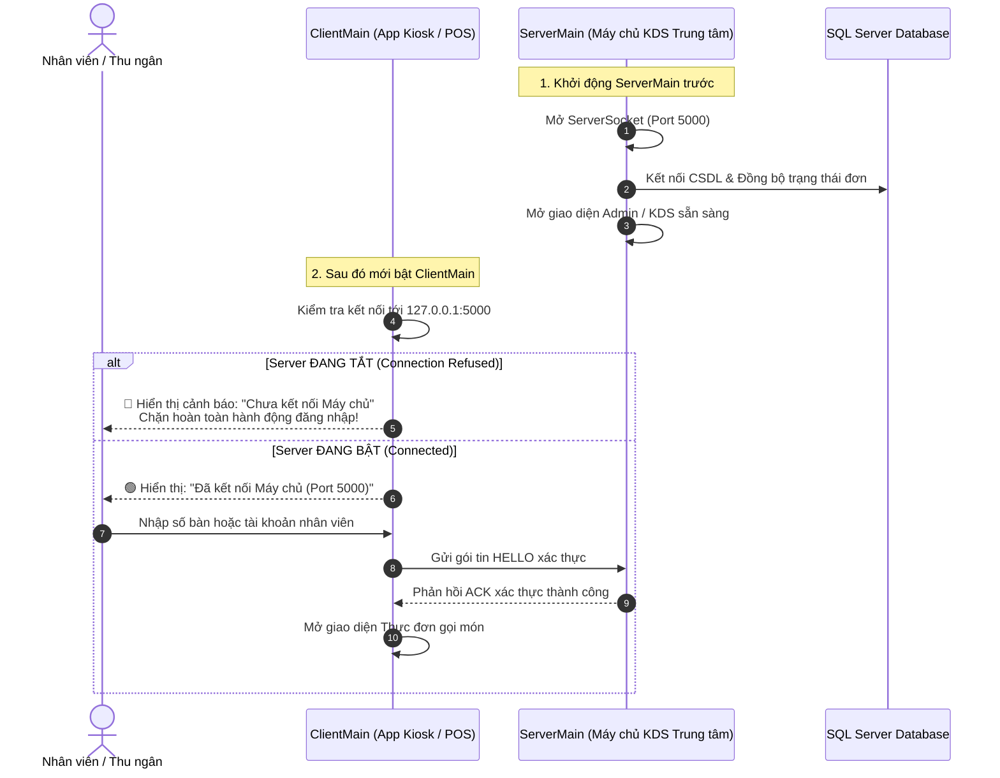

# KẾ HOẠCH CHI TIẾT: THIẾT KẾ LẠI GIAO DIỆN BẾP & BAR (KDS) VÀ CHUẨN HÓA LUỒNG HOẠT ĐỘNG SERVER - CLIENT

> **Mục tiêu tài liệu:** 
> 1. Thiết kế lại toàn diện giao diện hiển thị đơn hàng tại phân hệ **Bếp & Bar (KDS)**: Khắc phục triệt để tình trạng thông tin món hỗn loạn, trùng lặp kích cỡ/ghi chú, thiếu đường phân cách giữa các món, nút bấm lạc quẻ không đồng bộ với Design System.
> 2. Chuẩn hóa lại 100% **luồng khởi chạy và kiến trúc kết nối Socket Server - Client**: Khắc phục lỗi Client tự ý khởi động Server ngầm khi Server đang tắt, thiết lập đúng chuẩn quy trình "Khởi động Server trước → Client mới được kết nối và đăng nhập".

---

## PHẦN 1: PHÂN TÍCH THỰC TRẠNG & NGUYÊN NHÂN CỐT LÕI (ROOT CAUSES)

Dựa trên hình ảnh thực tế bạn vừa cung cấp (`media_1792439941775_d7957db9.png`) và kết quả rà soát trực tiếp trong mã nguồn (`ServerKDSView.java`, `OrderTicketCard.java`, `ClientSocketService.java`, `LoginController.java`, `server.css`), hệ thống đang gặp phải 4 vấn đề lớn sau:

### 1.1. Thông tin từng món bị hỗn loạn, trùng lặp và không có đường phân cách
* **Trùng lặp Size và Ghi chú (Bug hiển thị 3 lần):**
  - Nhìn vào hình ảnh thực tế trên đơn bàn 214 và bàn 06:
    ```text
    2x Sinh Tố Bơ Sầu Riêng (M)
    Size M • Đá 100% • «Size L»
    ✎ Size L
    ```
    ```text
    2x Trà Đào Cam Sả (M)
    Size M • Đá 100% • «Size L • +Đào miếng»
    ✎ Size L • +Đào miếng
    ```
  - **Nguyên nhân code trong [`OrderTicketCard.java`](file:///c:/Users/ACER/Documents/NetBeansProjects/CafeOrder/src/cafe/views/OrderTicketCard.java#L103-L128):**
    - **Dòng 1:** In tên món kèm `(M)` từ `oi.getName() + " (" + oi.getSizeCode() + ")"`.
    - **Dòng 2:** Gọi `oi.getCustomizationSummary()`. Phương thức này trong [`OrderItem.java`](file:///c:/Users/ACER/Documents/NetBeansProjects/CafeOrder/src/cafe/models/OrderItem.java#L108-L132) đã tự động ghép cả `Size M`, `Đá 100%`, và **đã ghép luôn cả trường Note `«...»` vào đuôi**.
    - **Dòng 3:** Code lại tiếp tục kiểm tra `if (oi.getNote() != null)` và in thêm một dòng riêng `Label lblNote = new Label("✎ " + oi.getNote())`.
    - Thêm vào đó, khi tạo món mẫu hoặc chọn món, trường `note` bị lưu lẫn cả thông tin Size/Topping (như `Size L • +Đào miếng`), dẫn đến mâu thuẫn trực tiếp giữa tên món `(M)` và ghi chú `Size L`, in ra tới 3 lần khiến nhân viên pha chế bị rối loạn hoàn toàn.
* **Không có đường ngăn cách giữa các món (Lack of Item Boundaries):**
  - Hiện tại, `itemsBox` chỉ là một `VBox(6)` chứa các dòng text rời rạc. Khi một đơn có từ 2 món trở lên (ví dụ: *Trà Đào Cam Sả* và *Bạc Xỉu Đá Sài Gòn*), cả 2 món đều có 3 dòng text phụ, nối liền nhau không hề có đường kẻ ngăn cách, không có viền bao khối, khiến mắt người đọc không thể phân biệt đâu là món thứ nhất, đâu là món thứ hai.
* **Số bàn bị lặp lại 2 lần trên tiêu đề phiếu:**
  - Header của card đang hiển thị: `[BÀN 214] #1009 • BÀN 214`.
  - Nguyên nhân: Nút `lblType` lấy `order.getOrderTypeLabel()` (vốn đã trả về `"BÀN 214"`), sau đó `lblId` lại ghép thêm `#1009 • BÀN 214`. Việc lặp lại chữ `"BÀN 214"` hai lần liên tiếp làm tiêu đề bị thừa thãi và chật chội.

---

### 1.2. Nút bấm và các thành phần UI bị lạc quẻ, lệch tông với hệ thống
* **Màu sắc nút bấm tự phát (Inconsistent Button Styling):**
  - Nút **[Bắt đầu pha chế]** dùng màu đen/than `#183C32` với bo góc nhọn `4px`.
  - Nút **[✓ Hoàn thành]** dùng màu xanh lá cây chói `#1B5E20` (`-fx-background-color: #1B5E20; -fx-background-radius: 4px;`) hoàn toàn không thuộc bảng màu Design System của quán.
  - Khi trạng thái là `DONE` (Đã hoàn thành), code chỉ in một dòng text trần `Label lblFinished = new Label("Đã xong • Chờ giao");` nằm trơ trọi ở góc dưới, không có khung nút, không có viền, nhìn như giao diện bị lỗi render.
* **Nút bấm bị nhảy vị trí tự do, không thẳng hàng (Unaligned Action Baseline):**
  - Do `OrderTicketCard` dùng `VBox` thông thường và không đặt `Priority.ALWAYS` cho vùng nội dung món, nên card có 1 món thì nút bấm nằm lưng chừng ở trên, card có 3 món thì nút bấm bị đẩy tít xuống dưới. Nhân viên pha chế khi nhìn lướt qua một hàng không thể bấm nhanh vì vị trí nút bấm trên mỗi card nằm so le lộn xộn.
* **Sự xung đột bo góc giữa các cụm nút:**
  - Dải chọn Trạm pha chế ở trên cùng dùng bo tròn viên thuốc `999px`.
  - Dải lọc trạng thái (`Tất cả đơn`, `Đang chờ`, `Đang pha chế`, `Đã xong`) dùng bo góc `8px`.
  - Các nút hành động trong Card lại dùng bo góc nhọn `4px` thừa hưởng từ giao diện cũ.

---

### 1.3. Lỗi luồng hoạt động: Client tự ý khởi động Server ngầm khi Server đang tắt
* **Hiện tượng bạn đã gặp:**
  *Bạn chỉ khởi chạy Client (`ClientMain`), trong khi `ServerMain` hoàn toàn chưa bật, nhưng Client vẫn vào được thẳng bên trong hệ thống bình thường.*
* **Vết tích và nguyên nhân trong mã nguồn:**
  - Tại [`ClientSocketService.java`](file:///c:/Users/ACER/Documents/NetBeansProjects/CafeOrder/src/cafe/services/ClientSocketService.java#L94-L117), trong phương thức `openSocketInternal`:
    ```java
    } catch (IOException firstEx) {
        // NGUYÊN NHÂN CHÍNH: Tự động khởi chạy CafeServerService ngầm!
        try {
            synchronized (ClientSocketService.class) {
                if (embeddedFallbackServer == null) {
                    embeddedFallbackServer = CafeServerService.getInstance();
                    embeddedFallbackServer.start(port);
                    Thread.sleep(40);
                }
            }
            socket = new Socket();
            socket.connect(new java.net.InetSocketAddress(resolvedHost, port), 350);
            ...
    ```
  - Đồng thời, ngay khi [`ClientMain.java`](file:///c:/Users/ACER/Documents/NetBeansProjects/CafeOrder/src/cafe/ClientMain.java#L70) khởi động, nó gọi lệnh `socketService.warmupConnectAsync()`. Khi lệnh này thử kết nối đến cổng 5000 và bị từ chối (do `ServerMain` chưa bật), nó lập tức nhảy vào khối `catch` trên và **âm thầm tự bật một `CafeServerService` ngay bên trong tiến trình của Client**!
  - Sau đó, khi người dùng đăng nhập bằng tài khoản quản lý tại [`LoginController.java`](file:///c:/Users/ACER/Documents/NetBeansProjects/CafeOrder/src/cafe/controllers/LoginController.java#L108), lệnh `ClientSocketService.getOrStartEmbeddedServer()` lại lấy đúng con Server "chạy lậu" đó để mở `AdminShellView`.
* **Hậu quả của luồng sai này:**
  1. Phá vỡ hoàn toàn kiến trúc Client-Server: Client vốn là thiết bị đầu cuối (Tablet tại bàn, Kiosk, máy POS nhân viên), không được phép đóng vai trò làm Server quản lý dữ liệu.
  2. Xung đột cổng nghiêm trọng: Nếu Client đã tự mở port 5000 ngầm, sau đó người dùng mới bật `ServerMain`, `ServerMain` sẽ văng lỗi `java.net.BindException: Address already in use: JVM_Bind` và sập ngay lập tức!
  3. Dữ liệu phân mảnh: Mỗi client chạy một server ngầm riêng biệt, không máy nào nhận được đơn của máy nào.

---

## PHẦN 2: THIẾT KẾ LẠI GIAO DIỆN PHIẾU BẾP / BAR (KDS REDESIGN SPECIFICATION)

Để màn hình KDS đạt chuẩn các chuỗi F&B chuyên nghiệp (Toast POS, Square KDS, Odoo KDS), toàn bộ phiếu đơn hàng (`OrderTicketCard`) và lưới hiển thị sẽ được tái cấu trúc triệt để theo bản đặc tả dưới đây:

```
┌─────────────────────────────────────────────────────────────┐
│ [BÀN 06]  #1003                           [ĐANG CHỜ] 09p    │ <- Header: Nổi bật số bàn, SLA đổi màu
├─────────────────────────────────────────────────────────────┤
│ ┌─ MÓN 1 ─────────────────────────────────────────────────┐ │
│ │ [ 2 ]  Trà Đào Cam Sả                       [Size L]    │ │ <- SL nổi bật, Tên món 13px Bold, Tag Size
│ │        • 100% Đá  •  70% Đường                          │ │ <- Tùy chọn gọn gàng, rõ ràng
│ │        • +Topping: Đào miếng                            │ │ <- Topping riêng dòng nếu có
│ └─────────────────────────────────────────────────────────┘ │
│ ─────────────────────────────────────────────────────────── │ <- Đường phân cách giữa các món (Dashed Divider)
│ ┌─ MÓN 2 ─────────────────────────────────────────────────┐ │
│ │ [ 1 ]  Bạc Xỉu Đá Sài Gòn                   [Size M]    │ │
│ │        • 100% Đá  •  Chuẩn đường                        │ │
│ │        ⚡ Ghi chú: Mang ra cùng lúc với món 1            │ │ <- Ghi chú đặt trong khung màu cam nhạt
│ └─────────────────────────────────────────────────────────┘ │
├─────────────────────────────────────────────────────────────┤
│ [ ▶ BẮT ĐẦU PHA CHẾ ]                                       │ <- Nút hành động cố định sát đáy (Pinned Baseline)
└─────────────────────────────────────────────────────────────┘
```

### 2.1. Chuẩn hóa Tiêu đề Phiếu (Ticket Header)
* **Khối thông tin Bàn & Loại đơn:**
  - Nếu là khách ngồi tại quán: Hiển thị Huy hiệu Bàn nổi bật: `BÀN 06` (Nền be `#EAE4DA`, chữ xanh đậm `#112823`, `12.5px Bold`, bo góc `6px`).
  - Nếu là mang về: Hiển thị Huy hiệu Mang về: `MANG VỀ` (Nền cam nhạt `#FFF3E0`, chữ cam đậm `#C05621`, `12.5px Bold`, bo góc `6px`).
  - Mã đơn hàng: `#1003` đi liền kề (màu `#78716C`, `12px Regular`). **Tuyệt đối không lặp lại chữ "BÀN" lần thứ hai**.
* **Đồng hồ đo SLA theo thời gian thực (Time Tracker):**
  - Dưới 5 phút: Nhãn `04:12 (4p)` màu xám xanh trung tính `#78716C`.
  - Từ 5 đến 10 phút: Đổi sang màu cam hổ phách `#D97706` (Cảnh báo pha chế).
  - Trên 10 phút: Đổi sang màu đỏ cảnh báo khẩn cấp `#DC2626` (Quá hạn phục vụ).
* **Huy hiệu Trạng thái (Status Badge):**
  - `ĐANG CHỜ`: Nền `#FEF3C7`, chữ `#B45309`, viền `#FDE68A`, bo góc `6px`.
  - `ĐANG PHA CHẾ`: Nền `#EFF6FF`, chữ `#1D4ED8`, viền `#BFDBFE`, bo góc `6px`.
  - `HOÀN THÀNH`: Nền `#DCFCE7`, chữ `#15803D`, viền `#BBF7D0`, bo góc `6px`.

---

### 2.2. Chuẩn hóa Khối hiển thị Món ăn (Individual Item Block & Separation)
Mỗi món trong đơn hàng sẽ là một **tiểu khối độc lập (Item Block)** có cấu trúc phân tầng thị giác rõ ràng:
1. **Dòng tiêu đề món (Item Headline):**
   - **Badge Số lượng (Quantity Pill):** Đặt trong khung hình vuông bo tròn `[ 2x ]` nền xanh đen `#112823`, chữ trắng `#FFFFFF` (`13px Bold`), giúp barista nhìn lướt từ xa là biết ngay cần lấy mấy ly.
   - **Tên món chính (Product Name):** Font `Inter`, `13.5px Bold`, màu `#112823`. **Cắt bỏ hoàn toàn hậu tố `(M)` bị lặp**.
   - **Pill Kích cỡ riêng biệt (Size Pill):** Đặt sát mép phải, ví dụ `[ Size L ]` (Nền `#F5F0E8`, viền `#DFD7CA`, chữ `#563521`, `11.5px Bold`, bo góc `5px`).
2. **Dòng Tùy chọn Pha chế (Drink Specifications):**
   - Định dạng gọn gàng bằng bullet tinh tế: `• 100% Đá  •  70% Đường  •  Nhiệt độ: Lạnh`.
   - Cỡ chữ `11.5px`, màu xám ấm `#57534E`, thụt đầu dòng thẳng hàng với tên món.
3. **Dòng Topping thêm (nếu có):**
   - Hiển thị rõ: `• +Topping: Đào miếng, Trân châu trắng` (Màu xanh rêu `#15803D`, `11.5px SemiBold`).
4. **Khối Ghi chú Đặc biệt của Khách (Kitchen Note Alert Box):**
   - Nếu món hoặc đơn có ghi chú thực sự (ví dụ: *"Ít đá 1 ly"*, *"Hâm nóng bánh"*, *"Không lấy ống hút"*):
   - Đặt trong một thẻ nhỏ riêng biệt có nền vàng nhạt `#FEF3C7`, viền `#FDE68A`, chữ nâu đậm `#92400E` kèm icon `⚡` hoặc `✎`.
   - **Giải quyết triệt để lỗi ghi chú rác:** Lọc bỏ các chuỗi ghi chú tự động sinh ra bị trùng lặp với Size/Topping (như `«Size L»`, `«Size L • +Đào miếng»`).
5. **Đường phân cách giữa các món (Item Boundary Line):**
   - Giữa các món luôn có một đường kẻ ngang đứt đoạn thanh lịch (`-fx-border-style: dashed; -fx-border-color: #E6E0D6 transparent transparent transparent; -fx-border-width: 1 0 0 0; -fx-margin: 6 0 6 0;`).

---

### 2.3. Chuẩn hóa Nút Hành Động Ở Đáy Thẻ (Pinned Action Bar)
* **Neo vị trí cố định (Sticky Baseline):**
  - Sử dụng thuộc tính `VBox.setVgrow(itemsContainer, Priority.ALWAYS)` để danh sách món tự co giãn đẩy dải nút hành động xuống **sát đáy thẻ**. Toàn bộ các thẻ trên cùng một hàng sẽ có dải nút bấm thẳng tắp một đường chân trời.
* **Bộ quy chuẩn Nút bấm theo từng trạng thái:**
  - **Trạng thái `QUEUED` (Đang chờ):**
    - Nút full-width trải dài mép dưới: **`[ ▶ Bắt đầu pha chế ]`**.
    - Style: Nền xanh rừng thương hiệu `#112823`, chữ trắng `#FFFFFF`, font `13px Bold`, bo góc `8px`, chiều cao `38px`, hiệu ứng hover `#1A3B34`.
  - **Trạng thái `PREPARING` (Đang pha chế):**
    - Nút full-width: **`[ ✓ Hoàn tất món & Báo phục vụ ]`**.
    - Style: Nền xanh lá dịu mắt `#15803D` (chuẩn màu thẻ POS), chữ trắng `#FFFFFF`, font `13px Bold`, bo góc `8px`, chiều cao `38px`, hiệu ứng hover `#166534`.
  - **Trạng thái `DONE` (Đã hoàn thành):**
    - Không để text trần nữa! Thay bằng nút phụ: **`[ ↺ Hoàn tác ]`** và nút **`[ 🖨 In lại vé ]`** (Nền trắng `#FFFFFF`, viền `#D8D1C3`, chữ `#57534E`, bo góc `8px`, chiều cao `36px`).

---

### 2.4. Đồng bộ Thanh Bộ Lọc & Tìm Kiếm Phía Trên
* Thống nhất toàn bộ các nút lọc trạng thái (`Tất cả đơn`, `Đang chờ`, `Đang pha chế`, `Đã xong`) sang quy chuẩn Design System:
  - Nút chưa chọn: Nền trắng `#FFFFFF`, viền xám `#DFD7CA`, chữ `#57534E`, bo góc `8px`, font `12.5px SemiBold`.
  - Nút đang chọn: Nền xanh đậm `#112823`, chữ trắng `#FFFFFF`, viền `#112823`, font `12.5px Bold`.
* Nút **`[Xóa đơn đã xong]`**:
  - Đổi từ màu đỏ nhạt sang phong cách nút phụ của hệ thống: Nền `#F5EFEB`, viền `#DFD7CA`, chữ `#854D0E`, hover sang `#FEE2E2` (đỏ dịu mắt) kèm icon thùng rác `🗑`.

---

## PHẦN 3: ĐẶC TẢ KIẾN TRÚC & CHUẨN HÓA LUỒNG SERVER - CLIENT (SERVER-FIRST ARCHITECTURE)

Đây là yêu cầu mấu chốt để hệ thống vận hành đúng bản chất mạng nội bộ của một chuỗi quán cà phê thực tế:



### 3.1. Nguyên tắc cốt lõi (Core Principles)
1. **ServerMain là Máy Chủ duy nhất:**
   - Chỉ có `ServerMain` mới được quyền khởi tạo và lắng nghe `ServerSocket(5000)`.
   - `ServerMain` sở hữu instance `CafeServerService`, quản lý lưu trữ đơn tập trung, điều phối màn hình KDS Bếp/Bar và các luồng xuất dữ liệu quản trị.
2. **ClientMain là Máy Khách thuần túy (Pure Client):**
   - `ClientMain` chỉ chứa `ClientSocketService` kết nối ra ngoài qua `Socket`.
   - **XÓA BỎ HOÀN TOÀN** đoạn code `embeddedFallbackServer.start(port)` trong `ClientSocketService`. Nếu socket không kết nối được tới cổng 5000, `ClientSocketService` chỉ đơn giản trả về `false` và kích hoạt sự kiện mất kết nối.

---

### 3.2. Cải tiến Giao diện & Trải nghiệm Đăng nhập (`LoginView` & `LoginController`)
Để người dùng không bị bỡ ngỡ khi Server chưa chạy, giao diện đăng nhập cần được bổ sung cơ chế kiểm soát trực quan:
1. **Huy hiệu Trạng thái Kết nối (Server Status Badge):**
   - Đặt ở góc trên bên phải hoặc ngay phía trên ô đăng nhập:
     - 🟢 **Khi Server đang chạy:** `● Máy chủ: Sẵn sàng (127.0.0.1:5000)` (Chữ xanh lá cây, nền kem nhạt).
     - 🔴 **Khi Server chưa bật:** `● Máy chủ: Chưa kết nối (Server đang tắt)` (Chữ đỏ cảnh báo, có nút nhỏ `[↻ Thử lại]`).
2. **Chặn đăng nhập có thông điệp rõ ràng:**
   - Nếu người dùng bấm `Đăng nhập` (hoặc nhấn Enter) trong khi trạng thái là 🔴 Mất kết nối:
     - Không cho phép chuyển trang.
     - Hiển thị hộp thoại cảnh báo mềm hoặc thông báo lỗi:
       > *"⚠️ Không thể kết nối đến Máy chủ trung tâm (Port 5000)!\nVui lòng khởi động ServerMain trên máy chủ trước, sau đó bấm [Thử lại]."*
3. **Cơ chế Tự động Thử lại (Auto-Retry Poll):**
   - Trong khi màn hình Login đang mở, một luồng nền nhẹ nhàng kiểm tra cổng 5000 mỗi 3 giây một lần. Ngay khi bạn bật `ServerMain`, đèn tín hiệu trên `LoginView` sẽ tự động chuyển từ 🔴 Đỏ sang 🟢 Xanh mà không cần tắt Client mở lại.

---

### 3.3. Phân định rõ vai trò khi đăng nhập trên ClientMain
Khi `ClientMain` kết nối thành công tới `ServerMain`:
- **Đăng nhập Số bàn (Khách hàng):** Chuyển vào `ClientView` (Kiosk gọi món tại bàn). Khi khách đặt món, đơn bắn qua Socket về Server và hiện ngay trên KDS của `ServerMain`.
- **Đăng nhập Tài khoản Nhân viên (Staff):** Chuyển vào `FloorPlanView` (Sơ đồ bàn & Thu ngân). Mọi thao tác đổi bàn, thanh toán, gọi thêm món đều đồng bộ qua Socket.
- **Nếu đăng nhập bằng Admin trên ClientMain:**
  - Nếu muốn mở giao diện quản trị từ xa, Client sẽ yêu cầu Server cung cấp dữ liệu qua Socket.
  - Tuy nhiên, luồng chuẩn của hệ thống: Quản lý ngồi tại máy thu ngân trung tâm sẽ chạy trực tiếp file `ServerMain.java`, nơi toàn bộ 10 phân hệ quản trị và quầy KDS đã được tích hợp sẵn sàng.

---

## PHẦN 4: DANH SÁCH FILE VÀ CÁC BƯỚC TRIỂN KHAI CHI TIẾT (ACTION PLAN)

Dưới đây là kế hoạch chi tiết từng file sẽ được chỉnh sửa khi bạn phê duyệt triển khai:

| STT | File cần sửa | Nhiệm vụ chi tiết | Mức độ ưu tiên |
| :---: | :--- | :--- | :---: |
| **1** | [`src/cafe/services/ClientSocketService.java`](file:///c:/Users/ACER/Documents/NetBeansProjects/CafeOrder/src/cafe/services/ClientSocketService.java) | - **Xóa bỏ triệt để** khối `catch` tự khởi động `embeddedFallbackServer.start()`.<br/>- Xóa biến `embeddedFallbackServer` và phương thức `getOrStartEmbeddedServer()`.<br/>- Đảm bảo `ClientSocketService` hoạt động đúng vai trò Client thuần túy. | **P0 (Khẩn cấp)** |
| **2** | [`src/cafe/controllers/LoginController.java`](file:///c:/Users/ACER/Documents/NetBeansProjects/CafeOrder/src/cafe/controllers/LoginController.java) | - Kiểm tra trạng thái Socket trước khi cho phép đăng nhập.<br/>- Nếu `socketService.isConnected() == false`, hiển thị thông báo yêu cầu bật Server trước.<br/>- Bổ sung callback kết nối lại khi người dùng bấm nút `[↻ Thử lại]`. | **P0 (Khẩn cấp)** |
| **3** | [`src/cafe/views/LoginView.java`](file:///c:/Users/ACER/Documents/NetBeansProjects/CafeOrder/src/cafe/views/LoginView.java) | - Thêm huy hiệu trạng thái kết nối máy chủ (🟢 Đã kết nối / 🔴 Mất kết nối).<br/>- Thêm nút `[↻ Thử lại kết nối]` tinh tế cạnh đèn trạng thái. | **P1 (Quan trọng)** |
| **4** | [`src/cafe/views/OrderTicketCard.java`](file:///c:/Users/ACER/Documents/NetBeansProjects/CafeOrder/src/cafe/views/OrderTicketCard.java) | - **Thiết kế lại 100% thẻ phiếu KDS** theo bản đặc tả ở Phần 2.<br/>- Sửa lỗi lặp lại chữ "BÀN" ở tiêu đề.<br/>- Đóng gói từng món vào một khối riêng, có đường ngăn cách đứt đoạn (`dashed divider`).<br/>- Loại bỏ lỗi in 3 lần Size và Note bị lặp text.<br/>- Thêm Badge số lượng `[ 2x ]` nền tối nổi bật.<br/>- Đặt dải nút hành động cố định sát đáy thẻ (`Priority.ALWAYS`).<br/>- Đồng bộ màu sắc nút (`#112823` và `#15803D`), bo góc `8px`. | **P0 (Khẩn cấp)** |
| **5** | [`src/cafe/views/ServerKDSView.java`](file:///c:/Users/ACER/Documents/NetBeansProjects/CafeOrder/src/cafe/views/ServerKDSView.java) & [`server.css`](file:///c:/Users/ACER/Documents/NetBeansProjects/CafeOrder/src/cafe/views/server.css) | - Nâng cấp thanh bộ lọc trạng thái và nút `[Xóa đơn đã xong]` theo chuẩn Design System.<br/>- Cân chỉnh khoảng cách thẻ trong `FlowPane` (hoặc chuyển sang lưới cột đều) để không còn khoảng trống thừa.<br/>- Loại bỏ các style bo góc nhọn `4px` lạc hậu. | **P1 (Quan trọng)** |
| **6** | [`src/cafe/views/AdminShellView.java`](file:///c:/Users/ACER/Documents/NetBeansProjects/CafeOrder/src/cafe/views/AdminShellView.java) | - Đảm bảo Tab 4 (KDS) và Tab 1 kết nối mượt mà với `ServerKDSView` sau khi được nâng cấp. | **P2 (Hoàn thiện)** |

---

## PHẦN 5: KỊCH BẢN KIỂM THỬ XÁC MINH (VERIFICATION SCENARIOS)

Sau khi hoàn tất thay đổi, chúng ta sẽ thực hiện 3 kịch bản kiểm thử thực tế để đảm bảo chất lượng tuyệt đối:

1. **Kịch bản 1: Thử nghiệm khởi chạy Client khi Server đang TẮT:**
   - Tắt toàn bộ ứng dụng.
   - Chỉ chạy duy nhất file `ClientMain.java`.
   - **Kỳ vọng:** Màn hình đăng nhập hiện đèn đỏ 🔴 *"Chưa kết nối Máy chủ (Port 5000)"*. Nhập tài khoản hoặc bàn bấm Đăng nhập sẽ bị chặn lại kèm thông báo nhắc nhở bật `ServerMain`. Không có bất kỳ ServerSocket nào bị tự ý mở ngầm.
2. **Kịch bản 2: Bật Server và kết nối lại tự động:**
   - Trong khi `ClientMain` đang mở ở kịch bản 1, tiến hành chạy `ServerMain.java`.
   - Bấm nút `[↻ Thử lại]` trên `ClientMain`.
   - **Kỳ vọng:** Đèn chuyển sang 🟢 Xanh. Đăng nhập thành công vào thực đơn gọi món.
3. **Kịch bản 3: Đặt đơn và kiểm tra hiển thị KDS mới:**
   - Từ `ClientMain`, đặt một đơn hàng gồm 2 món có tùy chỉnh phức tạp (Size L, ít đường, nhiều đá, có topping và có ghi chú đặc biệt).
   - Quan sát trên màn hình KDS của `ServerMain`:
   - **Kỳ vọng:**
     - Thẻ đơn xuất hiện ngay tức thì theo thời gian thực.
     - Số bàn rõ ràng, không bị lặp chữ `BÀN`.
     - 2 món được tách biệt hoàn toàn bằng đường kẻ ngăn cách.
     - Số lượng hiển thị trong badge `[ 2x ]` dễ nhìn từ xa.
     - Size và Topping hiển thị đúng 1 lần, không bị trùng lặp, không bị mâu thuẫn giữa `(M)` và `Size L`.
     - Ghi chú nằm trong khung vàng cam trang nhã.
     - Nút hành động nằm thẳng tắp ở đáy thẻ, mang phong cách sang trọng của quán.
