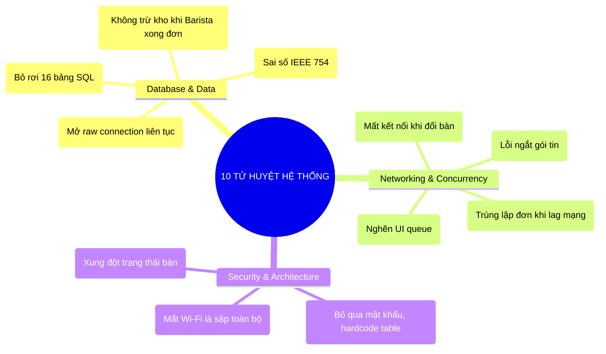
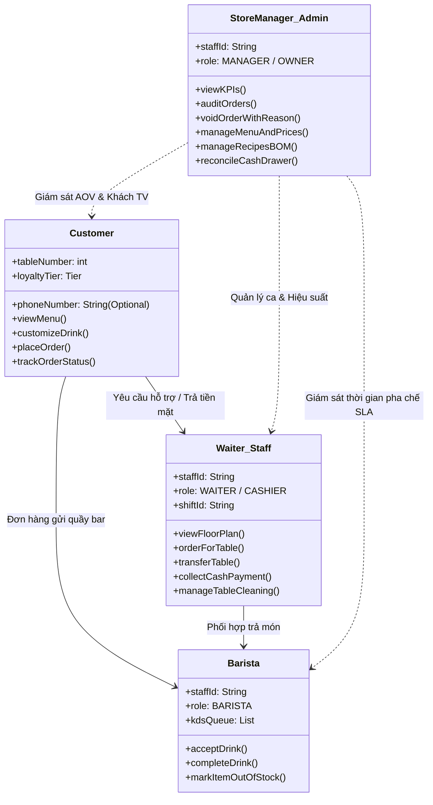
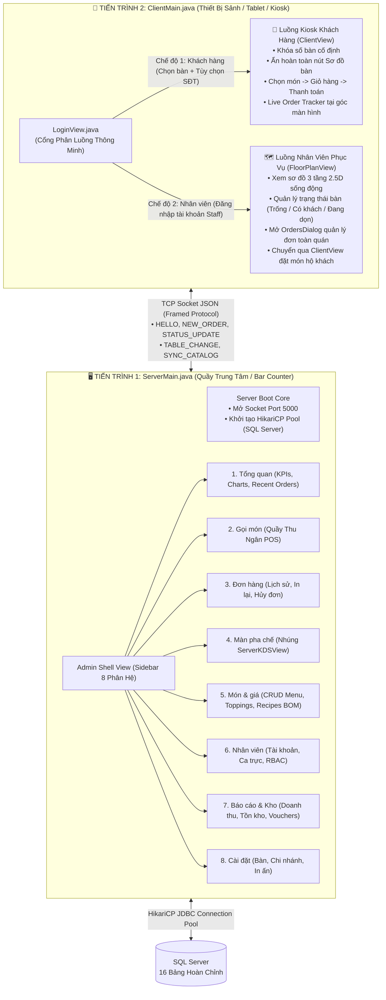
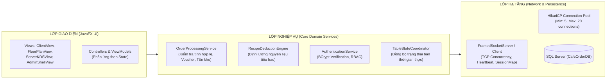
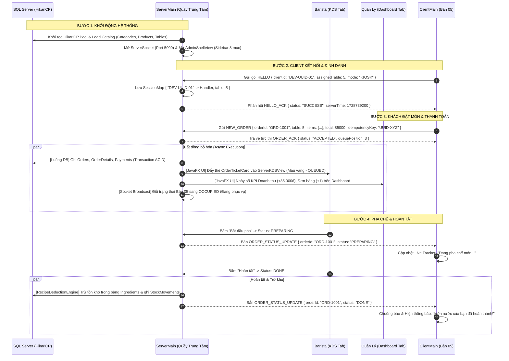
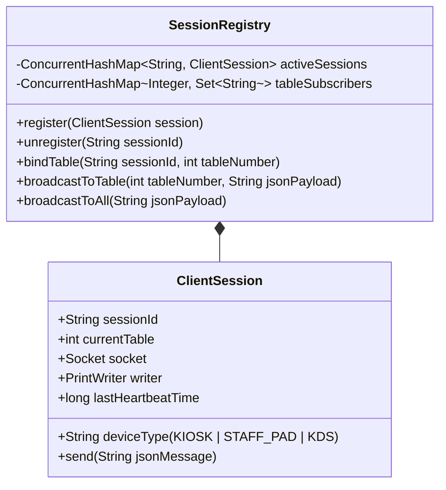
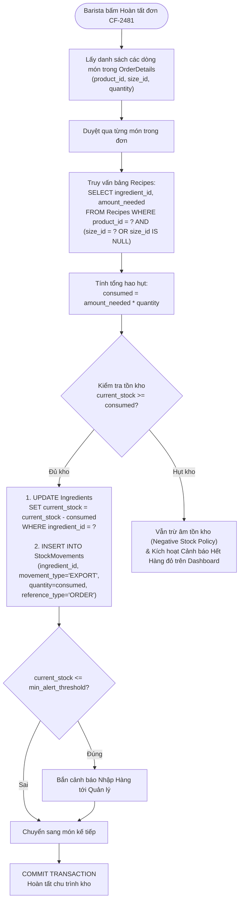
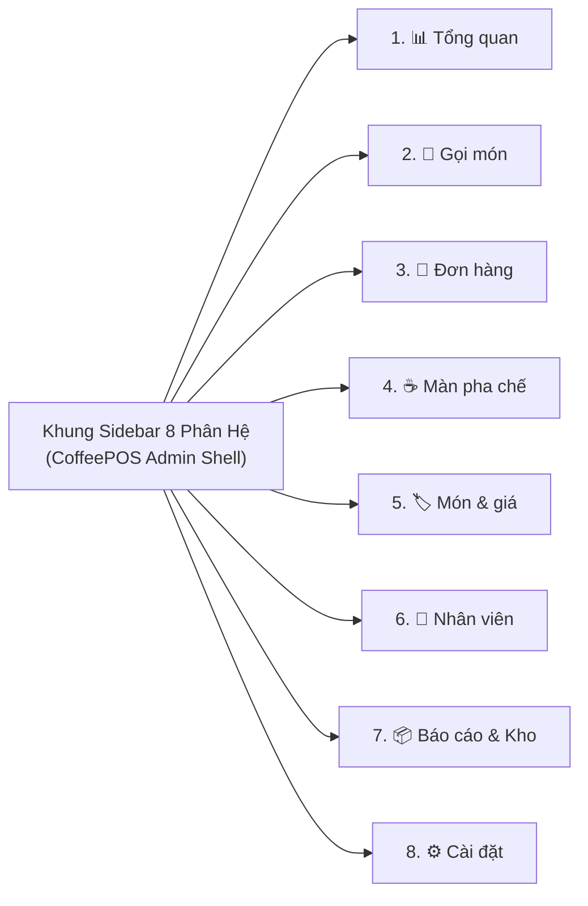
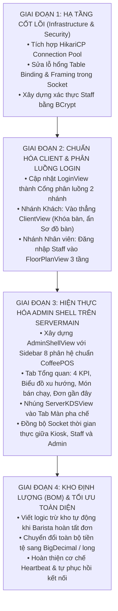

# ☕ BÁO CÁO THẨM ĐỊNH KIẾN TRÚC HỆ THỐNG & ĐỀ ÁN TÁI CẤU TRÚC CHUỖI F&B CHUYÊN SÂU
> **Tác giả:** Kỹ sư Thiết kế Hệ thống Cấp cao (Principal System Architect - 20 năm kinh nghiệm) & Chuyên gia Fullstack / F&B Operations  
> **Dự án Thẩm định:** `CafeOrder` (Brew & Bean Specialty Coffee / CoffeePOS Enterprise)  
> **Ngày phát hành:** 12/10/2026 — Bản Đánh giá Chuyên sâu & Nghiêm ngặt Nhất (Comprehensive & Critical Audit)  
> **Phạm vi thẩm định:** Toàn bộ Source Code (`src/cafe/...`), Schema Cơ sở dữ liệu (`setup_database.sql`), Giao thức Socket TCP, Mô hình Đa luồng và Quy trình Vận hành F&B Thực chiến.

---

## MỤC LỤC CHI TIẾT
1. [Lời Mở Đầu & Tuyên Ngôn Kiến Trúc](#lời-mở-đầu--tuyên-ngôn-kiến-trúc)
2. [Phần 1: Mổ Xẻ 10 "Tử Huyệt" Kỹ Thuật (Critical Technical Bottlenecks & Anti-Patterns)](#phần-1-mổ-xẻ-10-tử-huyệt-kỹ-thuật-critical-technical-bottlenecks--anti-patterns)
   - [1.1. Thắt cổ chai kết nối CSDL (Connection Pooling Absence)](#11-thắt-cổ-chai-kết-nối-csdl-connection-pooling-absence)
   - [1.2. Dữ liệu "bóng ma" (In-Memory Menu vs Database Disconnect)](#12-dữ-liệu-bóng-ma-in-memory-menu-vs-database-disconnect)
   - [1.3. Lỗ hổng Socket Protocol: Phân mảnh gói tin & Lệch Table Binding](#13-lỗ-hổng-socket-protocol-phân-mảnh-gói-tin--lệch-table-binding)
   - [1.4. Cửa hậu xác thực & Thảm họa an toàn thông tin (Authentication Backdoor)](#14-cửa-hậu-xác-thực--thảm-họa-an-toàn-thông-tin-authentication-backdoor)
   - [1.5. Đứt gãy chuỗi cung ứng & Định lượng công thức (BOM & Recipe Dead Code)](#15-đứt-gãy-chuỗi-cung-ứng--định-lượng-công-thức-bom--recipe-dead-code)
   - [1.6. Hiểm họa sai số tài chính (Floating-Point double vs BigDecimal)](#16-hiểm-họa-sai-số-tài-chính-floating-point-double-vs-bigdecimal)
   - [1.7. Thiếu tính bất biến và rủi ro trùng lặp đơn hàng (Zero Idempotency)](#17-thiếu-tính-bất-biến-và-rủi-ro-trùng-lặp-đơn-hàng-zero-idempotency)
   - [1.8. JavaFX Thread Starvation do nghẽn Event Queue](#18-javafx-thread-starvation-do-nghẽn-event-queue)
   - [1.9. Không có khả năng chịu lỗi ngoại tuyến (Zero Offline Resilience)](#19-không-có-khả-năng-chịu-lỗi-ngoại-tuyến-zero-offline-resilience)
   - [1.10. Vi phạm tính toàn vẹn trạng thái bàn trong môi trường đa máy trạm](#110-vi-phạm-tính-toàn-vẹn-trạng-thái-bàn-trong-môi-trường-đa-máy-trạm)
3. [Phần 2: Phân Tích Đa Chiều 4 Vai Trò (Personas) & Ma Trận Phân Quyền (RBAC)](#phần-2-phân-tích-đa-chiều-4-vai-trò-personas--ma-trận-phân-quyền-rbac)
   - [2.1. Phân tích Bản chất Màn hình Login & Bài toán Tích điểm Loyalty](#21-phân-tích-bản-chất-màn-hình-login--bài-toán-tích-điểm-loyalty)
   - [2.2. Khách hàng (Customer — Kiosk/Tablet Tại Bàn)](#22-khách-hàng-customer--kiosktablet-tại-bàn)
   - [2.3. Nhân viên Phục vụ / Thu ngân sảnh (Waiter / Staff POS)](#23-nhân-viên-phục-vụ--thu-ngân-sảnh-waiter--staff-pos)
   - [2.4. Nhân viên Pha chế (Barista — Màn hình KDS)](#24-nhân-viên-pha-chế-barista--màn-hình-kds)
   - [2.5. Quản lý Cửa hàng / Admin (Store Manager — CoffeePOS)](#25-quản-lý-cửa-hàng--admin-store-manager--coffeepos)
   - [2.6. Ma trận Phân quyền Truy cập (RBAC Matrix)](#26-ma-trận-phân-quyền-truy-cập-rbac-matrix)
4. [Phần 3: Kiến Trúc Chuẩn Hóa Mô Hình 1 (`ServerMain` vs `ClientMain`)](#phần-3-kiến-trúc-chuẩn-hóa-mô-hình-1-servermain-vs-clientmain)
   - [3.1. Phân định trách nhiệm tuyệt đối giữa 2 Tiến trình](#31-phân-định-trách-nhiệm-tuyệt-đối-giữa-2-tiến-trình)
   - [3.2. Sơ đồ Tô-pô Hệ thống & Luồng Dữ liệu Tổng thể](#32-sơ-đồ-tô-pô-hệ-thống--luồng-dữ-liệu-tổng-thể)
   - [3.3. Biểu đồ Tuần tự Khởi chạy & Vòng đời Đơn hàng Thời gian thực](#33-biểu-đồ-tuần-tự-khởi-chạy--vòng-đời-đơn-hàng-thời-gian-thực)
5. [Phần 4: Thiết Kế Chuẩn Giao Thức Mạng, Socket Concurrency & Framing](#phần-4-thiết-kế-chuẩn-giao-thức-mạng-socket-concurrency--framing)
   - [4.1. Khắc phục triệt để lỗi Table Binding (Tách Client Session và Table Number)](#41-khắc-phục-triệt-để-lỗi-table-binding-tách-client-session-và-table-number)
   - [4.2. Khắc phục Phân mảnh Packet (Message Framing & Newline Delimiter)](#42-khắc-phục-phân-mảnh-packet-message-framing--newline-delimiter)
   - [4.3. Cơ chế Nhịp tim (Heartbeat / Keep-Alive) & Tự phục hồi Kết nối](#43-cơ-chế-nhịp-tim-heartbeat--keep-alive--tự-phục-hồi-kết-nối)
   - [4.4. Đặc tả Bộ Gói tin JSON Chuẩn (Protocol Specification)](#44-đặc-tả-bộ-gói-tin-json-chuẩn-protocol-specification)
6. [Phần 5: Tối Ưu Cơ Sở Dữ Liệu & Quy Trình Trừ Kho Định Lượng (BOM Recipes)](#phần-5-tối-ưu-cơ-sở-dữ-liệu--quy-trình-trừ-kho-định-lượng-bom-recipes)
   - [5.1. Triển khai Connection Pool với HikariCP](#51-triển-khai-connection-pool-với-hikaricp)
   - [5.2. Đồng bộ hóa Danh mục & Sản phẩm Động từ SQL Server](#52-đồng-bộ-hóa-danh-mục--sản-phẩm-động-từ-sql-server)
   - [5.3. Thuật toán Trừ Tồn Kho Nguyên Vật Liệu (BOM Recipe Engine)](#53-thuật-toán-trừ-tồn-kho-nguyên-vật-liệu-bom-recipe-engine)
   - [5.4. Đảm bảo Tính Toàn Vẹn ACID & Khóa Lạc Quan (Optimistic Locking)](#54-đảm-bảo-tính-toàn-vẹn-acid--khóa-lạc-quan-optimistic-locking)
7. [Phần 6: Chi Tiết Giao Diện & Tính Năng 8 Phân Hệ Quản Trị `CoffeePOS`](#phần-6-chi-tiết-giao-diện--tính-năng-8-phân-hệ-quản-trị-coffeepos)
8. [Phần 7: Bảng Đối Chiếu Hiện Trạng vs Tiêu Chuẩn Enterprise F&B](#phần-7-bảng-đối-chiếu-hiện-trạng-vs-tiêu-chuẩn-enterprise-fb)
9. [Phần 8: Kế Hoạch Hành Động & Lộ Trình Refactor Từng Bước (Roadmap)](#phần-8-kế-hoạch-hành-động--lộ-trình-refactor-từng-bước-roadmap)

---

## LỜI MỞ ĐẦU & TUYÊN NGÔN KIẾN TRÚC

Là một Kỹ sư Thiết kế Hệ thống (System Architect) với 20 năm kinh nghiệm lăn lộn qua các hệ thống phân tán chịu tải cao, hệ thống ngân hàng lõi (Core Banking) và đặc biệt là các giải pháp ERP/POS cho chuỗi bán lẻ và F&B quy mô hàng trăm chi nhánh, tôi xin đưa ra một tuyên ngôn thẳng thắn và công tâm nhất:

> **"Dự án `CafeOrder` sở hữu một 'vỏ bọc' UI/UX tuyệt vời, chỉn chu, mang ngôn ngữ Zen Specialty cao cấp, và một Schema Cơ sở dữ liệu 16 bảng rất có tầm nhìn. Thế nhưng, đằng sau lớp vỏ hào nhoáng đó là một hệ thống đang 'chạy giả lập' ở tầng lõi. Sự đứt gãy giữa Database và Mã nguồn, các lỗi thiết kế mạng sơ đẳng, tư duy trộn lẫn phân quyền người dùng và sự vắng bóng hoàn toàn của nghiệp vụ kho định lượng đang biến dự án thành một quả bom nổ chậm nếu đưa vào vận hành thực tế tại bất kỳ quán cà phê nào dù chỉ có 10 bàn."**

Hệ thống hiện tại chưa thể gọi là phần mềm Enterprise F&B hoàn chỉnh. Nó mới chỉ dừng lại ở mức **Prototype giao diện gắn kèm Socket thử nghiệm**. Bản báo cáo này không nhằm mục đích phủ nhận công sức đã làm, mà có nhiệm vụ "vạch lá tìm sâu", mổ xẻ tận gốc rễ từng dòng code sai lệch, chỉ ra các tử huyệt chết người, và vạch ra giải pháp kỹ thuật chính xác đến từng class, từng method để nâng cấp dự án lên đẳng cấp Enterprise thực thụ.

---

## PHẦN 1: MỔ XẺ 10 "TỬ HUYỆT" KỸ THUẬT (CRITICAL TECHNICAL BOTTLENECKS & ANTI-PATTERNS)

Qua việc phân tích từng dòng mã tại [DatabaseManager.java](file:///C:/Users/ACER/Documents/NetBeansProjects/CafeOrder/src/cafe/services/DatabaseManager.java), [CafeServerService.java](file:///C:/Users/ACER/Documents/NetBeansProjects/CafeOrder/src/cafe/services/CafeServerService.java), [ClientSocketService.java](file:///C:/Users/ACER/Documents/NetBeansProjects/CafeOrder/src/cafe/services/ClientSocketService.java), [MenuRepository.java](file:///C:/Users/ACER/Documents/NetBeansProjects/CafeOrder/src/cafe/models/MenuRepository.java), [LoginController.java](file:///C:/Users/ACER/Documents/NetBeansProjects/CafeOrder/src/cafe/controllers/LoginController.java) và [setup_database.sql](file:///C:/Users/ACER/Documents/NetBeansProjects/CafeOrder/setup_database.sql), tôi chỉ ra **10 lỗi kiến trúc nghiêm trọng** sau:



---

### 1.1. Thắt cổ chai kết nối CSDL (Connection Pooling Absence)
* **Vị trí vi phạm:** [DatabaseManager.java](file:///C:/Users/ACER/Documents/NetBeansProjects/CafeOrder/src/cafe/services/DatabaseManager.java#L23-L27)
```java
// ĐOẠN CODE NGUY HIỂM HIỆN TẠI:
private static Connection getConnection() throws SQLException {
    return DriverManager.getConnection(DB_URL); // TỰ MỞ KẾT NỐI MỚI MỖI TRANSACTION!
}
```
* **Phân tích rủi ro thực tế:**
  1. Mỗi lần mở một kết nối vật lý TCP tới SQL Server qua `DriverManager.getConnection()`, hệ điều hành và DB phải thực hiện chuỗi bắt tay TCP 3-bước, xác thực SSL/TLS, xác thực đăng nhập người dùng SQL, cấp phát vùng nhớ process trên SQL Server. Quá trình này tiêu tốn **150ms – 400ms**.
  2. Trong giờ cao điểm F&B (Peak Hours: 08:00 - 09:30 sáng), 10 bàn khách cùng order liên tục hoặc Barista cập nhật trạng thái đơn liên tục. Việc tạo mới và hủy connection dồn dập sẽ gây ra hiện tượng **TCP Port Exhaustion (TIME_WAIT)** trên Windows Server, làm cạn kiệt tài nguyên của SQL Server và ném ra ngoại lệ `SQLException: Connection timed out`.
  3. Mọi truy vấn đọc (SELECT) kiểm tra trạng thái hay nạp menu sẽ bị nghẽn (Blocking), kéo theo độ trễ xử lý đơn tăng vọt.
* **Giải pháp kiến trúc bắt buộc:** Thay thế toàn bộ cơ chế `DriverManager` bằng thư viện **HikariCP** (Connection Pool nhanh và nhẹ nhất thế giới hiện nay), duy trì một Pool từ 10 - 20 kết nối sẵn sàng tái sử dụng với thời gian mượn kết nối < 1ms.

---

### 1.2. Dữ liệu "bóng ma" (In-Memory Menu vs Database Disconnect)
* **Vị trí vi phạm:** [MenuRepository.java](file:///C:/Users/ACER/Documents/NetBeansProjects/CafeOrder/src/cafe/models/MenuRepository.java#L21-L120) và [setup_database.sql](file:///C:/Users/ACER/Documents/NetBeansProjects/CafeOrder/setup_database.sql#L15-L80)
* **Phân tích sự mâu thuẫn:**
  - File `setup_database.sql` đã thiết kế cực kỳ chi tiết các bảng: `Categories`, `Products`, `Sizes`, `Toppings`, `CategoryToppings`.
  - Nhưng trong code Java, toàn bộ 67 món ăn, giá tiền, ảnh minh họa, danh sách topping lại được **hardcode tĩnh trong RAM** thông qua `MenuRepository.initData()`.
  - [DatabaseManager.java](file:///C:/Users/ACER/Documents/NetBeansProjects/CafeOrder/src/cafe/services/DatabaseManager.java) **HOÀN TOÀN KHÔNG CÓ** phương thức nào như `getAllProducts()`, `getCategories()`, `getToppingsByCategory()`.
* **Hậu quả vận hành:**
  - Khi người quản lý đăng nhập vào trang Quản trị để tăng giá một ly "Cà phê Muối" từ `32.000đ` lên `35.000đ` hoặc tạm ngưng bán món do hết nguyên liệu, họ sửa vào database nhưng giao diện khách hàng và KDS vẫn hiển thị giá cũ trong `MenuRepository`. Muốn đổi giá phải... dịch lại toàn bộ mã nguồn Java! Đây là điều cấm kỵ tuyệt đối trong mọi hệ thống phần mềm thương mại.
* **Giải pháp kiến trúc bắt buộc:** Viết Service nạp dữ liệu động từ SQL Server khi `ServerMain` khởi động, và đồng bộ danh mục xuống các `ClientMain` qua giao thức Socket khi có bất kỳ thay đổi nào từ Admin.

---

### 1.3. Lỗ hổng Socket Protocol: Phân mảnh gói tin & Lệch Table Binding
* **Vị trí vi phạm:** [CafeServerService.java](file:///C:/Users/ACER/Documents/NetBeansProjects/CafeOrder/src/cafe/services/CafeServerService.java#L47-L55) và [ClientSocketService.java](file:///C:/Users/ACER/Documents/NetBeansProjects/CafeOrder/src/cafe/services/ClientSocketService.java#L68-L90)

#### Lỗ hổng 1: Sai lệch định danh kết nối (The Table Binding Flaw)
```java
// CODE HIỆN TẠI TRONG CafeServerService:
private final ConcurrentHashMap<Integer, ClientHandler> clientMap = new ConcurrentHashMap<>();
// Trong handleMessage:
case "HELLO":
    clientMap.put(tableNumber, this); // GẮN KẾT NỐI VÀO SỐ BÀN NGAY LÚC LOGIN!
```
* **Kịch bản lỗi chết người:**
  1. Nhân viên cầm iPad mở `ClientMain`, đăng nhập bằng tài khoản phục vụ (mặc định table = 5). Socket gửi `HELLO table=5`, Server lưu kết nối này với key = `5`.
  2. Nhân viên bước tới **Bàn 08** để order hộ khách trên [FloorPlanView.java](file:///C:/Users/ACER/Documents/NetBeansProjects/CafeOrder/src/cafe/views/FloorPlanView.java). Khi thanh toán xong, đơn gửi đi mang `tableNumber = 8`.
  3. Barista tại [ServerKDSView.java](file:///C:/Users/ACER/Documents/NetBeansProjects/CafeOrder/src/cafe/views/ServerKDSView.java) bấm *"Bắt đầu pha"* hoặc *"Hoàn tất"*. Server tìm `clientMap.get(8)` để bắn cập nhật về màn hình.
  4. Kết quả: `clientMap.get(8) == null`! Server ghi log *"Không tìm thấy client cho Bàn 8"*. Máy tính bảng của nhân viên và khách tại Bàn 08 **hoàn toàn không nhận được thông báo**, thanh trạng thái đứng im vô tận!

#### Lỗ hổng 2: Phân mảnh Packet (Message Framing & Newline Issue)
* Hiện tại socket sử dụng `BufferedReader.readLine()` và `PrintWriter.println()`.
* Nếu trong trường `notes` (ghi chú của khách) chứa ký tự xuống dòng `\n` (khách gõ: *"Ít đá\nNhiều sữa"*), `readLine()` sẽ đọc dòng đầu tiên và đưa vào `Gson.fromJson()`. Gói tin lập tức bị lỗi `JsonSyntaxException`, socket ngắt kết nối đột ngột!
* **Giải pháp kiến trúc bắt buộc:**
  - Tách biệt **Connection Session ID** (hoặc `DeviceUUID`) với **Table Number**. Một máy trạm phục vụ có thể đại diện đặt hàng cho nhiều bàn khác nhau.
  - Sử dụng cơ chế Encode/Decode chuẩn (ví dụ Base64 trường ghi chú hoặc sử dụng JSON Compact 1 dòng duy nhất, kết hợp ký tự phân tách đặc biệt `\r\n` hoặc Length-Prefix Framing).

---

### 1.4. Cửa hậu xác thực & Thảm họa an toàn thông tin (Authentication Backdoor)
* **Vị trí vi phạm:** [LoginController.java](file:///C:/Users/ACER/Documents/NetBeansProjects/CafeOrder/src/cafe/controllers/LoginController.java#L35-L48)
```java
// CODE THỰC TẾ TRONG DỰ ÁN:
if (username.equalsIgnoreCase("nhanvien")) {
    tableNumber = 5;
    openFloorPlan(tableNumber, username);
} else if (username.equalsIgnoreCase("quanly")) {
    tableNumber = 1;
    openFloorPlan(tableNumber, username);
}
```
* **Đánh giá nghiêm khắc:**
  - Đây là một **cửa hậu (backdoor)** điển hình của sinh viên hoặc code làm vội để demo. Mật khẩu người dùng nhập vào bị **bỏ qua hoàn toàn**!
  - Trong database, bảng `Staff` đã định nghĩa cột `password_hash`, `role`, `status`, nhưng trong code lại không hề truy vấn bảng này để xác thực.
  - Thông tin đăng nhập không được băm (hashing) bằng các thuật toán tiêu chuẩn ngành (`BCrypt` hoặc `Argon2`).
  - Toàn bộ kết nối Socket không hề mang theo **Access Token / Session ID**. Bất kỳ ai trong mạng LAN mở terminal chạy một script Python gửi socket JSON `{ action: "NEW_ORDER", totalAmount: 0 }` đều có thể hack sập hệ thống hoặc tạo đơn khống mà Server không hề biết ai gửi!

---

### 1.5. Đứt gãy chuỗi cung ứng & Định lượng công thức (BOM & Recipe Dead Code)
* **Vị trí vi phạm:** [ServerKDSView.java](file:///C:/Users/ACER/Documents/NetBeansProjects/CafeOrder/src/cafe/views/ServerKDSView.java#L170-L210)
* **Vấn đề cốt lõi trong ngành F&B:**
  - Mục tiêu sống còn của phần mềm F&B không chỉ là in hóa đơn mà là **Kiểm soát thất thoát nguyên liệu (Cost of Goods Sold - COGS)**.
  - Trong `setup_database.sql`, bảng `Recipes` đã liên kết `product_id`, `size_id`, `ingredient_id` và `amount_needed`. Bảng `StockMovements` dùng để ghi nhận lịch sử xuất nhập kho.
  - **Thực tế trong code:** Khi Barista nhấn nút `[Hoàn tất]` trên thẻ đơn, hệ thống chỉ đổi trạng thái sang `DONE` và gửi socket. **Không có một dòng code nào thực hiện việc truy vấn công thức và trừ lùi tồn kho trong bảng `Ingredients`!**
* **Hậu quả:** Bộ phận kế toán và quản trị không thể biết quán còn bao nhiêu kg cà phê, bao nhiêu lít sữa, dẫn đến việc cạn kiệt nguyên liệu giữa ca hoặc nhân viên lén mang nguyên liệu ra ngoài bán mà phần mềm vẫn báo mọi thứ bình thường.

---

### 1.6. Hiểm họa sai số tài chính (Floating-Point double vs BigDecimal)
* **Vị trí vi phạm:** [Order.java](file:///C:/Users/ACER/Documents/NetBeansProjects/CafeOrder/src/cafe/models/Order.java), [OrderItem.java](file:///C:/Users/ACER/Documents/NetBeansProjects/CafeOrder/src/cafe/models/OrderItem.java), [DatabaseManager.java](file:///C:/Users/ACER/Documents/NetBeansProjects/CafeOrder/src/cafe/services/DatabaseManager.java)
* **Lỗi lập trình căn bản:**
  - Toàn bộ các trường tính toán tiền tệ (`basePrice`, `totalAmount`, `discountAmount`, `finalAmount`) đều sử dụng kiểu dữ liệu `double`.
  - Theo chuẩn **IEEE 754 Floating-Point**, các phép cộng trừ nhân chia trên `double` sẽ gây ra sai số làm tròn số thập phân (ví dụ: `0.1 + 0.2 = 0.30000000000000004`).
  - Khi cộng dồn hàng nghìn đơn hàng trong tháng, báo cáo doanh thu kế toán giữa tiền mặt thực thu và số liệu trong cơ sở dữ liệu sẽ bị lệch hàng chục đến hàng trăm nghìn đồng. Kiểm toán tài chính sẽ lập tức bác bỏ phần mềm này.
* **Quy chuẩn bắt buộc:** Trong Java và hệ thống tài chính, tiền tệ bắt buộc phải là `BigDecimal` (cho hệ thập phân) hoặc kiểu nguyên `long` (với tiền Đồng Việt Nam - VND không có xu lẻ).

---

### 1.7. Thiếu tính bất biến và rủi ro trùng lặp đơn hàng (Zero Idempotency)
* Khi mạng Wi-Fi tại quán chập chờn, khách hàng bấm nút *"Thanh toán"* 2 lần liên tiếp do nút chưa kịp disabled hoặc gói tin ACK gửi về bị chậm.
* Client gửi 2 gói tin `NEW_ORDER` lên Server.
* Do hệ thống không sinh **Idempotency Key (Khóa chống trùng lặp)** hoặc `ClientRequestID` duy nhất trước khi gửi, Server xử lý độc lập cả 2 gói tin và tạo ra **2 đơn hàng trùng khớp nhau hoàn toàn** trong Database và trên màn hình Barista. Khách hàng bị thu tiền 2 lần và quầy bar làm thừa 2 ly nước!

---

### 1.8. JavaFX Thread Starvation do nghẽn Event Queue
* **Vị trí vi phạm:** [ClientSocketService.java](file:///C:/Users/ACER/Documents/NetBeansProjects/CafeOrder/src/cafe/services/ClientSocketService.java#L80-L95)
* Socket lắng nghe chạy trên luồng nền (Background Daemon Thread). Mỗi khi nhận được gói tin, nó gọi `Platform.runLater(() -> { ... })` để cập nhật UI.
* Khi quán đông khách, các gói tin cập nhật trạng thái đơn (QUEUED, PREPARING, DONE), nhật ký kết nối, thay đổi trạng thái bàn liên tục dồn vào hàng đợi của JavaFX Application Thread.
* Khi hàng đợi UI bị quá tải, tốc độ khung hình của giao diện sẽ tụt từ 60 FPS xuống dưới 20 FPS, gây hiện tượng giật lag khi cuộn thực đơn hoặc đơ phím bấm khi khách thao tác.

---

### 1.9. Không có khả năng chịu lỗi ngoại tuyến (Zero Offline Resilience)
* Toàn bộ kiến trúc hiện tại phụ thuộc 100% vào việc kết nối Socket luôn thông suốt.
* Ngoài đời thực, sóng Wi-Fi của quán cà phê thường xuyên bị nhiễu do khách đông, hoặc router Wi-Fi bị quá tải IP cấp phát.
* Nếu mất mạng trong lúc khách đang chọn món, ứng dụng Client lập tức ném ngoại lệ `SocketException`, đứng hình hoặc mất toàn bộ giỏ hàng khách vừa tốn công chọn. Không có bộ đệm lưu trữ cục bộ (Local Cache / SQLite / H2 / Offline Storage) để tự động lưu tạm giỏ hàng và đồng bộ lại khi có mạng trở lại.

---

### 1.10. Vi phạm tính toàn vẹn trạng thái bàn trong môi trường đa máy trạm
* Hệ thống hiện tại không có cơ chế **Distributed Table State Locking (Khóa bàn phân tán)**.
* Kịch bản: Bàn 04 đang trống. Hai nhân viên phục vụ tại 2 tầng khác nhau cùng mở Bàn 04 để tạo đơn cho 2 nhóm khách khác nhau cùng một thời điểm. Cả 2 máy đều thấy bàn đang màu xám (Trống) và cùng cho phép tạo đơn. Khi gửi lên Server, 2 đơn hàng ghi đè lên nhau, gây ra tình huống hỗn loạn ngoài đời thực khi 2 nhóm khách tranh nhau 1 bàn.

---

## PHẦN 2: PHÂN TÍCH ĐA CHIỀU 4 VAI TRÒ (PERSONAS) & MA TRẬN PHÂN QUYỀN (RBAC)

Để loại bỏ hoàn toàn sự chồng chéo và mâu thuẫn người dùng, chúng ta phân định rạch ròi 4 vai trò tham gia vào vòng đời vận hành của chuỗi cửa hàng:



---

### 2.1. Phân tích Bản chất Màn hình Login & Bài toán Tích điểm Loyalty

#### Bản chất kỹ thuật của `LoginView.java`
Màn hình `LoginView.java` là **Cổng Đăng Nhập Xác Thực Của Thiết Bị & Nhân Sự Nội Bộ (Internal Staff / Device Setup)**.
- Khi một máy trạm mở lên đầu ngày làm việc:
  - Nếu là máy Kiosk đặt tại bàn: Kỹ thuật viên / Quản lý đăng nhập cấu hình 1 lần cố định: `"Thiết bị Kiosk - Bàn 05"`. Sau đó máy chuyển sang chế độ Khách hàng và **KHÓA CHẶT (Kiosk Lockdown)**, không cho khách thoát ra màn hình login hay sơ đồ bàn.
  - Nếu là máy POS di động của Nhân viên phục vụ: Nhân viên đăng nhập tài khoản cá nhân (`cashier1` / `waiter`) để ghi nhận trách nhiệm ca trực và mở `FloorPlanView`.

#### Bài toán Tích điểm Thành viên (Loyalty) trong F&B Thực tế
* **Khách hàng không bao giờ cần Username/Password để gọi món:**
  - Quy tắc vàng của F&B: **"Thời gian từ lúc bước vào quán tới khi cầm ly nước trên tay phải là ngắn nhất."**
  - Mọi rào cản bắt khách tạo tài khoản, nhập mật khẩu phức tạp hay chờ OTP qua SMS đều làm tỷ lệ bỏ đơn (Abandonment Rate) tăng vọt trên 70%.
* **Quy trình Check-in Thành viên chuẩn hóa:**
  1. **Vị trí xuất hiện:** Không chặn ở cổng vào! Khách vào xem menu ngay lập tức. Tính năng tích điểm xuất hiện nhẹ nhàng tại **Header màn hình Menu** hoặc tại **Bước Giỏ hàng / Thanh toán**.
  2. **Định danh bằng Số Điện Thoại (SĐT):** Khách chỉ cần nhập 10 chữ số điện thoại trên Numpad cảm ứng.
  3. **Tự động liên kết dữ liệu:**
     - Nếu SĐT đã tồn tại: Hệ thống hiển thị: *"Chào bạn Minh Anh (Hạng Vàng - Tích lũy 180 điểm)"*, tự động gợi ý các Voucher giảm giá dành riêng cho hạng Vàng.
     - Nếu SĐT chưa có: Hệ thống tự động tạo mới hồ sơ khách hàng ngay khi hoàn tất thanh toán mà không làm gián đoạn việc mua hàng.

---

### 2.2. Khách hàng (Customer — Kiosk/Tablet Tại Bàn)
* **Mục tiêu:** Gọi món nhanh chóng, tùy biến khẩu vị chính xác, thanh toán tiện lợi và biết chính xác khi nào món nước của mình hoàn thành.
* **Giao diện & Tính năng:**
  1. **Thực đơn Kiosk ([ClientView.java](file:///C:/Users/ACER/Documents/NetBeansProjects/CafeOrder/src/cafe/views/ClientView.java)):**
     - Đã khóa cứng số bàn tương ứng (VD: Bàn 05). Tuyệt đối **ẩn nút "Sơ đồ bàn"** để tránh việc khách nghịch chuyển sang bàn khác.
     - Lọc danh mục với animation mượt mà, tìm kiếm món tức thì (`Debounce 160ms`).
     - Nút thêm nhanh 1 chạm (`+`) cho cấu hình tiêu chuẩn, hoặc chạm vào thẻ để mở popup chuyên sâu.
  2. **Tùy biến Hương vị ([ItemDetailDialog.java](file:///C:/Users/ACER/Documents/NetBeansProjects/CafeOrder/src/cafe/views/ItemDetailDialog.java)):**
     - Lựa chọn Size S/M/L, % Đá, % Đường, Nhiệt độ (Nóng/Đá).
     - Topping được lọc động theo danh mục (chỉ hiện Topping phù hợp với món đang chọn, tránh việc chọn Kem Cheese cho Nước Cam).
  3. **Giỏ hàng & Khuyến mãi ([CartModalDialog.java](file:///C:/Users/ACER/Documents/NetBeansProjects/CafeOrder/src/cafe/views/CartModalDialog.java)):**
     - Nhập mã giảm giá Voucher; hệ thống kiểm tra điều kiện đơn tối thiểu và hạn sử dụng trước khi áp dụng.
  4. **Thanh toán Đa kênh ([PaymentDialog.java](file:///C:/Users/ACER/Documents/NetBeansProjects/CafeOrder/src/cafe/views/PaymentDialog.java)):**
     - Tiền mặt (nhân viên sẽ tới bàn thu), Thẻ ngân hàng, hoặc Quét mã VietQR động sinh theo mã đơn hàng.
  5. **Theo dõi Tiến độ Trực tiếp (Real-time Live Order Tracker):**
     - Sau khi nhận [OrderSuccessDialog.java](file:///C:/Users/ACER/Documents/NetBeansProjects/CafeOrder/src/cafe/views/OrderSuccessDialog.java), một Widget nhỏ góc trái màn hình hiển thị trạng thái chuyển dịch từ KDS: `ĐANG CHỜ` ➔ `ĐANG PHA CHẾ` ➔ `MỜI BẠN NHẬN NƯỚC`.

---

### 2.3. Nhân viên Phục vụ / Thu ngân sảnh (Waiter / Staff POS)
* **Mục tiêu:** Bao quát trạng thái bàn của toàn bộ 3 tầng, hỗ trợ khách gọi món tại bàn, chuyển bàn khi khách yêu cầu, thu tiền mặt và dọn bàn đón lượt khách mới.
* **Giao diện & Tính năng:**
  1. **Đăng nhập Ca trực ([LoginView.java](file:///C:/Users/ACER/Documents/NetBeansProjects/CafeOrder/src/cafe/views/LoginView.java)):**
     - Nhập tài khoản nhân viên (đối chiếu bảng `Staff`), hiển thị tên nhân viên đang trực ca trên Top Bar.
  2. **Sơ đồ Bàn Đa Tầng 2.5D ([FloorPlanView.java](file:///C:/Users/ACER/Documents/NetBeansProjects/CafeOrder/src/cafe/views/FloorPlanView.java)):**
     - Chuyển đổi linh hoạt giữa Tầng 1, Tầng 2, Tầng 3 (Rooftop).
     - Màu sắc bàn phản ánh trạng thái thời gian thực: `Trống` (Xám kem), `Đang phục vụ` (Vàng cam), `Đặt trước` (Xanh nhạt), `Bảo trì / Đang dọn` (Đỏ rượu).
     - Click chọn bàn trống ➔ Bấm *"Vào thực đơn đặt món"* để order hộ khách.
     - Tính năng chuyển bàn: Di chuyển toàn bộ giỏ hàng / đơn hàng từ Bàn cũ sang Bàn mới trong 1 thao tác.
  3. **Quản lý Đơn hàng Theo Ca ([OrdersDialog.java](file:///C:/Users/ACER/Documents/NetBeansProjects/CafeOrder/src/cafe/views/OrdersDialog.java)):**
     - Xem danh sách toàn bộ các đơn đang phục vụ trong quán.
     - Xác nhận đã thu tiền mặt đối với các đơn khách chọn phương thức thanh toán tiền mặt tại bàn.

---

### 2.4. Nhân viên Pha chế (Barista — Màn hình KDS)
* **Mục tiêu:** Nhận đơn tức thì không độ trễ, nắm rõ định lượng tùy biến (size, đá, đường, topping, ghi chú đặc biệt), theo dõi thời gian chờ của đơn và báo hoàn thành để phục vụ bưng món.
* **Giao diện & Tính năng ([ServerKDSView.java](file:///C:/Users/ACER/Documents/NetBeansProjects/CafeOrder/src/cafe/views/ServerKDSView.java) & [OrderTicketCard.java](file:///C:/Users/ACER/Documents/NetBeansProjects/CafeOrder/src/cafe/views/OrderTicketCard.java)):**
  1. **Header Thống kê Thời gian thực:** Đếm số lượng đơn `Đang chờ`, `Đang pha chế`, `Đã xong` kèm đồng hồ cảnh báo SLA.
  2. **Thẻ Đơn hàng Trực quan (Ticket Card):**
     - Mã đơn, Số bàn, Thời gian đặt đơn.
     - Danh sách từng ly nước kèm định lượng to rõ, tương phản cao để đọc dễ dàng ở khoảng cách 1.5 mét.
     - **Cảnh báo vượt ngưỡng thời gian (SLA Alert):** Đơn chờ quá 5 phút đổi viền sang màu cam; quá 10 phút nhấp nháy đỏ báo động.
  3. **Thao tác 1 chạm:**
     - Nút `[▶ Bắt đầu pha]`: Đổi trạng thái sang `PREPARING`, tự động thông báo về máy khách.
     - Nút `[✓ Hoàn tất]`: Đổi trạng thái sang `DONE`, kích hoạt trừ tồn kho nguyên vật liệu và báo chuông hoàn thành.
  4. **Báo hết món nhanh (86-ing Toggle):** Chức năng khóa nhanh món hết nguyên liệu để Kiosk tại bàn không cho khách đặt nữa.

---

### 2.5. Quản lý Cửa hàng / Admin (Store Manager — CoffeePOS)
* **Mục tiêu:** Nắm bắt toàn bộ sức khỏe kinh doanh của cửa hàng, kiểm soát dòng tiền, chống gian lận, quản trị danh mục và định mức tiêu hao nguyên vật liệu.
* **Giao diện & Tính năng (Theo ảnh thiết kế chuẩn `nhaminh-coffee.vn/quay`):**
  - Khung Sidebar 8 phân hệ quản trị tích hợp trên `ServerMain`.
  - Phân tích chi tiết 8 phân hệ được trình bày riêng tại [Phần 6](#phần-6-chi-tiết-giao-diện--tính-năng-8-phân-hệ-quản-trị-coffeepos).

---

### 2.6. Ma trận Phân quyền Truy cập (RBAC Matrix)

| Chức năng / Quyền hạn | Khách hàng (Customer) | Nhân viên Phục vụ (Waiter) | Thu ngân (Cashier) | Pha chế (Barista) | Quản lý / Chủ quán (Manager/Owner) |
| :--- | :---: | :---: | :---: | :---: | :---: |
| **Xem Thực đơn & Đặt món tại bàn** | ✅ | ✅ | ✅ | ❌ | ✅ |
| **Xem Sơ đồ bàn toàn quán** | ❌ | ✅ | ✅ | ❌ | ✅ |
| **Đổi bàn / Gộp bàn** | ❌ | ✅ | ✅ | ❌ | ✅ |
| **Thu tiền mặt tại bàn** | ❌ | ✅ | ✅ | ❌ | ✅ |
| **Thao tác trên màn KDS (Pha chế)** | ❌ | ❌ | ❌ | ✅ | ✅ |
| **Báo hết món nhanh (Out-of-stock)** | ❌ | ❌ | ❌ | ✅ | ✅ |
| **Hủy đơn / Hoàn tiền (Void/Refund)** | ❌ | ❌ | ❌ | ❌ | ✅ *(Bắt buộc nhập lý do)* |
| **Sửa giá món & Cập nhật Công thức** | ❌ | ❌ | ❌ | ❌ | ✅ |
| **Xem Báo cáo Doanh thu & Lợi nhuận** | ❌ | ❌ | ❌ | ❌ | ✅ |
| **Quản lý Tồn kho & Nhập hàng** | ❌ | ❌ | ❌ | ❌ | ✅ |
| **Quản trị Tài khoản Nhân viên** | ❌ | ❌ | ❌ | ❌ | ✅ |

---

## PHẦN 3: KIẾN TRÚC CHUẨN HÓA MÔ HÌNH 1 (`ServerMain` vs `ClientMain`)

Để đáp ứng trọn vẹn cả yêu cầu kỹ thuật và tính khả thi trong việc tái cấu trúc, chúng ta chuẩn hóa dự án theo **MÔ HÌNH 1**:

> **QUY ƯỚC BẤT BIẾN:**
> - `ServerMain.java` là **Trung Tâm Vận Hành Quầy Bar & Quản Trị Cửa Hàng (Central Bar & Admin Shell)**.
> - `ClientMain.java` là **Thiết Bị Đầu Cuối Đa Năng Tại Sảnh (Floor Endpoints - Kiosk Khách / iPad Phục Vụ)**.

### 3.1. Phân định trách nhiệm tuyệt đối giữa 2 Tiến trình



---

### 3.2. Sơ đồ Tô-pô Hệ thống & Luồng Dữ liệu Tổng thể

Kiến trúc phân tầng được thiết kế theo nguyên lý **Hexagonal / Clean Architecture** để triệt tiêu phụ thuộc trực tiếp giữa UI và Cơ sở dữ liệu:



---

### 3.3. Biểu đồ Tuần tự Khởi chạy & Vòng đời Đơn hàng Thời gian thực

Quy trình tuần tự từ lúc khởi động đến khi một ly cà phê được pha xong và giao tới tay khách hàng:



---

## PHẦN 4: THIẾT KẾ CHUẨN GIAO THỨC MẠNG, SOCKET CONCURRENCY & FRAMING

Để giải quyết triệt để 2 lỗi nghiêm trọng đã chỉ ra tại [Mục 1.3](#13-lỗ-hổng-socket-protocol-phân-mảnh-gói-tin--lệch-table-binding), lớp mạng phải được thiết kế lại theo tiêu chuẩn công nghiệp:

### 4.1. Khắc phục triệt để lỗi Table Binding (Tách Client Session và Table Number)
* **Nguyên nhân lỗi cũ:** Gắn chặt `tableNumber` làm Key trong `ConcurrentHashMap<Integer, ClientHandler>`.
* **Kiến trúc mới:**
  - Mỗi kết nối vật lý được cấp một `sessionId` ngẫu nhiên duy nhất (UUID).
  - Duy trì `SessionRegistry` hai chiều:
    1. `sessionsById: ConcurrentHashMap<String, ClientSession>`
    2. `tableRouting: ConcurrentHashMap<Integer, Set<String>>` (Một bàn có thể được lắng nghe bởi máy Kiosk tại bàn ĐỒNG THỜI với máy iPad của nhân viên phụ trách khu vực đó!).
  - Khi nhân viên đổi bàn trên sơ đồ, Client gửi gói tin `TABLE_FOCUS_CHANGE { previousTable: 5, newTable: 8 }` để Server cập nhật bảng định tuyến mà không làm đứt kết nối Socket.



---

### 4.2. Khắc phục Phân mảnh Packet (Message Framing & Newline Delimiter)
* Để loại bỏ nguy cơ `BufferedReader.readLine()` bị phân mảnh khi nội dung JSON chứa ký tự xuống dòng `\n`, mọi gói tin JSON gửi qua Socket bắt buộc phải:
  1. Được serialize bằng Gson dưới dạng **Compact Single-Line** (`GsonBuilder().disableHtmlEscaping().create().toJson()`).
  2. Bọc bởi ký tự kết thúc khung (End-of-Frame Delimiter) tiêu chuẩn: `\r\n`.
  3. Hoặc sử dụng cấu trúc **Length-Prefixed Framing**: Gửi 4 bytes độ dài (Payload Length) ở đầu trước khi gửi dữ liệu nhị phân. Trong phạm vi Java Socket đơn giản, cơ chế Compact JSON kết thúc bằng `\r\n` là giải pháp tối ưu và nhẹ nhất.

---

### 4.3. Cơ chế Nhịp tim (Heartbeat / Keep-Alive) & Tự phục hồi Kết nối
* Trong môi trường F&B, máy tính bảng bị ngắt Wi-Fi là chuyện xảy ra hàng giờ.
* **Quy trình Heartbeat:**
  - Cứ mỗi 15 giây, Client tự động gửi gói tin `{"action": "PING", "timestamp": ...}`.
  - Server nhận được sẽ phản hồi `{"action": "PONG", "timestamp": ...}` và cập nhật `lastHeartbeatTime`.
  - Một Timer ngầm trên Server quét mỗi 30 giây: nếu session nào quá 45 giây không có Heartbeat, Server chủ động đóng kết nối, giải phóng tài nguyên và chuyển trạng thái bàn tương ứng sang `OFFLINE` trên Dashboard.
  - Phía Client: Nếu mất kết nối, tự động kích hoạt `ExponentialBackoffReconnector` (thử kết nối lại sau 1s, 2s, 4s, 8s... tối đa 30s) kèm thông báo nhẹ nhàng trên UI mà không làm mất giỏ hàng đang chọn dở.

---

### 4.4. Đặc tả Bộ Gói tin JSON Chuẩn (Protocol Specification)

#### Gói tin 1: Định danh thiết bị (`HELLO`)
```json
{
  "action": "HELLO",
  "sessionId": "DEV-PAD-04",
  "deviceType": "STAFF_PAD",
  "assignedTable": 5,
  "appVersion": "2.0.0",
  "timestamp": 1728739200000
}
```

#### Gói tin 2: Đặt đơn hàng mới (`NEW_ORDER`)
```json
{
  "action": "NEW_ORDER",
  "idempotencyKey": "9b1deb4d-3b7d-4bad-9bdd-2b0d7b3dcb6d",
  "orderId": "CF-2481",
  "tableNumber": 5,
  "orderType": "DINE_IN",
  "staffId": "cashier1",
  "customerPhone": "0901234567",
  "items": [
    {
      "productId": 1,
      "productName": "Cà phê sữa đá",
      "sizeId": 2,
      "sizeName": "M",
      "quantity": 2,
      "unitPrice": 35000,
      "iceLevel": 100,
      "sugarLevel": 50,
      "toppings": [
        { "toppingId": 3, "toppingName": "Kem muối", "price": 10000 }
      ],
      "note": "Cho nhiều kem muối giúp mình"
    }
  ],
  "voucherCode": "WELCOME10",
  "discountAmount": 9000,
  "totalAmount": 81000,
  "paymentMethod": "CASH",
  "timestamp": 1728739210000
}
```

#### Gói tin 3: Cập nhật trạng thái pha chế từ KDS (`ORDER_STATUS_UPDATE`)
```json
{
  "action": "ORDER_STATUS_UPDATE",
  "orderId": "CF-2481",
  "tableNumber": 5,
  "newStatus": "PREPARING",
  "updatedBy": "barista1",
  "estimatedReadyTime": 1728739510000,
  "timestamp": 1728739250000
}
```

#### Gói tin 4: Đồng bộ trạng thái bàn toàn quán (`TABLE_STATUS_BROADCAST`)
```json
{
  "action": "TABLE_STATUS_BROADCAST",
  "tableNumber": 5,
  "newStatus": "OCCUPIED",
  "currentOrderId": "CF-2481",
  "timestamp": 1728739250000
}
```

---

## PHẦN 5: TỐI ƯU CƠ SỞ DỮ LIỆU & QUY TRÌNH TRỪ KHO ĐỊNH LƯỢNG (BOM RECIPES)

Để chấm dứt hoàn toàn tình trạng "dữ liệu bóng ma" và thắt cổ chai hiệu năng, tầng Database cần được đại tu theo 4 trụ cột kỹ thuật:

### 5.1. Triển khai Connection Pool với HikariCP
Tạo lớp quản lý kết nối chuẩn mực thay thế cho `DriverManager`:

```java
public class DataSourceProvider {
    private static HikariDataSource dataSource;

    static {
        HikariConfig config = new HikariConfig();
        config.setJdbcUrl("jdbc:sqlserver://localhost:1433;databaseName=CafeOrderDB;encrypt=false;trustServerCertificate=true");
        config.setUsername("sa");
        config.setPassword("123456");
        
        // Cấu hình tối ưu cho ứng dụng F&B Desktop/Server
        config.setMaximumPoolSize(15);
        config.setMinimumIdle(5);
        config.setIdleTimeout(300000); // 5 phút
        config.setConnectionTimeout(10000); // 10 giây
        config.setLeakDetectionThreshold(5000); // Phát hiện rò rỉ connection
        
        dataSource = new HikariDataSource(config);
    }

    public static Connection getConnection() throws SQLException {
        return dataSource.getConnection();
    }
}
```

---

### 5.2. Đồng bộ hóa Danh mục & Sản phẩm Động từ SQL Server
Loại bỏ việc hardcode 67 món trong `MenuRepository`. Thay vào đó, xây dựng `ProductCatalogService` đọc trực tiếp từ các bảng:
- `Categories` (Lấy danh sách nhóm món, icon, thứ tự sắp xếp).
- `Products` (Lấy danh sách món, `base_price`, `image_path`, `is_active`, `is_bestseller`, `prep_minutes`).
- `CategoryToppings` & `Toppings` (Chỉ nạp các topping được phép gắn với từng nhóm).

Khi Admin sửa giá món trên `AdminShellView`, hệ thống cập nhật vào SQL Server và phát gói tin `SYNC_CATALOG` qua Socket để tất cả máy Client tự động nạp lại Menu trong 100ms mà không cần khởi động lại app!

---

### 5.3. Thuật toán Trừ Tồn Kho Nguyên Vật Liệu (BOM Recipe Engine)
Khi Barista nhấn nút `[Hoàn tất & Gửi bàn]` tại `ServerKDSView`, hệ thống thực thi Transaction trừ kho định lượng nguyên tử (Atomic Inventory Deduction):



---

### 5.4. Đảm bảo Tính Toàn Vẹn ACID & Khóa Lạc Quan (Optimistic Locking)
* Khi thanh toán đơn hàng, áp dụng Voucher và chuyển trạng thái bàn, bắt buộc phải gom toàn bộ vào một Database Transaction duy nhất:
```java
try (Connection conn = DataSourceProvider.getConnection()) {
    conn.setAutoCommit(false);
    try {
        // 1. Kiểm tra và khóa trạng thái bàn (Optimistic check)
        // 2. Insert Orders
        // 3. Batch Insert OrderDetails & OrderDetailToppings
        // 4. Update Voucher used_count (nếu có)
        // 5. Insert Payments
        // 6. Update Table status -> 'OCCUPIED'
        conn.commit();
    } catch (Exception ex) {
        conn.rollback();
        throw ex;
    }
}
```
Điều này đảm bảo không bao giờ xảy ra tình trạng: Hóa đơn đã in ra nhưng dữ liệu tiền không lưu được vào CSDL, hoặc bàn đã đổi màu nhưng đơn hàng bị mất tích.

---

## PHẦN 6: CHI TIẾT GIAO DIỆN & TÍNH NĂNG 8 PHÂN HỆ QUẢN TRỊ `COFFEEPOS`

Dựa trên hình ảnh thực tế **`nhaminh-coffee.vn/quay`** bạn đã cung cấp, giao diện máy chủ tại quầy (`ServerMain.java`) được cấu trúc thành **`AdminShellView.java`** với Sidebar 8 phân hệ chuyên nghiệp:



### 6.1. Tab 1: `Tổng quan` (Executive Dashboard — Giống 100% hình mẫu)
* **Header:** Tiêu đề *"Tổng quan hôm nay"*, nhãn chi nhánh *"Quán Nhà Mình · Q.3"*, ngày tháng thời gian thực, thanh tìm kiếm toàn cục (`⌘K`) và nút CTA **`+ Tạo mới`** (tạo đơn nhanh hoặc nhập kho).
* **Hàng 1 — 4 Thẻ KPI Sống:**
  1. **Doanh thu:** `8.420.000đ` (`+12,4%` so với hôm qua).
  2. **Số đơn hàng:** `126 đơn` (`+9 đơn`).
  3. **Giá trị TB / đơn (AOV):** `66.800đ` (`+3,1%`).
  4. **Khách thành viên:** `41%` (`+5%`).
* **Hàng 2 — Phân tích Trực quan:**
  1. **Biểu đồ `Xu hướng` (7 ngày gần nhất `T2 -> CN`):** Biểu đồ đường so sánh doanh thu tuần này và tuần trước.
  2. **Bảng `Món bán chạy`:** Top sản phẩm tiêu thụ mạnh nhất ngày (*Cà phê sữa đá - 48 ly*, *Trà đào cam sả - 31 ly*, *Bạc xỉu - 27 ly*, *Matcha latte - 19 ly*).
* **Hàng 3 — Bảng `Đơn gần đây`:** Danh sách bảng thời gian thực (Mã đơn `#CF-2481`, Thu ngân, Số món, Tổng tiền, Trạng thái *Đang pha / Hoàn tất / Đã huỷ*). Tự động nhảy dòng mới khi có khách bấm thanh toán mà không cần F5 nạp lại trang!

### 6.2. Tab 2: `Gọi món` (Counter POS)
* Tích hợp trực tiếp màn hình gọi món tại quầy cho khách mua mang đi (Takeaway) hoặc khách order trực tiếp với nhân viên thu ngân mà không cần ngồi vào bàn.

### 6.3. Tab 3: `Đơn hàng` (Order Audit & History)
* Tra cứu toàn bộ lịch sử đơn theo ca, theo nhân viên hoặc phương thức thanh toán.
* **Quyền Hủy đơn (Void Order):** Chỉ duy nhất Quản lý tại tab này mới có quyền hủy đơn đã thanh toán kèm popup bắt buộc chọn lý do hủy (*"Khách đổi ý", "Pha sai công thức", "Nhập nhầm món"*) để phục vụ kiểm toán cuối tháng.
* In lại hóa đơn nhiệt (Reprint Receipt).

### 6.4. Tab 4: `Màn pha chế` (Embedded KDS Live)
* Nhúng trực tiếp toàn bộ giao diện [ServerKDSView.java](file:///C:/Users/ACER/Documents/NetBeansProjects/CafeOrder/src/cafe/views/ServerKDSView.java) vào đây. Barista đứng tại quầy có thể trực tiếp thao tác trên tab này với đầy đủ các thẻ ticket và nút bấm nhận/hoàn thành đơn.

### 6.5. Tab 5: `Món & giá` (Menu, Toppings & BOM Recipes)
* Quản lý danh sách 67 món ăn, cập nhật giá bán, tải ảnh sản phẩm mới.
* Cấu hình định lượng công thức cho từng món: chọn nguyên liệu từ kho, cài đặt số gram cà phê, ml sữa, số lượng ly nhựa tiêu hao.

### 6.6. Tab 6: `Nhân viên` (Staff & Shift Management)
* Quản lý danh sách nhân sự (Admin, Manager, Cashier, Barista, Waiter).
* Bàn giao ca trực (Shift Handover): Đối soát số tiền mặt thu được trong két so với số liệu ghi nhận trên phần mềm khi kết thúc ca làm việc.

### 6.7. Tab 7: `Báo cáo & Kho` (Reports, Inventory & Vouchers)
* Cảnh báo tồn kho nguyên liệu chạm ngưỡng tối thiểu (`min_alert_threshold`).
* Tạo phiếu Nhập kho (`IMPORT`) từ Nhà cung cấp (`Suppliers`), phiếu Hủy hàng hỏng (`WASTE`).
* Quản trị chiến dịch mã giảm giá `Vouchers` (giới hạn lượt dùng, ngày bắt đầu, ngày kết thúc).

### 6.8. Tab 8: `Cài đặt` (Store Settings)
* Cấu hình sơ đồ bàn (Thêm/xóa bàn, đổi tên khu vực Tầng 1, 2, 3).
* Cấu hình thông tin quán, máy in hóa đơn, địa chỉ IP/Port của Socket Server.

---

## PHẦN 7: BẢNG ĐỐI CHIẾU HIỆN TRẠNG VS TIÊU CHUẨN ENTERPRISE F&B

| Tiêu chí Đánh giá | Hiện trạng Code của Dự án | Tiêu chuẩn Enterprise F&B Chuyên nghiệp | Mức độ Nghiêm trọng |
| :--- | :--- | :--- | :---: |
| **Quản lý Kết nối CSDL** | `DriverManager.getConnection()` mở mới mỗi query | HikariCP Connection Pool (Max: 15-20 connections) | 🔴 **Cực kỳ nguy hiểm** |
| **Dữ liệu Thực đơn** | Hardcode tĩnh trong `MenuRepository.java` | Đọc động từ `Products`, `Categories`, `Toppings` trong SQL | 🔴 **Cực kỳ nguy hiểm** |
| **Bảo mật & Phân quyền** | Bỏ qua password, backdoor `nhanvien` / `quanly` | BCrypt Hashing, RBAC 5 quyền, Session Token | 🔴 **Cực kỳ nguy hiểm** |
| **Định danh Socket Bàn** | Socket map cứng theo số bàn lúc login (`tableNumber`) | Tách biệt `sessionId` với `tableNumber`, định tuyến động | 🔴 **Cực kỳ nguy hiểm** |
| **Quản lý Định lượng Kho** | Hoàn toàn không có code trừ kho khi Barista xong đơn | Tự động trừ tồn kho theo `Recipes` (BOM Engine) | 🔴 **Cực kỳ nguy hiểm** |
| **Tính toán Tiền tệ** | Sử dụng kiểu số thực `double` | Sử dụng kiểu `BigDecimal` hoặc `long` (VND) | 🟠 **Nghiêm trọng** |
| **Đóng gói Gói tin Socket** | Dùng `readLine()` dễ đứt khi ghi chú có dấu xuống dòng | Compact JSON kết thúc bằng `\r\n` hoặc Length Framing | 🟠 **Nghiêm trọng** |
| **Kiểm soát Trùng lặp Đơn** | Không có cơ chế kiểm tra | Sinh `idempotencyKey` duy nhất cho mỗi đơn hàng | 🟠 **Nghiêm trọng** |
| **Xử lý Mất mạng (Wi-Fi)** | Ném ngoại lệ, mất giỏ hàng, văng ứng dụng | Tự động thử kết nối lại ngầm, giữ nguyên giỏ hàng | 🟡 **Cần cải thiện** |
| **Giao diện Quản trị** | Chưa có, `quanly` đăng nhập chỉ ra Bàn số 1 | `AdminShellView` 8 phân hệ theo mẫu `CoffeePOS` | 🟡 **Cần bổ sung** |

---

## PHẦN 8: KẾ HOẠCH HÀNH ĐỘNG & LỘ TRÌNH REFACTOR TỪNG BƯỚC (ROADMAP)

Dựa trên toàn bộ phân tích khắt khe ở trên, lộ trình tái cấu trúc dự án được chia làm **4 giai đoạn tuần tự**, đảm bảo không làm gián đoạn mã nguồn hiện có:



### Chi tiết các bước triển khai:

#### 1. Giai đoạn 1: Hạ tầng Cốt lõi & Bảo mật (Core Infrastructure & Security)
- **File tác động:** [DatabaseManager.java](file:///C:/Users/ACER/Documents/NetBeansProjects/CafeOrder/src/cafe/services/DatabaseManager.java), [CafeServerService.java](file:///C:/Users/ACER/Documents/NetBeansProjects/CafeOrder/src/cafe/services/CafeServerService.java), [ClientSocketService.java](file:///C:/Users/ACER/Documents/NetBeansProjects/CafeOrder/src/cafe/services/ClientSocketService.java).
- **Nội dung:**
  1. Thêm dependency `HikariCP` vào dự án; chuyển đổi mọi lời gọi `DriverManager` sang Connection Pool.
  2. Nâng cấp `CafeServerService`: Thay thế `clientMap<Integer, ClientHandler>` bằng `SessionRegistry` tách biệt giữa `sessionId` và `tableNumber`.
  3. Chuẩn hóa đóng gói JSON: loại bỏ ký tự xuống dòng trong chuỗi text trước khi gửi để tránh đứt packet.
  4. Viết hàm xác thực đăng nhập trong `DatabaseManager` đối chiếu với bảng `Staff` thay cho kiểm tra chuỗi `"nhanvien"` / `"quanly"`.

#### 2. Giai đoạn 2: Chuẩn hóa Luồng Client & Phân luồng Login
- **File tác động:** [LoginView.java](file:///C:/Users/ACER/Documents/NetBeansProjects/CafeOrder/src/cafe/views/LoginView.java), [LoginController.java](file:///C:/Users/ACER/Documents/NetBeansProjects/CafeOrder/src/cafe/controllers/LoginController.java), [ClientView.java](file:///C:/Users/ACER/Documents/NetBeansProjects/CafeOrder/src/cafe/views/ClientView.java).
- **Nội dung:**
  1. Cấu hình `LoginView` với 2 tùy chọn rõ ràng:
     - **Dành cho Khách (Kiosk):** Nhập số bàn (hoặc chọn nhanh 1..12) + *(Tùy chọn nhập SĐT tích điểm)* ➔ Vào thẳng `ClientView` (ẩn nút quay lại Sơ đồ bàn).
     - **Dành cho Nhân viên:** Đăng nhập tài khoản Staff ➔ Vào `FloorPlanView` (Sơ đồ bàn 3 tầng, xem đơn hàng, hỗ trợ order hộ).
  2. Khắc phục việc mất liên kết khi đổi bàn: Khi nhân viên chọn bàn mới trên sơ đồ, gửi gói tin cập nhật bàn tới Server.

#### 3. Giai đoạn 3: Xây dựng Admin Shell (`CoffeePOS`) trên `ServerMain`
- **File tác động:** [ServerMain.java](file:///C:/Users/ACER/Documents/NetBeansProjects/CafeOrder/src/cafe/ServerMain.java), tạo mới `AdminShellView.java` và các Tab tương ứng.
- **Nội dung:**
  1. Biến `ServerMain` thành khung điều hành trung tâm với Sidebar 8 mục (chuẩn ảnh `nhaminh-coffee.vn/quay`).
  2. Hoàn thiện **Tab `Tổng quan`**: 4 thẻ KPI nhảy số trực tiếp, Biểu đồ xu hướng, Món bán chạy, Bảng đơn gần đây.
  3. Nhúng **`ServerKDSView`** vào **Tab `Màn pha chế`** để Barista làm việc.
  4. Đảm bảo khi Client gửi `NEW_ORDER`: Đơn nhảy đồng thời vào KDS của Barista, cộng dồn vào Dashboard của Admin và đổi màu bàn trên `FloorPlanView`.

#### 4. Giai đoạn 4: Nghiệp vụ Kho Định lượng (BOM) & Tinh chỉnh Toàn diện
- **File tác động:** `ServerKDSView.java`, `DatabaseManager.java`, các Models tiền tệ.
- **Nội dung:**
  1. Khi Barista bấm hoàn tất đơn: Tự động truy vấn công thức từ bảng `Recipes`, trừ tồn kho trong bảng `Ingredients`, ghi nhật ký vào `StockMovements`.
  2. Đổi các biến tiền tệ từ `double` sang `long` (tiền VND).
  3. Bổ sung cơ chế Heartbeat Ping/Pong để phát hiện máy tablet ngắt kết nối.

---

## KẾT LUẬN & ĐỀ XUẤT CỦA KỸ SƯ HỆ THỐNG

Dự án `CafeOrder` của bạn đang đứng trước một cơ hội rất lớn: **Nó đã có phần hình ảnh (UI/UX) và cơ sở dữ liệu (Database Schema) thuộc top đầu của các ứng dụng JavaFX hiện nay.** Điều nó thiếu duy nhất để trở thành một sản phẩm thương mại xuất sắc là **sự kết nối chuẩn mực giữa các tầng kiến trúc và tư duy vận hành F&B thực tế**.

Toàn bộ những phân tích, nhận xét khắt khe và các bản thiết kế kiến trúc trong tài liệu này được xây dựng dựa trên nguyên lý kỹ thuật chính xác nhất. Tôi sẵn sàng cùng bạn bắt tay vào triển khai lần lượt từng giai đoạn theo lộ trình trên ngay khi bạn đưa ra hiệu lệnh!
