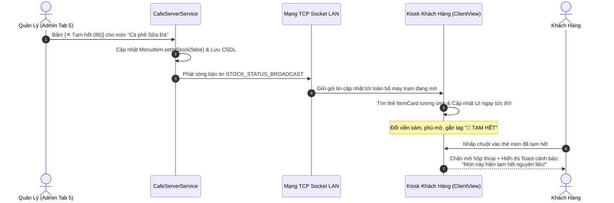

# KẾ HOẠCH NÂNG CẤP HỆ THỐNG GIAI ĐOẠN 5 (PLAN UI VER 5)
## ĐỒNG BỘ DESIGN SYSTEM, NGHIỆP VỤ 86-ING REALTIME & TỐI ƯU KHÔNG GIAN BẢNG BIỂU ADMIN

> **Nguyên tắc thực thi:** 
> - Tài liệu này đóng vai trò là bản đặc tả kỹ thuật và kiến trúc (Architecture & Design Specification). 
> - **Tuyệt đối không chỉnh sửa bất kỳ dòng mã nguồn nào trong lượt này.**
> - Các thông số về kích thước, tỷ lệ không gò bó cứng nhắc theo một số pixel cố định; tài liệu cung cấp nguyên lý linh hoạt (flex/adaptive) để agent và công cụ CLI tự động tính toán, co giãn vừa khít theo từng độ phân giải màn hình.

---

## MỤC LỤC
1. [Tổng quan mục tiêu nâng cấp](#1-tổng-quan-mục-tiêu-nâng-cấp)
2. [Hạng mục 1 & 3: Xử lý triệt để lỗi cắt chữ `...` tại bảng Đơn hàng (Hình 1 & Hình 3)](#2-hạng-mục-1--3-xử-lý-triệt-để-lỗi-cắt-chữ--tại-bảng-đơn-hàng-hình-1--hình-3)
3. [Hạng mục 2 & 6: Chuẩn hóa TextBox / ComboBox "màu tool" và Nút bấm lạc quẻ (Hình 2)](#3-hạng-mục-2--6-chuẩn-hóa-textbox--combobox-màu-tool-và-nút-bấm-lạc-quẻ-hình-2)
4. [Hạng mục 4: Nghiệp vụ Tạm Hết (86-ing) & Đồng bộ Realtime sang Client (Hình 4)](#4-hạng-mục-4-nghiệp-vụ-tạm-hết-86-ing--đồng-bộ-realtime-sang-client-hình-4)
5. [Hạng mục 5: Triệt tiêu khoảng trắng thừa cạnh thanh cuộn ở các phân hệ Quản trị](#5-hạng-mục-5-triệt-tiêu-khoảng-trắng-thừa-cạnh-thanh-cuộn-ở-các-phân-hệ-quản-trị)
6. [Hạng mục 6: Tối ưu đồ họa Banner Bestseller: Khử mờ, chống bóp méo tỷ lệ & bo góc hoàn hảo](#6-hạng-mục-6-tối-ưu-đồ-họa-banner-bestseller-khử-mờ-chống-bóp-méo-tỷ-lệ--bo-góc-hoàn-hảo)
7. [Lộ trình triển khai linh hoạt dành cho Agent / CLI](#7-lộ-trình-triển-khai-linh-hoạt-dành-cho-agent--cli)

---

## 1. TỔNG QUAN MỤC TIÊU NÂNG CẤP

Giai đoạn 4.5 đã giải quyết rất thành công việc bố trí lại thẻ vé KDS (Bếp & Bar) dàn đều ngang và neo nút cố định ở đáy. Tuy nhiên, khi đối chiếu toàn diện sang các phân hệ Quản trị còn lại (`AdminShellView`, `AdminSubViews`, `ClientView`), hệ thống bộc lộ **4 nhóm vấn đề cần giải quyết dứt điểm**:

```
┌─────────────────────────────────────────────────────────────────────────────┐
│                           TRỌNG TÂM PLAN UI VER 5                           │
├─────────────────────────────────────────────────────────────────────────────┤
│ 1. Triệt tiêu 100% hiện tượng cắt chữ ba chấm (...) tại các bảng dữ liệu.   │
│ 2. Xóa sổ toàn bộ các ComboBox, TextBox mặc định màu xám xịt của NetBeans   │
│    và thay thế các nút cam gradient bằng chuẩn Evergreen thanh lịch.       │
│ 3. Hoàn thiện nghiệp vụ Tạm Hết (86-ing): Phát sóng Socket Realtime, đổi   │
│    viền xám + gắn tag cảnh báo bên Kiosk, chặn đặt món có thông báo.        │
│ 4. Tự động co giãn bảng biểu (Auto-fit Flex) ở 4 phân hệ: Kho định lượng,   │
│    Khuyến mãi, Nhân sự, Báo cáo tài chính, xóa bỏ khoảng trắng hở lề.       │
│ 5. Tối ưu đồ họa banner Best Seller: Khử mờ nội suy, khóa tỷ lệ 4:3 gốc,   │
│    bo góc 14px hoàn hảo, render siêu nét chuẩn Retina/HiDPI.                │
└─────────────────────────────────────────────────────────────────────────────┘
```

---

## 2. HẠNG MỤC 1 & 3: XỬ LÝ TRIỆT ĐỂ LỖI CẮT CHỮ `...` TẠI BẢNG ĐƠN HÀNG (HÌNH 1 & HÌNH 3)

### 2.1. Phân tích nguyên nhân thực tế
- **Trên Hình 1:** Cột `TRẠNG THÁI` hiển thị `● Hoàn tất / Đã ...`.
- **Trên Hình 3:** Tại bảng Quản lý Đơn hàng (Tab 3), cả cột `TRẠNG THÁI` và cột `THAO TÁC XỬ LÝ` đều bị co rút:
  - Cột Trạng thái: `● Hoàn tất / Đã ...`
  - Cột Thao tác: Cả 3 nút bị vỡ thành `🖨 In ph...`, `✓ Hoàn ...`, `✕ H...`.
- **Nguyên nhân cốt lõi trong code:**
  - Trong `AdminShellView.java`: Phương thức `createStatusBadge` gán cứng nhãn chuỗi dài `"● Hoàn tất / Đã thu"` với độ rộng `prefWidth(120)` kèm padding ngang `10px` mỗi bên. Không gian text thực tế chỉ còn `100px`, không đủ hiển thị chuỗi dài 17 ký tự font đậm.
  - Khung `actions` chứa 3 nút bấm chỉ được cấp `prefWidth(230)`. Trong khi đó, 3 nút bấm `[🖨 In phiếu]`, `[✓ Hoàn tất]`, `[✕ Hủy]` kèm padding và khoảng cách `spacing(6)` cần tối thiểu `250px - 265px`. Khi nằm trong container hẹp, JavaFX tự động thêm dấu `...`.

### 2.2. Hướng giải quyết linh hoạt (Adaptive Solution)
Thay vì dùng pixel tĩnh cứng nhắc, áp dụng nguyên lý **Rút gọn nhãn thông minh (Smart Semantic Labeling)** kết hợp **Tỷ lệ cột co giãn**:

1. **Chuẩn hóa nhãn Trạng thái súc tích:**
   - Thay `"● Hoàn tất / Đã thu"` thành **`● Đã hoàn tất`** hoặc **`● Đã thu tiền`** (chữ ngắn hơn 35%, vừa khít trong badge mà không bị cắt cụt).
   - `● Đang pha chế` $\rightarrow$ giữ nguyên vì độ dài vừa vặn.
   - `● Chờ pha chế` $\rightarrow$ giữ nguyên.
   - `● Đã hủy` $\rightarrow$ giữ nguyên.
2. **Tối ưu dải nút bấm Thao tác (Action Buttons Cluster):**
   - Rút gọn text nút bấm:
     - `🖨 In phiếu` $\rightarrow$ **`🖨 In vé`** (hoặc chỉ dùng icon `🖨` kèm tooltip khi thu hẹp).
     - `✓ Hoàn tất` $\rightarrow$ **`✓ Xong`** (hoặc `✓ Hoàn tất`).
     - `✕ Hủy` $\rightarrow$ **`✕ Hủy`**.
   - Giảm padding của từng nút từ `4 10 4 10` về `4 8 4 8`, giảm `spacing` giữa các nút còn `4px`.
   - Nâng tỷ lệ phân bổ bề rộng của cột `THAO TÁC XỬ LÝ` lên mức an toàn (hoặc để cột tự mở rộng theo nội dung `USE_COMPUTED_SIZE`).
3. **Chuyển cột "CHI TIẾT MÓN" sang chế độ co giãn tự do (Fluid Column):**
   - Đặt `HBox.setHgrow(colItems, Priority.ALWAYS)` cho cột mô tả món, để khi cửa sổ phóng to, cột món sẽ nở rộng hấp thụ không gian, còn các cột Trạng thái và Thao tác luôn giữ khoảng thở cố định không bị bóp nghẹt.

---

## 3. HẠNG MỤC 2 & 6: CHUẨN HÓA TEXTBOX / COMBOBOX "MÀU TOOL" VÀ NÚT BẤM LẠC QUẺ (HÌNH 2)

### 3.1. Phân tích hiện trạng
- **Trên Hình 2:** 
  - Menu xổ xuống chọn Bàn tại Tab 2 (`cboTable` trong `AdminShellView.java`) đang dùng `ComboBox` mặc định nguyên bản của JavaFX Modena: Nền xám gradient xỉn màu, đường viền xám nhạt, hiệu ứng hover màu xanh lơ (cyan `#0096C9`) và thanh cuộn cổ điển của Windows.
  - Ngay bên dưới là nút `[ 🛒 Gọi Món Ngay ]` dùng dải màu cam gradient (`#FF8C00` $\rightarrow$ `#E65100`) gây cảm giác chắp vá, lạc quẻ so với tổng thể nhận diện thương hiệu.
- **Rà soát các ô nhập liệu "màu tool" còn sót lại:**
  - Ô nhập số lượng `txtQty` và chọn nguyên liệu `cboIng` trong bảng định lượng BOM (Tab 5).
  - Toàn bộ các ô nhập dữ liệu trong Tab 10 (Cài đặt hệ thống: Host, Port, Tên quán, Thuế VAT, Mật khẩu Wifi).
  - Các hộp thoại Modal nghiệp vụ (Thêm món, Nhập kho, Tạo Voucher, Thêm nhân viên).

### 3.2. Bộ quy chuẩn Design Tokens cho Form Controls (Chuẩn Client)
Loại bỏ hoàn toàn giao diện mặc định, áp dụng đồng bộ lớp giao diện phẳng (Warm Minimalist Theme):

```css
/* --- QUY CHUẨN TEXTBOX / INPUT FIELD CHUẨN CLIENT --- */
-fx-background-color: #FAF8F5;
-fx-background-radius: 8px;
-fx-border-color: #DFD8CE;
-fx-border-radius: 8px;
-fx-border-width: 1px;
-fx-font-family: 'Inter', sans-serif;
-fx-font-size: 13px;
-fx-text-fill: #112823;
-fx-padding: 8 12 8 12;
/* Khi focus / nhấp chuột: viền chuyển sang xanh rừng đậm #112823, không dùng xanh dương */

/* --- QUY CHUẨN COMBOBOX DROPDOWN CHUẨN CLIENT --- */
-fx-background-color: #FAF8F5;
-fx-background-radius: 8px;
-fx-border-color: #DFD8CE;
-fx-border-radius: 8px;
-fx-border-width: 1px;
-fx-font-family: 'Inter', sans-serif;
-fx-font-size: 13px;
-fx-font-weight: 700;
-fx-text-fill: #112823;
-fx-padding: 4 8 4 10;
-fx-cursor: hand;

/* Danh sách xổ xuống (Popup List View):
   - Nền danh sách: #FFFFFF, viền #DFD8CE, bo góc 8px.
   - Từng dòng mục: Padding 8px 12px, font 12.5px.
   - Khi hover: Nền kem #F5EFEB, chữ #112823.
   - Khi đang chọn (Selected): Nền xanh rừng #112823, chữ trắng #FFFFFF (triệt tiêu màu cyan #0096C9). */
```

### 3.3. Thay thế nút cam gradient lạc quẻ
- Đổi nút `[ 🛒 Gọi Món Ngay ]` sang đúng bảng màu thương hiệu:
  - **Màu nền:** Xanh rừng đậm `#112823` (hover chuyển `#1A3B34`).
  - **Màu chữ:** Trắng tinh `#FFFFFF`, font `Inter 13.5px ExtraBold`.
  - **Bo góc:** `8px`, hiệu ứng nhấn nút nảy nhẹ (`AnimationHelper.applyButtonPress`).

---

## 4. HẠNG MỤC 4: NGHIỆP VỤ TẠM HẾT (86-ING) & ĐỒNG BỘ REALTIME SANG CLIENT (HÌNH 4)

### 4.1. Thực trạng nghiệp vụ hiện tại
- **Trên Hình 4:** Tại bảng Quản lý Thực đơn (Tab 5), có nút gạt trạng thái `● Còn bán` / `✕ Tạm hết (86)`.
- Khi người quản trị bấm `✕ Tạm hết (86)`, hệ thống mới chỉ cập nhật biến cục bộ trong bộ nhớ của Admin.
- **Hạn chế lớn:**
  1. Không có sự kiện truyền tin qua Socket: Khách tại bàn (Kiosk) hoặc Nhân viên (Staff Pad) không hề hay biết món đã hết, vẫn bấm đặt bình thường.
  2. Giao diện Kiosk không thay đổi diện mạo, khách chỉ biết món hết khi nhân viên ra báo bằng miệng, gây trải nghiệm thất vọng.

### 4.2. Thiết kế Kiến trúc Đồng bộ Realtime (Socket Event-Driven)



### 4.3. Thiết kế giao diện món Tạm Hết bên Client (`ItemCard.java`)
Học tập cơ chế hiển thị của huy hiệu **`🔥 BÁN CHẠY`** để áp dụng cho món **`🚫 TẠM HẾT`**:

```
┌─────────────────────────────────────────────────────────────┐
│ ┌─────────────────────────────────────────────────────────┐ │
│ │ [Ảnh sản phẩm bị phủ mờ nhẹ Opacity 0.60]               │ │
│ │                                                         │ │
│ │                                   [ 🚫 TẠM HẾT ] (Góc)  │ │ <- Tag viền xám tro, chữ đậm
│ └─────────────────────────────────────────────────────────┘ │
│                                                             │
│ Cà phê Sữa Đá                                               │ <- Chữ chuyển xám trung tính
│ ─────────────────────────────────────────────────────────── │
│ Tạm ngưng phục vụ                                           │ <- Thay thế giá tiền
│ (Nút [+ Thêm] tự động ẩn hoặc vô hiệu hóa chuyển xám nhạt)  │
└─────────────────────────────────────────────────────────────┘
Viền thẻ: Đổi từ viền kem sang viền xám nhạt #D1D5DB (Border 1.5px)
```

1. **Hiệu ứng nhận diện từ xa:**
   - Viền thẻ sản phẩm đổi sang màu xám tro nhạt: `-fx-border-color: #D1D5DB; -fx-border-width: 1.5px;`.
   - Nền thẻ chuyển sang sắc độ xám kem tĩnh: `-fx-background-color: #F7F5F2;`.
   - Độ mờ toàn thẻ: `setOpacity(0.65)`.
   - Góc trên bên phải ảnh gắn nhãn cố định: **`🚫 TẠM HẾT`** (Nền xám đậm `#4B5563`, chữ trắng `#FFFFFF`, bo góc `6px`).
2. **Cơ chế chặn thao tác (Guard Interception):**
   - Vô hiệu hóa nút `[+ Thêm]`.
   - Khi khách nhấp chuột vào thân thẻ, không mở hộp thoại tùy chọn (`ItemDetailDialog`), đồng thời kích hoạt thông báo Toast nổi nhẹ nhàng:
     > *"Món '[Tên món]' hiện đang tạm hết nguyên liệu. Quý khách vui lòng chọn món thơm ngon khác nhé!"*
3. **Bảo vệ giỏ hàng (Cart Validation):**
   - Nếu khách đã lỡ thêm món vào giỏ từ trước lúc Admin bấm Tạm hết: Khi bấm "Tiến hành Thanh toán", hệ thống quét lại danh sách giỏ hàng, nếu có món tạm hết thì bôi đỏ món đó trong giỏ và thông báo khách bỏ ra trước khi hoàn tất.

---

## 5. HẠNG MỤC 5: TRIỆT TIÊU KHOẢNG TRẮNG THỪA CẠNH THANH CUỘN Ở CÁC PHÂN HỆ QUẢN TRỊ

### 5.1. Phân tích nguyên nhân
Tại các Tab Quản trị trong `AdminSubViews.java`:
- **Tab 6 (Kho & Định lượng):** Tổng chiều rộng các cột tĩnh chỉ đạt khoảng $\approx 1000\text{px}$.
- **Tab 7 (Khuyến mãi & Voucher):** Tổng chiều rộng các cột tĩnh chỉ đạt khoảng $\approx 965\text{px}$.
- **Tab 8 (Nhân sự & Phân quyền):** Tổng chiều rộng các cột tĩnh chỉ đạt khoảng $\approx 945\text{px}$.
- **Tab 9 (Báo cáo Tài chính):** Tổng chiều rộng các cột tĩnh chỉ đạt khoảng $\approx 1060\text{px}$.

Trong khi đó, trên màn hình máy tính chuẩn (1200x760 hoặc Full HD 1920x1080), vùng làm việc trung tâm rộng từ $1250\text{px} - 1600\text{px}$. Do toàn bộ các cột đều gán cứng số pixel (`setPrefWidth`) mà **không có cột nào được bật thuộc tính co giãn `HBox.setHgrow(..., Priority.ALWAYS)`**, bảng dừng lại ở khoảng $1000\text{px}$ và để lại một khoảng trắng khổng lồ rộng từ $250\text{px} - 500\text{px}$ trống trơn trước thanh cuộn bên phải.

### 5.2. Giải pháp kỹ thuật: Phân bổ Cột Co Giãn Động (Fluid Column Auto-Expansion)
Không cần can thiệp thuật toán phức tạp; giải pháp chuẩn mực của JavaFX là chọn ra **1 đến 2 cột chứa dữ liệu văn bản dài nhất trong mỗi bảng** để làm "cột hấp thụ không gian" (`Priority.ALWAYS` và `setMaxWidth(Double.MAX_VALUE)`):

```text
=== HIỆN TẠI (CÁC CỘT CỐ ĐỊNH, HỞ LỀ TRẮNG BÊN PHẢI) ===
┌──────┬──────────────────┬──────────┬──────────┐
│  MÃ  │ TÊN NGUYÊN LIỆU  │ TỒN KHO  │ TRẠNG THÁI│  (KHOẢNG TRẮNG THỪA TO TƯỚNG) ║ Thanh
└──────┴──────────────────┴──────────┴──────────┘                               ║ cuộn

=== SAU KHI SỬA (CỘT TÊN MÓN TỰ NỞ HẤP THỤ TOÀN BỘ KHÔNG GIAN DƯ) ===
┌──────┬────────────────────────────────────────────┬──────────┬──────────┐
│  MÃ  │ TÊN NGUYÊN LIỆU (Tự động mở rộng sát lề)   │ TỒN KHO  │ TRẠNG THÁI│ ║ Thanh
└──────┴────────────────────────────────────────────┴──────────┴──────────┘ ║ cuộn
```

**Bảng 5.1. Bảng quy hoạch cột co giãn linh hoạt theo từng phân hệ**

| Phân hệ / Tab | Cột được chọn làm Cột Co Giãn (`Priority.ALWAYS`) | Lý do lựa chọn |
| :--- | :--- | :--- |
| **Tab 6: Tồn kho Nguyên liệu** | **`TÊN NGUYÊN VẬT LIỆU`** & **`NHÀ CUNG CẤP`** | Tên nguyên liệu ("Hạt Cà phê Arabica Cầu Đất") và tên nhà cung cấp thường dài, khi nở rộng giúp đọc trọn vẹn không bị co cụm. |
| **Tab 7: Khuyến mãi & Voucher** | **`LOẠI GIẢM GIÁ / MÔ TẢ ĐIỀU KIỆN`** | Chứa mô tả chi tiết khuyến mãi, việc giãn rộng lấp kín bảng và giúp thông tin rõ ràng. |
| **Tab 8: Nhân sự & Phân quyền** | **`HỌ VÀ TÊN NHÂN SỰ`** & **`PHÂN HỆ ĐƯỢC PHÉP VÀO`** | Tên người dùng và danh sách các quyền hạn quản trị chiếm nhiều diện tích ngang, cần nở hết biên độ. |
| **Tab 9: Báo cáo Tài chính** | **`KỲ HẠCH TOÁN`** & **`DOANH THU GỘP`** | Tạo khoảng cách thoáng đãng giữa các con số tài chính, tránh dồn ép các cột số tiền vào sát nhau. |

*Khi áp dụng nguyên tắc này, mép phải của bảng sẽ luôn tự động áp sát thanh cuộn dọc với khoảng đệm lề chuẩn mực $12\text{px} - 14\text{px}$, hoàn toàn xóa sổ khoảng trắng thừa trên mọi độ phân giải.*

---

## 6. HẠNG MỤC 6: TỐI ƯU ĐỒ HỌA BANNER BESTSELLER: KHỬ MỜ, CHỐNG BÓP MÉO TỶ LỆ & BO GÓC HOÀN HẢO

### 6.1. Phân tích nguyên nhân đồ họa bị mờ và méo (Squished / Blurry Artifacts)
- **Tệp ảnh gốc:** Tài nguyên `/cafe/resources/images/products/kho_ga_do_mixi_banner.png` có độ phân giải gốc rất cao `1024 × 765 px`, tỷ lệ khung hình chuẩn $\approx 4:3$ (chính xác $1.3386$).
- **Nguyên nhân cốt lõi trong `ClientView.java` khiến ảnh hiển thị mờ, méo mó và mất thẩm mỹ:**
  1. **Bóp méo kích thước và lệch tỷ lệ (Aspect Ratio Mismatch):**
     - Khung chứa ảnh (`imgWrapper`) hiện bị ép cứng ở kích thước `130 × 118 px` (tỷ lệ $1.1017$).
     - Khi gắn `imgView.setFitWidth(130)` và `imgView.setFitHeight(118)` với cờ `setPreserveRatio(true)`, chiều cao thực tế của ảnh bị co rút chỉ còn $130 / 1.3386 = 97.1\text{px}$.
     - Độ chênh lệch $20.9\text{px}$ chiều dọc khiến ảnh bị lọt thỏm ở giữa, để lộ 2 khoảng đệm đen `#292524` ở trên và dưới.
     - Đồng thời, mặt nạ bo góc `Rectangle imgClip(130, 118)` có kích thước lớn hơn ảnh thực tế (`130 × 97.1 px`), dẫn đến việc ảnh không được bo góc chuẩn mà bị cắt hụt mép, tạo cảm giác nham nhở, răng cưa.
  2. **Thuật toán thu nhỏ (Downsampling) gây mờ nhòe, mất chi tiết:**
     - Việc nạp ảnh thô `new Image(is)` rồi để JavaFX tự co trên GPU canvas ở tỷ lệ thu nhỏ hơn 8 lần ($1024\text{px} \rightarrow 130\text{px}$) mà không áp dụng bộ lọc nội suy ở tầng giải mã (decode-time resampling) khiến hình ảnh bị vỡ nét (aliasing), khuôn mặt nhân vật và chữ trên hũ khô gà bị nhòe mờ, mất độ tương phản sắc sảo.

### 6.2. Giải pháp kỹ thuật nâng cấp đồ họa siêu nét & bo góc hoàn hảo
1. **Nạp ảnh chất lượng cao có nội suy khử răng cưa (Decode-time Bicubic Smoothing & Retina Scaling):**
   - Nạp ảnh thông qua constructor chuyên dụng của JavaFX với độ phân giải siêu mẫu (Supersampling x2 để hỗ trợ màn hình Retina / High-DPI):
     ```java
     // Load ảnh trực tiếp ở tỷ lệ 4:3 siêu nét (320x240 px, smooth = true, preserveRatio = true)
     Image img = new Image(is, 320, 240, true, true);
     ```
   - Việc chỉ định kích thước mục tiêu kèm cờ `smooth = true` kích hoạt bộ lọc nội suy chất lượng cao của JavaFX ngay khi giải mã, loại bỏ hoàn toàn hiện tượng vỡ hạt và mờ đục.
2. **Khóa tỷ lệ chuẩn 4:3 gốc & Tối ưu kích thước hiển thị:**
   - Điều chỉnh kích thước khung chứa ảnh sang kích thước chuẩn $152 \times 114\text{px}$ hoặc $148 \times 111\text{px}$ (khớp chính xác tỷ lệ $4:3$ của ảnh gốc $1024 \times 765$).
   - Ảnh lấp đầy trọn vẹn $100\%$ diện tích khung chứa, không bị bất kỳ khoảng đen hở viền nào ở 2 cạnh trên dưới.
3. **Bo góc hoàn hảo (Perfect Clip Radius):**
   - Đồng bộ mặt nạ cắt góc `Rectangle imgClip` chính xác theo kích thước hiển thị thực tế:
     ```java
     Rectangle imgClip = new Rectangle(targetW, targetH);
     imgClip.setArcWidth(14);
     imgClip.setArcHeight(14);
     imgView.setClip(imgClip);
     ```
   - Độ cong $14\text{px}$ đồng nhất hoàn hảo với `StackPane imgWrapper` và bo góc toàn banner (`-fx-background-radius: 14px`).
   - Kết quả: Ảnh đạt độ sắc nét tối đa (Retina Crisp), khuôn mặt nhân vật và chi tiết hũ khô gà nổi bật, các góc bo tròn mềm mại chuẩn thiết kế hiện đại.

---

## 7. LỘ TRÌNH TRIỂN KHAI LINH HOẠT DÀNH CHO AGENT / CLI

Khi người dùng ra lệnh triển khai mã nguồn, tiến trình sẽ được thực hiện tuần tự theo 5 bước an toàn, mỗi bước đều có thể tự căn chỉnh linh hoạt:

### Bước 1: Khắc phục lỗi cắt chữ `...` tại `AdminShellView.java`
- Điều chỉnh `createStatusBadge`: Rút gọn nhãn thành `● Đã hoàn tất`, `● Đã thu tiền`, nới lỏng `prefWidth` hoặc để tính toán tự nhiên.
- Điều chỉnh cụm nút `actions` tại Tab 3: Rút gọn nhãn nút `[🖨 In vé]`, `[✓ Xong]`, `[✕ Hủy]`, giảm nhẹ padding để 3 nút nằm thoải mái không bị co ngắn.
- Gán `HBox.setHgrow(Priority.ALWAYS)` cho cột mô tả món để tự động hấp thụ không gian thừa.

### Bước 2: Tẩy sạch "màu tool" của NetBeans và Nút cam gradient
- Định dạng lại `cboTable` tại Tab 2 bằng CSS phẳng: Nền kem sáng `#FAF8F5`, viền `#DFD8CE`, bo góc `8px`, chữ xanh `#112823`.
- Thay nút cam `[ 🛒 Gọi Món Ngay ]` bằng nút Evergreen chuẩn `#112823` chữ trắng.
- Rà soát các ô nhập `txtQty`, `cboIng`, và các `TextField` cài đặt hệ thống ở Tab 10 để gắn chung bộ style phẳng.

### Bước 3: Nâng cấp đồ họa Banner Bestseller siêu nét & bo góc chuẩn (`ClientView.java`)
- Khóa tỷ lệ khung ảnh 4:3 chuẩn xác ($152 \times 114\text{px}$), nạp ảnh nội suy mịn 320x240 (`smooth = true`).
- Gán mặt nạ bo góc 14px ăn khớp hoàn toàn với ảnh, triệt tiêu 100% khoảng đen hở viền và hiện tượng bóp méo hình ảnh.

### Bước 4: Hiện thực hóa nghiệp vụ Tạm Hết (86-ing) Realtime
- Bổ sung bản tin mạng `STOCK_STATUS_BROADCAST` vào `MessageProtocol.java`.
- Tại Server (`CafeServerService.java` & `AdminSubViews.java` Tab 5): Khi bấm nút gạt trạng thái món, gửi gói tin tới tất cả Client đang kết nối.
- Tại Client (`ClientSocketService.java` & `ClientView.java` & `ItemCard.java`): Nhận gói tin, đổi viền xám tro, gắn tag `🚫 TẠM HẾT`, mờ thẻ `0.65`, khóa nút bấm và thông báo khi khách nhấp chọn.

### Bước 5: Chữa dứt điểm khoảng trắng thừa tại Tabs 6, 7, 8, 9 (`AdminSubViews.java`)
- Tại các bảng Tồn kho (Tab 6), Voucher (Tab 7), Nhân sự (Tab 8), Sổ quỹ (Tab 9): Gán `HBox.setHgrow(..., Priority.ALWAYS)` cho các cột văn bản dài tương ứng theo Bảng 5.1.
- Biên dịch dự án bằng `javac` và chạy thử nghiệm xác minh giao diện.
