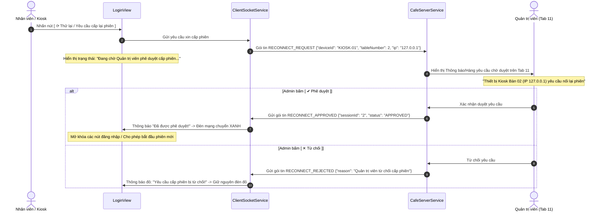

# KẾ HOẠCH NÂNG CẤP GIAO DIỆN & HOÀN THIỆN NGHIỆP VỤ HỆ THỐNG (PLAN UI VER 6.5)
**Dự án:** Hệ thống Quản lý Bán hàng & Điều phối Đặt món Quán Cafe (CafeOrder System)  
**Tài liệu tham chiếu:** `Plan UI ver6.5.md`  
**Phiên bản:** UI/UX & Protocol Architecture Version 6.5 (Cập nhật sau phản hồi thực tế từ Ver 6.0)  
**Đối tượng thực hiện:** Antigravity CLI / Developer  
**Nguyên tắc cốt lõi:**  
> ⚠️ **STRICT CONSTRAINT:** Tài liệu này đóng vai trò là bản đặc tả kỹ thuật và kiến trúc giải pháp toàn diện. **TUYỆT ĐỐI KHÔNG CHỈNH SỬA BẤT KỲ DÒNG MÃ NGUỒN NÀO** trong phiên hiện tại.  
> 💡 **ADAPTIVE METRICS & PROTOCOL HARDENING:** Mọi giải pháp giao diện đều được tính toán theo tỷ lệ co giãn thích ứng (Relative/Responsive layout) chống co cắt chữ, đồng thời hoàn thiện luồng Socket State Machine (Kick -> Logout -> Re-authorization -> Ping probe).

---

## MỤC LỤC TỔNG QUAN

1. [Bối cảnh & 6 Trọng tâm Cải tiến Bản Ver 6.5](#1-bối-cảnh--6-trọng-tâm-cải-tiến-bản-ver-65)
2. [Hạng mục 1: Xử lý Mất chữ Thẻ Hồ sơ (Shift Drawer) & Đổi Tên Nhân sự (Image 1)](#2-hạng-mục-1-xử-lý-mất-chữ-thẻ-hồ-sơ-shift-drawer--đổi-tên-nhân-sự-image-1)
3. [Hạng mục 2: Khắc phục Triệt để Lỗi Ngược Màu Chữ/Nền Bộ lọc Phân loại Bàn (Image 2)](#3-hạng-mục-2-khắc-phục-triệt-để-lỗi-ngược-màu-chữnền-bộ-lọc-phân-loại-bàn-image-2)
4. [Hạng mục 3: Cập nhật Bộ Icon Quản trị Admin Mới Thêm](#4-hạng-mục-3-cập-nhật-bộ-icon-quản-trị-admin-mới-thêm)
5. [Hạng mục 4: Tái cấu trúc Luồng Kick Socket - Tự Đăng xuất & Cơ chế Duyệt Cấp lại Phiên](#5-hạng-mục-4-tái-cấu-trúc-luồng-kick-socket---tự-đăng-xuất--cơ-chế-duyệt-cấp-lại-phiên)
6. [Hạng mục 5: Xây dựng Luồng Tương tác Logic Thực tế cho Nút Ping (RTT Probe)](#6-hạng-mục-5-xây-dựng-luồng-tương-tác-logic-thực-tế-cho-nút-ping-rtt-probe)
7. [Hạng mục 6: Chuẩn hóa & Loại bỏ Triệt để Lỗi Hiển thị 2 Nút Đăng xuất Trùng lặp (Image 3)](#7-hạng-mục-6-chuẩn-hóa--loại-bỏ-triệt-để-lỗi-hiển-thị-2-nút-đăng-xuất-trùng-lặp-image-3)
8. [Hướng dẫn Kỹ thuật Triển khai Chi tiết cho Antigravity CLI](#8-hướng-dẫn-kỹ-thuật-triển-khai-chi-tiết-cho-antigravity-cli)

---

## 1. BỐI CẢNH & 6 TRỌNG TÂM CẢI TIẾN BẢN VER 6.5

Dựa trên kết quả chạy thử nghiệm thực tế và 3 ảnh chụp giao diện được cung cấp, hệ thống ghi nhận 6 điểm cần tinh chỉnh dứt điểm:

```
+----------------------------------------------------------------------------------------------------+
|                                    6 TRỌNG TÂM CẢI TIẾN (PLAN UI VER 6.5)                          |
+---+------------------------------+-----------------------------------------------------------------+
| 1 | Mất chữ trong Thẻ Hồ Sơ      | - Tên cũ "Trần Minh Anh" cần đổi thành "Nguyễn Minh Luân".      |
|   | (Shift Drawer Modal)         | - Badge "• Đang ho...", giờ "06:45 h...", 4 nút đáy bị co "...".|
+---+------------------------------+-----------------------------------------------------------------+
| 2 | Phân loại bàn bị ngược màu   | - Chữ trắng trên nền trắng (tàng hình) khi unactive.            |
|   | (Table Filter Pills)         | - Chữ đen trên nền đen (tối thui) khi active.                   |
+---+------------------------------+-----------------------------------------------------------------+
| 3 | Cập nhật Icon Admin          | - Đã bổ sung 2 file: `thuc-don-gia.png` và `ha-tang-mang.png`.  |
|   | (Sidebar Tab 5 & Tab 11)     | - Cần map đúng file icon vào sidebar AdminShellView.            |
+---+------------------------------+-----------------------------------------------------------------+
| 4 | Luồng Kick & Cấp lại phiên   | - Kick: Bật Popup cảnh báo -> Tự văng về LoginView -> Đèn đỏ.  |
|   | (Socket Re-Auth Flow)        | - Tiếp tục: Bấm "Thử lại" -> Server nhận yêu cầu duyệt -> Tiếp. |
+---+------------------------------+-----------------------------------------------------------------+
| 5 | Hoàn thiện Luồng Nút Ping    | - Bấm Ping -> Đo RTT 2 chiều tức thời -> Báo Toast ms cụ thể    |
|   | (Latency Round-Trip-Time)    | -> Cập nhật nhãn RTT của dòng đó -> Timeout nếu mất gói.        |
+---+------------------------------+-----------------------------------------------------------------+
| 6 | Trùng lặp 2 nút Đăng xuất    | - Admin/Staff hiển thị 2 nút đăng xuất cùng lúc (1 trong card,  |
|   | (Duplicate Logout Buttons)   |   1 dưới chân card). Chuẩn hóa còn 1 nút duy nhất.             |
+---+------------------------------+-----------------------------------------------------------------+
```

---

## 2. HẠNG MỤC 1: XỬ LÝ MẤT CHỮ THẺ HỒ SƠ (SHIFT DRAWER) & ĐỔI TÊN NHÂN SỰ (IMAGE 1)

### 2.1. Phân tích Nguyên nhân Cắt xén (Dựa trên Image 1)

Trong `FloorPlanView.java:1546` (`showStaffShiftModal`):
1. **Khung chứa Modal quá hẹp:**
   - Chiều rộng được gán cố định: `root.setPrefWidth(600)`.
   - Với `padding: 24px` ở hai bên, chiều rộng thực tế bên trong chỉ còn: $600 - (24 \times 2) = 552px$.
2. **Cụm 4 nút tác vụ ở đáy quá dài:**
   - 4 nút được xếp trên cùng một hàng ngang `HBox(10)`:
     - `btnPin`: "🔑 Đổi mã PIN" $\rightarrow \approx 125px$.
     - `btnPrintZ`: "🖨 In Báo Cáo Ca (Z-Report)" $\rightarrow \approx 205px$.
     - `btnLogout`: "🚪 KẾT CA & ĐĂNG XUẤT" $\rightarrow \approx 195px$.
     - `btnClose`: "Đóng" $\rightarrow \approx 85px$.
   - Tổng chiều rộng cần thiết: $125 + 205 + 195 + 85 + (3 \times 10\text{ gap}) = 640px > 552px$!
   - Hệ quả: JavaFX tự động co hẹp và chèn dấu ba chấm `...` vào toàn bộ cả 4 nút: `🔑 Đổi mã ...`, `🖨 In Báo Cáo Ca (Z-Rep...`, `🚪 KẾT CA & ĐĂNG XU...`, `Đó...`.
3. **Thanh thông tin nhân viên (Staff Header) bị dồn ép:**
   - Nhãn thời gian dài: `"Chức danh: Thu ngân • Tài khoản: cashier1 • Đăng nhập: 06:45 hôm nay"` bị badge `"● Đang hoạt động"` chiếm chỗ bên phải $\rightarrow$ nhãn giờ bị cắt thành `06:45 h...` và badge bị co thành `• Đang ho...`.

### 2.2. Giải pháp Kiến trúc & Tái cấu trúc Layout

#### 1. Đổi Tên Nhân sự Toàn hệ thống:
- Đổi họ tên từ **`Trần Minh Anh`** $\rightarrow$ **`Nguyễn Minh Luân`**.
- Avatar chữ viết tắt đổi từ **`TA`** $\rightarrow$ **`NL`** (hoặc **`ML`**).
- Cập nhật trong toàn bộ cấu hình mẫu:
  - `DatabaseManager.java:185`: `addSeedStaff(1, "admin", "Nguyễn Minh Luân", "OWNER", "ACTIVE", "123456");`
  - `DatabaseManager.java:187`: `addSeedStaff(3, "cashier1", "Nguyễn Minh Luân", "CASHIER", "ACTIVE", "123456");`
  - `AdminShellView.java:211`: `lblName = new Label("Minh Luân");`

#### 2. Tái cấu trúc Modal Bàn Giao Ca Trực (`Shift Drawer`):
- Nâng chiều rộng modal từ `600px` lên **`680px - 700px`** (hoặc dùng `prefWidth: 680`).
- Thiết lập `minWidth(Region.USE_PREF_SIZE)` cho badge trạng thái `● Đang hoạt động` để triệt tiêu vĩnh viễn lỗi `• Đang ho...`.
- Tách hàng nút tác vụ thành **2 nhóm cân xứng (Split Actions Bar)**:
  - **Nhóm Trái (Tác vụ ca trực):** `[ 🔑 Đổi mã PIN ]` và `[ 🖨 In Báo Cáo Z-Report ]`.
  - **Nhóm Phải (Kết thúc ca):** `[ 🚪 Kết Ca & Đăng Xuất ]` và `[ Đóng ]`.

```
+---------------------------------------------------------------------------------------------------+
|               💼 HỒ SƠ NHÂN VIÊN & QUẢN LÝ CA TRỰC (SHIFT DRAWER)                                 |
+---------------------------------------------------------------------------------------------------+
|  [NL]   Nguyễn Minh Luân (Mã NV: NV-03)                                      [ ● Đang hoạt động ] |
|         Chức danh: Thu ngân  •  Tài khoản: cashier1  •  Đăng nhập: 06:45 hôm nay                  |
+---------------------------------------------------------------------------------------------------+
|  📊 ĐỐI SOÁT DOANH THU CA HIỆN TẠI (CA SÁNG: 06:30 - 14:30):                                       |
|  1. Tiền mặt ban đầu trong két (Cash Float):                 1.000.000 đ                          |
|  2. Tổng số hóa đơn đã xử lý thành công:                     7 đơn hàng                           |
|  3. Doanh số thanh toán TIỀN MẶT trong ca:                   937.000 đ                            |
|  4. Doanh số thanh toán CHUYỂN KHOẢN (VietQR):               0 đ                                  |
|  -----------------------------------------------------------------------                          |
|  => TỔNG TIỀN MẶT LÝ THUYẾT PHẢI CÓ TRONG KÉT:               1.937.000 đ                          |
+---------------------------------------------------------------------------------------------------+
|  💵 BÀN GIAO TIỀN MẶT KHI RA CA:                                                                  |
|  Số tiền mặt thực tế kiểm đếm (đ): [ 1937000        ]     Chênh lệch: 0 đ (Khớp 100%)             |
|  Ghi chú ca trực: [ Ca sáng hoàn thành tốt, bàn 05 đã đặt trước.                                ] |
+---------------------------------------------------------------------------------------------------+
|  [ 🔑 Đổi mã PIN ]  [ 🖨 In Báo Cáo Z-Report ]     |     [ 🚪 KẾT CA & ĐĂNG XUẤT ]   [ Đóng ]      |
+---------------------------------------------------------------------------------------------------+
```

---

## 3. HẠNG MỤC 2: KHẮC PHỤC TRIỆT ĐỂ LỖI NGƯỢC MÀU CHỮ/NỀN BỘ LỌC PHÂN LOẠI BÀN (IMAGE 2)

### 3.1. Phân tích Nguyên nhân Gốc rễ (Root Cause)

Quan sát Image 2:
- Nút thứ nhất (`Tất cả`): Nền màu trắng tinh, chữ màu trắng $\rightarrow$ **Trắng trên Trắng = Chữ biến mất hoàn toàn!**
- Nút thứ hai (`Bàn trống`): Nền màu xanh đen đậm `#112823`, chữ màu đen/nâu tối $\rightarrow$ **Đen trên Nền Tối = Chữ chìm nghỉm, không đọc được!**
- Nút thứ ba (`Có khách`): Nền trắng, chữ đen viền xám $\rightarrow$ Bình thường.

**Xem xét đoạn mã trong `FloorPlanView.java`:**
```java
// Khi khởi tạo nút (createFilterPill):
Label lbl = new Label(title);
lbl.setStyle("-fx-font-size: 11.5px; -fx-font-weight: 700; -fx-text-fill: " + (isActive ? "#FFFFFF" : "#292722") + ";");
content.getChildren().addAll(icon, lbl);
btn.setGraphic(content);

// Nhưng khi chuyển trạng thái (setTableFilter -> applyFilterPillStyle):
private void applyFilterPillStyle(Button btn, boolean isActive) {
    if (isActive) {
        btn.setStyle("-fx-background-color: #112823; -fx-background-radius: 6px;");
    } else {
        btn.setStyle("-fx-background-color: #FFFFFF; -fx-background-radius: 6px; -fx-border-color: #DED7CD; ...");
    }
}
```

**Lỗ hổng logic chết người:**
Hàm `applyFilterPillStyle` **chỉ thay đổi thuộc tính `background-color` của Button cha, hoàn toàn không cập nhật lại màu chữ của `Label` và màu vẽ của `Icon` nằm bên trong Graphic con!**
- Ban đầu `btnAll` được tạo với `isActive = true` $\rightarrow$ `lbl` được gán cứng `text-fill: #FFFFFF`. Khi người dùng click sang `Bàn trống`, `btnAll` bị gán `isActive = false` $\rightarrow$ Nền biến thành Trắng, nhưng chữ bên trong VẪN LÀ MÀU TRẮNG $\rightarrow$ **Chữ tàng hình!**
- Ngược lại, `btnEmpty` ban đầu được tạo với `isActive = false` $\rightarrow$ `lbl` được gán cứng `text-fill: #292722`. Khi click chọn nó, nền biến thành `#112823` (xanh đen), nhưng chữ bên trong VẪN LÀ MÀU ĐEN $\rightarrow$ **Chữ chìm vào nền!**

### 3.2. Giải pháp Khắc phục Triệt để

Cần cập nhật **đồng bộ 2 chiều** cả Nền (Container) và Chữ + Icon (Children Graphic).

```java
private void applyFilterPillStyle(Button btn, boolean isActive) {
    if (btn == null) return;
    
    // 1. Cập nhật Nền và Viền cho Button cha
    if (isActive) {
        btn.setStyle(
            "-fx-background-color: #112823; " +
            "-fx-background-radius: 8px; " +
            "-fx-cursor: hand;"
        );
    } else {
        btn.setStyle(
            "-fx-background-color: #FFFFFF; " +
            "-fx-background-radius: 8px; " +
            "-fx-border-color: #DED7CD; " +
            "-fx-border-radius: 8px; " +
            "-fx-border-width: 1px; " +
            "-fx-cursor: hand;"
        );
    }

    // 2. Duyệt Graphic con để cập nhật ĐỒNG BỘ màu Chữ và Icon
    if (btn.getGraphic() instanceof HBox) {
        HBox content = (HBox) btn.getGraphic();
        for (Node child : content.getChildren()) {
            if (child instanceof Label) {
                ((Label) child).setStyle(
                    "-fx-font-size: 12px; -fx-font-weight: 700; " +
                    "-fx-text-fill: " + (isActive ? "#FFFFFF" : "#3F3931") + ";"
                );
            } else if (child instanceof SVGPath) {
                ((SVGPath) child).setFill(isActive ? Color.WHITE : Color.web("#112823"));
                ((SVGPath) child).setStroke(isActive ? Color.WHITE : Color.web("#112823"));
            }
        }
    }
}
```

---

## 4. HẠNG MỤC 3: CẬP NHẬT BỘ ICON QUẢN TRỊ ADMIN MỚI THÊM

### 4.1. Hiện trạng Filesystem & Mapping Cũ

Người dùng đã bổ sung 2 file icon chuẩn thương hiệu vào thư mục:
`src/cafe/resources/images/icons/admin/`
1. **`thuc-don-gia.png`** (Dung lượng 866 bytes - Cập nhật lúc 19:29)
2. **`ha-tang-mang.png`** (Dung lượng 445 bytes - Cập nhật lúc 19:26)

Tuy nhiên, trong `AdminShellView.java` (dòng 183 và 189), hệ thống vẫn đang map nhầm file icon cũ:
```java
// CODE CŨ TRONG AdminShellView.java:
navButtons.add(createSidebarBtn(5, "Thực đơn & Giá", "mon-va-gia.png", SvgIcons.MENU, "☕"));   // Đang dùng mon-va-gia.png
...
navButtons.add(createSidebarBtn(11, "Hạ tầng & Mạng", "cai-dat.png", SvgIcons.SETTINGS, "🌐")); // Đang dùng cai-dat.png!
```

### 4.2. Hướng Cập nhật Mapping Chuẩn Xác

Cập nhật danh sách khởi tạo `navButtons` trong `AdminShellView.java`:
```java
// CẬP NHẬT CHUẨN XÁC:
navButtons.add(createSidebarBtn(5, "Thực đơn & Giá", "thuc-don-gia.png", SvgIcons.MENU, "☕"));
...
navButtons.add(createSidebarBtn(11, "Hạ tầng & Mạng", "ha-tang-mang.png", SvgIcons.SETTINGS, "🌐"));
```
- Khi load qua hàm `getIconNode(iconFileName, ...)`, ứng dụng sẽ ưu tiên nạp tệp `thuc-don-gia.png` và `ha-tang-mang.png` thay vì dùng icon fallback hoặc icon trùng lặp.

---

## 5. HẠNG MỤC 4: TÁI CẤU TRÚC LUỒNG KICK SOCKET - TỰ ĐĂNG XUẤT & CƠ CHẾ DUYỆT CẤP LẠI PHIÊN

### 5.1. Luồng Kick Phiên Hoàn Chỉnh (Kick -> Alert Popup -> Văng về LoginView -> Đèn Đỏ)

Khi Admin nhấn nút `[ ✕ Kick ]` tại Tab 11 (Hạ tầng & Mạng):

```mermaid
sequenceDiagram
    autonumber
    actor Admin as Quản trị viên (Tab 11)
    participant Server as CafeServerService
    participant Client as ClientSocketService
    participant UI as Client Shell / LoginView

    Admin->>Server: Click [ ✕ Kick ] phiên #X
    Server->>Client: Gửi gói tin SESSION_KICKED {"reason": "Quản trị viên đã ngắt kết nối phiên làm việc"}
    Note over Server: Tạm ngưng TCP socket & chuyển trạng thái phiên thành KICKED
    
    Client->>Client: Nhận diện type == SESSION_KICKED
    Note over Client: Đặt running = false; dừng heartbeat; chặn auto-retry
    Client->>UI: Hiển thị Modal Cảnh báo (Alert Lockout Dialog)
    Note over UI: "Phiên làm việc của bạn đã hết hạn hoặc bị Quản trị viên ngắt kết nối!"
    UI->>UI: Xóa trắng giỏ hàng (Cart.clear()) & Thông tin ca
    UI->>UI: Ép chuyển toàn bộ Stage về LoginView
    Note over UI: Chỉ báo cổng mạng trên LoginView chuyển sang MÀU ĐỎ (Chưa kết nối)
```

### 5.2. Luồng Yêu cầu Cấp lại Phiên & Quản trị viên Phê duyệt (Re-authorization Workflow)

Khi thiết bị đã bị văng ra `LoginView` và muốn tiếp tục làm việc:



#### Đặc tả Gói tin Protocol Mới trong `MessageProtocol.java`:
1. `RECONNECT_REQUEST`:
   ```json
   {
     "type": "RECONNECT_REQUEST",
     "deviceId": "STAFF_PAD_03",
     "tableNumber": 5,
     "deviceType": "STAFF_PAD",
     "requestTime": 1729512345000,
     "note": "Nhân viên yêu cầu mở lại phiên làm việc"
   }
   ```
2. `RECONNECT_APPROVED`:
   ```json
   {
     "type": "RECONNECT_APPROVED",
     "sessionId": "4",
     "approvedAt": 1729512350000
   }
   ```
3. `RECONNECT_REJECTED`:
   ```json
   {
     "type": "RECONNECT_REJECTED",
     "reason": "Thiết bị chưa được cấu hình hoặc đã quá giờ ca trực"
   }
   ```

#### Giao diện Hàng chờ Phê duyệt trên Tab 11 (AdminSubViews.java):
Ngay phía trên Bảng phiên kết nối (Active Sessions), bố trí một Card cảnh báo **"Yêu Cầu Nối Lại Phiên Đang Chờ Duyệt (Pending Reconnect Requests)"**:
- Khi có thiết bị gửi `RECONNECT_REQUEST`: Xuất hiện một hàng viền vàng hổ phách nổi bật.
- Cột thông tin: Thời gian, Loại thiết bị, Bàn gán, Địa chỉ IP.
- Cột hành động: Nút `[ ✔ Phê duyệt ]` (Màu xanh rừng `#15803D`) và nút `[ ✕ Từ chối ]` (Màu đỏ `#B91C1C`).

---

## 6. HẠNG MỤC 5: XÂY DỰNG LUỒNG TƯƠNG TÁC LOGIC THỰC TẾ CHO NÚT PING (RTT PROBE)

### 6.1. Hiện trạng Nút Ping

Trong `AdminSubViews.java:1880`:
```java
Button btnPingSingle = new Button("⚡ Ping");
btnPingSingle.setOnAction(ev -> {
    boolean ok = server.pingSession(s.sessionId);
    if (ok && toastCallback != null) {
        toastCallback.accept("Đã gửi gói tin thăm dò Ping tới phiên #" + s.sessionId);
    }
});
```
- Khi Admin bấm Ping, server chỉ gửi một gói tin `PING` ngầm.
- Khi Client nhận `PING`, Client gửi lại `PONG`. Server chạy `recordPong()`, tính ra `rttLatencyMs`.
- **Nhưng giao diện Admin KHÔNG hề cập nhật ngay!** Nhãn `rRtt` trên hàng vẫn đứng yên, Admin không biết độ trễ thực tế là bao nhiêu ms (phải chờ 3 giây sau timer mới vẽ lại, hoặc không nhận thấy phản hồi gì). Người dùng cảm nhận như *"nút Ping chưa có logic"*.

### 6.2. Thiết kế Luồng Phản hồi Trực quan Tức thì (Realtime Interactive Ping Feedback)

```
[ ADMIN BẤM NÚT "PING" ]
          │
          ▼
1. Đổi nút Ping sang trạng thái Đang đo: [ ⏳ Đang đo... ] (Vô hiệu hóa tạm thời)
2. Ghi nhận thời điểm t0 = System.currentTimeMillis()
3. Server bắn gói tin PING qua Socket tới Client
          │
          ├──> [ CÓ PHẢN HỒI PONG TRONG VÒNG 1500ms ]:
          │    - Tính RTT = t_pong - t0 (Ví dụ: 3 ms)
          │    - Cập nhật NGAY LẬP TỨC nhãn RTT của hàng đó: "3 ms"
          │    - Đổi màu badge RTT:
          │        * RTT < 20ms: Xanh lá (Rất tốt - Cực ổn định)
          │        * RTT 20ms - 80ms: Vàng hổ phách (Bình thường)
          │        * RTT > 80ms: Đỏ cam (Chậm / Mạng lag)
          │    - Bắn Toast thông báo nổi: "⚡ Phản hồi từ Phiên #2 (Bàn 01): 3 ms (Cực ổn định)"
          │    - Đổi nút Ping trở lại: [ ⚡ Ping ]
          │
          └──> [ TIMEOUT SAU 1500ms KHÔNG NHẬN ĐƯỢC PONG ]:
               - Cập nhật nhãn RTT: "Timeout ⚠️"
               - Bắn Toast cảnh báo: "⚠️ Phiên #2 không phản hồi gói tin Ping (Request Timeout)!"
               - Đổi nút Ping trở lại: [ ⚡ Ping ]
```

---

## 7. HẠNG MỤC 6: CHUẨN HÓA & LOẠI BỎ TRIỆT ĐỂ LỖI HIỂN THỊ 2 NÚT ĐĂNG XUẤT TRÙNG LẶP (IMAGE 3)

### 7.1. Phân tích Hiện trạng Trùng lặp (Dựa trên Image 3)

Quan sát Image 3 do người dùng chụp:
1. **Nút thứ nhất:** Nằm **bên trong** khối `profileCard`:
   `Button btnLogoutQuick = new Button("🚪  Đăng xuất");` (Nút màu hồng nhạt, chữ đỏ).
2. **Nút thứ hai:** Nằm **ngay bên dưới** khối `profileCard`:
   `Button btnAdminLogout = new Button(); ... Label lblAdminLogout = new Label("Đăng xuất Quản trị");` (Nút màu trắng, viền đỏ, icon và chữ đỏ).

**Hai nút đăng xuất nằm đè sát nhau**, thực hiện cùng một chức năng `onLogoutCallback.run()`, gây rối mắt và làm giao diện thiếu tính nhất quán.

**Điều này cũng xuất hiện tương tự ở `FloorPlanView.java`:**
- Trong `FloorPlanView.java`: Có nút "Thoát" nhỏ trong card hồ sơ, lại có thêm nút "Đăng xuất ca trực" to đùng ở chân sidebar, đồng thời trên TopBar lại có thêm một nút "Đăng xuất" thứ 3!

### 7.2. Chuẩn hóa Quy tắc Bố cục Đăng xuất Duy nhất

Áp dụng quy tắc thiết kế chuẩn: **Mỗi phân hệ (Shell) chỉ duy trì DUY NHẤT 1 nút đăng xuất ở vị trí trực quan nhất**.

#### 1. Đối với Màn hình Admin (`AdminShellView.java`):
- **Loại bỏ:** Bỏ nút `btnLogoutQuick` nằm bên trong `profileCard`.
- **Giữ lại & Nâng cấp:** Giữ lại nút `btnAdminLogout` chuyên biệt ở chân Sidebar với nhãn chuẩn: `[ 🚪 Đăng xuất Quản trị ]`.
- Khối `profileCard` chỉ thuần túy hiển thị Avatar `NL`, Tên `Nguyễn Minh Luân`, Vai trò `Quản lý · Toàn quyền`.

#### 2. Đối với Màn hình Staff POS (`FloorPlanView.java`):
- **Loại bỏ:** Bỏ nút "Thoát" nhỏ xíu bị nhét chật chội trong `profBottomRow`.
- **Giữ lại:** Nút mở ca trực `[ ⚙ Ca trực & Bàn giao ]` trong card, và nút `[ 🚪 Đăng xuất ca trực ]` trang trọng ở chân Sidebar (hoặc nút Đăng xuất trên TopBar).

---

## 8. HƯỚNG DẪN KỸ THUẬT TRIỂN KHAI CHI TIẾT CHO ANTIGRAVITY CLI

Khi được kích hoạt lệnh sửa đổi mã nguồn, Antigravity CLI sẽ thực hiện chính xác theo các chỉ dẫn dưới đây:

### Bước 1: Sửa Thẻ Hồ Sơ & Đổi Tên Nhân viên (`FloorPlanView.java` & `DatabaseManager.java`)
- Trong `DatabaseManager.java`:
  - Thay đổi tên seed staff: `addSeedStaff(1, "admin", "Nguyễn Minh Luân", "OWNER", "ACTIVE", "123456");`
  - Thay đổi tên cashier: `addSeedStaff(3, "cashier1", "Nguyễn Minh Luân", "CASHIER", "ACTIVE", "123456");`
- Trong `FloorPlanView.java`:
  - Tìm hàm `showStaffShiftModal`:
    - Đổi `root.setPrefWidth(600)` thành `root.setPrefWidth(680)`.
    - Thêm `badgeActive.setMinWidth(Region.USE_PREF_SIZE);` để chống co `• Đang ho...`.
    - Chia `actions` thành 2 cụm: Nhóm trái `(btnPin, btnPrintZ)` và Nhóm phải `(btnLogout, btnClose)` với `Region spacer` giãn cách giữa 2 cụm.

### Bước 2: Sửa Lỗi Ngược Màu Bộ Lọc Bàn (`FloorPlanView.java`)
- Tìm hàm `applyFilterPillStyle(Button btn, boolean isActive)`:
  - Bổ sung logic duyệt qua `btn.getGraphic()` để ép kiểu `HBox`, sau đó đặt lại màu chữ cho mọi `Label` con (`isActive ? "#FFFFFF" : "#3F3931"`) và màu cho mọi `SVGPath` con (`isActive ? Color.WHITE : Color.web("#112823")`).

### Bước 3: Cập nhật Icon Admin (`AdminShellView.java`)
- Tìm dòng khai báo `navButtons`:
  - Tab 5: Đổi `"mon-va-gia.png"` $\rightarrow$ `"thuc-don-gia.png"`.
  - Tab 11: Đổi `"cai-dat.png"` $\rightarrow$ `"ha-tang-mang.png"`.

### Bước 4: Xóa Nút Đăng Xuất Trùng Lặp (`AdminShellView.java` & `FloorPlanView.java`)
- Trong `AdminShellView.java`: Xóa bỏ `btnLogoutQuick` và dòng `profileCard.getChildren().addAll(profInfoRow, btnLogoutQuick);` $\rightarrow$ chỉ giữ `profileCard.getChildren().add(profInfoRow);`.
- Nút `btnAdminLogout` bên dưới sẽ là nút đăng xuất duy nhất.

### Bước 5: Nâng Cấp Luồng Kick Socket & Cấp Lại Phiên (`CafeServerService.java`, `ClientSocketService.java`, `AdminSubViews.java`)
- Mở rộng `MessageType.java`: Thêm `RECONNECT_REQUEST`, `RECONNECT_APPROVED`, `RECONNECT_REJECTED`.
- Bổ sung DTO tương ứng trong `MessageProtocol.java`.
- Trong `AdminSubViews.java`: Thêm bảng/danh sách `Pending Reconnect Requests` với 2 nút Duyệt/Từ chối.
- Khi Client nhận `SESSION_KICKED`: Ngắt kết nối, hiện Alert Popup và chuyển Stage về `LoginView`. Trên `LoginView`, gắn nút `[ ⟳ Yêu cầu cấp lại phiên ]` gửi `RECONNECT_REQUEST`.

### Bước 6: Hoàn Thiện Logic Nút Ping (`AdminSubViews.java` & `CafeServerService.java`)
- Khi bấm Ping: Server gửi probe, lắng nghe `recordPong()`. Bổ sung callback `Consumer<Long> onPongReceived` trong `ClientSession` để gọi trực tiếp `Platform.runLater()` cập nhật nhãn `rRtt` và hiển thị Toast kết quả RTT tức thời tới Admin.
