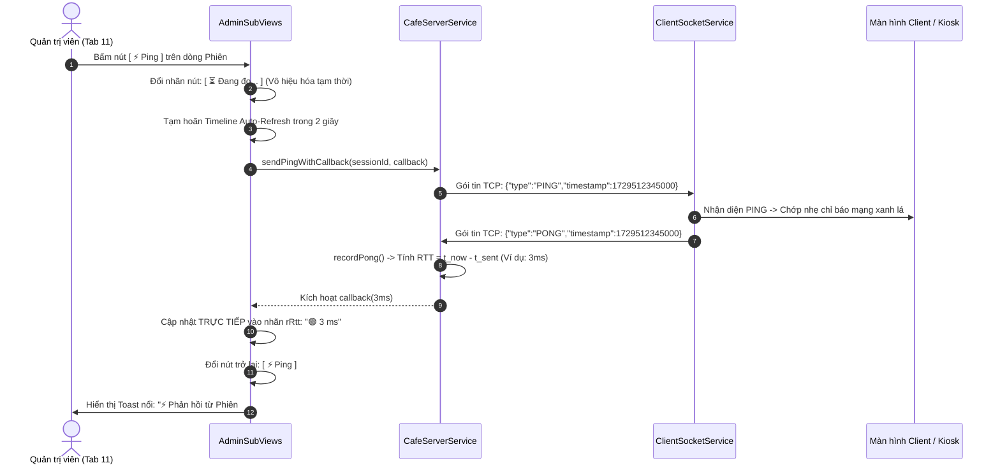

# KẾ HOẠCH NÂNG CẤP GIAO DIỆN & HOÀN THIỆN TRẢI NGHIỆM NGƯỜI DÙNG (PLAN UI VER 7.0)
**Dự án:** Hệ thống Quản lý Bán hàng & Điều phối Đặt món Quán Cafe (CafeOrder System)  
**Tài liệu tham chiếu:** `Plan UI ver7.md`  
**Phiên bản:** UI/UX & Architecture Version 7.0  
**Đối tượng thực hiện:** Antigravity CLI / Developer  
**Nguyên tắc cốt lõi:**  
> ⚠️ **STRICT CONSTRAINT:** Tài liệu này đóng vai trò là bản thiết kế kiến trúc và giải pháp chi tiết. **TUYỆT ĐỐI KHÔNG CHỈNH SỬA BẤT KỲ DÒNG MÃ NGUỒN NÀO** trong phiên hiện tại.  
> 💡 **ADAPTIVE METRICS & BOUTIQUE AESTHETICS:** Mọi giải pháp giao diện đều được tính toán theo tỷ lệ co giãn thích ứng (Relative/Responsive Layout), triệt tiêu các hộp thoại mặc định thô cứng của hệ điều hành, chuẩn hóa nhận diện thương hiệu ấm cúng (Warm Boutique Cafe Style) của Brew & Bean.

---

## MỤC LỤC TỔNG QUAN

1. [Bối cảnh & 4 Trọng tâm Cần xử lý trong Ver 7.0](#1-bối-cảnh--4-trọng-tâm-cần-xử-lý-trong-ver-70)
2. [Vấn đề 1: Tối ưu Tỷ lệ & Mở rộng Kích thước Form Đăng nhập (LoginView - Image 1)](#2-vấn-đề-1-tối-ưu-tỷ-lệ--mở-rộng-kích-thước-form-đăng-nhập-loginview---image-1)
3. [Vấn đề 2: Thiết kế Lại Toàn diện Hộp thoại Cảnh báo Ngắt phiên (Kick Alert Modal - Image 2)](#3-vấn-đề-2-thiết-kế-lại-toàn-diện-hộp-thoại-cảnh-báo-ngắt-phiên-kick-alert-modal---image-2)
4. [Vấn đề 3: Triệt tiêu Trùng lặp Biểu tượng (Duplicate Icons) trên Thanh Công cụ (Image 3)](#4-vấn-đề-3-triệt-tiêu-trùng-lặp-biểu-tượng-duplicate-icons-trên-thanh-công-cụ-image-3)
5. [Vấn đề 4: Tái Cấu trúc Toàn diện Luồng Đo Độ Trễ Mạng (Ping RTT Probe) giữa Admin & Client](#5-vấn-đề-4-tái-cấu-trúc-toàn-diện-luồng-đo-độ-trễ-mạng-ping-rtt-probe-giữa-admin--client)
6. [Lộ trình Triển khai Kỹ thuật cho Antigravity CLI](#6-lộ-trình-triển-khai-kỹ-thuật-cho-antigravity-cli)

---

## 1. BỐI CẢNH & 4 TRỌNG TÂM CẦN XỬ LÝ TRONG VER 7.0

Dựa trên kết quả trải nghiệm thực tế và 3 ảnh chụp giao diện được cung cấp, hệ thống ghi nhận 4 điểm nghẽn thị giác và tương tác:

```
+----------------------------------------------------------------------------------------------------+
|                                    4 TRỌNG TÂM CẢI TIẾN (PLAN UI VER 7.0)                          |
+---+------------------------------+-----------------------------------------------------------------+
| 1 | Form Login bé & thừa khoảng  | Cột phải rộng tới 1180px nhưng formCard bị bó cứng 440px;       |
|   | trống & Đổi Icon Hạt Cafe    | textbox chỉ cao 42px, chữ bé, lọt thỏm giữa khoảng trắng mênh   |
|   | (Image 1)                    | mông khi chạy trên màn hình Full HD / Maximized. Thay icon ly   |
|   |                              | cà phê ☕ cũ bằng icon hạt cafe chuẩn `coffee-beans.png`.        |
+---+------------------------------+-----------------------------------------------------------------+
| 2 | Popup ngắt kết nối thô xấu   | Dùng Alert mặc định của JavaFX (theme Modena/Windows 98);       |
|   | & lạc quẻ (Image 2)          | biểu tượng X vuông đỏ viền bạc lỗi thời, nút OK xấu xí,         |
|   |                              | chữ bị co cắt "h...", hoàn toàn lạc lõng với phong cách cafe.   |
+---+------------------------------+-----------------------------------------------------------------+
| 3 | Lặp lại 2 icon trên 1 nút    | Nút công cụ trên sơ đồ bàn vừa có icon SVG lớn, vừa chứa thêm   |
|   | (Image 3)                    | ký tự icon nhỏ bên cạnh: "⟳", "⇄ Chuyển", "⧉ Gộp".              |
+---+------------------------------+-----------------------------------------------------------------+
| 4 | Bấm Ping nhưng không có gì   | Nút "Ping toàn bộ" vẽ lại bảng ở mili-giây 0 trước khi Pong về; |
|   | xảy ra                       | Timer 3s tự động xóa đè giao diện; Client hoàn toàn không có    |
|   |                              | phản hồi hay chỉ báo độ trễ RTT.                                |
+---+------------------------------+-----------------------------------------------------------------+
```

---

## 2. VẤN ĐỀ 1: TỐI ƯU TỶ LỆ & MỞ RỘNG KÍCH THƯỚC FORM ĐĂNG NHẬP (LOGINVIEW - IMAGE 1)

### 2.1. Phân tích Hiện trạng & Nguyên nhân Gốc rễ

Quan sát Image 1 (`media_1792754889238_5bf731b5.png`) và kiểm tra mã nguồn tại `LoginView.java:145-200`:
- **Bố cục Không Gian Mất Cân Đối:**
  - Màn hình chia 2 cột: Cột trái Poster tranh Hero (`leftHeroPane`), Cột phải là Form đăng nhập (`rightFormPane`).
  - Khi ứng dụng chạy toàn màn hình (Maximized Full HD 1920x1080), cột phải chiếm tới $\approx 1180px$ chiều rộng và $1000px$ chiều cao.
  - Tuy nhiên, khối `formCard` bị giới hạn cứng:
    ```java
    formCard.setMaxWidth(440);
    formCard.setMinWidth(360);
    formCard.setPadding(new Insets(32, 40, 32, 40));
    ```
  - Chiều rộng thực tế của các ô nhập liệu chỉ là: $440 - 80 = 360px$.
  - Chiều cao các ô nhập liệu `txtAccount`, `txtPassword` chỉ vỏn vẹn **`42px`**, cỡ chữ **`13px`**.
  - Tiêu đề chào mừng chỉ là **`22px`**, nhãn trường chỉ là **`12px`**.
  - Nút đăng nhập cao **`42px`**.
- **Hệ quả Thị giác:**
  - Khối form đăng nhập chỉ chiếm chưa đầy 30% diện tích cột phải, lọt thỏm trơ trọi giữa một khoảng trắng bao la rộng gần 1200px, tạo cảm giác trống trải, thiếu chuyên nghiệp và khó thao tác trên các thiết bị cảm ứng POS.

### 2.2. Giải pháp Nâng cấp Tỷ lệ Đồ họa (Upscaling & Responsive Balance)

Áp dụng quy tắc thiết kế co giãn thích ứng (Adaptive Ratio), nâng cấp kích thước toàn bộ các phần tử trong `formCard`:

```
+------------------------------------------------------------------------------------+
| SO SÁNH THÔNG SỐ KÍCH THƯỚC TRƯỚC VÀ SAU CẢI TIẾN                                  |
+------------------------------------+-----------------------+-----------------------+
| Thành phần Giao diện               | Kích thước Cũ (Ver 6) | Kích thước Mới Đề xuất|
+------------------------------------+-----------------------+-----------------------+
| Icon Thương hiệu Đỉnh Form         | Label Ký tự ☕ 24px   | ImageView coffee-beans.png (48x48px)|
| Bề rộng tối đa Card (formCard)     | 440 px                | 540 px (+23%)         |
| Chiều cao Textbox (Tài khoản/Pass) | 42 px                 | 50 px - 52 px (+24%)  |
| Cỡ chữ trong Textbox nhập liệu     | 13 px Regular         | 15 px SemiBold        |
| Padding bên trong Textbox          | 10px 14px             | 12px 18px             |
| Tiêu đề "Chào mừng trở lại!"       | 22 px                 | 30 px Bold (Playfair) |
| Lời dẫn phụ (Subtitle)             | 12.5 px               | 14 px Medium          |
| Nhãn trường nhập liệu              | 12 px                 | 13.5 px Bold          |
| Nút "Đăng nhập" chính              | Cao 42 px, Chữ 13 px  | Cao 50 px, Chữ 15.5 px|
| Khối vai trò nhanh (Role Pills)    | Cao 34 px             | Cao 42 px, Chữ 13 px  |
| Khoảng cách giãn dòng (Spacing)    | 14 px                 | 18 px - 20 px         |
+------------------------------------+-----------------------+-----------------------+
```

#### Chi tiết Thay thế Icon Đỉnh Form:
- **Hiện trạng:** Code dùng `Label iconBean = new Label("☕");` hiển thị ký tự emoji tách cà phê unicode đơn điệu và nhỏ.
- **Nâng cấp:** Thay thế bằng `ImageView` nạp trực tiếp tệp hình ảnh hạt cà phê chất lượng cao:
  - **Đường dẫn tệp:** `src/cafe/resources/images/placeholders/coffee-beans.png`
  - **Đường dẫn tài nguyên JavaFX:** `"/cafe/resources/images/placeholders/coffee-beans.png"`
  - **Kích thước hiển thị:** `fitWidth = 48`, `fitHeight = 48` (hoặc đặt trong `StackPane` bo tròn mềm mại).
  - **Thuộc tính:** `setPreserveRatio(true)`, `setSmooth(true)`, tạo điểm nhấn nhận diện thương hiệu ấm cúng và chuyên nghiệp ngay khi mở màn hình đăng nhập.

```
[BỐ CỤC FORM ĐĂNG NHẬP VER 7.0 ĐẦY ĐẶN & SANG TRỌNG]

+------------------------------------------------------------------------------------+
|                                                                                    |
|       [ 🫘 coffee-beans.png ]  (Icon Hạt Cafe Nét Cao Cấp 48x48px)                 |
|                                                                                    |
|       Chào mừng trở lại!                                                           |
|       Đăng nhập để bắt đầu phục vụ khách hàng.                                     |
|                                                                                    |
|       [ ● Máy chủ: Sẵn sàng (127.0.0.1:8888 • RTT: 2ms) ]                         |
|                                                                                    |
|       👤  TÀI KHOẢN                                                                |
|       +--------------------------------------------------------------------+       |
|       |  cashier1                                                          | (52px)|
|       +--------------------------------------------------------------------+       |
|                                                                                    |
|       🔒  MẬT KHẨU                                                                 |
|       +--------------------------------------------------------------------+       |
|       |  ••••••••                                                      👁  | (52px)|
|       +--------------------------------------------------------------------+       |
|                                                                                    |
|       +--------------------------------------------------------------------+       |
|       |                          ĐĂNG NHẬP                                 | (52px)|
|       +--------------------------------------------------------------------+       |
|                                                                                    |
|       ------------------ Chọn nhanh vai trò (Demo Quick-Fill) ------------------   |
|                                                                                    |
|       [      Kiosk Khách      ] [    Thu ngân (POS)    ] [    Quản lý (Admin)    ] |
|                                                                                    |
|                  Brew & Bean © 2026 — Hệ thống Quản lý Quán Cà Phê                 |
|                                                                                    |
+------------------------------------------------------------------------------------+
```

---

## 3. VẤN ĐỀ 2: THIẾT KẾ LẠI TOÀN DIỆN HỘP THOẠI CẢNH BÁO NGẮT PHIÊN (KICK ALERT MODAL - IMAGE 2)

### 3.1. Phân tích Hiện trạng "Lạc Quẻ" (Dựa trên Image 2)

Quan sát Image 2 (`media_1792754892100_29da522f.png`) và mã nguồn tại `ClientController.java:164-171`:
```java
javafx.scene.control.Alert alert = new javafx.scene.control.Alert(javafx.scene.control.Alert.AlertType.ERROR);
alert.initOwner(primaryStage);
alert.setTitle("Phiên Làm Việc Đã Bị Ngắt");
alert.setHeaderText("NGẮT KẾT NỐI TỪ QUẢN TRỊ VIÊN");
alert.setContentText(...);
alert.showAndWait();
```

**Các Điểm Khiếm Khuyết Trầm Trọng:**
1. **Theme Mặc định Thô Cứng (Modena Default):**
   - Hộp thoại sử dụng cửa sổ gốc của JavaFX với thanh tiêu đề Windows màu xám và biểu tượng tách cà phê Java cổ điển.
   - Viền khung chữ nhật thô ráp, không bo góc, không có hiệu ứng đổ bóng hiện đại.
2. **Icon X Vuông Đỏ Cũ Kỹ:**
   - Sử dụng biểu tượng lỗi mặc định của hệ điều hành (hình vuông màu đỏ mờ viền bạc với chữ X trắng), trông giống như một lỗi sập phần mềm (Crash Error) thay vì một thông báo nghiệp vụ bảo mật lịch thiệp.
3. **Nút Bấm Xấu Xí:**
   - Nút `[ OK ]` màu xanh xám nhạt với viền xanh lơ đặc trưng của JavaFX Modena, hoàn toàn không ăn nhập với màu sắc xanh rừng đậm `#112823` và màu kem ấm `#FAF8F5` của quán cà phê.
4. **Cắt xén Văn bản:**
   - Dòng chữ nội dung dài bị co hẹp và kết thúc bằng dấu ba chấm: `"Phiên làm việc của bạn đã bị ngắt bởi Quản trị viên h..."`.

### 3.2. Thiết kế Cửa Sổ Thông Báo Độc Quyền: `CustomKickDialog`

Thay thế hoàn toàn `javafx.scene.control.Alert` bằng một **Custom Modal Stage** không viền OS (`StageStyle.TRANSPARENT`), bo góc 16px, mang đậm ngôn ngữ thiết kế Boutique Cafe:

```
+------------------------------------------------------------------------------------+
|                [CUSTOM MODAL] THÔNG BÁO NGẮT KẾT NỐI HỆ THỐNG                      |
+------------------------------------------------------------------------------------+
|                                                                                    |
|                                   /===========\                                    |
|                                  |   🛡️ / 🔒   |  (Icon Khiên Bảo Mật Tròn Đỏ       |
|                                   \===========/   Đường Kính 64px, Nền Hồng Nhạt)  |
|                                                                                    |
|                          Phiên Làm Việc Đã Bị Ngắt                                 |
|                 (Font Playfair Display 22px Bold, Màu #112823)                     |
|                                                                                    |
|  +------------------------------------------------------------------------------+  |
|  |  LÝ DO TỪ MÁY CHỦ QUẢN TRỊ:                                                  |  |
|  |  "Phiên làm việc của thiết bị này đã bị Quản trị viên ngắt kết nối do hết    |  |
|  |  ca trực hoặc điều phối lại bàn phục vụ."                                    |  |
|  +------------------------------------------------------------------------------+  |
|                                                                                    |
|  Thời gian ngắt: 18:35:12 • Thiết bị: KIOSK-02 • Trạng thái: Ngắt kết nối an toàn  |
|                                                                                    |
|         [ 🚪 Trở Về Màn Hình Đăng Nhập ]      [ ⟳ Gửi Yêu Cầu Nối Lại Phiên ]       |
+------------------------------------------------------------------------------------+
```

#### Quy chuẩn Kỹ thuật Cho Modal Mới:
- **Khung chứa (`root`):**
  - Chiều rộng `prefWidth: 460px`, bo tròn góc `background-radius: 18px`, viền `#DFD7CA`.
  - Hiệu ứng đổ bóng mờ: `dropshadow(gaussian, rgba(0,0,0,0.28), 32, 0.2, 0, 10)`.
- **Huy hiệu Biểu tượng (Icon Badge):**
  - Vòng tròn `Circle(30, Color.web("#FEE2E2"))` với viền `#FECACA`.
  - Bên trong là biểu tượng SVG Khiên Bảo Mật (`SvgIcons.SHIELD` hoặc `SvgIcons.LOCK`) màu đỏ rượu `#B91C1C`.
- **Khung lý do (Message Box):**
  - Nền kem nhạt `#FBF9F5`, viền `#EFEAE2`, padding 14px.
  - Nhãn text bật `wrapText: true`, phông chữ `Inter 13px Medium`, màu `#57534E`, **hiển thị trọn vẹn 100% nội dung, không bao giờ bị cắt ba chấm**.
- **Nút hành động:**
  - Nút chính `[ ⟳ Gửi Yêu Cầu Nối Lại Phiên ]`: Nền xanh rừng đậm `#112823`, chữ trắng, bo góc 8px.
  - Nút phụ `[ 🚪 Trở Về Đăng Nhập ]`: Nền xám be `#EAE4DA`, chữ `#1C1917`.

---

## 4. VẤN ĐỀ 3: TRIỆT TIÊU TRÙNG LẶP BIỂU TƯỢNG (DUPLICATE ICONS) TRÊN THANH CÔNG CỤ (IMAGE 3)

### 4.1. Phân tích Nguyên nhân Lặp Icon (Dựa trên Image 3)

Quan sát Image 3 (`media_1792754894189_05e47cc4.png`) và mã nguồn tại `FloorPlanView.java:500-515`:
```java
Button btnRefresh = createToolButton("⟳", "lam-moi.png");
Button btnTransfer = createToolButton("⇄ Chuyển", "chuyen-ban.png");
Button btnMerge = createToolButton("⧉ Gộp", "tach-gop-ban.png");
```
Trong hàm `createToolButton`:
```java
private Button createToolButton(String title, String iconFileName) {
    ...
    Node icon = cafe.utils.IconHelper.getIcon("staff", iconFileName, null, "⚙", 15, Color.web("#112823"));
    Label lbl = new Label(title);
    content.getChildren().addAll(icon, lbl);
    btn.setGraphic(content);
    return btn;
}
```

**Sự Lặp lại Thừa Thãi:**
1. **Nút Làm mới (`btnRefresh`):**
   - Đã có `icon` lớn nạp từ `lam-moi.png`.
   - Phần text `title` lại truyền thêm ký tự xoay unicode: `"⟳"`.
   - $\rightarrow$ **Hai biểu tượng xoay nằm dính cạnh nhau (1 to 1 bé)!**
2. **Nút Chuyển bàn (`btnTransfer`):**
   - Đã có `icon` lớn 2 mũi tên nạp từ `chuyen-ban.png`.
   - Phần text `title` lại chứa thêm ký tự mũi tên: `"⇄ Chuyển"`.
   - $\rightarrow$ **Hai biểu tượng mũi tên lặp lại liên tiếp!**
3. **Nút Gộp bàn (`btnMerge`):**
   - Đã có `icon` lớn 2 ô vuông lồng nhau nạp từ `tach-gop-ban.png`.
   - Phần text `title` lại chứa thêm ký tự ô vuông: `"⧉ Gộp"`.
   - $\rightarrow$ **Hai biểu tượng ô vuông lặp lại liên tiếp!**

### 4.2. Giải pháp Chuẩn hóa: Giữ Icon Lớn - Xóa Icon Nhỏ

Loại bỏ toàn bộ các ký tự unicode gây lặp lại trong chuỗi tiêu đề, giữ nguyên Graphic icon lớn:

```
+------------------------------------------------------------------------------------+
| HIỆN TẠI (LẶP 2 ICON)             | ĐỀ XUẤT VER 7.0 (CHUẨN HÓA SẠCH ĐẸP)           |
+-----------------------------------+------------------------------------------------+
| [ 🔄  ⟳ ]                         | [ 🔄 ] (Nút vuông chỉ có icon lớn, tooltip rõ) |
| [ ⇄  ⇄ Chuyển ]                   | [ ⇄  Chuyển ] (Icon lớn + chữ "Chuyển")        |
| [ ⧉  ⧉ Gộp ]                      | [ ⧉  Gộp ] (Icon lớn + chữ "Gộp")              |
+-----------------------------------+------------------------------------------------+
```

```java
// SỬA ĐỔI CHUẨN XÁC TRONG FloorPlanView.java:
Button btnRefresh = createToolButton("", "lam-moi.png"); // Bỏ chuỗi "⟳", chỉ giữ icon lớn
btnRefresh.setTooltip(new Tooltip("Làm mới sơ đồ bàn"));
btnRefresh.setPrefWidth(38);

Button btnTransfer = createToolButton("Chuyển bàn", "chuyen-ban.png"); // Bỏ ký tự "⇄ "
Button btnMerge = createToolButton("Gộp bàn", "tach-gop-ban.png");       // Bỏ ký tự "⧉ "
```

---

## 5. VẤN ĐỀ 4: TÁI CẤU TRÚC TOÀN DIỆN LUỒNG ĐO ĐỘ TRỄ MẠNG (PING RTT PROBE) GIỮA ADMIN & CLIENT

### 5.1. Phân tích Nguyên nhân "Bấm Ping nhưng không có gì xảy ra"

1. **Lỗi Đồng bộ Hàng đợi Trong `btnPingAll` (AdminSubViews.java:1999):**
   ```java
   btnPingAll.setOnAction(e -> {
       server.pingAllSessions();
       if (toastCallback != null) toastCallback.accept("Đã phát sóng thăm dò Ping...");
       renderRows[0].run(); // <= LỖI NGHIÊM TRỌNG TẠI ĐÂY!
   });
   ```
   - Khi Admin bấm `[ ⚡ Ping toàn bộ thiết bị ]`, `server.pingAllSessions()` bắn gói tin qua socket.
   - Nhưng **NGAY LẬP TỨC ở mili-giây thứ 0**, hàm `renderRows[0].run()` được gọi để vẽ lại bảng.
   - Gói tin vừa rời card mạng máy chủ, gói Pong từ Client chưa kịp quay về (cần 1-5ms), bảng đã được vẽ lại với giá trị RTT cũ.
   - Hàm `pingAllSessions()` cũng không gắn bất kỳ callback nào để nhận thông báo khi Pong về.
   - Kết quả: Toàn bộ bảng giữ nguyên số liệu cũ, giao diện không có bất kỳ chuyển động nào!
2. **Xung đột Chu kỳ Tự Động Vẽ Lại (Timeline Timer 3s):**
   - `Timeline timer = new Timeline(new KeyFrame(Duration.seconds(3), ev -> renderRows[0].run()));`
   - Cứ đúng 3 giây, timer tự động gọi `renderRows`, xóa sạch toàn bộ các nút và các hàng trong bảng rồi dựng lại.
   - Nếu Admin bấm nút `btnPingSingle` trên từng dòng, nút vừa kịp chuyển sang `⏳ Đang đo...`, timer 3 giây ập tới xóa phăng nút đi và dựng lại nút `⚡ Ping` ban đầu, triệt tiêu toàn bộ phản hồi đo đạc!
3. **Phía Client Hoàn Toàn Thiếu Chỉ Báo Phản Hồi:**
   - Khi Client nhận Ping từ Server, Client chỉ âm thầm trả về Pong trong background thread mà giao diện không có bất kỳ phản hồi nào cho nhân viên biết tình trạng mạng.

### 5.2. Thiết kế Luồng Ping RTT Thời Gian Thực Hoàn Hảo (End-to-End Realtime Ping Architecture)



#### Quy chuẩn Kỹ thuật Cho Nút `btnPingAll` (Ping Toàn Mạng):
1. **Trạng thái Nút bấm:**
   - Khi bấm, đổi nút thành: `[ ⏳ Đang đo toàn mạng (0/N)... ]`.
   - Vô hiệu hóa nút trong 1.5 giây để tránh Admin spam click.
2. **Thu thập Kết quả Song song (Parallel Collector):**
   - Tạo một bộ đếm phản hồi `AtomicInteger responsesReceived` và một danh sách độ trễ `List<Long> latencies`.
   - Duyệt qua từng session trong `activeSessions.values()`, gọi `sendPingWithCallback`.
   - Mỗi khi một session nhận được Pong, cập nhật trực tiếp nhãn RTT của hàng đó mà **không gọi hàm `renderRows[0].run()` làm giật màn hình**.
   - Khi toàn bộ session đã phản hồi (hoặc sau 1200ms timeout):
     - Tính độ trễ trung bình $\overline{\text{RTT}}$.
     - Cập nhật thẻ KPI `RTT PING TRUNG BÌNH`.
     - Đổi nút trở lại: `[ ⚡ Ping toàn bộ thiết bị ]`.
     - Bắn Toast thông báo: *"⚡ Đã đo độ trễ X thiết bị: RTT trung bình Y ms (Rất tốt)"*.

#### Bổ sung Chỉ Báo Ping Phía Client (`LoginView` & `ClientView`):
1. **Tại `LoginView`:**
   - Trên thanh trạng thái máy chủ, bổ sung độ trễ RTT đo được:
     `● Máy chủ: Sẵn sàng (127.0.0.1:8888 • RTT: 2ms)`.
   - Nút `[ ↻ Thử lại ]` khi bấm sẽ đo lại Ping và cập nhật độ trễ ngay lập tức.
2. **Tại `ClientView` & `FloorPlanView`:**
   - Chỉ báo mạng ở góc trên đổi từ chữ tĩnh thành huy hiệu động: `🟢 2ms` (Xanh lá nếu < 20ms, Vàng nếu < 80ms, Đỏ nếu lag).

---

## 6. LỘ TRÌNH TRIỂN KHAI KỸ THUẬT CHO ANTIGRAVITY CLI

Khi được kích hoạt lệnh chỉnh sửa mã nguồn thực tế, Antigravity CLI sẽ thực hiện chính xác theo các chỉ dẫn dưới đây:

### Bước 1: Mở rộng Bố cục Form Đăng nhập & Thay Icon Hạt Cafe (`src/cafe/views/LoginView.java`)
1. Thay thế Icon đỉnh form:
   - Thay `Label iconBean = new Label("☕");` bằng:
     ```java
     ImageView iconBeanView = new ImageView();
     try {
         URL beanUrl = getClass().getResource("/cafe/resources/images/placeholders/coffee-beans.png");
         if (beanUrl == null) beanUrl = getClass().getResource("/resources/images/placeholders/coffee-beans.png");
         if (beanUrl != null) {
             iconBeanView.setImage(new Image(beanUrl.toExternalForm(), 96, 96, true, true));
         }
     } catch (Exception ignored) {}
     iconBeanView.setFitWidth(48);
     iconBeanView.setFitHeight(48);
     iconBeanView.setPreserveRatio(true);
     iconBeanView.setSmooth(true);
     ```
   - Đưa `iconBeanView` vào vị trí của `iconBean` trong `formCard`.
2. Mở rộng kích thước `formCard`:
   - Đổi `formCard.setMaxWidth(440)` $\rightarrow$ `formCard.setMaxWidth(540)`.
   - Đổi `formCard.setPadding(new Insets(32, 40, 32, 40))` $\rightarrow$ `formCard.setPadding(new Insets(36, 44, 36, 44))`.
   - Đổi `formCard.setSpacing(14)` $\rightarrow$ `formCard.setSpacing(18)`.
3. Tăng kích thước các trường nhập liệu:
   - `txtAccount.setPrefHeight(50)` và `txtPassword.setPrefHeight(50)`.
   - Style font chữ đổi thành `-fx-font-size: 14.5px; -fx-padding: 12 16 12 16;`.
4. Tăng kích thước nút bấm:
   - `btnLogin.setPrefHeight(50); btnLogin.setStyle("-fx-font-size: 15px; -fx-font-weight: 800; ...")`.
   - Tiêu đề `lblWelcome.setStyle("-fx-font-size: 28px; -fx-font-weight: 800; ...")`.

### Bước 2: Thay thế Alert Mặc định bằng Custom Modal Dialog (`src/cafe/controllers/ClientController.java`)
1. Tìm sự kiện `socketService.setOnSessionKickedReceived(...)`.
2. Xóa bỏ hoàn toàn việc khởi tạo `javafx.scene.control.Alert`.
3. Thay thế bằng hàm gọi Custom Dialog:
   - Tạo `Stage modalStage` với `StageStyle.TRANSPARENT` và `Modality.APPLICATION_MODAL`.
   - Dựng giao diện hộp thoại bo tròn góc 18px, nền `#FFFFFF`, bóng mờ 24px, icon Khiên bảo mật tròn đỏ.
   - Bố trí 2 nút bấm phong cách Brew & Bean: `[ Trở về Đăng nhập ]` và `[ Yêu cầu Cấp lại Phiên ]`.

### Bước 3: Xóa Bỏ Biểu tượng Trùng Lặp Trên Nút Công Cụ (`src/cafe/views/FloorPlanView.java`)
1. Tìm dòng khởi tạo các nút công cụ (dòng 500-515):
   - Đổi `createToolButton("⟳", "lam-moi.png")` $\rightarrow$ `createToolButton("", "lam-moi.png")`.
   - Đổi `createToolButton("⇄ Chuyển", "chuyen-ban.png")` $\rightarrow$ `createToolButton("Chuyển bàn", "chuyen-ban.png")`.
   - Đổi `createToolButton("⧉ Gộp", "tach-gop-ban.png")` $\rightarrow$ `createToolButton("Gộp bàn", "tach-gop-ban.png")`.
2. Kiểm tra hàm `createToolButton`: Nếu `title` rỗng (`""`), không thêm `Label` vào `content` để nút icon xoay căn giữa tuyệt đối.

### Bước 4: Hoàn Thiện Cơ Chế Đo Ping Độc Lập Với Timer (`src/cafe/views/AdminSubViews.java`)
1. Trong `btnPingAll`:
   - Xóa bỏ dòng `renderRows[0].run()` tức thời ngay sau khi gửi ping.
   - Thêm biến cờ `isMeasuringPing = true`.
   - Duyệt qua danh sách phiên, đăng ký callback nhận Pong và cập nhật trực tiếp lên Label của từng dòng.
2. Trong `Timeline timer`:
   - Kiểm tra `if (isMeasuringPing) return;` trước khi gọi `renderRows[0].run()` để chống ghi đè khi đang đo độ trễ.
3. Trong `LoginView.java`:
   - Bổ sung hiển thị `(RTT: X ms)` khi kết nối thành công.
