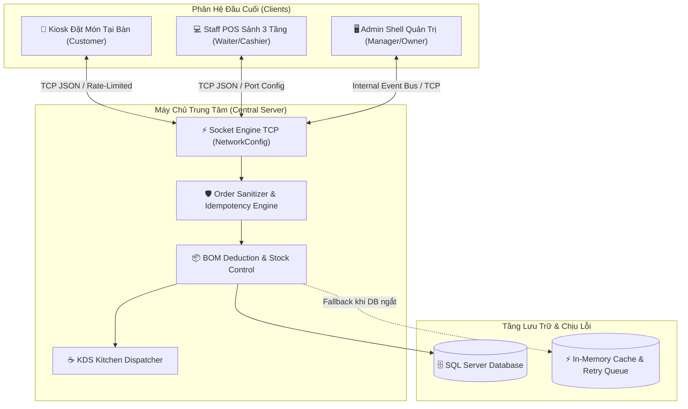

# ☕ TỔNG HỢP CÁC CHỨC NĂNG CỐT LÕI HỆ THỐNG CAFEORDER (BREW & BEAN ENTERPRISE POS)

> **Tài liệu đặc tả kiến trúc & toàn bộ chức năng cốt lõi của hệ thống CafeOrder.**  
> Phiên bản: **Enterprise POS v4.5** | Ngôn ngữ: **Java (JDK 17+) & JavaFX** | Kiến trúc: **Client - Server (TCP Socket) & MVC** | Cơ sở dữ liệu: **Microsoft SQL Server (kèm In-Memory Fallback)**.

---

## 📑 MỤC LỤC TỔNG QUAN

1. [Kiến Trúc Tổng Thể & Mô Hình Hoạt Động](#1-kiến-trúc-tổng-thể--mô-hình-hoạt-động)
2. [Phân Hệ 1: Khách Hàng Tự Gọi Món (Customer Kiosk)](#2-phân-hệ-1-khách-hàng-tự-gọi-món-customer-kiosk)
3. [Phân Hệ 2: Thu Ngân & Phục Vụ (Staff POS - Sơ Đồ Bàn 3 Tầng)](#3-phân-hệ-2-thu-ngân--phục-vụ-staff-pos---sơ-đồ-bàn-3-tầng)
4. [Phân Hệ 3: Quầy Điều Phối Pha Chế (Kitchen Display System - KDS)](#4-phân-hệ-3-quầy-điều-phối-pha-chế-kitchen-display-system---kds)
5. [Phân Hệ 4: Trung Tâm Quản Trị Hệ Thống (Admin Management Shell - 11 Phân Hệ)](#5-phân-hệ-4-trung-tâm-quản-trị-hệ-thống-admin-management-shell---11-phân-hệ)
6. [Các Cơ Chế Kỹ Thuật Nâng Cao & Toàn Vẹn Dữ Liệu](#6-các-cơ-chế-kỹ-thuật-nâng-cao--toàn-vẹn-dữ-liệu)
7. [Ma Trận Phân Quyền Vai Trò (RBAC Matrix)](#7-ma-trận-phân-quyền-vai-trò-rbac-matrix)
8. [Hướng Dẫn Khởi Chạy Nhanh Toàn Hệ Thống](#8-hướng-dẫn-khởi-chạy-nhanh-toàn-hệ-thống)

---

## 1. KIẾN TRÚC TỔNG THỂ & MÔ HÌNH HOẠT ĐỘNG

Hệ thống **CafeOrder** được xây dựng nhằm giải quyết bài toán vận hành khép kín cho chuỗi quán cà phê quy mô lớn (3 tầng phục vụ, quầy bar espresso, bếp bánh và mang đi):



* **Mô hình Server-First:** Máy chủ `ServerMain` đóng vai trò là "bộ não" điều phối trung tâm, lắng nghe kết nối TCP trên cổng linh hoạt (mặc định cấu hình qua `NetworkConfig`).
* **Đồng bộ thời gian thực hai chiều:** Đơn hàng từ Kiosk và Staff POS được đẩy tức thì (< 50ms) xuống quầy pha chế KDS mà không cần in giấy. Khi Barista đổi trạng thái đơn (*Đang pha chế*, *Đã hoàn tất*), tín hiệu lập tức đồng bộ ngược về bàn của khách.
* **Chuẩn thiết kế Design System (Client Benchmark):** Tối giản, thanh lịch với tông màu chủ đạo **Evergreen `#112823`**, màu kem ấm `#F5F0E8`, bo góc mềm mại `8px`, loại bỏ 100% tình trạng cắt cụt chữ bằng dấu ba chấm (`...`).

---

## 2. PHÂN HỆ 1: KHÁCH HÀNG TỰ GỌI MÓN (CUSTOMER KIOSK)

Giao diện Kiosk dành cho máy tính bảng đặt tại từng bàn hoặc kiosk đứng tại sảnh:

### 2.1. Thực đơn trực quan & Tiếp thị thông minh
* **Menu 69 món đa dạng:** Chia thành 8 danh mục chuyên sâu: *Cà phê, Trà & Trái cây, Đá xay, Trà sữa, Nước ép & Soda, Matcha & Chocolate, Bánh ngọt, Món ăn nhẹ*.
* **Ghim món Bán chạy (#1 Bestseller):** Mỗi danh mục tự động đưa món `isBestseller = true` lên vị trí đầu tiên của lưới món. Thẻ món bán chạy sở hữu **viền Gradient đỏ cam lửa nóng** (`#EF4444` → `#F59E0B`), hiệu ứng nhấp nháy (`pulsing`) và huy hiệu `🔥 BÁN CHẠY`.
* **Banner Marketing Khô Gà MixiFood:** Tích hợp banner tiếp thị nổi bật cho món Khô Gà Lá Chanh MixiFood (Món 68), hiển thị ảnh chuẩn dọc tỷ lệ vàng `0.55` và nút 1-chạm *"🛒 Gọi Món Ngay"*.
* **Tìm kiếm & Lọc nhanh:** Lọc theo danh mục hoặc tìm kiếm theo tên món với tốc độ phản hồi tức thì.

### 2.2. Hộp thoại tùy biến món ăn/thức uống (Item Customization Modal)
* **Kích cỡ ly (Size):** Hỗ trợ Size S (-5.000đ), Size M (chuẩn), Size L (+7.000đ).
* **Mức độ Ngọt (Đường):** Lựa chọn 0%, 30%, 70%, 100% đường.
* **Mức độ Lạnh (Đá):** Lựa chọn 0% (Không đá), 50% (Ít đá), 100% (Chuẩn đá).
* **Nhiệt độ:** Tùy chọn Dùng Lạnh hoặc Dùng Nóng (đối với cà phê và trà nóng).
* **Topping phong phú:** Trân châu đen (+8k), Thạch củ năng (+10k), Kem Cheese (+12k), Bánh Flan (+10k)... tự động cộng dồn vào giá thành.
* **Ghi chú bếp:** Khách nhập lời nhắn gửi riêng đến người pha chế (*"Ít ngọt", "Nhiều sữa tươi"*).

### 2.3. Giỏ hàng Reactive & Khuyến mãi (Cart Model)
* Giỏ hàng nổi (`Floating Cart Button`) hiển thị số lượng món theo thời gian thực.
* Tự động tính toán tổng tiền, chiết khấu và thuế VAT.
* **Smart Note Chips:** 1 chạm để thêm các ghi chú phổ biến: *"Mang về"*, *"Ít ngọt"*, *"Không đá"*, *"Giao nước lọc kèm"*.
* **Áp dụng Voucher:** Nhập mã giảm giá khuyến mãi (VD: `BREW25K`, `GIAM10`), tự động kiểm tra điều kiện đơn hàng tối thiểu và chiết khấu ngay trên giao diện.

### 2.4. Thanh toán Fintech VietQR 2 cột
* **Giao diện 2 cột chuẩn Fintech:** Cân đối, không cần cuộn trang.
* **Cột trái:** Chọn phương thức thanh toán (*VietQR*, *Tiền mặt tại quầy*, *Thẻ/Ví điện tử*) và bảng tóm tắt chi phí rõ ràng.
* **Cột phải:**
  * Hiển thị mã **VietQR MB Bank** chính hãng, viền bo sạch đẹp.
  * Thông tin tài khoản ngân hàng: Số tài khoản (`0909 888 999`), Chủ tài khoản, Số tiền chính xác và Nội dung chuyển khoản.
  * Tích hợp nút **1-Click Sao Chép (📋 Chép)** vào Clipboard kèm hiệu ứng phản hồi trực quan.
* **Hóa đơn điện tử K80 (`OrderSuccessDialog`):** Sau khi xác nhận, hiển thị hóa đơn in nhiệt khổ 80mm với mã vạch Barcode và đầy đủ chi tiết đơn hàng.

### 2.5. Luồng Đăng xuất / Đổi bàn an toàn
* Nút `[ Đổi bàn / Thoát ]` nổi bật trên TopBar và chân Sidebar.
* Tự động ẩn khi ClientView được nhúng vào Admin POS.
* Khi khách bấm thoát: Ngắt kết nối socket bàn cũ, kích hoạt kết nối ấm ngầm (`warmupConnectAsync()`) và chuyển màn hình về `LoginView`.

---

## 3. PHÂN HỆ 2: THU NGÂN & PHỤC VỤ (STAFF POS - SƠ ĐỒ BÀN 3 TẦNG)

Giao diện dành riêng cho nhân viên phục vụ và thu ngân phụ trách sảnh:

### 3.1. Sơ đồ bàn 3 tầng tương tác trực quan
* **3 Tầng không gian:**
  * **Tầng 1 (Sảnh chính & Bar):** 12 bàn phục vụ (Bàn 01 - Bàn 12).
  * **Tầng 2 (Không gian làm việc & Ban công):** 10 bàn (Bàn 201 - Bàn 210).
  * **Tầng 3 (Sân thượng & Phòng họp VIP):** 8 bàn (Bàn 301 - Bàn 308).
  * **Khu vực Mang đi (Takeaway):** Điều phối đơn mang về không chiếm bàn.
* **Nhận diện trạng thái bàn bằng màu sắc:**
  * *Bàn Trống (Trắng / Xám nhạt):* Sẵn sàng đón khách mới.
  * *Bàn Đang Phục Vụ (Xanh ngọc `#112823`):* Đang có khách ngồi và có đơn hàng hoạt động.
  * *Bàn Đã Đặt Trước (Vàng Hổ Phách `#D97706`):* Đã được giữ chỗ theo giờ hẹn của khách.

### 3.2. Nghiệp vụ vận hành tại bàn
* **Mở bàn & Gọi món:** Nhấp vào bàn trống để chuyển ngay sang menu đặt món cho bàn đó.
* **Xem đơn đang chạy:** Nhấp vào bàn đang phục vụ để xem danh sách món đã gọi, thời gian khách ngồi và tổng tạm tính.
* **Đặt trước bàn (Reservation):** Nhập tên khách hàng, số điện thoại, số lượng khách và thời gian hẹn trước.
* **Đổi bàn & Gộp bàn:** Di chuyển khách từ bàn này sang bàn khác hoặc gộp hóa đơn hai bàn đang phục vụ vào một.
* **Thanh toán nhanh tại chỗ:** Tích hợp bộ chọn phương thức Tiền mặt / Quẹt thẻ / Quét mã VietQR MB Bank hiển thị tức thì trên màn hình Staff POS.

### 3.3. Đăng xuất ca trực đa điểm chạm
* Nút "Thoát" nhanh trong thẻ hồ sơ nhân viên (`Profile Card`).
* Nút "Đăng xuất" trên thanh công cụ TopBar.
* Nút "Đăng xuất ca trực" lớn màu đỏ nguy hiểm (`#FEE2E2` / `#B91C1C`) ở chân Sidebar, giúp nhân viên bàn giao ca trực nhanh chóng và an toàn.

---

## 4. PHÂN HỆ 3: QUẦY ĐIỀU PHỐI PHA CHẾ (KITCHEN DISPLAY SYSTEM - KDS)

Màn hình điều phối chế biến dành cho Barista và nhân viên làm bếp:

### 4.1. Thẻ đơn hàng thông minh (Plan UI 4.5 Standard)
* **Header 2 tầng chống cắt chữ:**
  * *Tầng 1:* Định danh bàn `[BÀN 05]` / `[MANG VỀ]` đi liền mã đơn `#1004` bên trái; Đồng hồ đếm giờ SLA `03:25 (3p trước)` bên phải.
  * *Tầng 2:* Dải trạng thái dạng Pill mềm mại độc lập: `● ĐANG CHỜ`, `● ĐANG PHA CHẾ`, `● ĐÃ HOÀN THÀNH`.
  * **Chấm dứt hoàn toàn lỗi vỡ giao diện cắt cụt chữ thành dấu ba chấm (`...`).**
  * Chiều rộng thẻ chuẩn hóa cố định **`340px`** (min 320px, max 360px), các thẻ thẳng hàng tắp trên toàn bộ lưới hiển thị.
* **Lọc bỏ hiển thị phi logic (Food/Pastry Filter):**
  * Tự động phát hiện món ăn/bánh ngọt (Cheesecake, Croissant, Bánh mì que, Mochi, Khô gà...) và **ẩn hoàn toàn** dòng *Đá*, *Đường*, *Nhiệt độ* cùng tag mặc định *Size M*.
  * Chỉ in số lượng, tên món và ghi chú bếp thực tế (*"Nướng giòn", "Làm nóng"*).
* **Lọc sạch ghi chú thanh toán:**
  * Loại bỏ các chuỗi kỹ thuật thanh toán tiền mặt, chuyển khoản, voucher khỏi vé bếp. Người làm bếp chỉ thấy đúng yêu cầu món ăn.

### 4.2. Quy trình chuyển đổi trạng thái 1 chạm
* **Đang chờ (QUEUED):** Nút **`[ ▶ Bắt đầu pha chế ]`** màu xanh đậm thương hiệu `#112823`.
* **Đang pha chế (PREPARING):** Nút **`[ ✓ Hoàn tất món & Báo phục vụ ]`** đồng bộ màu Evergreen `#112823` (thay thế màu xanh lá cây chói `#15803D`).
* **Đã hoàn thành (DONE):** Chuyển sang 2 nút phụ nền `#F5EFEB`: `[ ↺ Hoàn tác ]` và `[ 🖨 In lại vé ]`.

### 4.3. Phân luồng theo trạm pha chế (Station Filter)
* Lọc hiển thị đơn hàng theo từng trạm chuyên biệt:
  * *Tất cả các trạm:* Quản lý chung toàn quầy.
  * *☕ Quầy Máy Pha Espresso:* Chỉ nhận các món Cà phê truyền thống, Espresso, Latte, Cappuccino...
  * *🍹 Quầy Trà & Đá Xay:* Tiếp nhận các món Trà trái cây, Trà sữa, Sinh tố, Đá xay, Nước ép.
  * *🥐 Tủ Bánh Ngọt & Đồ Ăn Nhẹ:* Chuyên trách Bánh ngọt, Bánh mì nóng, Khô gà, Món ăn vặt.

### 4.4. Cảnh báo thời gian SLA (Service Level Agreement)
* Đồng hồ đo thời gian chờ thực tế tự động cập nhật mỗi giây:
  * *Dưới 5 phút:* Màu xám trung tính `#78716C` (Tiến độ tốt).
  * *5 - 10 phút:* Màu cam hổ phách `#D97706` (Cần lưu ý đẩy nhanh).
  * *Trên 10 phút:* Màu đỏ cảnh báo khẩn cấp `#DC2626` (Quá hạn phục vụ).

---

## 5. PHÂN HỆ 4: TRUNG TÂM QUẢN TRỊ HỆ THỐNG (ADMIN MANAGEMENT SHELL - 11 PHÂN HỆ)

Trung tâm điều hành doanh nghiệp toàn diện dành cho Quản lý và Chủ quán:

### Tab 1: Tổng Quan Kinh Doanh & Phân Tích BI Tương Tác (Interactive BI Dashboard)
* **4 Thẻ KPI Sống:** Doanh thu kỳ chọn, Tổng số đơn hàng, Giá trị trung bình/đơn (AOV), Tỷ lệ khách thành viên.
* **Biểu đồ Doanh thu Đa chiều tương tác (Cross-Component Sync):**
  * 3 chế độ xem: *7 ngày qua*, *Theo tháng (T1-T12)*, *Theo khung giờ (07h - 22h)*.
  * **Nhấn vào bất kỳ cột nào trên biểu đồ**, toàn bộ 4 thẻ KPI và bảng Top 5 món bán chạy nhất sẽ tự động lọc và cập nhật đồng bộ theo kỳ đó.
* **Bảng Đơn hàng Gần đây:** Hiển thị mã đơn, số bàn, danh sách món, tổng tiền. Nhấp vào từng dòng để mở lại phiếu thanh toán K80.

### Tab 2: POS Gọi Món & Bàn Tại Quầy (Embedded Counter POS)
* Nhúng trực tiếp phân hệ POS vào trong Admin Shell.
* Hỗ trợ chọn nhanh phục vụ tại chỗ (Bàn 1 đến 12, Tầng 2, Tầng 3) hoặc Mang đi (Takeaway).
* Đồng bộ danh mục món ăn thời gian thực từ database.

### Tab 3: Quản Lý & Kiểm Toán Đơn Hàng (Full-Width Enterprise DataGrid)
* Tra cứu toàn bộ lịch sử đơn hàng theo mã đơn (`#1001`), số bàn, tên món.
* Bộ lọc trạng thái dạng Segmented Pill: *Tất cả, Chờ pha chế, Đang pha chế, Đã hoàn tất/Đã thu, Đã hủy*.
* Nút thao tác từng dòng đồng bộ chuẩn Client: `[ 🖨 In phiếu ]`, `[ ✓ Hoàn tất ]` (tự động kích hoạt trừ kho BOM), `[ ✕ Hủy đơn ]`.

### Tab 4: Bếp & Bar KDS Điều Phối
* Nhúng phân hệ KDS toàn màn hình vào bảng điều khiển quản trị.
* Kết hợp bộ lọc trạm pha chế Barista / Trà / Bánh.

### Tab 5: Quản Lý Thực Đơn & Định Lượng Pha Chế BOM (Master-Detail 2 Cột)
* **Cột trái:** Danh sách 69 món ăn/thức uống, tìm kiếm theo tên, lọc theo nhóm danh mục.
* **Nút bật/tắt bán hàng (86-ing):** Nút `[ ● Còn bán ]` / `[ ✕ Tạm hết (86) ]` giúp quản lý lập tức khóa món khi hết nguyên liệu mà không cần xóa món khỏi hệ thống.
* **Cột phải - Trình giám định định lượng (BOM Inspector):**
  * Điều chỉnh giá bán tiêu chuẩn trực tiếp.
  * Xem công thức định lượng chi tiết (Gram trà, ml sữa, số lượng ly nhựa, ống hút...).
  * Thêm nguyên liệu định lượng mới vào món ăn.
  * Tính toán tự động **Giá vốn nguyên liệu (COGS)** và **Tỷ suất lãi gộp (Gross Margin %)**.

### Tab 6: Quản Lý Tồn Kho Nguyên Vật Liệu (25 Mặt Hàng Chuẩn)
* Đồng bộ 25 mặt hàng nguyên vật liệu cốt lõi từ SQL Server (*Hạt Arabica, Robusta, Sữa tươi, Sữa đặc, Kem béo, Đào ngâm, Trân châu, Ly nhựa, Ống hút...*).
* Cảnh báo tự động các mặt hàng có tồn kho rơi xuống dưới định mức tối thiểu (`minThreshold`).
* Bộ lọc nhanh: *Cảnh báo sắp hết, Hạt & Trà, Sữa & Kem, Trái cây, Topping, Bao bì*.
* **Modal Nhập kho nguyên liệu:** Tạo phiếu nhập kho bổ sung số lượng tức thì.

### Tab 7: Khuyến Mãi & Voucher Giảm Giá
* Quản lý danh sách mã giảm giá phát hành cho Kiosk và Quầy.
* Hỗ trợ cả 2 hình thức: Giảm theo số tiền mặt (`AMOUNT` - VD: -25.000đ) hoặc Giảm theo phần trăm (`PERCENT` - VD: -10%).
* Ràng buộc giá trị đơn hàng tối thiểu, theo dõi lượt sử dụng và ngày hết hạn.
* Bật/tắt trạng thái hoạt động của mã (`Đang chạy` / `Tạm dừng`) hoặc xóa mã.

### Tab 8: Quản Lý Nhân Sự & Phân Quyền Truy Cập (RBAC)
* Danh sách nhân sự với đầy đủ thông tin: Họ tên, Tên đăng nhập, Quyền hạn, Trạng thái.
* Phân quyền 5 vai trò: `OWNER`, `MANAGER`, `CASHIER`, `WAITER`, `BARISTA`.
* Đổi vai trò trực tiếp qua ComboBox; khóa/mở khóa tài khoản nhân viên khi cần.
* Modal thêm nhân viên mới với mật khẩu khởi tạo an toàn.

### Tab 9: Báo Cáo Tài Chính, Giá Vốn COGS & Lợi Nhuận Ròng
* Báo cáo tài chính theo kỳ linh hoạt: *Hôm nay (theo 4 ca trực), 7 ngày qua, Tháng này, Quý này*.
* Tính toán tự động 4 chỉ số tài chính sống:
  * **Tổng Doanh thu gộp (Gross Revenue)**
  * **Giá vốn hàng bán (BOM COGS - ~31%)**
  * **Chi phí vận hành & Khuyến mãi (OpEx)**
  * **Lợi nhuận ròng (Net Profit) & Tỷ suất lãi ròng (%)**
* **Xuất Báo cáo CSV / Excel:** Xuất toàn bộ sổ cái kế toán ra file `.csv` chuẩn encoding `UTF-8 BOM`, mở ngay trên Excel không bị lỗi font tiếng Việt.

### Tab 10: Cấu Hình Hệ Thống, Máy In Nhiệt & Cơ Sở Dữ Liệu
* **Thông tin thương hiệu:** Cấu hình tên quán, địa chỉ, hotline, mật khẩu Wi-Fi và lời cảm ơn in trên hóa đơn.
* **In thử phiếu mẫu (Test Print):** Kiểm tra mẫu in hóa đơn nhiệt khổ K80 trước khi vận hành.
* **Chẩn đoán hệ thống:** Kiểm tra trạng thái máy chủ Socket TCP, Pool kết nối SQL Server và thông số phiên bản.
* **Khôi phục dữ liệu mẫu (Reset Seed Data):** 1-click đưa toàn bộ đơn hàng, kho nguyên liệu và nhân sự về trạng thái mẫu ban đầu để đào tạo nhân viên.

### Tab 11: Giám Sát Hạ Tầng & Mạng Socket (Real-Time Socket Telemetry)
* **Giám sát kết nối Socket:** Thống kê số lượng Client Kiosk và Staff POS đang kết nối đồng thời.
* **Đo lường lưu lượng mạng:** Theo dõi số gói tin nhận/gửi (`Packets received/sent`), tổng dung lượng byte truyền tải và độ trễ phản hồi mạng RTT Ping-Pong (ms).
* **Cơ chế chống Spam (Rate-Limiting):** Giới hạn tối đa 15 requests/giây cho mỗi client, tự động chặn và ghi nhận số lần vi phạm nếu client cố tình flood socket.
* **Cấu hình Cổng Socket Động:** Cho phép thay đổi cổng TCP (1024 - 65535) và Host IP của máy chủ thông qua Modal cấu hình trực quan mà không cần can thiệp mã nguồn.

---

## 6. CÁC CƠ CHẾ KỸ THUẬT NÂNG CAO & TOÀN VẸN DỮ LIỆU

### 6.1. Cơ chế Chống Đặt Trùng Đơn (Idempotency Key Engine)
* Mỗi đơn hàng từ Client khi gửi đi được gắn một mã định danh duy nhất `requestId` (UUID hoặc chuỗi thời gian).
* Server lưu vết các key đã xử lý trong `processedIdempotencyKeys`.
* Nếu mạng chập chờn khiến client gửi lại đơn hàng (Retry), Server phát hiện trùng key và trả về ngay kết quả đơn hàng cũ mà **không tạo đơn rác, không trừ kho lặp lại**.
* Khối `synchronized` bảo vệ đa luồng, chống tình trạng đua lệnh đồng thời (Race Condition) khi hai yêu cầu cùng đến trong 1 phần nghìn giây.

### 6.2. Kiểm duyệt & Chuẩn hóa Dữ liệu Phía Server (Server-Side Sanitization)
* Ngăn chặn hoàn toàn việc client gửi giá tiền bị chỉnh sửa hoặc topping giả mạo.
* Server duyệt qua toàn bộ món trong đơn và đối chiếu trực tiếp với `MenuRepository`:
  * Tự động áp giá gốc niêm yết từ máy chủ.
  * Chuẩn hóa phụ thu size (-5k cho Size S, +7k cho Size L).
  * Kiểm tra danh sách topping được phép và áp giá gốc niêm yết.
  * Giới hạn số lượng tối đa 99 món/dòng.
  * Tính toán lại thành tiền chuẩn xác phía Server.

### 6.3. Kiểm soát Trừ Kho Định Lượng Đa Tầng (Multi-Layer BOM Deduction)
* Khi đơn hàng chuyển sang trạng thái `DONE` hoặc `PAID`, Server kích hoạt hàm trừ kho nguyên liệu tự động.
* Cơ chế bảo vệ 2 tầng:
  1. *Tầng RAM Cache (`deductedOrderIds`):* Đánh dấu cờ `isStockDeducted` để ngăn chặn việc nhân viên bấm nút "Hoàn tất" nhiều lần gây trừ kho lặp lại.
  2. *Tầng SQL Server Movement:* Ghi nhận từng lần trừ kho vào bảng `StockMovements` với loại giao dịch `'SALE'` và liên kết `order_id` để kiểm toán độc lập.

### 6.4. Cơ chế Chịu Lỗi Mất Kết Nối Database (In-Memory Fallback & Retry Queue)
* Nếu hệ thống mất kết nối tới SQL Server (do đứt cáp mạng hoặc dịch vụ MSSQL dừng):
  * Hệ thống **không bị sập hay treo ứng dụng**, mà tự động chuyển sang chế độ `IN-MEMORY FALLBACK`.
  * Toàn bộ đơn hàng vẫn được tiếp nhận, hiển thị lên KDS và phục vụ bình thường trên bộ nhớ RAM.
  * Các đơn hàng chưa ghi được vào DB được đẩy vào hàng đợi retry `dbRetryQueue` để tự động đồng bộ bù khi cơ sở dữ liệu phục hồi.

### 6.5. Phục Hồi Đơn Hàng Khi Khởi Động Lại Server (Persistence Order Recovery)
* Khi `ServerMain` được khởi động lại sau sự cố mất điện:
  * Hàm `loadActiveOrdersFromDb()` tự động truy vấn các đơn hàng có trạng thái `QUEUED` và `PREPARING` từ SQL Server.
  * Tái lập trạng thái bàn bận, khôi phục bộ đếm mã đơn và đưa các vé bếp trở lại màn hình KDS, đảm bảo không bị thất thoát đơn của khách.

---

## 7. MA TRẬN PHÂN QUYỀN VAI TRÒ (RBAC MATRIX)

| Phân hệ / Nghiệp vụ | Khách hàng (CUSTOMER) | Phục vụ (WAITER) | Thu ngân (CASHIER) | Pha chế (BARISTA) | Quản lý (MANAGER) | Chủ quán (OWNER) |
| :--- | :---: | :---: | :---: | :---: | :---: | :---: |
| **Duyệt Menu & Tự Đặt Món tại Bàn** | ✅ | ✅ | ✅ | — | ✅ | ✅ |
| **Tùy Biến Món & Áp Mã Voucher** | ✅ | ✅ | ✅ | — | ✅ | ✅ |
| **Xem Sơ Đồ Bàn 3 Tầng** | — | ✅ | ✅ | — | ✅ | ✅ |
| **Đổi Bàn, Gộp Bàn, Đặt Trước Bàn** | — | ✅ | ✅ | — | ✅ | ✅ |
| **Thu Tiền & In Phiếu Thanh Toán** | — | — | ✅ | — | ✅ | ✅ |
| **Xem Màn Pha Chế KDS** | — | — | — | ✅ | ✅ | ✅ |
| **Chuyển Trạng Thái Pha Chế / Hoàn Tất** | — | — | — | ✅ | ✅ | ✅ |
| **Dashboard BI & Doanh Thu Tức Thời** | — | — | — | — | ✅ | ✅ |
| **Chỉnh Sửa Menu, Giá & Định Lượng BOM** | — | — | — | — | ✅ | ✅ |
| **Khóa Món Tạm Thời (86-ing)** | — | — | ✅ | ✅ | ✅ | ✅ |
| **Nhập Kho Nguyên Vật Liệu** | — | — | — | — | ✅ | ✅ |
| **Quản Lý Nhân Sự & Đổi Quyền RBAC** | — | — | — | — | — | ✅ |
| **Báo Cáo Tài Chính & Xuất CSV** | — | — | — | — | ✅ | ✅ |
| **Cấu Hình Mạng & Reset Dữ Liệu Hệ Thống** | — | — | — | — | — | ✅ |

---

## 8. HƯỚNG DẪN KHỞI CHẠY NHANH TOÀN HỆ THỐNG

### 8.1. Biên dịch toàn bộ mã nguồn
Mở PowerShell tại thư mục gốc dự án:
```powershell
javac -encoding UTF-8 --module-path "lib" --add-modules javafx.controls,javafx.fxml,javafx.graphics -cp "build/classes;lib/*" -d build/classes src/cafe/models/*.java src/cafe/repositories/*.java src/cafe/repositories/mock/*.java src/cafe/utils/*.java src/cafe/services/*.java src/cafe/controllers/*.java src/cafe/views/admin/*.java src/cafe/views/*.java src/cafe/*.java test/*.java
```

### 8.2. Khởi chạy Máy chủ Quản trị Trung tâm (Server & Admin POS)
```powershell
java --module-path "lib" --add-modules javafx.controls,javafx.fxml,javafx.graphics -cp "build/classes;lib/*" cafe.ServerMain
```
*Màn hình hiển thị: 11 phân hệ Quản trị Admin Shell và Trung tâm điều phối đơn KDS.*

### 8.3. Khởi chạy Cổng Đăng nhập Phân hệ Client (Kiosk & Staff POS)
Mở cửa sổ dòng lệnh thứ hai:
```powershell
java --module-path "lib" --add-modules javafx.controls,javafx.fxml,javafx.graphics -cp "build/classes;lib/*" cafe.ClientMain
```
* **Chế độ Khách hàng (Kiosk):** Nhập số bàn (VD: `1`, `5`, `12`) hoặc chọn *"Mang về (Takeaway)"* → Bấm **[ Vào Đặt Món ]**.
* **Chế độ Nhân viên / Thu ngân (Staff POS):** Chọn tab *"Nhân viên"* → Đăng nhập tài khoản `cashier` / `123456` hoặc `manager` / `123456`.

### 8.4. Chạy kiểm thử tự động toàn diện
```powershell
# Chạy bộ kiểm chứng tính toàn vẹn hệ thống (Idempotency, Recovery, Sanitization)
java -cp "build/classes;lib/*" test.AuditVerificationSuite

# Chạy kịch bản tích hợp E2E thời gian thực Client - Server - KDS
java -cp "build/classes;lib/*" test.IntegrationWorkflowTest
```

---
*Bản quyền tài liệu thuộc về nhóm phát triển dự án CafeOrder • Brew & Bean Enterprise POS v4.5.*
