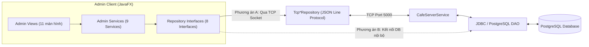

# YÊU CẦU TÍCH HỢP & GIAO THỨC API MODULE ADMIN (ADMIN API & INTEGRATION REQUIREMENTS)

> **Dự án:** CafeOrder  
> **Mục đích:** Đặc tả đầy đủ các thao tác đọc/ghi dữ liệu, cấu trúc thông điệp TCP/JSON, mã lỗi, xác thực/phân quyền và cơ chế đồng bộ khi tích hợp Admin UI (`ui_admin`) vào Database thật và TCP Server chung của nhóm.

---

## 1. KIẾN TRÚC KẾT NỐI ĐỀ XUẤT CHO ADMIN

Hiện tại trong giai đoạn phát triển độc lập, `AdminMain` đang khởi tạo các `Mock*Repository` (in-memory) được tiêm (inject) vào 9 lớp Service (`src/cafe/services/*`). Khi tích hợp với hệ thống của nhóm, nhóm có thể chọn **1 trong 2 mô hình triển khai** mà **không cần sửa code giao diện (`src/cafe/views/admin/*`) hay logic `Service`**:



---

## 2. DANH MỤC CÁC THAO TÁC ĐỌC/GHI DỮ LIỆU TỪ ADMIN

### 2.1. Nhóm Xác thực & Quản lý Người dùng (`UserRepository` / `AdminUserService`)

| Mã thao tác | Loại | Tham số đầu vào (Request Payload) | Dữ liệu trả về (Response Payload) | Quyền yêu cầu | Mã lỗi nghiệp vụ có thể trả về |
|---|---|---|---|---|---|
| `ADMIN_LOGIN` | Read/Write | `{ "username": "admin01", "password": "***" }` | `{ "ok": true, "user": { "id": 1, "username": "admin01", "fullName": "...", "role": "ADMIN", "status": "ACTIVE" } }` | Public | `EMPTY_CREDENTIALS`, `INVALID_CREDENTIALS`, `ACCOUNT_DISABLED`, `FORBIDDEN_ROLE` |
| `GET_USERS` | Read | `{ "keyword": "", "role": "ALL", "status": "ALL" }` | `List<User>` (ẩn hoặc băm `password`) | `ADMIN` | `FORBIDDEN` |
| `CREATE_USER` | Write | `{ "username": "...", "fullName": "...", "passwordHash": "<sha256>", "role": "CASHIER", "status": "ACTIVE", "actor": "admin01" }` | `{ "ok": true, "user": User }` | `ADMIN` | `INVALID_USERNAME_FORMAT`, `EMPTY_FULLNAME`, `WEAK_PASSWORD`, `DUPLICATE_USERNAME`, `FORBIDDEN` |
| `UPDATE_USER` | Write | `{ "id": 2, "fullName": "...", "role": "STAFF", "status": "ACTIVE", "actor": "admin01" }` | `{ "ok": true }` | `ADMIN` | `NOT_FOUND`, `SELF_DISABLE`, `SELF_DEMOTE`, `LAST_ADMIN_PROTECTION`, `FORBIDDEN` |
| `TOGGLE_USER_STATUS` | Write | `{ "id": 2, "targetStatus": "DISABLED", "actor": "admin01" }` | `{ "ok": true, "newStatus": "DISABLED" }` | `ADMIN` | `NOT_FOUND`, `SELF_DISABLE`, `LAST_ADMIN_PROTECTION`, `FORBIDDEN` |
| `RESET_USER_PASSWORD` | Write | `{ "id": 2, "newPasswordHash": "<sha256>", "actor": "admin01" }` | `{ "ok": true }` | `ADMIN` | `NOT_FOUND`, `WEAK_PASSWORD`, `FORBIDDEN` |

---

### 2.2. Nhóm Thực đơn & Danh mục (`CategoryRepository`, `MenuItemRepository`)

| Mã thao tác | Loại | Tham số đầu vào (Request Payload) | Dữ liệu trả về (Response Payload) | Quyền yêu cầu | Quy tắc đồng bộ / Broadcast |
|---|---|---|---|---|---|
| `GET_CATEGORIES` | Read | `{ "keyword": "" }` | `List<Category>` | `ADMIN`, `STAFF`, `TABLE` | - |
| `CREATE_CATEGORY` | Write | `{ "name": "Trà Sữa", "status": "ACTIVE", "actor": "admin01" }` | `{ "ok": true, "category": Category }` | `ADMIN` | Mã lỗi: `INVALID_NAME`, `INVALID_STATUS`, `DUPLICATE_NAME`. |
| `UPDATE_CATEGORY` | Write | `{ "id": 1, "name": "Cà phê Đặc Sản", "status": "ACTIVE", "actor": "admin01" }` | `{ "ok": true, "cascadedItems": 6 }` | `ADMIN` | Nếu đổi tên: Cascade cập nhật tên danh mục trên các `MenuItem` thuộc danh mục đó. Nếu chuyển `INACTIVE`: Chặn khi còn món `ACTIVE` (`HAS_ACTIVE_ITEMS`). |
| `GET_MENU_ITEMS` | Read | `{ "keyword": "", "category": "ALL", "status": "ALL" }` | `List<MenuItem>` | `ALL` (Client chỉ lấy `ACTIVE`) | - |
| `CREATE_MENU_ITEM` | Write | `{ "name": "...", "price": 39000, "category": "...", "description": "...", "iconEmoji": "☕", "status": "ACTIVE", "actor": "admin01" }` | `{ "ok": true, "item": MenuItem }` | `ADMIN` | Kiểm tra `0 < price <= 10,000,000`; chặn tạo `ACTIVE` nếu danh mục `INACTIVE`. Broadcast `MENU_UPDATED` cho các bàn. |
| `UPDATE_MENU_ITEM` | Write | `{ "id": 5, "name": "...", "price": 45000, "category": "...", "status": "ACTIVE", "actor": "admin01" }` | `{ "ok": true }` | `ADMIN` | **Chỉ đổi giá tương lai**, tuyệt đối không sửa `unitPrice` của các `OrderItem` trong các đơn hàng đã tạo trước đó. |
| `TOGGLE_MENU_STATUS` | Write | `{ "id": 5, "actor": "admin01" }` | `{ "ok": true, "newStatus": "INACTIVE" }` | `ADMIN`, `BARISTA` | Khi hết món (`INACTIVE`), Server broadcast cho Client tại bàn để khóa nút đặt món đó. |

---

### 2.3. Nhóm Bàn & Thiết bị Kiosk (`TableRepository`, `DeviceRepository`)

| Mã thao tác | Loại | Tham số đầu vào (Request Payload) | Dữ liệu trả về (Response Payload) | Quyền yêu cầu | Mã lỗi & Quy tắc bảo toàn |
|---|---|---|---|---|---|
| `GET_TABLES` | Read | `{ "keyword": "", "status": "ALL" }` | `List<CafeTable>` | `ADMIN`, `STAFF`, `CASHIER` | - |
| `CREATE_TABLE` | Write | `{ "tableNumber": 15, "deviceId": "DEV-TB15", "status": "AVAILABLE", "actor": "admin01" }` | `{ "ok": true, "table": CafeTable }` | `ADMIN` | `INVALID_TABLE_NUMBER` (`1..999`), `DUPLICATE_TABLE`, `DUPLICATE_DEVICE_ID`, `DEVICE_BUSY`. |
| `UPDATE_TABLE` | Write | `{ "id": 1, "tableNumber": 1, "deviceId": "DEV-TB01", "status": "OCCUPIED", "actor": "admin01" }` | `{ "ok": true }` | `ADMIN` | Chặn đổi `tableNumber` hoặc chuyển về `AVAILABLE`/`INACTIVE` khi bàn còn đơn chưa kết thúc (`HAS_ACTIVE_ORDERS`). |
| `ASSIGN_DEVICE` | Write | `{ "deviceId": 2, "tableNumber": 1, "actor": "admin01" }` | `{ "ok": true }` | `ADMIN` | Thực thi trong 1 Transaction: Gỡ thiết bị cũ của bàn đích (nếu có), gỡ bàn cũ của thiết bị (nếu có), gán 1–1 mới. |
| `UNASSIGN_DEVICE` | Write | `{ "deviceId": 2, "actor": "admin01" }` | `{ "ok": true }` | `ADMIN` | Đặt `device.tableNumber = 0` và xóa `table.deviceId = ""`. |
| `RESET_DEVICE_SECRET`| Write | `{ "deviceId": 1, "actor": "admin01" }` | `{ "ok": true, "credentialStatus": "RESET_REQUIRED" }` | `ADMIN` | Sinh secret mới, lưu `SHA-256` vào `secretHash`, buộc Kiosk xác thực lại. |

---

### 2.4. Nhóm Đơn hàng, Thanh toán & Báo cáo (`OrderRepository`, `PaymentRepository`, `ReportService`)

| Mã thao tác | Loại | Tham số đầu vào (Request Payload) | Dữ liệu trả về (Response Payload) | Quyền yêu cầu | Quy tắc xử lý & Đồng bộ |
|---|---|---|---|---|---|
| `GET_ORDERS` | Read | `{ "keyword": "", "status": "ALL", "dateFilter": "TODAY\|WEEK\|MONTH\|ALL" }` | `List<Order>` (kèm `List<OrderItem>`) | `ADMIN`, `CASHIER`, `BARISTA`, `STAFF` | Lọc theo `timestamp` của đơn và trạng thái. |
| `UPDATE_ORDER_STATUS`| Write | `{ "orderId": 1020, "newStatus": "PAID", "actor": "admin01" }` | `{ "ok": true, "order": Order, "tableStatus": "OCCUPIED" }` | `ADMIN`, `CASHIER`, `BARISTA`, `STAFF` | Kiểm tra State Machine 9 bước; kiểm tra `totalAmount > 0`; nếu `PAID` phải có `Payment SUCCESS` khớp tiền; tự động giải phóng bàn về `AVAILABLE` khi đơn cuối cùng của bàn chuyển sang `COMPLETED` hoặc `CANCELLED`. |
| `GET_PAYMENTS` | Read | `{ "keyword": "", "method": "ALL", "status": "ALL" }` | `List<Payment>` | `ADMIN`, `CASHIER` | - |
| `CONFIRM_PAYMENT` | Write | `{ "paymentId": 18, "actor": "admin01" }` | `{ "ok": true, "payment": Payment }` | `ADMIN`, `CASHIER` | Chỉ áp dụng cho `PENDING`; chặn nếu đơn `CANCELLED` (`ORDER_CANCELLED`) hoặc lệch tiền (`AMOUNT_MISMATCH`). |
| `FAIL_PAYMENT` | Write | `{ "paymentId": 18, "actor": "admin01" }` | `{ "ok": true, "payment": Payment }` | `ADMIN`, `CASHIER` | Chuyển `PENDING -> FAILED`, lưu người xử lý và `AuditLog`. |
| `GET_REPORT_SUMMARY` | Read | `{ "period": "TODAY\|WEEK\|MONTH\|ALL" }` | `ReportSummary`, `List<ProductSales>`, `List<CategorySales>`, `Map<String, Double> weeklyRevenue` | `ADMIN` | Chỉ tính trên đơn `PAID`/`COMPLETED` có `Payment SUCCESS` khớp tiền và dòng món `isBillable() == true`. |

---

## 3. ĐỐI CHIẾU GIAO THỨC TCP/JSON HIỆN TẠI VÀ ĐỀ XUẤT MỞ RỘNG

### 3.1. Những điểm giao thức hiện tại của nhóm (`src/cafe/protocol/`) CHƯA hỗ trợ cho Admin
Qua kiểm tra trực tiếp [`MessageType.java`](file:///d:/LTM/DoAnMonHoc/CafeOrder/src/cafe/protocol/MessageType.java) và [`CafeServerService.java`](file:///d:/LTM/DoAnMonHoc/CafeOrder/src/cafe/services/CafeServerService.java):
1. `MessageType` hiện chỉ có **14 hằng số** phục vụ luồng đặt món cơ bản (`LOGIN`, `GET_MENU`, `CREATE_ORDER`, `ORDER_STATUS`, `CONFIRM_ITEM`, `OUT_OF_STOCK`, `CANCEL_ITEM`, `PAY`, `CALL_STAFF`, `RATE`, `GET_HISTORY`, `PONG`, `SUCCESS`, `ERROR`).
2. `CafeServerService.login()` hiện chỉ kiểm tra 2 tài khoản hardcode (`staff/123` và `client/123`) — chưa hỗ trợ đăng nhập `ADMIN`, `CASHIER`, `BARISTA` hay xác thực thiết bị bàn (`tableNumber + deviceId + secret`).
3. `CafeServerService.createOrder()` đang gán thẳng trạng thái `"CONFIRMED"` thay vì `"CREATED"`, và không truyền `unitPrice` vào `OrderItem` khi parse từ gói tin Client (dẫn đến `unitPrice = 0.0` nếu không tra cứu giá từ `MenuRepository`).
4. `CafeServerService.pay()` hiện cộng dồn doanh thu vào biến tạm `double revenue` trên RAM và đánh dấu thẳng `Order` thành `"PAID"` mà không tạo bản ghi `Payment` (`method`, `transactionCode`, `status`, `processedBy`).

### 3.2. Cấu trúc Envelope JSON chuẩn đề xuất khi nâng cấp TCP Protocol

Để giữ tương thích ngược với JSON Line Protocol hiện tại (`MessageProtocol`), các thông điệp Admin và giao dịch tài chính nên bao gồm:

```json
{
  "type": "UPDATE_ORDER_STATUS",
  "requestId": "550e8400-e29b-41d4-a716-446655440000",
  "actor": "admin01",
  "role": "ADMIN",
  "timestamp": 1760877600000,
  "payload": {
    "orderId": 1020,
    "expectedCurrentStatus": "WAITING_PAYMENT",
    "newStatus": "PAID"
  }
}
```

### 3.3. Xử lý lỗi mạng, Gửi trùng (Idempotency) và Xung đột đồng thời (Concurrency)
1. **Idempotency (`requestId`):**
   - Model `Order` trong nhánh `ui_admin` đã có trường `String requestId` (UUID). Khi Client gửi `CREATE_ORDER`, Server kiểm tra `UNIQUE (request_id)`: nếu `request_id` đã tồn tại thì trả về ngay `Order` đã tạo trước đó thay vì nhân đôi đơn hàng.
2. **Optimistic Concurrency khi cập nhật trạng thái đơn:**
   - Khi cả `CASHIER` và `ADMIN` (hoặc `BARISTA` trên KDS) cùng bấm chuyển trạng thái 1 đơn hàng, Server kiểm tra `OrderService.isValidTransition(currentDbStatus, newStatus)`. Người bấm sau sẽ nhận mã lỗi `INVALID_TRANSITION` kèm trạng thái mới nhất của đơn.
3. **Snapshot giá trên Server khi nhận `CREATE_ORDER`:**
   - Server **không được tin tưởng giá `price` gửi từ Client**, cũng không được để `unitPrice = 0`. Khi xử lý `CREATE_ORDER`, Server phải tra cứu `MenuItem` đang `ACTIVE` trong DB, lấy `MenuItem.getPrice()` gán vào `OrderItem.setUnitPrice(...)` và lưu xuống bảng `order_items`.
