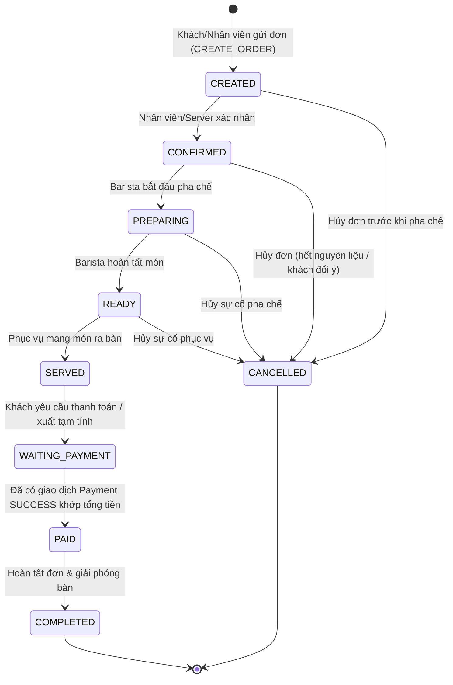

# QUY TẮC NGHIỆP VỤ MODULE ADMIN (ADMIN BUSINESS RULES SPECIFICATION)

> **Dự án:** CafeOrder  
> **Phạm vi:** Các quy tắc nghiệp vụ đã được kiểm chứng và thực thi tại tầng Model + Service + View của nhánh `ui_admin`  
> **Nguyên tắc:** Mọi quy tắc dưới đây đang được bảo vệ trực tiếp ở tầng Service (`src/cafe/services/`) và Model (`src/cafe/models/`), không phụ thuộc vào việc UI có khóa nút hay không.

---

## 1. QUY TẮC VÒNG ĐỜI ĐƠN HÀNG (ORDER STATE MACHINE — 9 TRẠNG THÁI)

### 1.1. Sơ đồ chuyển trạng thái chuẩn

### 1.2. Bảng ma trận chuyển trạng thái (`OrderService.getAllowedNextStatuses`)

| Trạng thái hiện tại (`currentStatus`) | Trạng thái tiếp theo hợp lệ (`allowedNextStatuses`) | Điều kiện tiên quyết bắt buộc (Preconditions) | Hệ quả đồng bộ (Side Effects) |
|---|---|---|---|
| `CREATED` | `CONFIRMED`, `CANCELLED` | Nếu sang `CONFIRMED`: Đơn phải có `totalQuantity > 0` và `totalAmount > 0`. | Nếu `CONFIRMED`: Bàn chuyển sang `OCCUPIED`. Nếu `CANCELLED`: Kiểm tra giải phóng bàn về `AVAILABLE`. |
| `CONFIRMED` | `PREPARING`, `CANCELLED` | Nếu sang `PREPARING`: Đơn phải có `totalQuantity > 0` và `totalAmount > 0`. | Đồng bộ trạng thái bàn; ghi `AuditLog`. |
| `PREPARING` | `READY`, `CANCELLED` | Nếu sang `READY`: Đơn phải có `totalQuantity > 0` và `totalAmount > 0`. | Đồng bộ trạng thái bàn; ghi `AuditLog`. |
| `READY` | `SERVED`, `CANCELLED` | Nếu sang `SERVED`: Đơn phải có `totalQuantity > 0` và `totalAmount > 0`. | Đồng bộ trạng thái bàn; ghi `AuditLog`. |
| `SERVED` | `WAITING_PAYMENT` | Không cho phép `CANCELLED` sau khi khách đã nhận món (`SERVED`). | Bàn giữ trạng thái `OCCUPIED`; ghi `AuditLog`. |
| `WAITING_PAYMENT` | `PAID` | **Bắt buộc** tồn tại bản ghi `Payment` của đơn đó có `status = 'SUCCESS'` và `Math.abs(payment.amount - order.totalAmount) <= 0.01`. | Bàn giữ `OCCUPIED` cho đến khi `COMPLETED`; ghi `AuditLog`. |
| `PAID` | `COMPLETED` | Đơn đã thanh toán đủ. | Nếu bàn không còn đơn active nào khác, tự động chuyển `CafeTable.status` về `AVAILABLE`. |
| `COMPLETED` | *(Không có — Terminal)* | Trạng thái kết thúc thành công. | Mọi yêu cầu đổi trạng thái đều bị từ chối (`FAILED (INVALID_TRANSITION)`). |
| `CANCELLED` | *(Không có — Terminal)* | Trạng thái kết thúc hủy. | Mọi yêu cầu đổi trạng thái đều bị từ chối (`FAILED (INVALID_TRANSITION)`). |

---

## 2. QUY TẮC TÍNH TIỀN ĐƠN HÀNG & DÒNG MÓN (`Order` & `OrderItem`)

1. **Điều kiện dòng món được tính tiền (`OrderItem.isBillable()`):**
   - `qty > 0`
   - `Double.isFinite(unitPrice) && unitPrice >= 0`
   - `status == null || "CONFIRMED".equalsIgnoreCase(status.trim())`
   - Các dòng món có trạng thái `OUT_OF_STOCK`, `CANCELLED`, `PENDING` hoặc giá `NaN`/`Infinity`/âm đều **không được tính vào tổng số lượng và tổng tiền đơn hàng**.
2. **Công thức tính thành tiền dòng món (`OrderItem.getSubtotal()`):**
   $$\text{Subtotal} = \begin{cases} \text{qty} \times \text{unitPrice} & \text{nếu } \text{qty} > 0 \land \text{isFinite}(\text{unitPrice}) \land \text{unitPrice} \ge 0 \\ 0.0 & \text{ngược lại} \end{cases}$$
3. **Công thức tính tổng số lượng và tổng tiền đơn hàng (`Order.getTotalQuantity()`, `Order.getTotalAmount()`):**
   $$\text{TotalQuantity} = \sum_{i \in \text{items}, \, i.\text{isBillable}()} i.\text{qty}$$
   $$\text{TotalAmount} = \sum_{i \in \text{items}, \, i.\text{isBillable}()} i.\text{getSubtotal}()$$
4. **Chặn đơn rỗng / đơn 0 đồng:**
   - Mọi đơn hàng có `TotalQuantity <= 0` hoặc `TotalAmount <= 0` (ví dụ tất cả các món trong đơn đều bị đánh dấu `OUT_OF_STOCK` hoặc `CANCELLED`) **chỉ được phép chuyển sang `CANCELLED`**, tuyệt đối không được chuyển sang `CONFIRMED`, `PREPARING`, `READY`, `SERVED`, `WAITING_PAYMENT`, `PAID` hay `COMPLETED`.

---

## 3. QUY TẮC THANH TOÁN (`PaymentService`)

1. **Không tự động sinh thanh toán giả khi đổi trạng thái đơn:**
   - `OrderService.updateOrderStatus()` tuyệt đối không tự tạo `Payment` ngầm. Nếu thu ngân/Admin muốn chuyển đơn từ `WAITING_PAYMENT` sang `PAID`, hệ thống kiểm tra `PaymentRepository.findAllByOrderId(orderId)` phải có giao dịch `SUCCESS` khớp số tiền.
2. **Quy trình xử lý giao dịch `PENDING` (`PaymentService.confirmPendingPayment` & `markPaymentFailed`):**
   - Chỉ giao dịch đang ở trạng thái `PENDING` mới được phép xác nhận (`SUCCESS`) hoặc đánh dấu lỗi (`FAILED`).
   - Khi xác nhận (`confirmPendingPayment`):
     - Đơn hàng liên kết phải tồn tại.
     - Đơn hàng **không được ở trạng thái `CANCELLED`**.
     - Tổng tiền hợp lệ của đơn hàng phải `> 0` và khớp với số tiền giao dịch: `Math.abs(payment.getAmount() - order.getTotalAmount()) <= 0.01`.
     - Khi hợp lệ: Cập nhật `status = "SUCCESS"`, `paidAt = now()`, `processedBy = actor`, và ghi `AuditLog` (`CONFIRM_PAYMENT`).
   - Khi đánh dấu thất bại (`markPaymentFailed`):
     - Cập nhật `status = "FAILED"`, `processedBy = actor`, và ghi `AuditLog` (`FAIL_PAYMENT`).

---

## 4. QUY TẮC DOANH THU, AOV & BÁO CÁO (`ReportService` & `ReportSummary`)

1. **Điều kiện đơn hàng được ghi nhận doanh thu (`ReportService.isRevenueEligibleOrder`):**
   - `Order.status` thuộc `{'PAID', 'COMPLETED'}`.
   - `Order.getTotalAmount() > 0` và `Order.getTotalQuantity() > 0`.
   - Có bản ghi `Payment` liên kết đạt `status = 'SUCCESS'` và `Math.abs(payment.amount - order.totalAmount) <= 0.01`.
2. **Công thức Giá trị đơn hàng trung bình (AOV — `ReportSummary`):**
   $$\text{AOV} = \begin{cases} \dfrac{\text{TotalRevenue}}{\text{CompletedOrders}} & \text{nếu } \text{CompletedOrders} > 0 \\ 0.0 & \text{nếu } \text{CompletedOrders} = 0 \end{cases}$$
   *(Lưu ý: Mẫu số là số đơn hoàn tất/đã thanh toán hợp lệ `completedOrders`, tuyệt đối không chia cho `totalOrders` bao gồm cả đơn hủy/đơn chưa thu tiền).*
3. **Tính nhất quán số liệu giữa KPI Cards, Bảng Sản Phẩm và Bảng Danh Mục:**
   - Trong cùng một kỳ lọc (`TODAY`, `WEEK`, `MONTH`, `ALL`), cả 3 báo cáo (`getReportSummary`, `getProductSalesReport`, `getCategorySalesReport`) đều lọc trên cùng tập đơn hàng đủ điều kiện doanh thu (`isRevenueEligibleOrder`) và chỉ cộng các dòng món `item.isBillable() == true`.
   - Đảm bảo bất biến:
     $$\text{KPI TotalRevenue} = \sum \text{ProductSales.revenue} = \sum \text{CategorySales.revenue}$$
4. **Quy tắc đếm số đơn theo danh mục (`CategorySales.orderCount`):**
   - Nếu 1 đơn hàng có 3 món cùng thuộc danh mục `"Cà phê"`, `orderCount` của danh mục `"Cà phê"` chỉ tăng thêm **1** (sử dụng `Set<Integer> orderIds` phân biệt), trong khi `itemCount` tăng theo tổng số lượng ly bán ra.

---

## 5. QUY TẮC THỰC ĐƠN & DANH MỤC (`MenuService` & `CategoryService`)

1. **Ràng buộc Danh mục (`CategoryService`):**
   - Tên danh mục không được rỗng và không trùng lặp (không phân biệt hoa thường).
   - Trạng thái chỉ nhận `ACTIVE` hoặc `INACTIVE`.
   - **Chặn vô hiệu hóa danh mục đang có món mở bán:** Không thể chuyển danh mục từ `ACTIVE` sang `INACTIVE` (qua `updateCategory` hoặc `toggleCategoryStatus`) nếu vẫn còn bất kỳ `MenuItem` nào thuộc danh mục đó đang ở trạng thái `ACTIVE`.
   - **Cascade khi đổi tên danh mục:** Khi Admin đổi tên danh mục từ `oldName` sang `newName`, toàn bộ các `MenuItem` đang có `category.equalsIgnoreCase(oldName)` được tự động cập nhật sang `newName` để không làm rơi món khỏi danh mục.
2. **Ràng buộc Món ăn (`MenuService`):**
   - Tên món không được rỗng và không trùng lặp (case-insensitive).
   - Giá bán (`price`) phải là số thực hữu hạn (`Double.isFinite(price)`), lớn hơn `0` và không vượt quá trần `10,000,000 đ`.
   - Danh mục được chọn phải tồn tại trong `CategoryRepository`.
   - **Chặn mở bán món trong danh mục đã khóa:** Không thể tạo mới món với trạng thái `ACTIVE`, cập nhật món sang `ACTIVE`, hoặc bật mở bán (`toggleMenuItemStatus`) nếu danh mục chứa món đó đang ở trạng thái `INACTIVE`.

---

## 6. QUY TẮC BÀN & THIẾT BỊ KIOSK (`TableService` & `DeviceService`)

1. **Quan hệ 1–1 tuyệt đối giữa Bàn (`CafeTable`) và Thiết bị (`Device`):**
   - Một bàn chỉ được gắn tối đa 1 thiết bị Kiosk tại một thời điểm; một thiết bị chỉ được gắn cho tối đa 1 bàn.
   - Khi gán thiết bị $D$ vào bàn $T$ (`DeviceService.assignDevice`):
     - Nếu bàn $T$ trước đó đang gắn thiết bị $D_{\text{old}} \ne D$, hệ thống tự động gỡ $D_{\text{old}}$ về trạng thái chưa gán bàn (`tableNumber = 0`).
     - Nếu thiết bị $D$ trước đó đang gắn ở bàn $T_{\text{old}} \ne T$, hệ thống tự động xóa `deviceId` trên bàn $T_{\text{old}}$.
     - Cập nhật đồng bộ cả 2 chiều: `D.tableNumber = T` và `T.deviceId = D.deviceId`.
   - Khi tạo/sửa bàn trong `TableService`, nếu nhập mã `deviceId` đang thuộc về bàn khác, hệ thống từ chối ngay và trả về thông báo lỗi chỉ rõ số bàn đang giữ thiết bị đó.
2. **Bảo vệ bàn đang có khách / đơn hàng hoạt động:**
   - Một bàn đang có đơn hàng chưa kết thúc (trạng thái khác `COMPLETED` và `CANCELLED`):
     - Không được phép đổi số bàn (`tableNumber`).
     - Không được phép chuyển trạng thái bàn sang `AVAILABLE`, `OFFLINE`, hay `INACTIVE` (bắt buộc giữ `OCCUPIED` cho đến khi đơn hàng hoàn tất hoặc hủy).
3. **Bảo mật khóa thiết bị (`Device.secretHash`):**
   - Khóa bí mật của thiết bị được băm một chiều bằng `SHA-256` (`64` ký tự hex).
   - Khi Admin thực hiện `resetDeviceCredential`, hệ thống sinh chuỗi khóa mới, băm `SHA-256`, cập nhật `credentialStatus = "RESET_REQUIRED"` và ghi `AuditLog`.

---

## 7. QUY TẮC NGƯỜI DÙNG, PHÂN QUYỀN RBAC & AN TOÀN QUẢN TRỊ (`AdminUserService`)

1. **Kiểm tra quyền thực thi ở tầng Service (`verifyAdminActor`):**
   - Mọi hàm biến đổi dữ liệu trong `AdminUserService` (`createUser`, `updateUser`, `toggleUserStatus`, `resetPassword`) đều kiểm tra tài khoản `actor` trong `UserRepository`: phải tồn tại, đang `ACTIVE` và có `role == Role.ADMIN`.
2. **Chống tự khóa hoặc tự hạ quyền (`Self-Lockout / Self-Demotion Protection`):**
   - Tài khoản Admin đang đăng nhập **không thể tự chuyển trạng thái của chính mình sang `DISABLED`** và **không thể tự đổi vai trò của chính mình từ `ADMIN` sang vai trò khác**.
3. **Bảo vệ Admin hoạt động cuối cùng (`Last Active Admin Protection`):**
   - Nếu hệ thống chỉ còn duy nhất 1 tài khoản `ADMIN` đang `ACTIVE` (`countOtherActiveAdmins == 0`), mọi thao tác khóa (`DISABLED`) hoặc hạ quyền tài khoản đó đều bị từ chối.
4. **Ràng buộc mật khẩu và định danh:**
   - `username`: Từ 4–30 ký tự, chỉ gồm chữ cái ASCII, chữ số và dấu gạch dưới (`^[a-zA-Z0-9_]{4,30}$`).
   - `password`: Tối thiểu 6 ký tự (sau khi `trim`), phải khớp `confirmPassword` khi tạo mới hoặc đặt lại mật khẩu trên UI (sử dụng `PasswordField` ẩn ký tự).
   - Mật khẩu luôn được băm `SHA-256` trước khi lưu xuống Repository.

---

## 8. BẢNG TỔNG HỢP ĐIỀU KIỆN HỢP LỆ & TỪ CHỐI (VALIDATION MATRIX)

| Module | Thao tác | Điều kiện Hợp lệ (Valid) | Điều kiện Từ chối (Rejected) & Mã AuditLog |
|---|---|---|---|
| **Auth / User** | Đăng nhập Admin | `username` tồn tại, `verifyPassword(raw)` đúng, `status = ACTIVE`, `role = ADMIN` | Rỗng (`EMPTY_CREDENTIALS`), sai mật khẩu (`INVALID_CREDENTIALS`), bị khóa (`ACCOUNT_DISABLED`), không phải Admin (`FORBIDDEN_ROLE`) |
| **User** | Tạo / Sửa / Khóa / Reset Pass | `actor` là `ADMIN` active; `username` khớp regex; `password >= 6`; còn ít nhất 1 `ADMIN` active | Không đủ quyền (`FORBIDDEN`), trùng tên (`DUPLICATE_USERNAME`), tự khóa (`SELF_DISABLE`), tự hạ quyền (`SELF_DEMOTE`), khóa Admin cuối (`LAST_ADMIN_PROTECTION`) |
| **Category** | Tạo / Sửa / Đổi trạng thái | Tên không rỗng, không trùng; `status` là `ACTIVE`/`INACTIVE` | Trùng tên (`DUPLICATE_NAME`), sai trạng thái (`INVALID_STATUS`), tắt danh mục còn món đang bán (`HAS_ACTIVE_ITEMS`) |
| **Menu** | Tạo / Sửa / Bật mở bán | Tên duy nhất; `0 < price <= 10,000,000` (finite); Category tồn tại & đang `ACTIVE` (nếu món `ACTIVE`) | Giá `<= 0` / `NaN` / `> 10M` (`INVALID_PRICE`), danh mục không tồn tại hoặc đang `INACTIVE` (`CATEGORY_INACTIVE_OR_INVALID`) |
| **Table** | Tạo / Sửa bàn | `1 <= tableNumber <= 999` duy nhất; `deviceId` chưa gán cho bàn khác; không đổi trạng thái/số bàn khi còn đơn active | Trùng số bàn (`DUPLICATE_TABLE`), trùng thiết bị (`DUPLICATE_DEVICE_ID`), bàn đang có đơn active (`HAS_ACTIVE_ORDERS`) |
| **Device** | Gán bàn / Gỡ bàn / Reset | Thiết bị tồn tại; bàn đích tồn tại (`1..999`) | Thiết bị không tồn tại (`NOT_FOUND`), bàn đích không tồn tại (`TABLE_NOT_FOUND`), gỡ thiết bị chưa gán (`ALREADY_UNASSIGNED`) |
| **Order** | Chuyển trạng thái đơn | Tuân thủ đúng State Machine; `totalAmount > 0` (trừ khi hủy); sang `PAID` phải có `Payment SUCCESS` khớp tiền | Nhảy cóc/lùi trạng thái (`INVALID_TRANSITION`), đơn 0 đồng (`ZERO_BILLABLE_AMOUNT`), chưa thanh toán đủ (`PAYMENT_REQUIRED`) |
| **Payment** | Xác nhận / Báo lỗi `PENDING` | Giao dịch đang `PENDING`; đơn tồn tại, không `CANCELLED`, khớp `order.getTotalAmount()` | Đơn đã hủy (`ORDER_CANCELLED`), lệch số tiền (`AMOUNT_MISMATCH`), không tìm thấy đơn (`ORDER_NOT_FOUND`) |
