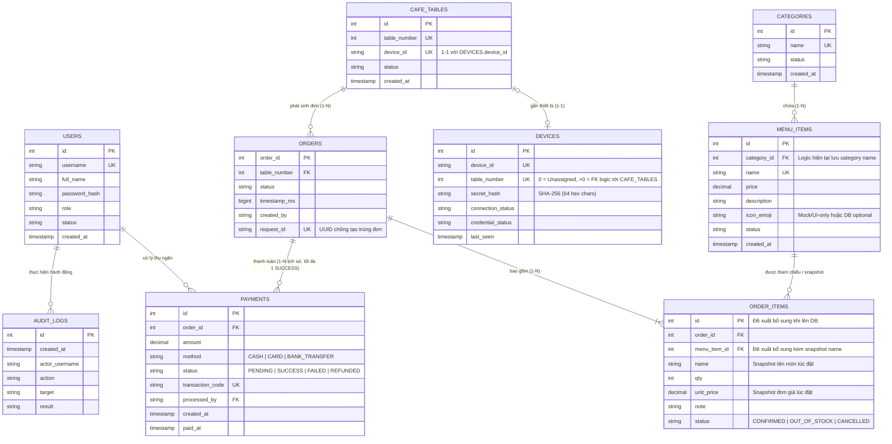

# TỪ ĐIỂN DỮ LIỆU MODULE ADMIN (ADMIN DATA DICTIONARY)

> **Dự án:** CafeOrder — Hệ thống gọi món tại bàn, KDS và Quản trị quán cà phê  
> **Phạm vi:** Toàn bộ các Entity / Model đang sử dụng trong nhánh `ui_admin` (`src/cafe/models/`)  
> **Mục đích:** Chuẩn hóa cấu trúc dữ liệu giữa Admin UI, Database (PostgreSQL/MySQL) và Giao thức TCP/JSON của nhóm.

---

## 1. SƠ ĐỒ QUAN HỆ THỰC THỂ (ERD LOGIC & ĐỀ XUẤT DATABASE)

---

## 2. CHI TIẾT CÁC ENTITY TRONG ADMIN

### 2.1. `User` (`src/cafe/models/User.java`) & `Role` (`src/cafe/models/Role.java`)

Quản lý tài khoản nhân sự và định danh phiên làm việc trên hệ thống.

| Tên trường (Java) | Tên cột DB đề xuất | Kiểu Java | Kiểu DB đề xuất | Ràng buộc (Constraints) | Nguồn dữ liệu | Mô tả & Quy tắc nghiệp vụ |
|---|---|---|---|---|---|---|
| `id` | `id` | `int` | `SERIAL / INT` | `PRIMARY KEY`, `> 0` | Persistent DB | Định danh duy nhất của tài khoản. |
| `username` | `username` | `String` | `VARCHAR(30)` | `NOT NULL`, `UNIQUE`, Regex `^[a-zA-Z0-9_]{4,30}$` | Persistent DB | Tên đăng nhập không dấu, không khoảng trắng, không cho sửa sau khi tạo. |
| `fullName` | `full_name` | `String` | `VARCHAR(100)` | `NOT NULL`, `LENGTH(TRIM) > 0` | Persistent DB | Họ và tên hiển thị của nhân viên. |
| `password` | `password_hash` | `String` | `CHAR(64)` | `NOT NULL`, SHA-256 Hex (`^[0-9a-f]{64}$`) | Persistent DB | **Không lưu plaintext.** Tự động băm SHA-256 qua `User.hashPassword()`. |
| `role` | `role` | `Role` (enum) | `VARCHAR(20)` | `NOT NULL`, `IN ('ADMIN','CASHIER','BARISTA','STAFF','TABLE')` | Persistent DB | Vai trò phân quyền RBAC. |
| `status` | `status` | `String` | `VARCHAR(15)` | `NOT NULL`, `IN ('ACTIVE','DISABLED')` | Persistent DB | Trạng thái hoạt động (Soft-delete / Khóa tài khoản, tuyệt đối không xóa cứng). |
| `createdAt` | `created_at` | `String` | `TIMESTAMP` | `NOT NULL`, `DEFAULT NOW()` | Persistent DB | Thời điểm tạo tài khoản (`yyyy-MM-dd HH:mm`). |

---

### 2.2. `Category` (`src/cafe/models/Category.java`)

Quản lý nhóm thực đơn (Danh mục).

| Tên trường (Java) | Tên cột DB đề xuất | Kiểu Java | Kiểu DB đề xuất | Ràng buộc (Constraints) | Nguồn dữ liệu | Mô tả & Quy tắc nghiệp vụ |
|---|---|---|---|---|---|---|
| `id` | `id` | `int` | `SERIAL / INT` | `PRIMARY KEY`, `> 0` | Persistent DB | Mã định danh danh mục. |
| `name` | `name` | `String` | `VARCHAR(80)` | `NOT NULL`, `UNIQUE` (case-insensitive) | Persistent DB | Tên danh mục (`Cà phê`, `Trà & Trái cây`,...). Khi đổi tên trong Admin, hệ thống tự động cascade sang `MenuItem.category`. |
| `status` | `status` | `String` | `VARCHAR(15)` | `NOT NULL`, `IN ('ACTIVE','INACTIVE')` | Persistent DB | Không cho phép chuyển sang `INACTIVE` nếu còn món `ACTIVE` thuộc danh mục. |
| `createdAt` | `created_at` | `String` | `TIMESTAMP` | `NOT NULL`, `DEFAULT NOW()` | Persistent DB | Thời điểm khởi tạo danh mục. |

---

### 2.3. `MenuItem` (`src/cafe/models/MenuItem.java`)

Quản lý thực đơn đồ uống và bánh ngọt.

| Tên trường (Java) | Tên cột DB đề xuất | Kiểu Java | Kiểu DB đề xuất | Ràng buộc (Constraints) | Nguồn dữ liệu | Mô tả & Quy tắc nghiệp vụ |
|---|---|---|---|---|---|---|
| `id` | `id` | `int` | `SERIAL / INT` | `PRIMARY KEY`, `> 0` | Persistent DB | Mã món ăn/đồ uống. |
| `name` | `name` | `String` | `VARCHAR(120)` | `NOT NULL`, `UNIQUE` (case-insensitive) | Persistent DB | Tên món hiển thị trên Menu Client, KDS và Hóa đơn. |
| `price` | `price` | `double` | `NUMERIC(12,2)` | `NOT NULL`, `Finite`, `0 < price <= 10,000,000` | Persistent DB | Giá bán hiện hành (VNĐ). Chặn `NaN`, `Infinity`, số âm hoặc `<= 0`. |
| `category` | `category_id` / `category_name` | `String` | `INT FK` hoặc `VARCHAR(80)` | `NOT NULL`, phải tồn tại trong `Category` | Persistent DB | Hiện tại model dùng `String category` để tương thích với `ClientController`. Khi lên DB nên dùng `category_id` kèm JOIN. |
| `description` | `description` | `String` | `VARCHAR(500)` | `NULLABLE` | Persistent DB | Mô tả thành phần / hương vị món. |
| `iconEmoji` | `icon_emoji` | `String` | `VARCHAR(16)` | `NOT NULL`, `DEFAULT '☕'` | UI / DB Optional | Biểu tượng hiển thị trên thẻ món. |
| `status` | `status` | `String` | `VARCHAR(15)` | `NOT NULL`, `IN ('ACTIVE','INACTIVE')` | Persistent DB | Trạng thái mở bán. Không thể `ACTIVE` nếu danh mục cha đang `INACTIVE`. |
| `createdAt` | `created_at` | `String` | `TIMESTAMP` | `NOT NULL`, `DEFAULT NOW()` | Persistent DB | Thời điểm thêm món. |

---

### 2.4. `CafeTable` (`src/cafe/models/CafeTable.java`)

Quản lý sơ đồ bàn vật lý trong quán và liên kết 1–1 với thiết bị Kiosk/Tablet tại bàn.

| Tên trường (Java) | Tên cột DB đề xuất | Kiểu Java | Kiểu DB đề xuất | Ràng buộc (Constraints) | Nguồn dữ liệu | Mô tả & Quy tắc nghiệp vụ |
|---|---|---|---|---|---|---|
| `id` | `id` | `int` | `SERIAL / INT` | `PRIMARY KEY`, `> 0` | Persistent DB | Khóa chính nội bộ của bàn. |
| `tableNumber` | `table_number` | `int` | `INT` | `NOT NULL`, `UNIQUE`, `1 <= tableNumber <= 999` | Persistent DB | Số bàn vật lý. Không được đổi số bàn khi bàn đang có đơn hàng chưa kết thúc. |
| `deviceId` | `device_id` | `String` | `VARCHAR(50)` | `NULLABLE`, `UNIQUE` (khi khác rỗng) | Persistent DB | Mã thiết bị Kiosk gắn tại bàn. Quan hệ **1–1 nghiêm ngặt** với `Device`. |
| `status` | `status` | `String` | `VARCHAR(15)` | `NOT NULL`, `IN ('AVAILABLE','OCCUPIED','OFFLINE','INACTIVE')` | Persistent DB | Trạng thái bàn. Tự động đồng bộ sang `OCCUPIED` khi có đơn active và tự giải phóng về `AVAILABLE` khi mọi đơn tại bàn đã `COMPLETED`/`CANCELLED`. |
| `createdAt` | `created_at` | `String` | `TIMESTAMP` | `NOT NULL`, `DEFAULT NOW()` | Persistent DB | Ngày tạo bàn. |

---

### 2.5. `Device` (`src/cafe/models/Device.java`)

Quản lý thiết bị Tablet/Kiosk đặt tại bàn và thông tin bảo mật xác thực thiết bị.

| Tên trường (Java) | Tên cột DB đề xuất | Kiểu Java | Kiểu DB đề xuất | Ràng buộc (Constraints) | Nguồn dữ liệu | Mô tả & Quy tắc nghiệp vụ |
|---|---|---|---|---|---|---|
| `id` | `id` | `int` | `SERIAL / INT` | `PRIMARY KEY`, `> 0` | Persistent DB | Khóa chính thiết bị. |
| `deviceId` | `device_id` | `String` | `VARCHAR(50)` | `NOT NULL`, `UNIQUE` | Persistent DB | Mã định danh phần cứng/logic của Kiosk (VD: `DEV-TB01-A9F`). |
| `tableNumber` | `table_number` | `int` | `INT` | `NOT NULL`, `>= 0` (`0` = chưa gán bàn; `> 0` = `UNIQUE`) | Persistent DB | Số bàn đang gắn thiết bị (`0` nếu là thiết bị dự phòng `SPARE`). |
| `secretHash` | `device_secret_hash` | `String` | `CHAR(64)` | `NOT NULL`, SHA-256 Hex (`^[0-9a-f]{64}$`) | Persistent DB | Mã băm SHA-256 của khóa bí mật thiết bị. **Không lưu/hiển thị plaintext secret trên UI.** |
| `connectionStatus` | `connection_status` | `String` | `VARCHAR(15)` | `NOT NULL`, `IN ('ONLINE','OFFLINE')` | Runtime / DB | Trạng thái kết nối TCP Socket hiện tại của thiết bị. |
| `lastSeen` | `last_seen` | `String` | `TIMESTAMP` | `NULLABLE` | Runtime / DB | Thời điểm cuối cùng nhận gói tin từ thiết bị. |
| `credentialStatus` | `credential_status` | `String` | `VARCHAR(20)` | `NOT NULL`, `IN ('ACTIVE','RESET_REQUIRED','REVOKED')` | Persistent DB | Trạng thái khóa bảo mật. Khi Admin bấm `Reset Credential`, chuyển sang `RESET_REQUIRED` và xoay vòng `secretHash`. |

---

### 2.6. `Order` (`src/cafe/models/Order.java`) & `OrderItem` (`src/cafe/models/OrderItem.java`)

Thực thể cốt lõi dùng chung giữa **Client – Server – KDS – Admin**.

#### A. Bảng `Order`
| Tên trường (Java) | Tên cột DB đề xuất | Kiểu Java | Kiểu DB đề xuất | Ràng buộc (Constraints) | Nguồn dữ liệu | Mô tả & Quy tắc nghiệp vụ |
|---|---|---|---|---|---|---|
| `orderId` | `order_id` | `int` | `SERIAL / INT` | `PRIMARY KEY`, `> 0` | Persistent DB | Mã đơn hàng (VD: `#1001..#1025`). |
| `table` | `table_number` | `int` | `INT` | `NOT NULL`, `> 0`, FK tới `cafe_tables(table_number)` | Persistent DB | Số bàn đặt món. |
| `items` | *(Bảng `order_items`)* | `List<OrderItem>` | Quan hệ `1-N` | Tối thiểu 1 `OrderItem` khi tạo đơn | Persistent DB | Danh sách các dòng món ăn trong đơn. |
| `status` | `status` | `String` | `VARCHAR(20)` | `NOT NULL`, thuộc 9 trạng thái chuẩn State Machine | Persistent DB | `CREATED`, `CONFIRMED`, `PREPARING`, `READY`, `SERVED`, `WAITING_PAYMENT`, `PAID`, `COMPLETED`, `CANCELLED`. |
| `timestamp` | `created_at_ms` / `created_at` | `long` | `BIGINT` / `TIMESTAMP` | `NOT NULL`, `> 0` | Persistent DB | Epoch milliseconds lúc tạo đơn (phục vụ lọc `TODAY`, `WEEK`, `MONTH` và biểu đồ doanh thu). |
| `createdBy` | `created_by` | `String` | `VARCHAR(50)` | `NOT NULL` | Persistent DB | Nguồn tạo đơn (VD: `"Bàn 01"`, `"staff01"`, `"Client"`). |
| `requestId` | `request_id` | `String` | `VARCHAR(64)` | `NOT NULL`, `UNIQUE` (UUID) | Persistent DB | Khóa Idempotency chống tạo trùng đơn khi mạng chập chờn gửi lại gói tin `CREATE_ORDER`. |

#### B. Bảng `OrderItem`
| Tên trường (Java) | Tên cột DB đề xuất | Kiểu Java | Kiểu DB đề xuất | Ràng buộc (Constraints) | Nguồn dữ liệu | Mô tả & Quy tắc nghiệp vụ |
|---|---|---|---|---|---|---|
| `name` | `item_name_snapshot` | `String` | `VARCHAR(120)` | `NOT NULL` | Persistent DB | **Snapshot tên món** tại thời điểm đặt (không bị đổi khi Admin sửa tên món sau này). |
| `qty` | `quantity` | `int` | `INT` | `NOT NULL`, `> 0` | Persistent DB | Số lượng phần đặt. |
| `note` | `note` | `String` | `VARCHAR(255)` | `NULLABLE` | Persistent DB | Ghi chú pha chế (`Ít đá`, `Ít ngọt`,...). |
| `unitPrice` | `unit_price_snapshot` | `double` | `NUMERIC(12,2)` | `NOT NULL`, `Finite`, `>= 0` | Persistent DB | **Snapshot đơn giá** tại thời điểm đặt (không bị đổi khi Admin tăng/giảm giá menu sau này). |
| `status` | `item_status` | `String` | `VARCHAR(20)` | `NOT NULL`, `IN ('CONFIRMED','OUT_OF_STOCK','CANCELLED')` | Persistent DB | Chỉ dòng món có `isBillable() == true` (`status == null \|\| CONFIRMED`, `qty > 0`, `unitPrice >= 0` hữu hạn) mới được cộng vào tổng tiền đơn. |

---

### 2.7. `Payment` (`src/cafe/models/Payment.java`)

Quản lý giao dịch thanh toán của đơn hàng.

| Tên trường (Java) | Tên cột DB đề xuất | Kiểu Java | Kiểu DB đề xuất | Ràng buộc (Constraints) | Nguồn dữ liệu | Mô tả & Quy tắc nghiệp vụ |
|---|---|---|---|---|---|---|
| `id` | `id` | `int` | `SERIAL / INT` | `PRIMARY KEY`, `> 0` | Persistent DB | Mã giao dịch thanh toán. |
| `orderId` | `order_id` | `int` | `INT` | `NOT NULL`, FK tới `orders(order_id)` | Persistent DB | Đơn hàng được thanh toán. Một đơn có thể có lịch sử thử thanh toán (`FAILED`), nhưng chỉ tối đa 1 giao dịch `SUCCESS`. |
| `amount` | `amount` | `double` | `NUMERIC(12,2)` | `NOT NULL`, `> 0`, phải khớp `order.getTotalAmount()` | Persistent DB | Số tiền thanh toán (VNĐ). |
| `method` | `method` | `String` | `VARCHAR(20)` | `NOT NULL`, `IN ('CASH','CARD','BANK_TRANSFER')` | Persistent DB | Phương thức thanh toán. |
| `status` | `status` | `String` | `VARCHAR(20)` | `NOT NULL`, `IN ('PENDING','SUCCESS','FAILED','REFUNDED')` | Persistent DB | Trạng thái giao dịch. |
| `transactionCode` | `transaction_code` | `String` | `VARCHAR(64)` | `NOT NULL`, `UNIQUE` | Persistent DB | Mã tham chiếu giao dịch (tiền mặt/ngân hàng/POS). |
| `processedBy` | `processed_by` | `String` | `VARCHAR(30)` | `NOT NULL`, FK logic tới `users(username)` | Persistent DB | Thu ngân/Admin thực hiện hoặc xác nhận giao dịch. |
| `createdAt` | `created_at` | `String` | `TIMESTAMP` | `NOT NULL` | Persistent DB | Thời điểm khởi tạo yêu cầu thanh toán. |
| `paidAt` | `paid_at` | `String` | `TIMESTAMP` | `NULLABLE` (`NOT NULL` khi `status = 'SUCCESS'`) | Persistent DB | Thời điểm thanh toán thành công thực tế. |

---

### 2.8. `AuditLog` (`src/cafe/models/AuditLog.java`)

Nhật ký kiểm toán bất biến (Append-only) ghi nhận toàn bộ thao tác quản trị và bảo mật.

| Tên trường (Java) | Tên cột DB đề xuất | Kiểu Java | Kiểu DB đề xuất | Ràng buộc (Constraints) | Nguồn dữ liệu | Mô tả & Quy tắc nghiệp vụ |
|---|---|---|---|---|---|---|
| `id` | `id` | `int` | `BIGSERIAL / INT` | `PRIMARY KEY`, `> 0` | Persistent DB | Mã bản ghi log. |
| `timestamp` | `created_at` | `String` | `TIMESTAMP` | `NOT NULL`, `DEFAULT NOW()` | Persistent DB | Thời điểm diễn ra sự kiện (`yyyy-MM-dd HH:mm:ss`). |
| `user` | `actor_username` | `String` | `VARCHAR(30)` | `NOT NULL` | Persistent DB | Tài khoản thực hiện thao tác (hoặc `"anonymous"` nếu đăng nhập lỗi). |
| `action` | `action` | `String` | `VARCHAR(50)` | `NOT NULL` | Persistent DB | Mã hành động chuẩn hóa (`LOGIN`, `CREATE_USER`, `UPDATE_ORDER_STATUS`, `CONFIRM_PAYMENT`, `UPDATE_SETTINGS`,...). |
| `target` | `target` | `String` | `VARCHAR(255)` | `NOT NULL` | Persistent DB | Đối tượng bị tác động (VD: `"Order #1020"`, `"Bàn 1"`, `"admin01"`). |
| `result` | `result` | `String` | `VARCHAR(100)` | `NOT NULL` (`SUCCESS` hoặc `FAILED (<mã_lỗi>)`) | Persistent DB | Kết quả thực thi. Hỗ trợ lọc theo tiền tố `SUCCESS` / `FAILED`. |

---

### 2.9. Các Model Thống Kê / Tổng Hợp (Read-Only DTOs — Không tạo bảng vật lý)

Các lớp dưới đây là **DTO tính toán động (Derived/Aggregated Models)** từ `Order`, `OrderItem`, `Payment`, `MenuItem` trong `ReportService`, **không tạo bảng vật lý trong Database**:
1. [`ReportSummary`](file:///d:/LTM/DoAnMonHoc/CafeOrder/src/cafe/models/ReportSummary.java): Chứa `totalRevenue`, `totalOrders`, `completedOrders`, `cancelledOrders`, `pendingOrders`, `averageOrderValue` (`totalRevenue / completedOrders`).
2. [`ProductSales`](file:///d:/LTM/DoAnMonHoc/CafeOrder/src/cafe/models/ProductSales.java): Chứa `rank`, `productName`, `category`, `quantitySold`, `revenue` (tính từ các `OrderItem` hợp lệ thuộc các đơn đủ điều kiện ghi nhận doanh thu).
3. [`CategorySales`](file:///d:/LTM/DoAnMonHoc/CafeOrder/src/cafe/models/CategorySales.java): Chứa `categoryName`, `itemCount` (tổng số ly/phần bán ra), `revenue`, `orderCount` (số đơn hàng phân biệt có chứa món thuộc danh mục).
